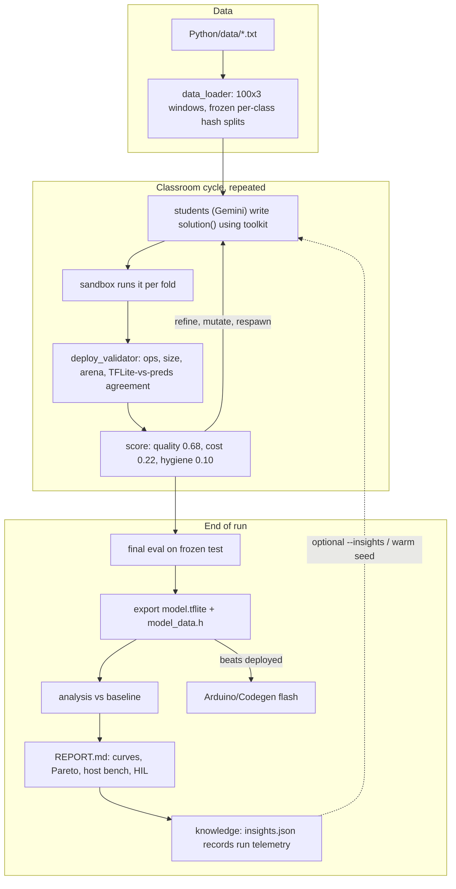

# codegen_task

A [codegen-classroom](https://github.com/google-research/codegen-classroom) task
that evolves the playground's IMU gesture classifier under a TensorFlow Lite
Micro deploy contract and ships the winning model to the Seeed Studio XIAO
nRF52840 Sense. The `codegen-classroom` library is used unmodified; all
task-specific scoring, validation, and hardware-in-the-loop (HIL) logic lives
in this package.

## Setup and Quickstart

### Prerequisites and Environment Setup

From the repository root (`ml-on-device-playground/`):

```bash
# 1. Create the Python 3.11 virtual environment and install dependencies
#    (plus the Seeed nRF52840 Arduino core and TFLite Micro library if arduino-cli is installed)
make setup

# Or install only the Python virtual environment when running without hardware:
make venv
```

### Getting and Configuring a Gemini API Key

Live classroom runs (`make codegen-run`) require a `GEMINI_API_KEY` for
`codegen-classroom`:

1. Open [Google AI Studio API Keys](https://aistudio.google.com/apikey) and sign
   in with your Google account.
2. Click **Create API key** and copy the generated key.
3. In the repository root (`ml-on-device-playground/`), copy `.env.example` to
   `.env` and paste your key:
   ```bash
   cp .env.example .env
   ```
   Set the key inside `.env`:
   ```env
   GEMINI_API_KEY=your_api_key_here
   ```
   (Alternatively, export it directly in your shell with
   `export GEMINI_API_KEY="your_api_key_here"`.)
4. Run the offline smoke test to verify your environment, then launch a
   classroom run or the desktop UI:
   ```bash
   make codegen-test    # fast offline unit tests (no API key needed)
   make codegen-mock    # end-to-end pipeline smoke test using a mock student
   make codegen-run     # live multi-student Gemini classroom run + HIL eval
   make ui              # launch the PyQt desktop UI (Record, Train, Live Inference, Codegen)
   ```

### Supported LLM APIs and Extending to Other Providers

Currently, **Gemini (`google-genai`) is the only LLM API supported out of the
box** by `codegen-classroom` (`codegen_classroom.agents.GeminiAgent`).

However, the classroom runner can be extended to other LLM APIs (such as OpenAI,
Anthropic, or local OpenAI-compatible servers like Ollama and vLLM) without
modifying the scoring or validation pipeline:

- Subclass `codegen_classroom.agents.StudentAgent` (or `GeminiAgent`) and
  override `generate_code(self, prompt: str) -> str` to call your preferred LLM
  SDK and return the model's markdown response containing a ` ```python ` block.
- Pass your custom student instances into `classroom.Classroom(students=...)` in
  `run_micro_gesture.py` (see `_MockStudent` in `run_micro_gesture.py` for a
  minimal reference implementation).

## Loop



## Files

| File | Role |
| :--- | :--- |
| `data_loader.py` | Recordings to windows in firmware order; per-class hash split so test stays frozen as data grows; `dataset_fingerprint()`. |
| `deploy.py` | Artifact analysis, hard-budget validator with agreement check, custom metrics via `register_metric`, `model_data.h` writer, on-device REPLAY evaluation (`python -m codegen_task.deploy`). |
| `toolkit.py` | Helpers students import in the sandbox: determinism, shaping, augmentation, hard negatives, in-graph normalization, class weights, int8 conversion, converted-model inference, contract pre-check. |
| `config.py` | Models, run defaults, metric weights, 8-section system prompt, refinement directions, baseline solution, archetypes, cross-run insights. |
| `run_micro_gesture.py` | Runner: seed validation, CV scoring, respawn, final eval, analysis, export, leaderboard, promote, report; `--watch` and `--prompt_only` modes. |
| `report.py` | `REPORT.md` with dataset stats, per-layer model table, confusion, ROC/PR/calibration, streaming simulation, host benchmark, Pareto frontier, HIL, progression. |
| `leaderboard.tsv`, `solutions/` | One row per run; `micro_gesture_<N>s_<N>c_<date>.md` reports with `plots/`, plus `insights.json`. |

## Scoring and Deploy Contract

- **Composite Score (`1.00` total)**:
  - **Quality (`0.68`)**: `f1_macro` (`0.38`), `balanced_accuracy` (`0.12`), `worst_class_recall` (`0.12`), `null_fpr` (`0.06`).
  - **On-Device Cost (`0.22`)**: `model_kb` (`0.06`), `mflops` (`0.05`), `arena_kb` (`0.04`), `host_latency_ms` (`0.03`), `mcu_ms_est` (`0.02`), `params_k` (`0.02`). Cost metrics score `1.0` at zero and `0.0` at the soft budget.
  - **Hygiene (`0.10`)**: `int8_fraction` (`0.05`), `tflite_agreement` (`0.03`), `exec_time` (`0.02`).
- **Hard Deploy Validator (`deploy.py`)**: Rejects any submission whose `y_pred_df.attrs["tflite_model"]` fails input shape (`WINDOW_ROWS * 3 = 300`), output shape (`NUM_CLASSES`), allowed TFLite Micro ops (`deploy.ALLOWED_OPS`, matching `RegisterOps()` in `Arduino/Codegen/Codegen.ino`), flatbuffer size (`<= 64 KB`), estimated tensor arena (`<= 40 KB`), or raw `X_val` TFLite-vs-returned prediction agreement (`>= 95%`, forcing normalization into the TFLite graph).

## Hill Climbing

Within a run, Cycle 0 evaluates the unmodified v1 float32 MLP baseline (`no_seed=True`), and subsequent cycles climb via 3-fold stratified out-of-fold scoring, single-cycle rollback (`patience=1`) onto personal-best refinements or peer crossover, respawn of excluded students from the classroom leader, and per-cycle bottleneck feedback. Cold-start discovery (`--noinsights` by default) avoids cross-run architecture spoilers; optional `--insights` and `--nono_seed` enable warm-starting from earlier runs. `--deploy` promotes and flashes only when the candidate improves on the deployed test score (`--force` overrides).

## Commands

```bash
make codegen-test                    # offline unit tests
make codegen-mock                    # baseline through the whole pipeline
make codegen-run                     # 4 students x 12 cycles, promote winner, HIL
make codegen-run CODEGEN_ARGS="--num_cycles=8 --insights"
make codegen-watch                   # rerun on new recordings
make codegen                         # flash Arduino/Codegen and open PyQt UI
make flash-codegen && make device-eval
make logs | make status | make leaderboard | make report-open
```

Outputs go to `experiments/micro_gesture/<experiment>/<run_id>/` with
`run.log`, `student_instructions.md`, `students/*.csv`, and `export/`.

## Dataset and Gesture Collection Guide

Recordings are stored as whitespace-separated ASCII files named `<Label>-<index>.txt` in `Python/data/` (`ax ay az` in raw `g` units at `100 Hz`, ~100 rows per 1.0 s window). Windows are ingested by `data_loader.py` and center-cropped or edge-padded to `100` rows (`300` features: `s000_x, s000_y, s000_z, ..., s099_z`).

### Hardware Orientation and Coordinate Axes


The development board is the **Seeed Studio XIAO nRF52840 Sense** with an STMicroelectronics **LSM6DS3TR-C** 6-DOF IMU mounted on the underside of the PCB and the Nordic nRF52840 metal shield on the top face:

- **Bottom (`+X`)**: USB Type-C connector edge where the USB cable attaches.
- **Top (`-X`)**: Ceramic 2.4 GHz antenna edge opposite the USB-C connector.
- **Left (`+Y`)**: Pin rail containing `D0` through `D6` and the `RST` button.
- **Right (`-Y`)**: Pin rail containing `D7` through `D10`, `3V3`, `GND`, and `5V`.
- **Chip Facing Up (`+Z`)**: Normal rest orientation with the Nordic metal shield and LEDs facing upward toward the ceiling (`Z ≈ +1.0 g` at rest).

| Axis | UI Graph Color | Physical Direction | Flat Rest (Chip Up) | Gravity Tilt Check (`+1.0 g` points toward ceiling) |
| :--- | :--- | :--- | :--- | :--- |
| **+X** | Blue | Toward **USB-C Port (Bottom)** | `~0.0 g` | Cable pointing to ceiling reads `+1.0 g`; antenna to ceiling reads `-1.0 g`. |
| **+Y** | Red | Toward **Left Pins (D0–D6)** | `~0.0 g` | Left edge (`D0–D6`) to ceiling reads `+1.0 g`; right edge (`D7–5V`) to ceiling reads `-1.0 g`. |
| **+Z** | Green | **Up** out of the Chip Face | `~+1.0 g` | Flat chip-up reads `+1.0 g`; flipped chip-down reads `-1.0 g`. |

### Gesture Motion Patterns


### 10-Class Execution Protocol

All class labels use **PascalCase** (`UpperCamelCase`) without hyphens or spaces so every file matches `<Label>-<index>.txt` (1.0 s window at 100 Hz, 12 takes per class):

1. **`Null`**: Non-gesture baseline. Mix of board resting flat on desk, board propped slightly by the USB cable, and board held still in hand (natural idle tremor).
2. **`Drop`**: Hold board 1–2 feet above a soft couch cushion (`Chip UP`, `+Z ≈ +1.0 g`). Release cleanly at ~0.2 s so it free-falls flat onto the cushion.
3. **`Flick`**: Grip the USB cable 3–4 inches behind the USB-C connector. Flick the board downward in the air like a wand and let it rebound without hitting any surface.
4. **`Slap`**: Grip the USB cable with ~3 inches of slack behind the USB-C connector. Slap the board flat once against the open palm of your other hand.
5. **`Twirl`**: Hold the USB cable pointing straight UP toward the ceiling with the chip facing your forehead. Spin/twirl the cable and board between your fingers around its long axis.
6. **`Shake`**: Grip right by the USB-C cable (`Chip UP` / tilted toward you) and shake rapidly left-and-right along `±Y` 3–4 times within 1.0 s.
7. **`Punch`**: Grip right by the USB-C cable with the cable pointing UP toward the sky and the chip facing toward you. Punch forward away from your body and snap back.
8. **`Roll`**: Hold the board out in front of you (`Chip UP`, `+Z ≈ +1.0 g`) and roll your wrist 180° (`+Z → -Z`) like turning a doorknob.
9. **`Pendulum`**: Pinch the USB cable 4–5 inches above the board so the sensor dangles vertically, and swing it smoothly left-and-right like a pendulum arc.
10. **`Poke`**: Hold firmly right at the sensor/cable junction (no slack) and poke the sensor tip once against your open palm.

## Task Origin and Initial Prompt

### Origin Prompt

Paraphrased from the initial prompt that produced `Python/codegen_task`, so
the task can be recreated from scratch with an AI agent or by hand:

> Clone https://github.com/google-research/codegen-classroom next to the
> on-device ML playground and review how it works: the student contract, the
> scoring loop, mutation strategies, and the `tasks/template/` layout.
>
> Build a classroom task called `micro_gesture` that evolves the playground's
> gesture classifier (XIAO nRF52840 Sense, LSM6DS3 at 100 Hz, recordings in
> `Python/data/<Label>-<n>.txt`) so it runs efficiently and accurately on the
> device under TensorFlow Lite Micro, and self-tunes.
>
> Constraints and preferences:
> - Minimal or zero changes to the codegen-classroom library; keep all task
>   code in the playground repo, reusing existing folders (`Python/`,
>   `Arduino/`) and keeping the original playground functional and its diff
>   small.
> - Students may use any library (TensorFlow, JAX, PyTorch), but the artifact
>   must be a TFLite model the firmware can run.
> - Custom scoring inside the task: accuracy plus on-device cost such as
>   latency, FLOPs, model size, arena, parameter count, int8 coverage, and
>   robustness metrics such as worst-class recall and Null false-trigger rate.
>   Include as many useful metrics and tips for the students as possible.
> - Include `gemini-4-argon` among the students.
> - Set it up to demonstrate hill climbing across runs and to rerun
>   automatically when new recordings arrive.
> - Prompt the human for more recordings when data is thin.

### Student Initial Prompt (Cycle 0)

> Start with a concise 1-2 sentence plan, then provide the Cycle 0 `solution(X_train, y_train, X_val)` implementing the v1 baseline (`Flatten -> Dense(32, relu) -> Dense(16, relu) -> Dense(k, softmax)` trained on raw `X_train` without in-graph normalization, quantization, or augmentation, converted with `tk.to_float_tflite`) so Cycle 0 measures the unmodified v1 starting point before refinement.

Full system instructions, starting archetypes, and refinement directions are
defined in [`config.py`](config.py) and written to `student_instructions.md`
inside each run directory.

