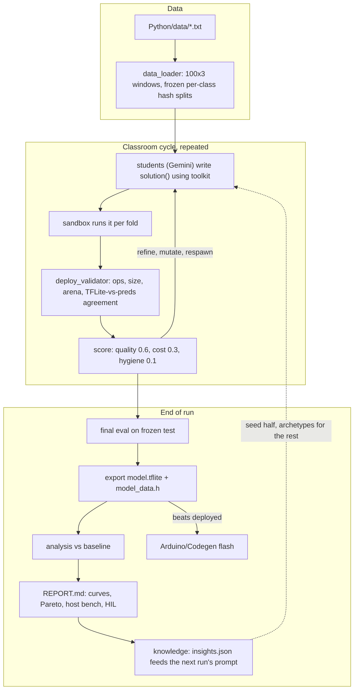
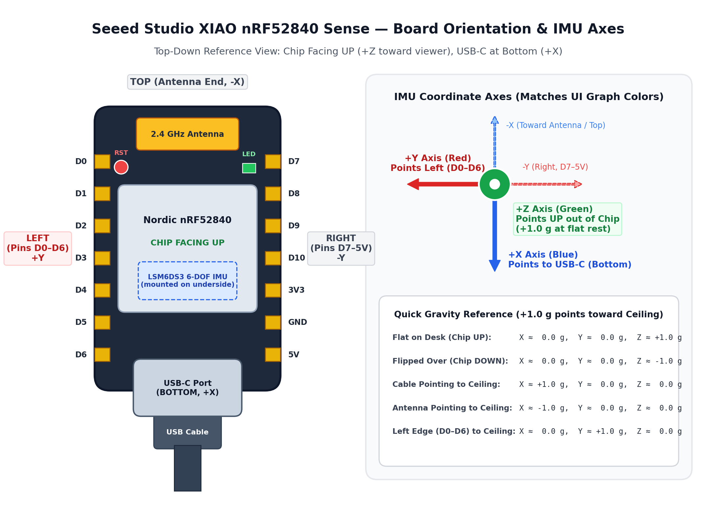
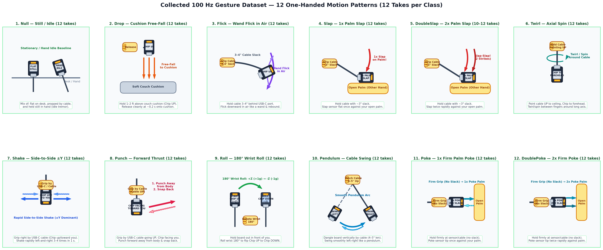

# codegen_task

A [codegen-classroom](https://pypi.org/project/codegen-classroom/) task that
evolves the playground's gesture classifier under an on-device deploy contract
and ships the winner to the XIAO nRF52840 Sense. The library is used
unmodified; everything task-specific lives in this package.

## Loop



## Files

| File | Role |
| :--- | :--- |
| `data_loader.py` | Recordings to windows in firmware order; per-class hash split so test stays frozen as data grows; `dataset_fingerprint()`. |
| `deploy.py` | Artifact analysis, hard-budget validator with agreement check, custom metrics via `register_metric`, `model_data.h` writer, on-device REPLAY evaluation (`python -m codegen_task.deploy`). |
| `toolkit.py` | Helpers students import in the sandbox: determinism, shaping, augmentation, hard negatives, in-graph normalization, class weights, int8 conversion, converted-model inference, contract pre-check. |
| `config.py` | Models, run defaults, metric weights, 8-section system prompt, refinement directions, baseline solution, archetypes, cross-run insights. |
| `run_micro_gesture.py` | Runner: seed validation, CV scoring, respawn, final eval, analysis, export, leaderboard, promote, report; `--watch` and `--prompt_only` modes. |
| `report.py` | `REPORT.md` with dataset stats, per-layer model table, confusion, ROC/PR/calibration, streaming simulation, host benchmark, Pareto frontier, HIL, progression. |
| `leaderboard.tsv`, `solutions/` | One row per run; `micro_gesture_<N>s_<N>c_<date>.md` reports with `plots/`, plus `insights.json`. |

## Scoring

Weights sum to 1.0: quality 0.60 (`f1_macro`, `balanced_accuracy`,
`worst_class_recall`, `null_fpr`), cost 0.30 (`model_kb`, `mflops`,
`arena_kb`, `host_latency_ms`, `mcu_ms_est`, `params_k`), hygiene 0.10
(`int8_fraction`, `tflite_agreement`, `exec_time`). Cost metrics score 1.0 at
zero and 0.0 at the soft budget. Cycles are scored on stratified out-of-fold
predictions over all learning rows; the frozen test set is used once, at the
end.

Custom metrics reach the scorer without library changes: the validator runs
in the parent thread right before `score_predictions`, stores the artifact
analysis in a `threading.local`, and the registered metric functions read it.
Students pass the model as `y_pred_df.attrs["tflite_model"]`.

## Deploy contract

Hard failures returned to the student as the retry traceback: input of
exactly `WINDOW_ROWS * 3` values, `NUM_CLASSES` outputs, ops within
`deploy.ALLOWED_OPS` (mirrored by `RegisterOps()` in the firmware), at most
64 KB flatbuffer and 40 KB estimated arena, and at least 95 % agreement
between the TFLite bytes run on raw `X_val` and the returned predictions,
which forces normalization into the graph.

## Hill climbing

Within a run: out-of-fold scoring, refinement directions, peer crossover,
respawn of excluded students from the current best, per-cycle feedback on
untried levers. Across runs: the top leaderboard solution report seeds half the
students (after a budget check), the rest start from distinct archetypes,
and `insights.json` adds a "what previous runs learned" section with the
frontier. `--deploy` promotes only on a test-score gain; `watch.py` ties
this to new recordings.

## Commands

```bash
make codegen-test                    # offline unit tests
make codegen-mock                    # baseline through the whole pipeline
make codegen-run                     # real run, promote winner, report, HIL
make codegen-run CODEGEN_ARGS="--no_seed --num_cycles=8"
make codegen-watch                   # rerun on new recordings
make logs | make status | make leaderboard | make report-open
make flash-codegen && make device-eval
```

Outputs go to `experiments/micro_gesture/<experiment>/<run_id>/` with
`run.log`, `student_instructions.md`, `students/*.csv`, and `export/`.

## Dataset and Gesture Collection Guide

Recordings are stored as whitespace-separated ASCII files named `<Label>-<index>.txt` in `Python/data/` (`ax ay az` in raw `g` units at `100 Hz`, ~100 rows per 1.0 s window). Windows are ingested by `data_loader.py` and center-cropped or edge-padded to `100` rows (`300` features: `s000_x, s000_y, s000_z, ..., s099_z`).

### Hardware Orientation and Coordinate Axes



The development board is the **Seeed Studio XIAO nRF52840 Sense** with an STMicroelectronics **LSM6DS3TR-C** 6-DOF IMU mounted on the underside of the PCB and the Nordic nRF52840 metal shield on the top face:

- **Bottom (`+X`)**: USB Type-C connector edge where the USB cable attaches.
- **Top (`-X`)**: Ceramic 2.4 GHz antenna edge opposite the USB-C connector.
- **Left (`+Y`)**: Pin rail containing `D0` through `D6` and the `RST` button.
- **Right (`-Y`)**: Pin rail containing `D7` through `D10`, `3V3`, `GND`, and `5V`.
- **Chip Facing Up (`+Z`)**: Normal rest orientation with the Nordic metal shield and LEDs facing upward toward the ceiling (`Z ≈ +1.0 g` at rest).

| Axis | UI Graph Color | Physical Direction | Flat Rest (Chip Up) | Gravity Tilt Check (`+1.0 g` points toward ceiling) |
| :--- | :--- | :--- | :--- | :--- |
| **+X** | Blue | Toward **USB-C Port (Bottom)** | `~0.0 g` | Cable pointing to ceiling reads `+1.0 g`; antenna to ceiling reads `-1.0 g`. |
| **+Y** | Red | Toward **Left Pins (D0–D6)** | `~0.0 g` | Left edge (`D0–D6`) to ceiling reads `+1.0 g`; right edge (`D7–5V`) to ceiling reads `-1.0 g`. |
| **+Z** | Green | **Up** out of the Chip Face | `~+1.0 g` | Flat chip-up reads `+1.0 g`; flipped chip-down reads `-1.0 g`. |

### Gesture Motion Patterns



### 10-Class Execution Protocol

All class labels use **PascalCase** (`UpperCamelCase`) without hyphens or spaces so every file matches `<Label>-<index>.txt` (1.0 s window at 100 Hz, 12 takes per class):

1. **`Null`**: Non-gesture baseline. Mix of board resting flat on desk, board propped slightly by the USB cable, and board held still in hand (natural idle tremor).
2. **`Drop`**: Hold board 1–2 feet above a soft couch cushion (`Chip UP`, `+Z ≈ +1.0 g`). Release cleanly at ~0.2 s so it free-falls flat onto the cushion.
3. **`Flick`**: Grip the USB cable 3–4 inches behind the USB-C connector. Flick the board downward in the air like a wand and let it rebound without hitting any surface.
4. **`Slap`**: Grip the USB cable with ~3 inches of slack behind the USB-C connector. Slap the board flat once against the open palm of your other hand.
5. **`Twirl`**: Hold the USB cable pointing straight UP toward the ceiling with the chip facing your forehead. Spin/twirl the cable and board between your fingers around its long axis.
6. **`Shake`**: Grip right by the USB-C cable (`Chip UP` / tilted toward you) and shake rapidly left-and-right along `±Y` 3–4 times within 1.0 s.
7. **`Punch`**: Grip right by the USB-C cable with the cable pointing UP toward the sky and the chip facing toward you. Punch forward away from your body and snap back.
8. **`Roll`**: Hold the board out in front of you (`Chip UP`, `+Z ≈ +1.0 g`) and roll your wrist 180° (`+Z → -Z`) like turning a doorknob.
9. **`Pendulum`**: Pinch the USB cable 4–5 inches above the board so the sensor dangles vertically, and swing it smoothly left-and-right like a pendulum arc.
10. **`Poke`**: Hold firmly right at the sensor/cable junction (no slack) and poke the sensor tip once against your open palm.

