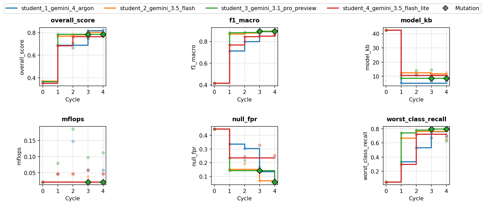
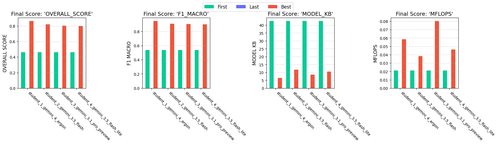

# Micro-Gesture Solution Report — Run `20261025_170637`

- **Dataset**: `78beb5ebc3c6` (9 classes: `Flick, Null, Pendulum, Poke, Punch, Roll, Shake, Slap, Twirl`)
- **Generated**: 2026-10-25T17:31:52 | **Exported**: `model.tflite`, `model_data.h`, `solution.py`, `summary.json`, `analysis.md`

## Scorecard (Frozen Test & Footprint)

| overall score | macro F1 | balanced acc | worst recall | Null FPR | TFLite agree | retrain delta |
| :--- | :--- | :--- | :--- | :--- | :--- | :--- |
| 0.8611 | 0.9437 | 0.9487 | 0.8333 | 0.09524 | 1 | 0 |

| model KB | arena KB (est) | MFLOPs | params (k) | MCU ms (est) | host ms | int8 frac |
| :--- | :--- | :--- | :--- | :--- | :--- | :--- |
| 6.422 | 1.934 | 0.05835 | 1.561 | 6.079 | 0.007052 | 1 |

## Winning Solution Analysis

- **Winner**: `student_1_gemini_4_argon` (Cycle 4) | **Run**: `20261025_170637` | **Dataset**: `78beb5ebc3c6`
- **Tags**: `conv2d, int8, in-graph-norm, hybrid-pooling, peak-aligned-blending, hard-negatives`

The model normalizes raw 100x3 accelerometer windows in-graph using training channel statistics before reshaping to a 4D tensor. Temporal features are extracted via two strided Conv2D layers (5x1 kernels, stride 2x1) that downsample the frame count from 100 to 25. An overlapping 2-segment hybrid pooling layer combines AveragePooling2D and MaxPooling2D across temporal sub-windows (frames 0..14 and 10..24), feeding a 64-unit feature vector into a Dense softmax classifier fully quantized to int8 TFLite.

## Validation Deltas (Cycle 0 → Best Cycle)

| overall_score | f1_macro | balanced_accuracy | worst_class_recall | null_fpr |
| :--- | :--- | :--- | :--- | :--- |
| 0.352 → 0.823 (+0.47) | 0.416 → 0.905 (+0.489) | 0.441 → 0.904 (+0.463) | 0.0476 → 0.685 (+0.638) | 0.445 → 0.0756 (-0.37) |

| model_kb | mflops | arena_kb | params_k | mcu_ms_est | host_latency_ms | int8_fraction | exec_time |
| :--- | :--- | :--- | :--- | :--- | :--- | :--- | :--- |
| 42.5 → 6.42 (-36.1) | 0.0211 → 0.0584 (+0.0372) | 5.16 → 1.93 (-3.22) | 10.3 → 1.56 (-8.75) | 2.2 → 6.08 (+3.88) | 0.089 → 0.00819 (-0.0808) | 0 → 1 (+1) | 5.89 → 9.15 (+3.26) |

## Key Aspects

- Peak-aligned same-class gesture blending shifts windows to match dynamic energy peaks before interpolation, eliminating double-peak dynamic artifacts on single-impulse gestures.
- Class weights are computed on augmented data prior to adding synthetic Null hard negatives (tilted poses and slow wrist drift), preventing class-weight dilution and penalizing false triggers.
- Strided temporal Conv2D feature extraction downsamples sequence length from 100 to 25 frames while maintaining a ultra-compact 1.56k parameter count and 6.42 KB model footprint.
- Overlapping 2-segment hybrid pooling captures both chronological progression (first half vs. second half) and peak impulse energy.
- Full int8 post-training quantization calibrated on representative augmented and negative windows yields 100% int8 op execution and 1.0 prediction agreement.

## Improvements from Baseline

- The baseline unnormalized float32 MLP (42.5 KB) scored an overall score of 0.3524 with a macro F1 of 0.4161 and Null FPR of 0.4454.
- Switching to a 2-stage strided Conv2D network with in-graph normalization reduced model size from 42.54 KB to 6.42 KB and activation arena from 5.16 KB to 1.93 KB while enabling 100% int8 execution.
- Data-centric enhancements (peak-aligned blending, physical augmentations, and rich Null hard negatives with undiluted class weights) drastically reduced Null FPR from 0.4454 to 0.0756 on validation (0.0952 on test).
- Validation macro F1 improved from 0.4161 to 0.9051 (0.9437 test) and worst-class recall improved from 0.0476 to 0.6852 (0.8333 test), boosting the overall evaluation score to 0.8611 on test.

## Risks and Trade-offs

- Estimated MCU latency increased from 2.20 ms to 6.08 ms and MFLOPs increased from 0.021 to 0.058 due to the 2D convolutions, though remaining comfortably inside the 18 ms budget.
- Worst-class recall (0.6852 validation) remains sensitive to small-fold sample variance where misclassifying a single window causes significant metric drops.

## Next Experiments

- Test depthwise-separable Conv2D layers with equal 2D strides (2, 2) to determine if computational complexity and MFLOPs can be reduced below 0.04 without dropping macro F1.
- Calibrate explicit Null class output probability thresholding or temperature scaling to lower the Null false-positive rate below 0.05.
- Experiment with dynamic kinematic features (e.g. L1 magnitude or gravity-centered dynamic acceleration) inside the graph to strengthen distinction among closely related strike gestures.

## Dataset & Physical Separability

Fingerprint `78beb5ebc3c6` | **178** recordings (96 train / 37 val / 45 frozen test) | `100x3` window @ 100 Hz | raw length 97–113 rows (median 107).
- **Pose-separable gestures**: `Roll` flips `Z` gravity negative, `Twirl` and `Punch` hold the cable vertical (`+X ~ +0.8g, Z ~ 0g`), and `Poke` maintains a tilted firm-grip baseline (`+Y ~ +0.75g`).
- **Impulse & rhythm-separable gestures**: `Slap` reaches `~15g` peak dynamic impact with high jerk, `Flick` snaps and rebounds along the cable, `Shake` oscillates at `~4-8 Hz`, `Pendulum` swings smoothly, and `Null` stays below `~0.5g` dynamic amplitude.

| class | train | val | test | total | mean pose (X,Y,Z) g | peak |a_dyn| g | RMS jerk g/s | dom Hz |
| :--- | :--- | :--- | :--- | :--- | :--- | :--- | :--- | :--- |
| Flick | 10 | 4 | 5 | 19 | (-2.18, +0.33, +0.17) | 12.52 | 146.0 | 1.5 |
| Null | 12 | 5 | 6 | 23 | (+0.09, +0.01, +0.26) | 0.18 | 5.4 | 5.7 |
| Pendulum | 10 | 4 | 5 | 19 | (-1.84, -0.14, +0.04) | 2.64 | 22.1 | 3.5 |
| Poke | 13 | 5 | 6 | 24 | (-0.08, +0.65, +0.33) | 5.68 | 102.9 | 1.8 |
| Punch | 10 | 4 | 5 | 19 | (+0.14, -0.06, +0.45) | 9.95 | 135.3 | 1.0 |
| Roll | 10 | 4 | 4 | 18 | (-0.13, -0.17, +0.38) | 2.83 | 52.1 | 1.7 |
| Shake | 10 | 4 | 5 | 19 | (-1.91, +0.40, +0.43) | 15.12 | 304.3 | 8.9 |
| Slap | 11 | 4 | 5 | 20 | (-1.00, +0.09, +0.22) | 16.12 | 274.1 | 1.1 |
| Twirl | 10 | 3 | 4 | 17 | (-3.97, +0.27, +0.57) | 3.57 | 59.8 | 4.8 |
| total | 96 | 37 | 45 | 178 | - | - | - | - |

*Figure 1. Recording length and acceleration magnitude distributions (1 g mode at rest).*

*Figure 2. (a) Gravity pose vs. peak dynamic impulse across all 120 recordings; (b) per-class physical feature matrix explaining why raw pose + centered + jerk channels separate the 10 classes.*

*Figure 3. Per-class mean ± 1 SD acceleration over the 1 s window.*

## Model Architecture, Internals & Budgets

- **I/O & Quantization**: input `[1, 100, 3] int8 scale=0.12541 zp=-1` → output `[1, 9] int8 scale=0.0039062 zp=-128` | int8=True (100% int8 ops) | **29,177** MACs, **1,696** weight bytes
- **Operators (9)**: `AVERAGE_POOL_2D, CONCATENATION, CONV_2D, FULLY_CONNECTED, MAX_POOL_2D, MUL, RESHAPE, SOFTMAX, SUB`

| metric | model KB | arena KB (est) | MFLOPs | params (k) | MCU ms (est) | host ms |
| :--- | :--- | :--- | :--- | :--- | :--- | :--- |
| value | 6.422 | 1.934 | 0.05835 | 1.561 | 6.079 | 0.007052 |
| soft / hard budget | 16.0 / 64.0 | 6.0 / 40.0 | 0.2 / - | 6.0 / - | 18.0 / - | 0.05 / - |

### Layer Breakdown

| # | op | output | dtype | MACs | weight B | live act B |
| :--- | :--- | :--- | :--- | :--- | :--- | :--- |
| 0 | SUB | 1x100x3 | int8 | 300 | 3 | 600 |
| 1 | MUL | 1x100x3 | int8 | 300 | 3 | 600 |
| 2 | RESHAPE | 1x100x1x3 | int8 | 300 | 16 | 600 |
| 3 | CONV_2D | 1x50x1x10 | int8 | 7500 | 190 | 800 |
| 4 | CONV_2D | 1x25x1x16 | int8 | 20000 | 864 | 900 |
| 5 | AVERAGE_POOL_2D | 1x2x1x16 | int8 | 32 | 0 | 432 |
| 6 | MAX_POOL_2D | 1x2x1x16 | int8 | 32 | 0 | 432 |
| 7 | CONCATENATION | 1x2x1x32 | int8 | 64 | 0 | 128 |
| 8 | RESHAPE | 1x64 | int8 | 64 | 8 | 128 |
| 9 | FULLY_CONNECTED | 1x9 | int8 | 576 | 612 | 73 |
| 10 | SOFTMAX | 1x9 | int8 | 9 | 0 | 18 |

*Figure 4. Per-op (a) compute (kMACs), (b) weight footprint (KB), and (c) live activation RAM pressure (KB) in execution order.*

*Figure 5. (a) t-SNE projection of the quantized 64D penultimate feature representation across all 120 recordings (stars = frozen test); (b) sliding 200 ms temporal occlusion sensitivity on the true-class logit margin.*

## TFLite Evaluation (Validation and Frozen Test)

| split | rows | accuracy | macro F1 | mean top-1 prob (all / ok / err) |
| :--- | :--- | :--- | :--- | :--- |
| val | 131 | 0.9695 | 0.9726 | 0.892 (ok 0.902, err 0.557) |
| test | 159 | 0.9371 | 0.9437 | 0.833 (ok 0.850, err 0.586) |

| class | val F1 (support) | test precision | test recall | test F1 (support) |
| :--- | :--- | :--- | :--- | :--- |
| Flick | 1 (n=12) | 1 | 1 | 1 (n=15) |
| Null | 0.955 (n=35) | 0.9268 | 0.9048 | 0.916 (n=42) |
| Pendulum | 0.857 (n=12) | 0.8824 | 1 | 0.938 (n=15) |
| Poke | 1 (n=15) | 0.8824 | 0.8333 | 0.857 (n=18) |
| Punch | 1 (n=12) | 1 | 1 | 1 (n=15) |
| Roll | 1 (n=12) | 0.8 | 1 | 0.889 (n=12) |
| Shake | 1 (n=12) | 1 | 0.9333 | 0.966 (n=15) |
| Slap | 1 (n=12) | 1 | 0.8667 | 0.929 (n=15) |
| Twirl | 0.941 (n=9) | 1 | 1 | 1 (n=12) |

*Figure 6. Row-normalized confusion matrices on validation (a) and frozen test (b) splits; cell labels are counts.*

## Classifier Calibration & ROC/PR (Held-Out Val + Test, 290 rows)

| accuracy | macro F1 | top-2 acc | macro AUC | macro AP | MCC | kappa | log loss | ECE (10 bins) |
| :--- | :--- | :--- | :--- | :--- | :--- | :--- | :--- | :--- |
| 0.9517 | 0.9573 | 0.9897 | 0.9984 | 0.9905 | 0.9445 | 0.9441 | 0.225 | 0.1065 |

| class | support | precision | recall | f1 | ROC AUC | AP |
| :--- | :--- | :--- | :--- | :--- | :--- | :--- |
| Flick | 27 | 1 | 1 | 1 | 1 | 1 |
| Null | 77 | 0.9589 | 0.9091 | 0.9333 | 0.9946 | 0.9875 |
| Pendulum | 27 | 0.8182 | 1 | 0.9 | 0.9975 | 0.9728 |
| Poke | 33 | 0.9375 | 0.9091 | 0.9231 | 0.9962 | 0.9773 |
| Punch | 27 | 1 | 1 | 1 | 1 | 1 |
| Roll | 24 | 0.8889 | 1 | 0.9412 | 0.9989 | 0.9879 |
| Shake | 27 | 1 | 0.963 | 0.9811 | 0.9994 | 0.9952 |
| Slap | 27 | 1 | 0.9259 | 0.9615 | 0.9996 | 0.9963 |
| Twirl | 21 | 1 | 0.9524 | 0.9756 | 0.9998 | 0.9978 |

*Figure 7. (a) One-vs-rest ROC, (b) precision-recall, (c) calibration reliability diagram, (d) top-1 confidence.*

*Figure 8. Per-class precision, recall, and F1 on all held-out rows.*

## Streaming Simulation (50% Overlap)

| windows | duration (s) | pure-window acc | Null FPR | boundary windows | prediction flips |
| :--- | :--- | :--- | :--- | :--- | :--- |
| 89 | 45.0 | 0.94 | 0.1429 | 39 | 51 |

*Figure 9. Sliding 1 s windows (50% overlap) over concatenated test recordings: (a) predicted vs true class, (b) top-1 confidence vs UNSURE threshold.*

## Host Benchmark

`Python 3.11.17` | `TF 2.15.1` | `macOS-26.7.1-arm64-arm-64bit` | Evaluator e2e: **0.018 ms/row**.

| runtime | p50 ms | p95 ms | min ms | inf/s |
| :--- | :--- | :--- | :--- | :--- |
| TFLite reference (no delegate) | 0.007166 | 0.007436 | 0.006833 | 1.395e+05 |
| TFLite + XNNPACK | 0.002042 | 0.002084 | 0.002 | 4.897e+05 |

*Figure 10. Single-threaded host latency over 300 invocations (reference kernel vs XNNPACK).*

## Hardware in the Loop (XIAO nRF52840 Sense)

Flashed `Arduino/Codegen` on `/dev/cu.usbmodem1101` (46 s) | Flash `255456 B`, Static RAM `98280 B` | `INFO:model_bytes=6576,window_rows=100,classes=Flick|Null|Pendulum|Poke|Punch|Roll|Shake|Slap|Twirl,input_type=int8,output_type=int8,step=50`.

| host acc | device acc | host F1 | device F1 | device latency ms | arena bytes | host-device agreement |
| :--- | :--- | :--- | :--- | :--- | :--- | :--- |
| 0.9778 | 0.9778 | 0.9814 | 0.9814 | 7.81 (max 7.82) | 2948 | 1 |

## Pareto Frontier & Hardware Trade-offs

**84** scored attempts across **3** runs on dataset `78beb5ebc3c6` (non-dominated accuracy-vs-size frontier):

| KB | val F1 | MFLOPs | arena KB | val score | run | student | cycle |
| :--- | :--- | :--- | :--- | :--- | :--- | :--- | :--- |
| 5.2 | 0.713 | 0.046 | 1.7 | 0.6886 | 20261025_170637 | 1_gemini_4_argon | 1 |
| 6.4 | 0.889 | 0.058 | 1.9 | 0.8184 | 20261025_170637 | 1_gemini_4_argon | 3 |
| 6.4 | 0.905 | 0.058 | 1.9 | 0.8227 | 20261025_170637 | 1_gemini_4_argon | 4 |
| 9.5 | 0.922 | 0.048 | 1.9 | 0.8268 | 20261024_190925 | 1_gemini_4_argon | 7 |
| 11.8 | 0.930 | 0.145 | 3.0 | 0.7620 | 20261024_194005 | 3_gemini_3.1_pro_preview | 7 |
| 13.8 | 0.933 | 0.110 | 3.2 | 0.7696 | 20261024_190925 | 3_gemini_3.1_pro_preview | 7 |

*Figure 11. Multi-objective Pareto dashboard: (a) validation F1 vs model KB, (b) validation F1 vs MFLOPs, (c) activation arena RAM vs model flash KB colored by F1, and (d) overall score vs model KB showing the 8–14.5 KB sweet spot.*

## Student LLM Elo Ratings & Head-to-Head Record

Pairwise smooth-margin Elo (`start=1500`, `K_cycle=12`, `K_test=24`) across **3** runs (**24** classroom rounds) on dataset `78beb5ebc3c6`:

| LLM family | Elo | win rate (matches) | cycle #1s | test #1s | best val | best test | mean KB |
| :--- | :--- | :--- | :--- | :--- | :--- | :--- | :--- |
| gemini-4-argon | 1612 | 69.3% (72) | 12 | 3 | 0.8268 | 0.8611 | 13.7 |
| gemini-3.5-flash | 1569 | 67.5% (72) | 7 | 0 | 0.8096 | 0.8360 | 16.0 |
| gemini-3.1-pro-preview | 1418 | 35.5% (72) | 2 | 0 | 0.7863 | 0.8289 | 18.3 |
| gemini-3.5-flash-lite | 1401 | 27.7% (72) | 0 | 0 | 0.7871 | 0.8120 | 16.4 |

*Figure 12. (a) LLM student Elo trajectory across all classroom cycles and frozen-test evaluations; (b) pairwise head-to-head win rate matrix.*

## Classroom Progression

| student | best cycle | val score | val F1 | KB | MFLOPs | scored cycles |
| :--- | :--- | :--- | :--- | :--- | :--- | :--- |
| 1_gemini_4_argon | 4 | 0.8227 | 0.9051 | 6.422 | 0.05835 | 5 |
| 2_gemini_3.5_flash | 3 | 0.8026 | 0.8927 | 11.71 | 0.03826 | 5 |
| 3_gemini_3.1_pro_preview | 1 | 0.7863 | 0.8802 | 8.633 | 0.08017 | 5 |
| 4_gemini_3.5_flash_lite | 4 | 0.7738 | 0.8588 | 10.57 | 0.04613 | 5 |

*Figure 13. Per-student learning trajectory across cycles (lines = best-so-far, diamonds = peer collaboration).*

*Figure 14. Frozen-test metrics per student.*

## Leaderboard History

| student | test_overall | elo | test_f1_macro | test_wcr | model_kb | mflops | arena_kb | retrain_delta | solution_id | dataset | timestamp |
| :--- | :--- | :--- | :--- | :--- | :--- | :--- | :--- | :--- | :--- | :--- | :--- |
| student_3_gemini_3.1_pro_preview | 0.713 | 1352 | 0.927 | 0.75 | 21.55 | 0.269 | 4.3 | 0 | micro_gesture_4s_8c_20261022 | 78beb5ebc3c6 | 2026-10-22T23:53:22 |
| student_1_gemini_4_argon_r1 | 0.819 | 1483 | 0.924 | 0.833 | 10.79 | 0.067 | 2.58 | -0.002 | micro_gesture_4s_8c_20261023_v3 | 78beb5ebc3c6 | 2026-10-23T02:38:21 |
| student_4_gemini_3.5_flash_lite | 0.816 | 1473 | 0.933 | 0.786 | 10.95 | 0.059 | 2.58 | -0 | micro_gesture_4s_8c_20261023_v4 | 78beb5ebc3c6 | 2026-10-23T04:10:11 |
| student_2_gemini_3.5_flash | 0.786 | 1404 | 0.886 | 0.75 | 11.09 | 0.049 | 3.22 | 0 | micro_gesture_4s_8c_20261024 | 78beb5ebc3c6 | 2026-10-24T15:56:19 |
| student_1_gemini_4_argon | 0.842 | 1557 | 0.942 | 0.778 | 9.45 | 0.048 | 1.93 | 0 | micro_gesture_4s_8c_20261024_v2 | 78beb5ebc3c6 | 2026-10-24T19:27:54 |
| student_1_gemini_4_argon | 0.855 | 1604 | 0.942 | 0.75 | 6.43 | 0.058 | 1.93 | 0 | micro_gesture_4s_8c_20261024_v3 | 78beb5ebc3c6 | 2026-10-24T19:55:09 |
| student_1_gemini_4_argon | 0.861 | 1626 | 0.944 | 0.833 | 6.42 | 0.058 | 1.93 | 0 | micro_gesture_4s_5c_20261025 | 78beb5ebc3c6 | 2026-10-25T17:31:38 |
