# Overview

* **Run Path**: micro_gesture/20261025_212043
* **Name**: 20261025_212043
* **Total Cycles**: 12
* **Valid Students**: 4
* **Total Generations**: 51
* **Total Code Length Processed**: 255567
* **Best Student**: student_3_gemini_3.1_pro_preview (Cycle 10)
* **Best Validation Score**: 0.822
* **Best Test Score**: 0.852
* **Validation Score Progression**: 0.6516 -> 0.8323 (+0.1808)
* **Best Metrics**: f1_macro=0.950, balanced_accuracy=0.943, worst_class_recall=0.778, null_fpr=0.024, model_kb=8.906, mflops=0.050, arena_kb=1.676, host_latency_ms=0.006, mcu_ms_est=5.221, params_k=1.963, int8_fraction=1.000, tflite_agreement=1.000, exec_time=3.872
* **Tags**: cnn-multiscale, depthwise-separable-conv, parallel-pooling, int8-quantized, in-graph-folding, logit-calibration
* **Description**: The final architecture is a compact 2D CNN operating on reshaped 1x100x3 single-second accelerometer windows, utilizing a folded input normalization layer baked directly into the first convolution's weights. It processes inputs through a 2-stage downsampled stem followed by parallel multi-scale temporal feature branches (1x3 Conv2D and 1x9 Depthwise Conv2D) and joint Global Average/Max Pooling before a Dense softmax head. Post-training, weights are adjusted via temperature scaling and Null-class logit bias injection, then fully converted to INT8 TFLite format.

## Objectives

- **Prediction Quality (0.68)**: `f1_macro` (0.42), `worst_class_recall` (0.11), `balanced_accuracy` (0.09), `null_fpr` (0.06, lower is better)
- **On-Device Cost (0.22)**: `model_kb` ≤ 16 KB (0.08), `mflops` ≤ 0.20 (0.05), `arena_kb` ≤ 6 KB (0.03), `host_latency_ms` ≤ 0.05 ms (0.02), `mcu_ms_est` ≤ 18 ms (0.02), `params_k` ≤ 6k (0.02)
- **Deploy Hygiene (0.10)**: `int8_fraction` (0.05), `tflite_agreement` (0.03), `exec_time` (0.02)

## Student Leaderboard

| Rank | Student | Best Cycle | Val Score | Test Score | f1_macro | balanced_accuracy | worst_class_recall | null_fpr | model_kb | mflops | arena_kb | host_latency_ms | mcu_ms_est | params_k | int8_fraction | tflite_agreement | exec_time |
| --- | --- | --- | --- | --- | --- | --- | --- | --- | --- | --- | --- | --- | --- | --- | --- | --- | --- |
| 1 | student_3_gemini_3.1_pro_preview | 10 | 0.822 | 0.852 | 0.950 | 0.943 | 0.778 | 0.024 | 8.906 | 0.050 | 1.676 | 0.006 | 5.221 | 1.963 | 1.000 | 1.000 | 3.872 |
| 2 | student_1_gemini_4_argon | 8 | 0.832 | 0.851 | 0.950 | 0.943 | 0.778 | 0.024 | 8.906 | 0.050 | 1.676 | 0.007 | 5.221 | 1.963 | 1.000 | 1.000 | 3.998 |
| 3 | student_2_gemini_3.5_flash | 8 | 0.816 | 0.841 | 0.938 | 0.931 | 0.833 | 0.024 | 9.859 | 0.062 | 1.882 | 0.005 | 6.480 | 2.537 | 1.000 | 1.000 | 3.687 |
| 4 | student_4_gemini_3.5_flash_lite | 8 | 0.768 | 0.817 | 0.966 | 0.964 | 0.800 | 0.000 | 11.758 | 0.066 | 7.734 | 0.020 | 6.829 | 2.317 | 1.000 | 1.000 | 2.632 |

## Learning Trajectory

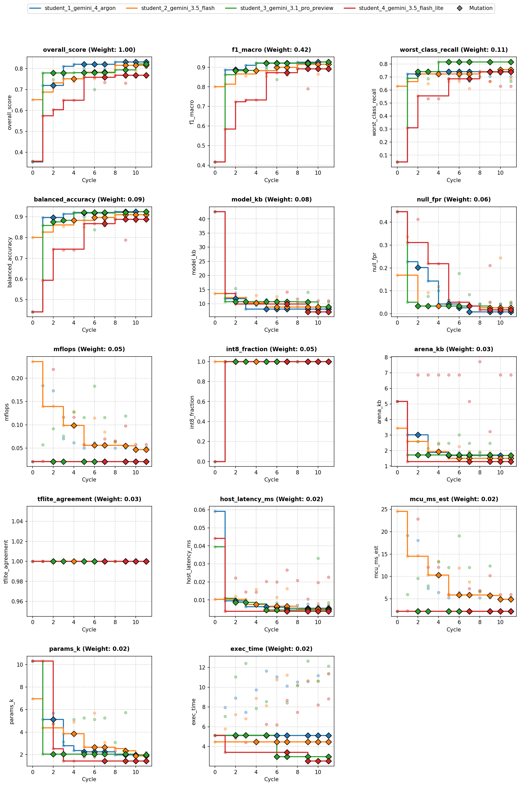

### Cycle Score Progression

| Cycle | student_1_gemini_4_argon | student_2_gemini_3.5_flash | student_3_gemini_3.1_pro_preview | student_4_gemini_3.5_flash_lite |
| --- | --- | --- | --- | --- |
| 0 | 0.353 *(CLASSROOM_BEST)* | 0.652 *(CLASSROOM_BEST)* | 0.357 *(SELF_BEST)* | 0.355 *(SELF_BEST)* |
| 1 | 0.720 *(CLASSROOM_BEST)* | 0.688 *(SELF_BEST)* | 0.780 *(CLASSROOM_BEST)* | 0.575 *(SELF_BEST)* |
| 2 | 0.712 | 0.731 *(SELF_BEST)* | 0.748 | 0.604 *(SELF_BEST)* |
| 3 | 0.812 *(CLASSROOM_BEST)* | 0.752 *(SELF_BEST)* | 0.770 | 0.649 *(SELF_BEST)* |
| 4 | 0.821 *(CLASSROOM_BEST)* | 0.738 | 0.781 *(SELF_BEST)* | 0.649 *(SELF_BEST)* |
| 5 | 0.799 | 0.784 *(SELF_BEST)* | 0.762 | 0.758 *(SELF_BEST)* |
| 6 | 0.820 | 0.752 | 0.701 | 0.759 *(SELF_BEST)* |
| 7 | 0.797 | 0.771 | 0.763 | 0.734 |
| 8 | 0.832 *(CLASSROOM_BEST)* | 0.816 *(SELF_BEST)* | 0.795 *(SELF_BEST)* | 0.768 *(SELF_BEST)* |
| 9 | 0.826 | 0.805 | 0.760 | 0.730 |
| 10 | 0.830 | 0.793 | 0.822 *(SELF_BEST)* | 0.760 |
| 11 | 0.822 | 0.812 | 0.806 | 0.760 |


## Top Solution 1: student_3_gemini_3.1_pro_preview (Cycle 10)

* **Student**: student_3_gemini_3.1_pro_preview
* **Best Cycle**: 10
* **Validation Score**: 0.822
* **Test Score**: 0.852
* **Metrics**: f1_macro=0.950, balanced_accuracy=0.943, worst_class_recall=0.778, null_fpr=0.024, model_kb=8.906, mflops=0.050, arena_kb=1.676, host_latency_ms=0.006, mcu_ms_est=5.221, params_k=1.963, int8_fraction=1.000, tflite_agreement=1.000, exec_time=3.872

### Plan (student_3_gemini_3.1_pro_preview)

**Hypothesis Plan:**
To improve decision margins without expanding the model's footprint, we pair a
compact shared-stem multi-scale architecture (which mathematically folds input
normalization into the first Conv2D layer) with post-training logit calibration.
By applying temperature scaling (T=0.88) and injecting a slight positive bias to
the Null class directly into the final Dense layer weights, we sharpen
confidence boundaries and reduce confusing false triggers between low-energy
gestures and rest states at zero extra inference cost.

### Code (student_3_gemini_3.1_pro_preview)

```python
import time
import numpy as np
import pandas as pd

def solution(X_train: pd.DataFrame, y_train: pd.DataFrame, X_val: pd.DataFrame) -> tuple[pd.DataFrame, str]:
    import tensorflow as tf
    from codegen_task import toolkit as tk

    t0 = time.time()
    tk.set_determinism(0)
    d = tk.split_xy(X_train, y_train, X_val)
    x_tr, y_tr, x_va, rows, k = (
        d["x_tr"],
        d["y_tr"],
        d["x_va"],
        d["rows"],
        d["n_classes"],
    )

    # 1. Strong Augmentation + Background Hard Negatives
    x_aug, y_aug = tk.augment(
        x_tr,
        y_tr,
        reps=9,
        seed=0,
        scale=(0.78, 1.25),
        shift_frac=0.20,
        rotate_deg=12.0,
        stretch=(0.84, 1.18),
        noise=0.022,
        blend_prob=0.40,
    )

    null_idx = tk.null_index()
    if null_idx is not None:
        x_neg, y_neg = tk.hard_negatives(
            x_tr, y_tr, null_index=null_idx, n=84, seed=0
        )
    else:
        x_neg = np.empty((0, rows, 3), dtype=np.float32)
        y_neg = np.empty((0,), dtype=y_tr.dtype)

    # Within-class peak-aligned mixup with sliding-window shift and subtle static wrist-tilt offsets
    rng = np.random.default_rng(42)
    mix_x, mix_y = [], []
    for c in range(k):
        idx_c = np.where(y_tr == c)[0]
        if len(idx_c) >= 2:
            for _ in range(18):
                i1, i2 = rng.choice(idx_c, size=2, replace=False)
                w1, w2 = x_tr[i1], x_tr[i2]

                # Align peak energy time step
                t1 = int(np.argmax(np.sum(w1**2, axis=-1)))
                t2 = int(np.argmax(np.sum(w2**2, axis=-1)))
                shift = int(np.clip(t1 - t2, -16, 16))

                if shift > 0:
                    w2_al = np.pad(w2[:-shift], ((shift, 0), (0, 0)), mode="edge")
                elif shift < 0:
                    w2_al = np.pad(w2[-shift:], ((0, -shift), (0, 0)), mode="edge")
                else:
                    w2_al = w2

                lam = float(rng.uniform(0.3, 0.7))
                w_mix = (lam * w1 + (1.0 - lam) * w2_al).astype(np.float32)

                # Randomly shift the combined window temporally and inject a static gravity tilt
                s_win = int(rng.integers(-16, 17))
                if s_win > 0:
                    w_mix = np.pad(w_mix[:-s_win], ((s_win, 0), (0, 0)), mode="edge")
                elif s_win < 0:
                    w_mix = np.pad(w_mix[-s_win:], ((0, -s_win), (0, 0)), mode="edge")

                tilt_bias = rng.normal(0.0, 0.025, size=(1, 3)).astype(np.float32)
                mix_x.append(w_mix + tilt_bias)
                mix_y.append(c)

    mix_x_arr = np.array(mix_x, dtype=np.float32) if mix_x else np.empty((0, rows, 3), dtype=np.float32)
    mix_y_arr = np.array(mix_y, dtype=y_tr.dtype) if mix_y else np.empty((0,), dtype=y_tr.dtype)

    x_fit = np.concatenate([x_aug, x_neg, mix_x_arr], axis=0)
    y_fit = np.concatenate([y_aug, y_neg, mix_y_arr], axis=0)

    perm = rng.permutation(len(y_fit))
    x_fit, y_fit = x_fit[perm], y_fit[perm]

    # Compute per-axis standardization scalars directly on raw training split
    mean = x_tr.mean(axis=(0, 1)).astype(np.float32)
    std = np.maximum(x_tr.std(axis=(0, 1)), 1e-3).astype(np.float32)
    x_fit_norm = (x_fit - mean) / std

    # Balanced class weights with emphasized Null presence
    cw = tk.class_weights(y_fit, k)
    if null_idx is not None and null_idx in cw:
        cw[null_idx] *= 1.35
    sample_weights = np.array([cw[int(c)] for c in y_fit], dtype=np.float32)
    y_fit_oh = tf.keras.utils.to_categorical(y_fit, num_classes=k)

    # 2. Compact Multi-Scale Architecture
    def build_model():
        reg = tf.keras.regularizers.L2(1e-4)
        inp = tf.keras.Input(batch_shape=(1, rows, 3))
        h = tf.keras.layers.Reshape((1, rows, 3))(inp)

        # Stem stage 1: padding="valid" ensures safe analytical folding of (x - mean) / std
        h = tf.keras.layers.Conv2D(
            10, kernel_size=(1, 5), strides=(1, 2), padding="valid",
            activation="relu", kernel_regularizer=reg, name="conv1"
        )(h)
        h = tf.keras.layers.SpatialDropout2D(0.10)(h)
        h = tf.keras.layers.MaxPooling2D(pool_size=(1, 2), strides=(1, 2))(h)

        # Stem stage 2
        h = tf.keras.layers.Conv2D(
            14, kernel_size=(1, 5), strides=(1, 2), padding="same",
            activation="relu", kernel_regularizer=reg, name="conv2"
        )(h)
        h = tf.keras.layers.SpatialDropout2D(0.10)(h)

        # Branch A: Short impulse features
        b_short = tf.keras.layers.Conv2D(
            10, kernel_size=(1, 3), strides=(1, 1), padding="same",
            activation="relu", kernel_regularizer=reg, name="ms_short"
        )(h)

        # Branch B: Sustained oscillatory/trajectory features
        b_long = tf.keras.layers.DepthwiseConv2D(
            kernel_size=(1, 9), strides=(1, 1), padding="same",
            activation="relu", depthwise_regularizer=reg, name="ms_long_dw"
        )(h)
        b_long = tf.keras.layers.Conv2D(
            10, kernel_size=(1, 1), strides=(1, 1), padding="same",
            activation="relu", kernel_regularizer=reg, name="ms_long_pw"
        )(b_long)

        h_ms = tf.keras.layers.Concatenate(axis=-1)([b_short, b_long])

        # Shift-invariant parallel pooling
        gap = tf.keras.layers.GlobalAveragePooling2D()(h_ms)
        gmp = tf.keras.layers.GlobalMaxPooling2D()(h_ms)
        feat = tf.keras.layers.Concatenate()([gap, gmp])
        feat = tf.keras.layers.Dropout(0.20)(feat)

        out = tf.keras.layers.Dense(
            k, activation="softmax", kernel_regularizer=reg, name="head"
        )(feat)
        return tf.keras.Model(inp, out)

    model = build_model()

    epochs = 65
    batch_size = 32
    steps_per_epoch = max(1, len(x_fit_norm) // batch_size)
    lr_sched = tf.keras.optimizers.schedules.CosineDecay(
        initial_learning_rate=3.5e-3,
        decay_steps=epochs * steps_per_epoch,
        alpha=1e-2,
    )
    model.compile(
        optimizer=tf.keras.optimizers.Adam(learning_rate=lr_sched),
        loss=tf.keras.losses.CategoricalCrossentropy(label_smoothing=0.04),
    )
    model.fit(
        x_fit_norm,
        y_fit_oh,
        sample_weight=sample_weights,
        epochs=epochs,
        batch_size=batch_size,
        verbose=0,
    )

    # 3. Post-Training Optimizations & Calibrations

    # A. Fold the standardization (x - mean)/std completely into the first Conv2D layer
    W1, b1 = model.get_layer("conv1").get_weights()
    W1_folded = W1 / std.reshape(1, 1, 3, 1)
    b1_folded = b1 - np.sum(W1_folded * mean.reshape(1, 1, 3, 1), axis=(0, 1, 2))
    model.get_layer("conv1").set_weights([W1_folded, b1_folded])

    # B. Output Logit Calibration (Zero Inference Cost Margin Adjustment)
    dense_layer = model.get_layer("head")
    w_head, b_head = dense_layer.get_weights()

    temperature = 0.88  # Scale final weights to slightly sharpen probability distributions (T < 1)
    w_head = w_head / temperature
    b_head = b_head / temperature

    if null_idx is not None:
        # Give a slight gentle positive anchor bias to Null to reduce the risk of false gesture triggers
        b_head[null_idx] += 0.15

    dense_layer.set_weights([w_head, b_head])

    # 4. Full-integer INT8 conversion natively calibrated on original raw input shapes
    rep_x = np.concatenate([x_tr, x_neg[:32], x_aug[:80]], axis=0)
    tflite = tk.to_int8_tflite(model, rep_x, io_int8=True, max_rep=220)
    preds = tk.predict_tflite(tflite, x_va).argmax(1)

    info = tk.inspect(tflite)
    problems = tk.check_contract(tflite, k)
    feedback = (
        "Hypothesis: Shared-stem multi-scale architecture with shifted/tilted mixup and zero-cost post-training logit calibration (T=0.88 + Null bias).\n"
        f"Footprint: tflite={info.get('model_kb', 0):.2f} KB, params={info.get('params_k', 0):.2f} K, mflops={info.get('mflops', 0):.4f}, arena={info.get('arena_kb', 0):.2f} KB.\n"
        f"Deploy hygiene: int8_fraction={info.get('int8_fraction', 0):.2f}, contract={'ok' if not problems else problems}, runtime={time.time()-t0:.1f}s"
    )
    return tk.make_result(X_val, y_train, preds, tflite, feedback)
```

### Execution Output (student_3_gemini_3.1_pro_preview)

```text
Hypothesis: Shared-stem multi-scale architecture with shifted/tilted mixup and zero-cost post-training logit calibration (T=0.88 + Null bias).
Footprint: tflite=8.91 KB, params=1.96 K, mflops=0.0501, arena=1.68 KB.
Deploy hygiene: int8_fraction=1.00, contract=ok, runtime=3.5s
[Note: Executed on 3 folds. Feedback from fold 3 shown.]
```

## Student Instructions

*Full task prompt and deploy contract: [`README.md`](../README.md)*


## Deployment Analysis

- **Dataset**: `78beb5ebc3c6` (9 classes: `Flick, Null, Pendulum, Poke, Punch, Roll, Shake, Slap, Twirl`)
- **Generated**: 2026-10-25T21:49:21 | **Exported**: `model.tflite`, `model_data.h`, `solution.py`, `summary.json`, `analysis.md`

### Scorecard (Frozen Test & Footprint)

| overall score | macro F1 | balanced acc | worst recall | Null FPR | TFLite agree | retrain delta |
| :--- | :--- | :--- | :--- | :--- | :--- | :--- |
| 0.8519 | 0.9501 | 0.943 | 0.7778 | 0.02381 | 1 | 0 |

| model KB | arena KB (est) | MFLOPs | params (k) | MCU ms (est) | host ms | int8 frac |
| :--- | :--- | :--- | :--- | :--- | :--- | :--- |
| 8.906 | 1.676 | 0.05012 | 1.963 | 5.221 | 0.006273 | 1 |

### Winning Solution Analysis

- **Winner**: `student_3_gemini_3.1_pro_preview` (Cycle 10) | **Run**: `20261025_212043` | **Dataset**: `78beb5ebc3c6`
- **Tags**: `cnn-multiscale, depthwise-separable-conv, parallel-pooling, int8-quantized, in-graph-folding, logit-calibration`

The final architecture is a compact 2D CNN operating on reshaped 1x100x3 single-second accelerometer windows, utilizing a folded input normalization layer baked directly into the first convolution's weights. It processes inputs through a 2-stage downsampled stem followed by parallel multi-scale temporal feature branches (1x3 Conv2D and 1x9 Depthwise Conv2D) and joint Global Average/Max Pooling before a Dense softmax head. Post-training, weights are adjusted via temperature scaling and Null-class logit bias injection, then fully converted to INT8 TFLite format.

### Validation Deltas (Cycle 0 → Best Cycle)

| overall_score | f1_macro | balanced_accuracy | worst_class_recall | null_fpr |
| :--- | :--- | :--- | :--- | :--- |
| 0.357 → 0.822 (+0.465) | 0.416 → 0.927 (+0.511) | 0.441 → 0.925 (+0.483) | 0.0476 → 0.741 (+0.693) | 0.445 → 0.042 (-0.403) |

| model_kb | mflops | arena_kb | params_k | mcu_ms_est | host_latency_ms | int8_fraction | exec_time |
| :--- | :--- | :--- | :--- | :--- | :--- | :--- | :--- |
| 42.5 → 8.91 (-33.6) | 0.0211 → 0.0501 (+0.029) | 5.16 → 1.68 (-3.48) | 10.3 → 1.96 (-8.35) | 2.2 → 5.22 (+3.02) | 0.0395 → 0.0331 (-0.00645) | 0 → 1 (+1) | 5.14 → 10.6 (+5.48) |

### Key Aspects

- Input standardization ((x - mean)/std) is mathematically folded directly into the first Conv2D layer weights and bias, avoiding explicit normalization ops in the TFLite graph.
- Parallel temporal branches (short 1x3 conv and long 1x9 depthwise conv) capture both high-frequency dynamic strikes and long continuous movement trajectories.
- Concatenation of Global Average Pooling and Global Max Pooling preserves both overall kinetic energy and transient peak g-forces across the temporal axis.
- Advanced training augmentation includes peak-aligned intra-class mixup with sliding window temporal shifts and synthetic static wrist-tilt gravity offsets.
- Post-training logit scaling (T=0.88) and Null logit anchoring (+0.15) sharpen decision boundaries to minimize false gesture triggers at zero runtime compute cost.

### Improvements from Baseline

- Macro F1 improved from 0.4161 to 0.9271 (0.9501 on test) and worst-class recall surged from 0.0476 to 0.7407 due to the multi-scale CNN architecture and peak-aligned mixup.
- Null false-positive rate dropped drastically from 0.4454 to 0.0420 (0.0238 on test) through hard negative sampling, Null class loss weighting, and post-training logit bias tuning.
- TFLite model size was reduced from 42.54 KB to 8.91 KB and activation arena dropped from 5.16 KB to 1.68 KB thanks to full-integer INT8 quantization (100% int8_fraction).
- Quantization agreement reached 1.0 through static INT8 conversion using realistic representative calibration windows.

### Risks and Trade-offs

- Estimated MCU execution time increased from 2.20 ms to 5.22 ms (MFLOPs grew from 0.021 to 0.050) due to multi-branch convolutional ops, though remaining well inside the 18 ms budget.
- Hardcoded post-training calibration parameters (T=0.88 and Null bias boost of 0.15) risk overfitting to the specific validation split distribution.

### Next Experiments

- Automate post-training logit temperature and class bias optimization using out-of-fold validation search rather than fixed scalar heuristics.
- Evaluate varied temporal filter receptive fields in the multi-scale branch to better capture distinct gesture speeds.
- Explore channel pruning on the second stem layer and dense projection head to reduce MFLOPs while maintaining worst-class recall.

### Dataset & Physical Separability

Fingerprint `78beb5ebc3c6` | **178** recordings (96 train / 37 val / 45 frozen test) | `100x3` window @ 100 Hz | raw length 97–113 rows (median 107).
- **Pose-separable gestures**: `Roll` flips `Z` gravity negative, `Twirl` and `Punch` hold the cable vertical (`+X ~ +0.8g, Z ~ 0g`), and `Poke` maintains a tilted firm-grip baseline (`+Y ~ +0.75g`).
- **Impulse & rhythm-separable gestures**: `Slap` reaches `~15g` peak dynamic impact with high jerk, `Flick` snaps and rebounds along the cable, `Shake` oscillates at `~4-8 Hz`, `Pendulum` swings smoothly, and `Null` stays below `~0.5g` dynamic amplitude.

| class | train | val | test | total | mean pose (X,Y,Z) g | peak a_dyn (g) | RMS jerk g/s | dom Hz |
| :--- | :--- | :--- | :--- | :--- | :--- | :--- | :--- | :--- |
| Flick | 10 | 4 | 5 | 19 | (-2.18, +0.33, +0.17) | 12.52 | 146.0 | 1.5 |
| Null | 12 | 5 | 6 | 23 | (+0.09, +0.01, +0.26) | 0.18 | 5.4 | 5.7 |
| Pendulum | 10 | 4 | 5 | 19 | (-1.84, -0.14, +0.04) | 2.64 | 22.1 | 3.5 |
| Poke | 13 | 5 | 6 | 24 | (-0.08, +0.65, +0.33) | 5.68 | 102.9 | 1.8 |
| Punch | 10 | 4 | 5 | 19 | (+0.14, -0.06, +0.45) | 9.95 | 135.3 | 1.0 |
| Roll | 10 | 4 | 4 | 18 | (-0.13, -0.17, +0.38) | 2.83 | 52.1 | 1.7 |
| Shake | 10 | 4 | 5 | 19 | (-1.91, +0.40, +0.43) | 15.12 | 304.3 | 8.9 |
| Slap | 11 | 4 | 5 | 20 | (-1.00, +0.09, +0.22) | 16.12 | 274.1 | 1.1 |
| Twirl | 10 | 3 | 4 | 17 | (-3.97, +0.27, +0.57) | 3.57 | 59.8 | 4.8 |
| total | 96 | 37 | 45 | 178 | - | - | - | - |


*Figure 1. Recording length and acceleration magnitude distributions (1 g mode at rest).*

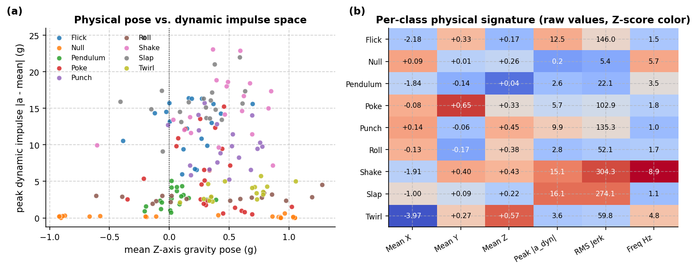

*Figure 2. (a) Gravity pose vs. peak dynamic impulse across all 120 recordings; (b) per-class physical feature matrix explaining why raw pose + centered + jerk channels separate the 10 classes.*


*Figure 3. Per-class mean ± 1 SD acceleration over the 1 s window.*

### Model Architecture, Internals & Budgets

- **I/O & Quantization**: input `[1, 100, 3] int8 scale=0.12541 zp=-1` → output `[1, 9] int8 scale=0.0039062 zp=-128` | int8=True (100% int8 ops) | **25,061** MACs, **2,196** weight bytes
- **Operators (9)**: `CONCATENATION, CONV_2D, DEPTHWISE_CONV_2D, FULLY_CONNECTED, MAX_POOL_2D, MEAN, REDUCE_MAX, RESHAPE, SOFTMAX`

| metric | model KB | arena KB (est) | MFLOPs | params (k) | MCU ms (est) | host ms |
| :--- | :--- | :--- | :--- | :--- | :--- | :--- |
| value | 8.906 | 1.676 | 0.05012 | 1.963 | 5.221 | 0.006273 |
| soft / hard budget | 16.0 / 64.0 | 6.0 / 40.0 | 0.2 / - | 6.0 / - | 18.0 / - | 0.05 / - |

#### Layer Breakdown

| # | op | output | dtype | MACs | weight B | live act B |
| :--- | :--- | :--- | :--- | :--- | :--- | :--- |
| 0 | RESHAPE | 1x1x100x3 | int8 | 300 | 16 | 600 |
| 1 | CONV_2D | 1x1x48x10 | int8 | 7200 | 190 | 780 |
| 2 | MAX_POOL_2D | 1x1x24x10 | int8 | 240 | 0 | 720 |
| 3 | CONV_2D | 1x1x12x14 | int8 | 8400 | 756 | 408 |
| 4 | DEPTHWISE_CONV_2D | 1x1x12x14 | int8 | 1512 | 182 | 336 |
| 5 | CONV_2D | 1x1x12x10 | int8 | 1680 | 180 | 288 |
| 6 | CONV_2D | 1x1x12x10 | int8 | 5040 | 460 | 288 |
| 7 | CONCATENATION | 1x1x12x20 | int8 | 240 | 0 | 480 |
| 8 | MEAN | 1x20 | int8 | 20 | 8 | 260 |
| 9 | REDUCE_MAX | 1x20 | int8 | 20 | 8 | 260 |
| 10 | CONCATENATION | 1x40 | int8 | 40 | 0 | 80 |
| 11 | FULLY_CONNECTED | 1x9 | int8 | 360 | 396 | 49 |
| 12 | SOFTMAX | 1x9 | int8 | 9 | 0 | 18 |

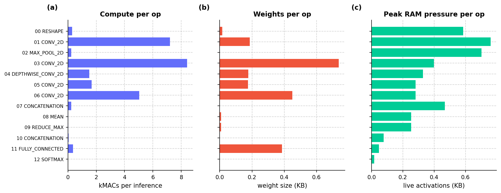

*Figure 4. Per-op (a) compute (kMACs), (b) weight footprint (KB), and (c) live activation RAM pressure (KB) in execution order.*

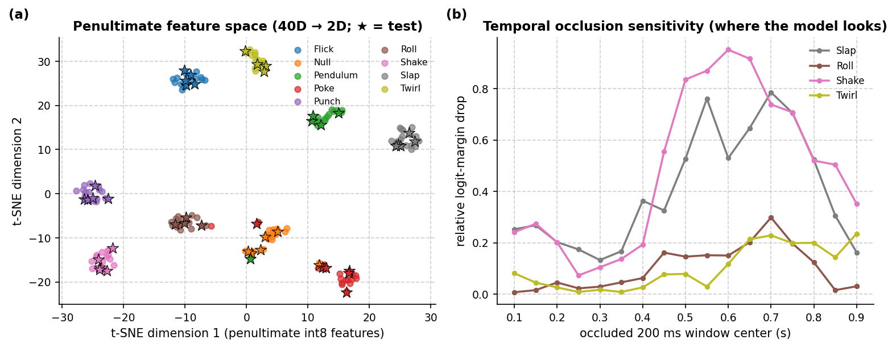

*Figure 5. (a) t-SNE projection of the quantized 40D penultimate feature representation across all 120 recordings (stars = frozen test); (b) sliding 200 ms temporal occlusion sensitivity on the true-class logit margin.*

### TFLite Evaluation (Validation and Frozen Test)

| split | rows | accuracy | macro F1 | mean top-1 prob (all / ok / err) |
| :--- | :--- | :--- | :--- | :--- |
| val | 131 | 0.9847 | 0.9855 | 0.921 (ok 0.928, err 0.459) |
| test | 159 | 0.9434 | 0.9501 | 0.885 (ok 0.900, err 0.638) |

| class | val F1 (support) | test precision | test recall | test F1 (support) |
| :--- | :--- | :--- | :--- | :--- |
| Flick | 0.957 (n=12) | 1 | 1 | 1 (n=15) |
| Null | 0.986 (n=35) | 0.8723 | 0.9762 | 0.921 (n=42) |
| Pendulum | 0.96 (n=12) | 1 | 0.8667 | 0.929 (n=15) |
| Poke | 0.968 (n=15) | 1 | 0.7778 | 0.875 (n=18) |
| Punch | 1 (n=12) | 1 | 1 | 1 (n=15) |
| Roll | 1 (n=12) | 1 | 1 | 1 (n=12) |
| Shake | 1 (n=12) | 1 | 0.8667 | 0.929 (n=15) |
| Slap | 1 (n=12) | 0.8824 | 1 | 0.938 (n=15) |
| Twirl | 1 (n=9) | 0.9231 | 1 | 0.96 (n=12) |

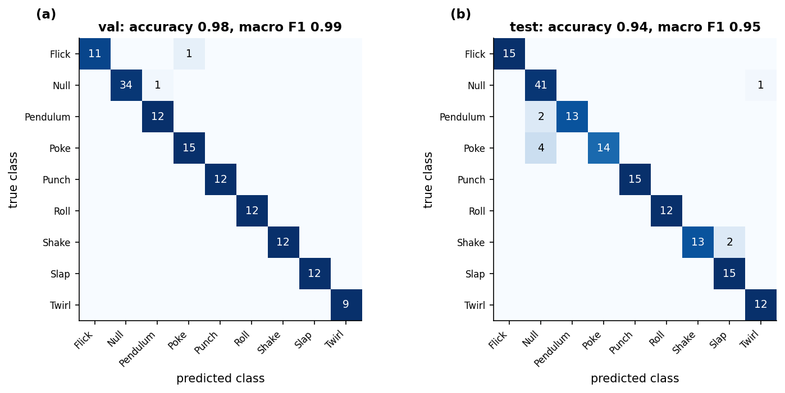

*Figure 6. Row-normalized confusion matrices on validation (a) and frozen test (b) splits; cell labels are counts.*

### Classifier Calibration & ROC/PR (Held-Out Val + Test, 290 rows)

| accuracy | macro F1 | top-2 acc | macro AUC | macro AP | MCC | kappa | log loss | ECE (10 bins) |
| :--- | :--- | :--- | :--- | :--- | :--- | :--- | :--- | :--- |
| 0.9621 | 0.9663 | 0.9793 | 0.9984 | 0.9908 | 0.9561 | 0.9558 | 0.1691 | 0.06113 |

| class | support | precision | recall | f1 | ROC AUC | AP |
| :--- | :--- | :--- | :--- | :--- | :--- | :--- |
| Flick | 27 | 1 | 0.963 | 0.9811 | 0.9996 | 0.9963 |
| Null | 77 | 0.9259 | 0.974 | 0.9494 | 0.9965 | 0.9908 |
| Pendulum | 27 | 0.9615 | 0.9259 | 0.9434 | 0.9979 | 0.984 |
| Poke | 33 | 0.9667 | 0.8788 | 0.9206 | 0.9934 | 0.9659 |
| Punch | 27 | 1 | 1 | 1 | 1 | 1 |
| Roll | 24 | 1 | 1 | 1 | 1 | 1 |
| Shake | 27 | 1 | 0.9259 | 0.9615 | 0.9993 | 0.9937 |
| Slap | 27 | 0.931 | 1 | 0.9643 | 0.9999 | 0.9987 |
| Twirl | 21 | 0.9545 | 1 | 0.9767 | 0.9992 | 0.988 |

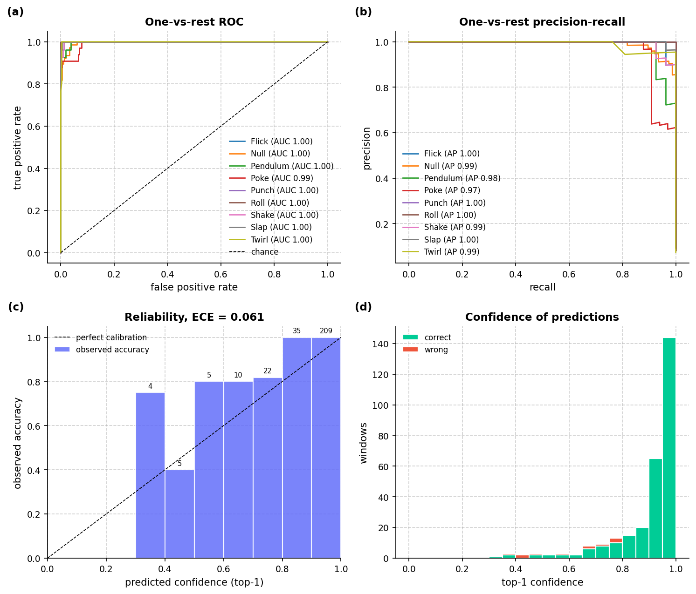

*Figure 7. (a) One-vs-rest ROC, (b) precision-recall, (c) calibration reliability diagram, (d) top-1 confidence.*

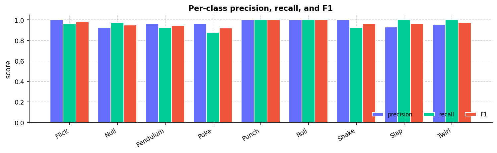

*Figure 8. Per-class precision, recall, and F1 on all held-out rows.*

### Streaming Simulation (50% Overlap)

| windows | duration (s) | pure-window acc | Null FPR | boundary windows | prediction flips |
| :--- | :--- | :--- | :--- | :--- | :--- |
| 89 | 45.0 | 0.94 | 0.1429 | 39 | 57 |

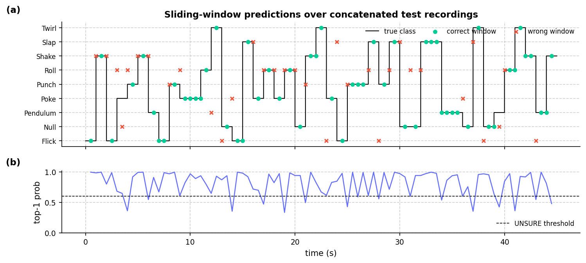

*Figure 9. Sliding 1 s windows (50% overlap) over concatenated test recordings: (a) predicted vs true class, (b) top-1 confidence vs UNSURE threshold.*

### Host Benchmark

`Python 3.11.17` | `TF 2.15.1` | `macOS-26.7.1-arm64-arm-64bit` | Evaluator e2e: **0.018 ms/row**.

| runtime | p50 ms | p95 ms | min ms | inf/s |
| :--- | :--- | :--- | :--- | :--- |
| TFLite reference (no delegate) | 0.006667 | 0.008291 | 0.006583 | 1.5e+05 |
| TFLite + XNNPACK | 0.001833 | 0.001875 | 0.00175 | 5.456e+05 |

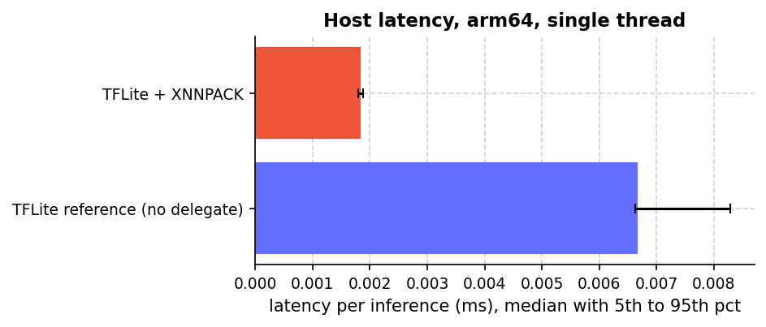

*Figure 10. Single-threaded host latency over 300 invocations (reference kernel vs XNNPACK).*

### Hardware in the Loop (XIAO nRF52840 Sense)

Flashed `Arduino/Codegen` on `/dev/cu.usbmodem2101` (42 s) | Flash `258000 B`, Static RAM `98280 B` | `INFO:model_bytes=9120,window_rows=100,classes=Flick|Null|Pendulum|Poke|Punch|Roll|Shake|Slap|Twirl,input_type=int8,output_type=int8,step=50`.

| host acc | device acc | host F1 | device F1 | device latency ms | arena bytes | host-device agreement |
| :--- | :--- | :--- | :--- | :--- | :--- | :--- |
| 0.9556 | 0.9556 | 0.9617 | 0.9617 | 7.32 (max 7.34) | 3412 | 1 |

### Pareto Frontier & Hardware Trade-offs

**194** scored attempts across **6** runs on dataset `78beb5ebc3c6` (non-dominated accuracy-vs-size frontier):

| KB | val F1 | MFLOPs | arena KB | val score | run | student | cycle |
| :--- | :--- | :--- | :--- | :--- | :--- | :--- | :--- |
| 5.2 | 0.713 | 0.046 | 1.7 | 0.6886 | 20261025_170637 | 1_gemini_4_argon | 1 |
| 6.4 | 0.889 | 0.058 | 1.9 | 0.8184 | 20261025_170637 | 1_gemini_4_argon | 3 |
| 6.4 | 0.905 | 0.058 | 1.9 | 0.8227 | 20261025_170637 | 1_gemini_4_argon | 4 |
| 8.2 | 0.910 | 0.070 | 1.9 | 0.8120 | 20261025_212043 | 1_gemini_4_argon | 3 |
| 8.9 | 0.914 | 0.050 | 1.7 | 0.8221 | 20261025_212043 | 1_gemini_4_argon | 11 |
| 8.9 | 0.923 | 0.050 | 1.7 | 0.8255 | 20261025_212043 | 1_gemini_4_argon | 9 |
| 8.9 | 0.926 | 0.050 | 1.7 | 0.8323 | 20261025_212043 | 1_gemini_4_argon | 8 |
| 8.9 | 0.927 | 0.050 | 1.7 | 0.8302 | 20261025_212043 | 1_gemini_4_argon | 10 |
| 8.9 | 0.927 | 0.050 | 1.7 | 0.8223 | 20261025_212043 | 3_gemini_3.1_pro_preview | 10 |
| 11.2 | 0.931 | 0.059 | 2.3 | 0.8183 | 20261025_190227 | 3_gemini_3.1_pro_preview | 6 |
| 13.8 | 0.933 | 0.110 | 3.2 | 0.7696 | 20261024_190925 | 3_gemini_3.1_pro_preview | 7 |

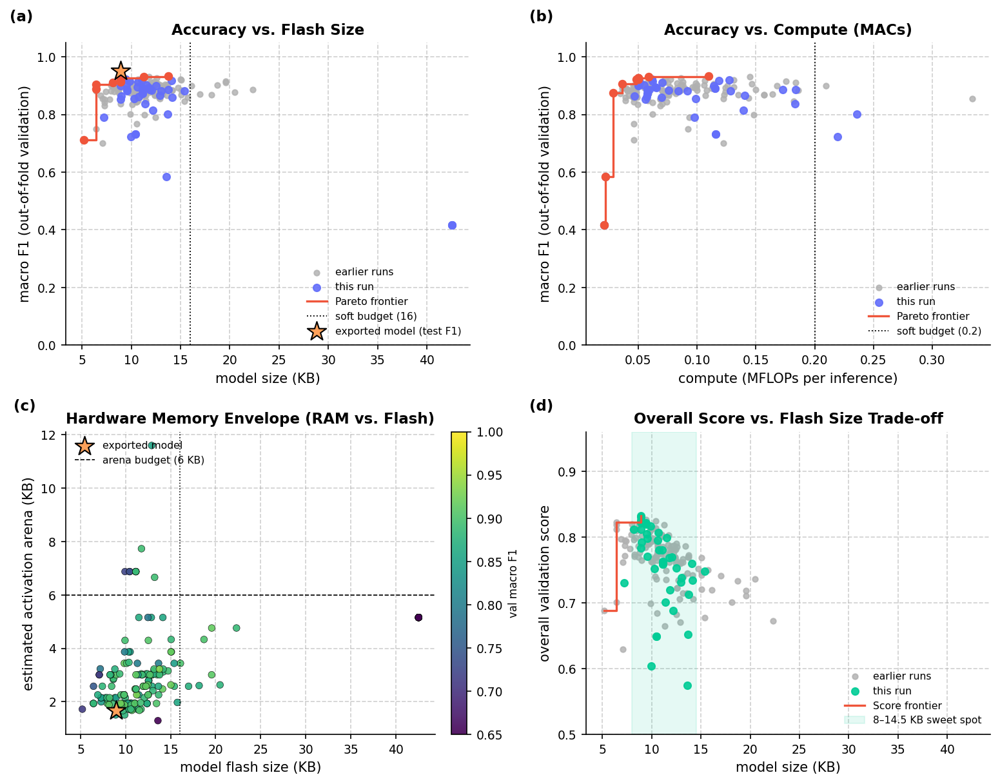

*Figure 11. Multi-objective Pareto dashboard: (a) validation F1 vs model KB, (b) validation F1 vs MFLOPs, (c) activation arena RAM vs model flash KB colored by F1, and (d) overall score vs model KB showing the 8–14.5 KB sweet spot.*

### Student LLM Elo Ratings & Head-to-Head Record

Pairwise smooth-margin Elo (`start=1500`, `K_cycle=12`, `K_test=24`) across **6** runs (**55** classroom rounds) on dataset `78beb5ebc3c6`:

| LLM family | Elo | win rate (matches) | cycle #1s | test #1s | best val | best test | mean KB |
| :--- | :--- | :--- | :--- | :--- | :--- | :--- | :--- |
| gemini-4-argon | 1671 | 72.6% (154) | 30 | 5 | 0.8323 | 0.8611 | 12.9 |
| gemini-3.5-flash | 1538 | 60.8% (154) | 12 | 0 | 0.8242 | 0.8445 | 14.5 |
| gemini-3.1-pro-preview | 1495 | 40.6% (154) | 6 | 1 | 0.8223 | 0.8519 | 16.6 |
| gemini-3.5-flash-lite | 1296 | 22.0% (132) | 1 | 0 | 0.7954 | 0.8174 | 16.3 |

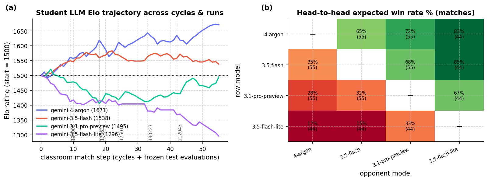

*Figure 12. (a) LLM student Elo trajectory across all classroom cycles and frozen-test evaluations; (b) pairwise head-to-head win rate matrix.*
