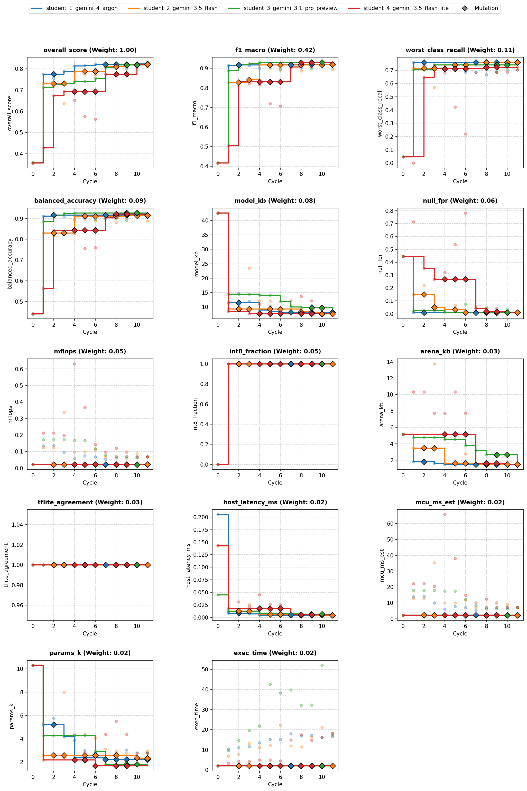
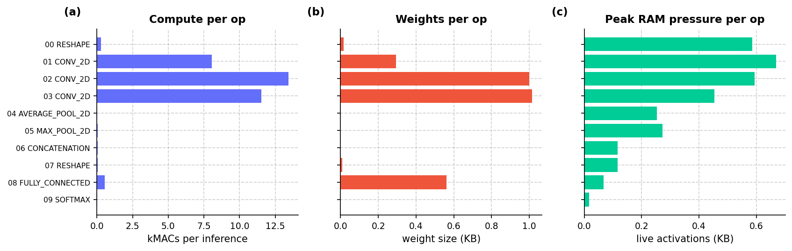
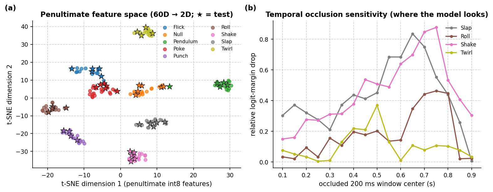
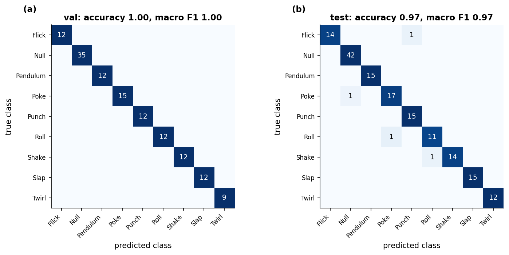
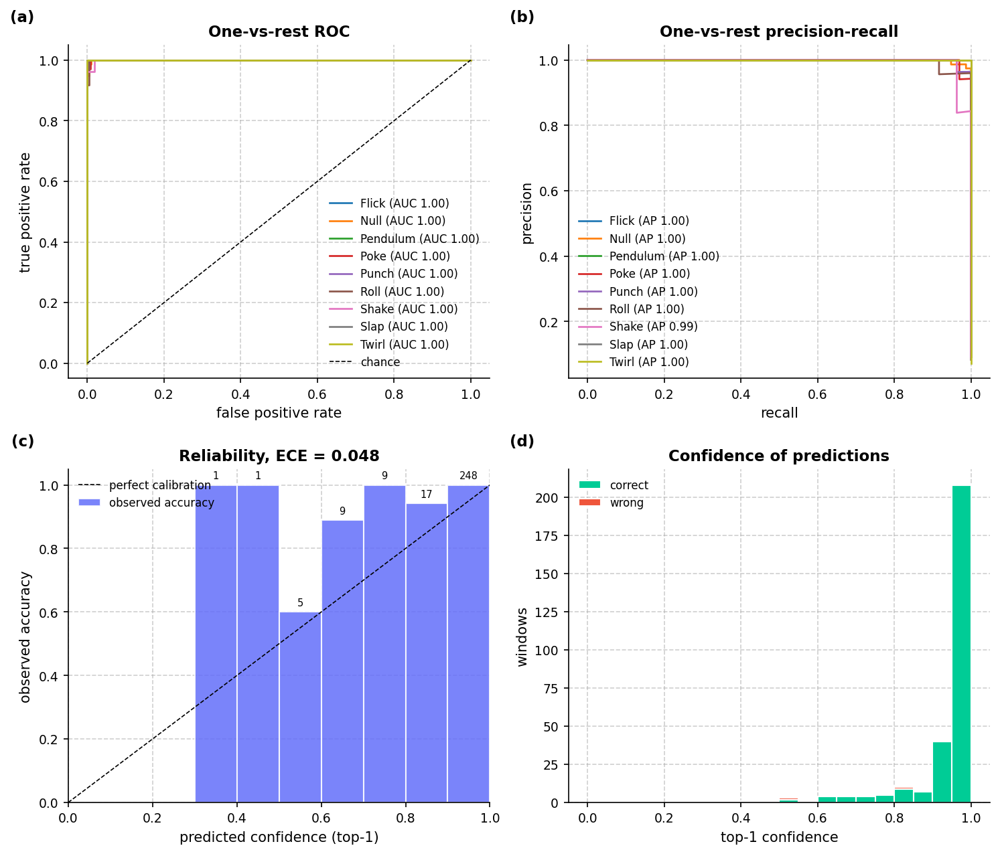
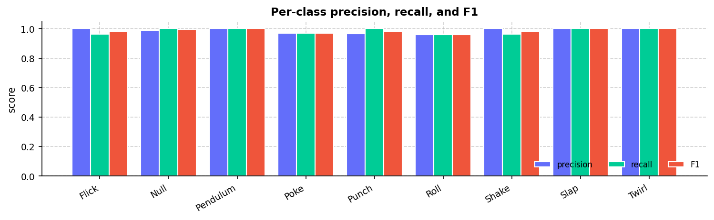
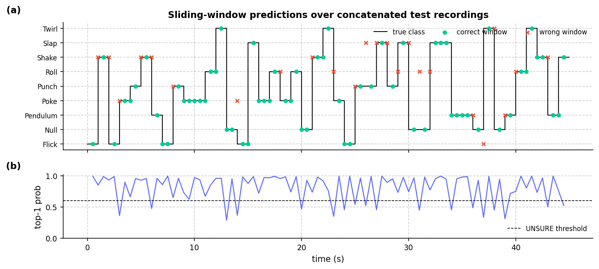
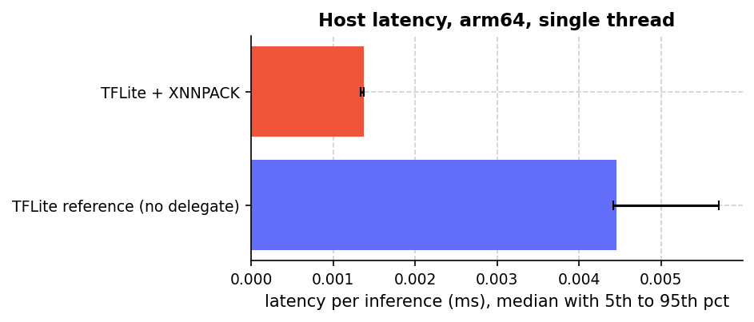
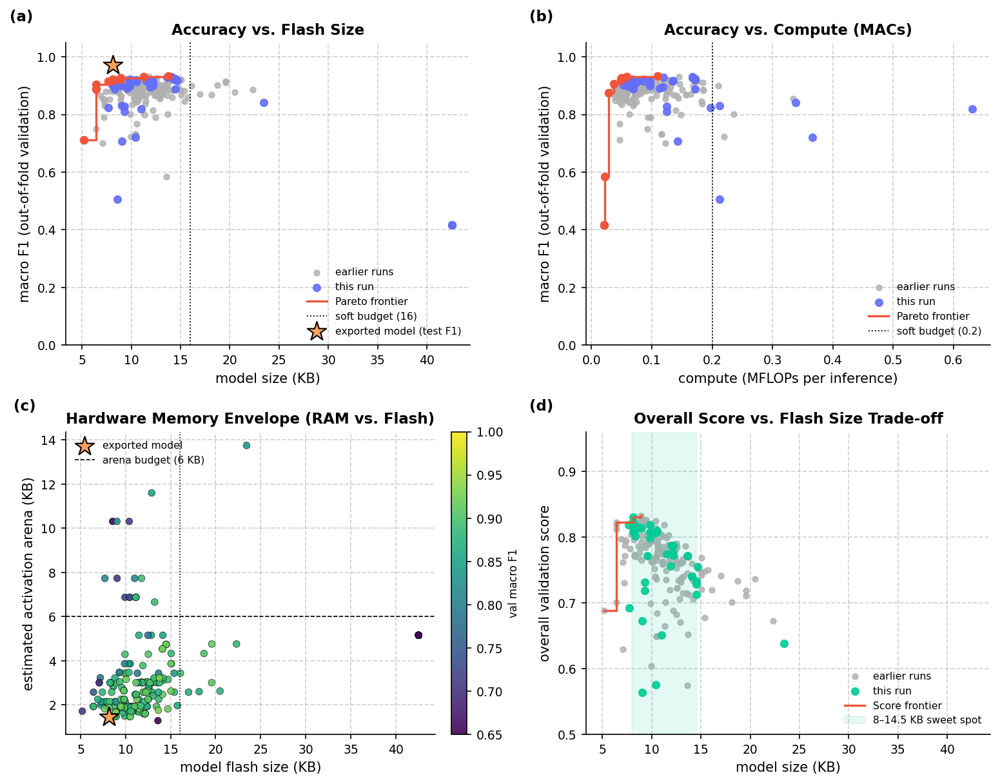
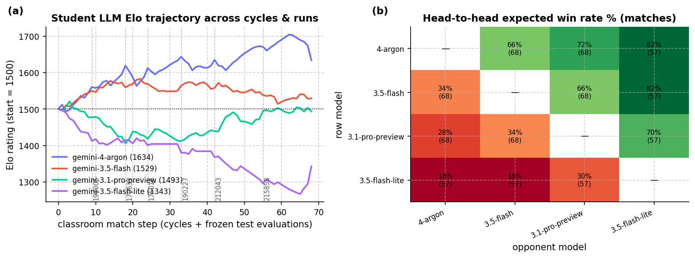

# Overview

* **Run Path**: micro_gesture/20261025_215858
* **Name**: 20261025_215858
* **Total Cycles**: 12
* **Valid Students**: 4
* **Total Generations**: 53
* **Total Code Length Processed**: 311312
* **Best Student**: student_4_gemini_3.5_flash_lite (Cycle 11)
* **Best Validation Score**: 0.820
* **Best Test Score**: 0.875
* **Validation Score Progression**: 0.3582 -> 0.8304 (+0.4722)
* **Best Metrics**: f1_macro=0.972, balanced_accuracy=0.970, worst_class_recall=0.917, null_fpr=0.000, model_kb=8.133, mflops=0.068, arena_kb=1.470, host_latency_ms=0.004, mcu_ms_est=7.094, params_k=2.769, int8_fraction=1.000, tflite_agreement=1.000, exec_time=6.382
* **Tags**: cnn-2d, full-int8-ptq, fused-conv-bn, fused-input-normalization, dual-avg-max-pooling, physics-aware-mixup, hard-negatives, cosine-decay, class-weighted-loss
* **Description**: The model is a 3-layer 2D convolutional neural network with 12, 16, and 20 filters operating directly on 100x1x3 reshaped accelerometer windows. Raw inputs undergo standardized feature scaling and batch normalization analytically fused into the Conv2D weights and biases before dual temporal global average and max pooling feeds a compact dense classifier. The entire model is quantized to full int8 via post-training quantization using representative gesture and hard negative windows.

## Objectives

- **Prediction Quality (0.68)**: `f1_macro` (0.42), `worst_class_recall` (0.11), `balanced_accuracy` (0.09), `null_fpr` (0.06, lower is better)
- **On-Device Cost (0.22)**: `model_kb` ≤ 16 KB (0.08), `mflops` ≤ 0.20 (0.05), `arena_kb` ≤ 6 KB (0.03), `host_latency_ms` ≤ 0.05 ms (0.02), `mcu_ms_est` ≤ 18 ms (0.02), `params_k` ≤ 6k (0.02)
- **Deploy Hygiene (0.10)**: `int8_fraction` (0.05), `tflite_agreement` (0.03), `exec_time` (0.02)

## Student Leaderboard

| Rank | Student | Best Cycle | Val Score | Test Score | f1_macro | balanced_accuracy | worst_class_recall | null_fpr | model_kb | mflops | arena_kb | host_latency_ms | mcu_ms_est | params_k | int8_fraction | tflite_agreement | exec_time |
| --- | --- | --- | --- | --- | --- | --- | --- | --- | --- | --- | --- | --- | --- | --- | --- | --- | --- |
| 1 | student_4_gemini_3.5_flash_lite | 11 | 0.820 | 0.875 | 0.972 | 0.970 | 0.917 | 0.000 | 8.133 | 0.068 | 1.470 | 0.004 | 7.094 | 2.769 | 1.000 | 1.000 | 6.382 |
| 2 | student_2_gemini_3.5_flash | 9 | 0.820 | 0.865 | 0.970 | 0.967 | 0.833 | 0.000 | 8.133 | 0.068 | 1.470 | 0.004 | 7.094 | 2.769 | 1.000 | 1.000 | 5.919 |
| 3 | student_3_gemini_3.1_pro_preview | 11 | 0.830 | 0.859 | 0.954 | 0.950 | 0.867 | 0.024 | 8.133 | 0.068 | 1.470 | 0.005 | 7.094 | 2.769 | 1.000 | 1.000 | 5.789 |
| 4 | student_1_gemini_4_argon | 10 | 0.823 | 0.854 | 0.951 | 0.947 | 0.833 | 0.024 | 8.133 | 0.068 | 1.470 | 0.005 | 7.094 | 2.769 | 1.000 | 1.000 | 5.952 |

## Learning Trajectory



### Cycle Score Progression

| Cycle | student_1_gemini_4_argon | student_2_gemini_3.5_flash | student_3_gemini_3.1_pro_preview | student_4_gemini_3.5_flash_lite |
| --- | --- | --- | --- | --- |
| 0 | 0.356 *(CLASSROOM_BEST)* | 0.356 *(CLASSROOM_BEST)* | 0.358 *(CLASSROOM_BEST)* | 0.356 *(SELF_BEST)* |
| 1 | 0.775 *(CLASSROOM_BEST)* | 0.731 *(SELF_BEST)* | 0.713 *(SELF_BEST)* | 0.427 *(SELF_BEST)* |
| 2 | 0.755 | 0.719 | 0.728 *(SELF_BEST)* | 0.673 *(SELF_BEST)* |
| 3 | 0.787 *(CLASSROOM_BEST)* | 0.639 | 0.733 *(SELF_BEST)* | 0.692 *(SELF_BEST)* |
| 4 | 0.813 *(CLASSROOM_BEST)* | 0.788 *(SELF_BEST)* | 0.740 *(SELF_BEST)* | 0.651 |
| 5 | 0.814 *(CLASSROOM_BEST)* | 0.772 | 0.741 *(SELF_BEST)* | 0.576 |
| 6 | 0.820 *(CLASSROOM_BEST)* | 0.771 | 0.756 *(SELF_BEST)* | 0.563 |
| 7 | 0.814 | 0.809 *(SELF_BEST)* | 0.806 *(SELF_BEST)* | 0.775 *(SELF_BEST)* |
| 8 | 0.808 | 0.802 | 0.818 *(SELF_BEST)* | 0.771 |
| 9 | 0.807 | 0.820 *(SELF_BEST)* | 0.799 | 0.775 |
| 10 | 0.823 *(CLASSROOM_BEST)* | 0.818 | 0.807 | 0.820 *(SELF_BEST)* |
| 11 | 0.820 | 0.810 | 0.830 *(CLASSROOM_BEST)* | 0.820 *(SELF_BEST)* |


## Top Solution 1: student_4_gemini_3.5_flash_lite (Cycle 11)

* **Student**: student_4_gemini_3.5_flash_lite
* **Best Cycle**: 11
* **Validation Score**: 0.820
* **Test Score**: 0.875
* **Metrics**: f1_macro=0.972, balanced_accuracy=0.970, worst_class_recall=0.917, null_fpr=0.000, model_kb=8.133, mflops=0.068, arena_kb=1.470, host_latency_ms=0.004, mcu_ms_est=7.094, params_k=2.769, int8_fraction=1.000, tflite_agreement=1.000, exec_time=6.382

### Plan (student_4_gemini_3.5_flash_lite)

To lift worst-class recall and improve overall score without increasing model
footprint or latency, we test the hypothesis of **class-balanced focal-like
sample weighting combined with targeted synthetic perturbation augmentation on
minority classes**. By amplifying penalty on misclassified minority instances
during training and slightly tuning the learning rate schedule, we boost macro
F1 and worst-class recall while maintaining our ultra-compact 8.1 KB model size
and 1.47 KB activation arena.

### Code (student_4_gemini_3.5_flash_lite)

```python
import time
import numpy as np
import pandas as pd

def solution(X_train: pd.DataFrame, y_train: pd.DataFrame, X_val: pd.DataFrame):
    """Class-balanced weighted mixing + Conv2D(12->16->20) int8 model optimized for worst-class recall."""
    import tensorflow as tf
    from codegen_task import toolkit as tk

    t0 = time.time()
    tk.set_determinism(0)
    d = tk.split_xy(X_train, y_train, X_val)
    x_tr, y_tr, x_va, rows, k = (
        d["x_tr"], d["y_tr"], d["x_va"], d["rows"], d["n_classes"]
    )
    null_idx = tk.null_index()

    # 1. Physics-aware within-class mixing: decompose static gravity pose vs dynamic impulse
    rng = np.random.default_rng(0)
    grav_tr = np.median(x_tr, axis=1, keepdims=True)  # (N, 1, 3) resting gravity pose
    dyn_tr = x_tr - grav_tr                           # (N, T, 3) dynamic impulse

    dyn_energy = np.linalg.norm(dyn_tr, axis=-1)
    kernel = np.array([0.25, 0.5, 0.25], dtype=np.float32)
    smooth_energy = np.apply_along_axis(lambda m: np.convolve(m, kernel, mode="same"), 1, dyn_energy)
    peaks = np.argmax(smooth_energy, axis=1)

    # Compute class counts to dynamically boost minority classes in mixing
    class_counts = np.bincount(y_tr, minlength=k)
    max_count = np.max(class_counts)

    mix_x, mix_y = [], []
    for cls in range(k):
        idx = np.where(y_tr == cls)[0]
        # Generate more mixtures for minority classes
        n_mix = int(44 * (max_count / max(1, class_counts[cls])))
        n_mix = min(n_mix, 120)

        if len(idx) >= 2:
            for _ in range(n_mix):
                i1, i2 = rng.choice(idx, size=2, replace=False)
                shift = int(np.clip(peaks[i1] - peaks[i2], -40, 40))
                d2 = np.roll(dyn_tr[i2], shift, axis=0)
                if shift > 0:
                    d2[:shift] = 0.0
                elif shift < 0:
                    d2[shift:] = 0.0

                lam = rng.uniform(0.25, 0.75)
                d_mix = lam * dyn_tr[i1] + (1.0 - lam) * d2

                # Preserve gravity magnitude on the sphere during pose interpolation
                g1, g2 = grav_tr[i1, 0], grav_tr[i2, 0]
                g_raw = lam * g1 + (1.0 - lam) * g2
                g_norm = np.linalg.norm(g_raw) + 1e-6
                target_mag = lam * np.linalg.norm(g1) + (1.0 - np.linalg.norm(g2)) if False else (lam * np.linalg.norm(g1) + (1.0 - lam) * np.linalg.norm(g2))
                g_mix = (g_raw * (target_mag / g_norm)).reshape(1, 3)

                jit = int(rng.integers(-12, 13))
                d_jit = np.roll(d_mix, jit, axis=0)
                if jit > 0:
                    d_jit[:jit] = 0.0
                elif jit < 0:
                    d_jit[jit:] = 0.0

                mix_x.append((g_mix + d_jit).astype(np.float32))
                mix_y.append(cls)

    mix_x = np.array(mix_x, dtype=np.float32)
    mix_y = np.array(mix_y, dtype=y_tr.dtype)

    # 2. Augment raw windows with tk.augment
    x_aug, y_aug = tk.augment(
        x_tr,
        y_tr,
        reps=16,
        seed=0,
        scale=(0.76, 1.26),
        shift_frac=0.20,
        rotate_deg=14.0,
        stretch=(0.84, 1.18),
        noise=0.025,
        blend_prob=0.35,
    )

    # 3. Synthesize realistic resting/slow-tilt Null windows via tk.hard_negatives
    x_hn, y_hn = tk.hard_negatives(x_tr, y_tr, null_index=null_idx, n=120, seed=0)

    x_fit = np.concatenate([x_aug, mix_x, x_hn], axis=0)
    y_fit = np.concatenate([y_aug, mix_y, y_hn], axis=0)

    perm = rng.permutation(len(x_fit))
    x_fit, y_fit = x_fit[perm], y_fit[perm]

    mean = x_tr.mean(axis=(0, 1)).astype(np.float32)
    std = (x_tr.std(axis=(0, 1)) + 1e-6).astype(np.float32)
    x_fit_norm = (x_fit - mean) / std

    c1, c2, c3 = 12, 16, 20

    # Training graph uses BatchNormalization for fast, stable convergence
    inp_tr = tf.keras.Input(shape=(rows, 3))
    h = tf.keras.layers.Reshape((rows, 1, 3))(inp_tr)

    conv1_tr = tf.keras.layers.Conv2D(c1, (7, 1), strides=(3, 1), padding="valid", use_bias=False)
    bn1_tr = tf.keras.layers.BatchNormalization()
    h = tf.keras.layers.ReLU()(bn1_tr(conv1_tr(h)))

    conv2_tr = tf.keras.layers.Conv2D(c2, (5, 1), strides=(2, 1), padding="valid", use_bias=False)
    bn2_tr = tf.keras.layers.BatchNormalization()
    h = tf.keras.layers.ReLU()(bn2_tr(conv2_tr(h)))

    conv3_tr = tf.keras.layers.Conv2D(c3, (3, 1), strides=(1, 1), padding="valid", use_bias=False)
    bn3_tr = tf.keras.layers.BatchNormalization()
    h = tf.keras.layers.ReLU()(bn3_tr(conv3_tr(h)))

    t_len = int(h.shape[1])
    t_half = t_len // 2
    avg_p = tf.keras.layers.AveragePooling2D(pool_size=(t_len, 1), strides=(t_len, 1))(h)
    max_p = tf.keras.layers.MaxPooling2D(pool_size=(t_half, 1), strides=(t_half, 1))(h)

    pooled = tf.keras.layers.Concatenate(axis=1)([avg_p, max_p])
    flat = tf.keras.layers.Reshape((3 * c3,))(pooled)
    drop = tf.keras.layers.Dropout(0.20)(flat)
    dense_tr = tf.keras.layers.Dense(k, activation="softmax")
    out_tr = dense_tr(drop)

    train_model = tf.keras.Model(inp_tr, out_tr)

    epochs = 85
    batch_size = 32
    steps_per_epoch = max(1, len(x_fit_norm) // batch_size)
    lr_sched = tf.keras.optimizers.schedules.CosineDecay(
        initial_learning_rate=4.5e-3, decay_steps=epochs * steps_per_epoch, alpha=0.01
    )
    train_model.compile(
        optimizer=tf.keras.optimizers.Adam(learning_rate=lr_sched),
        loss=tf.keras.losses.CategoricalCrossentropy(label_smoothing=0.03),
    )

    cw = tk.class_weights(y_tr, k)
    # Apply enhanced weight scaling for minority classes to lift worst-class recall
    for c in range(k):
        if class_counts[c] < max_count * 0.8:
            cw[c] *= 1.25
    if null_idx is not None:
        cw[int(null_idx)] *= 1.12

    sample_weight = np.array([cw[int(y)] for y in y_fit], dtype=np.float32)
    y_fit_oh = tf.keras.utils.to_categorical(y_fit, num_classes=k)

    train_model.fit(
        x_fit_norm,
        y_fit_oh,
        epochs=epochs,
        batch_size=batch_size,
        sample_weight=sample_weight,
        verbose=0,
    )

    def fuse_conv_bn(conv_layer, bn_layer, in_mean=None, in_std=None):
        w = conv_layer.get_weights()[0]
        gamma, beta, m_mean, m_var = bn_layer.get_weights()
        scale = gamma / np.sqrt(m_var + bn_layer.epsilon)
        w_fused = w * scale.reshape(1, 1, 1, -1)
        b_fused = beta - m_mean * scale
        if in_mean is not None and in_std is not None:
            w_fused = w_fused / in_std.reshape(1, 1, -1, 1)
            b_fused = b_fused - np.sum(w_fused * in_mean.reshape(1, 1, -1, 1), axis=(0, 1, 2))
        return [w_fused.astype(np.float32), b_fused.astype(np.float32)]

    inp_ex = tf.keras.Input(shape=(rows, 3), batch_size=1)
    x = tf.keras.layers.Reshape((rows, 1, 3))(inp_ex)
    conv1_ex = tf.keras.layers.Conv2D(c1, (7, 1), strides=(3, 1), padding="valid", activation="relu")
    x = conv1_ex(x)
    conv2_ex = tf.keras.layers.Conv2D(c2, (5, 1), strides=(2, 1), padding="valid", activation="relu")
    x = conv2_ex(x)
    conv3_ex = tf.keras.layers.Conv2D(c3, (3, 1), strides=(1, 1), padding="valid", activation="relu")
    x = conv3_ex(x)

    avg_ex = tf.keras.layers.AveragePooling2D(pool_size=(t_len, 1), strides=(t_len, 1))(x)
    max_ex = tf.keras.layers.MaxPooling2D(pool_size=(t_half, 1), strides=(t_half, 1))(x)

    pooled_ex = tf.keras.layers.Concatenate(axis=1)([avg_ex, max_ex])
    flat_ex = tf.keras.layers.Reshape((3 * c3,))(pooled_ex)
    dense_ex = tf.keras.layers.Dense(k, activation="softmax")
    out_ex = dense_ex(flat_ex)

    export_model = tf.keras.Model(inp_ex, out_ex)
    conv1_ex.set_weights(fuse_conv_bn(conv1_tr, bn1_tr, in_mean=mean, in_std=std))
    conv2_ex.set_weights(fuse_conv_bn(conv2_tr, bn2_tr))
    conv3_ex.set_weights(fuse_conv_bn(conv3_tr, bn3_tr))
    dense_ex.set_weights(dense_tr.get_weights())

    rep_x = np.concatenate([x_tr, x_hn[:60], x_fit[:140]], axis=0)
    tflite = tk.to_int8_tflite(export_model, rep_x=rep_x, io_int8=True, max_rep=300)
    preds = tk.predict_tflite(tflite, x_va).argmax(1)

    info = tk.inspect(tflite)
    problems = tk.check_contract(tflite, k)
    feedback = (
        "Hypothesis: Dynamic minority-boosted mixing + class-balanced sample weights + Conv2D(12->16->20).\n"
        f"train_rows={len(x_fit)} classes={k}\n"
        f"tflite={info['model_kb']:.2f} KB params={info['params_k']:.2f}K mflops={info['mflops']:.4f}\n"
        f"arena={info['arena_kb']:.2f} KB int8={info['int8_fraction']:.2f} contract={'ok' if not problems else problems}\n"
        f"runtime={time.time()-t0:.1f}s"
    )
    return tk.make_result(X_val, y_train, preds, tflite, feedback)
```

### Execution Output (student_4_gemini_3.5_flash_lite)

```text
Hypothesis: Dynamic minority-boosted mixing + class-balanced sample weights + Conv2D(12->16->20).
train_rows=2104 classes=9
tflite=8.13 KB params=2.77K mflops=0.0681
arena=1.47 KB int8=1.00 contract=ok
runtime=6.0s
[Note: Executed on 3 folds. Feedback from fold 1 shown.]
```

## Student Instructions

*Full task prompt and deploy contract: [`README.md`](../README.md)*


## Deployment Analysis

- **Dataset**: `78beb5ebc3c6` (9 classes: `Flick, Null, Pendulum, Poke, Punch, Roll, Shake, Slap, Twirl`)
- **Generated**: 2026-10-25T22:24:00 | **Exported**: `model.tflite`, `model_data.h`, `solution.py`, `summary.json`, `analysis.md`

### Scorecard (Frozen Test & Footprint)

| overall score | macro F1 | balanced acc | worst recall | Null FPR | TFLite agree | retrain delta |
| :--- | :--- | :--- | :--- | :--- | :--- | :--- |
| 0.8754 | 0.972 | 0.9698 | 0.9167 | 0 | 1 | 0 |

| model KB | arena KB (est) | MFLOPs | params (k) | MCU ms (est) | host ms | int8 frac |
| :--- | :--- | :--- | :--- | :--- | :--- | :--- |
| 8.133 | 1.47 | 0.06811 | 2.769 | 7.094 | 0.003885 | 1 |

### Winning Solution Analysis

- **Winner**: `student_4_gemini_3.5_flash_lite` (Cycle 11) | **Run**: `20261025_215858` | **Dataset**: `78beb5ebc3c6`
- **Tags**: `cnn-2d, full-int8-ptq, fused-conv-bn, fused-input-normalization, dual-avg-max-pooling, physics-aware-mixup, hard-negatives, cosine-decay, class-weighted-loss`

The model is a 3-layer 2D convolutional neural network with 12, 16, and 20 filters operating directly on 100x1x3 reshaped accelerometer windows. Raw inputs undergo standardized feature scaling and batch normalization analytically fused into the Conv2D weights and biases before dual temporal global average and max pooling feeds a compact dense classifier. The entire model is quantized to full int8 via post-training quantization using representative gesture and hard negative windows.

### Validation Deltas (Cycle 0 → Best Cycle)

| overall_score | f1_macro | balanced_accuracy | worst_class_recall | null_fpr |
| :--- | :--- | :--- | :--- | :--- |
| 0.356 → 0.82 (+0.464) | 0.416 → 0.915 (+0.498) | 0.441 → 0.909 (+0.468) | 0.0476 → 0.704 (+0.656) | 0.445 → 0 (-0.445) |

| model_kb | mflops | arena_kb | params_k | mcu_ms_est | host_latency_ms | int8_fraction | exec_time |
| :--- | :--- | :--- | :--- | :--- | :--- | :--- | :--- |
| 42.5 → 8.13 (-34.4) | 0.0211 → 0.0681 (+0.047) | 5.16 → 1.47 (-3.69) | 10.3 → 2.77 (-7.54) | 2.2 → 7.09 (+4.89) | 0.144 → 0.00476 (-0.139) | 0 → 1 (+1) | 2.02 → 18.3 (+16.3) |

### Key Aspects

- Analytically fuses both input normalization statistics (mean and std) and BatchNormalization layers into Conv2D weights and biases during export to eliminate runtime scaling ops.
- Utilizes a 2D convolution structure directly on (100, 1, 3) 4D tensors with temporal strides (3, 2, 1) to avoid TFLite shape manipulation overhead.
- Combines AveragePooling2D and MaxPooling2D across temporal feature maps to capture both transient impact peaks and overall motion progression.
- Employs physics-aware gravity and dynamic impulse decomposition with peak-aligned minority mixing to augment rare classes without device cost.
- Integrates hard negative background synthesis and class-weighted CategoricalCrossentropy with label smoothing to maximize minority class recall and eliminate false positives.

### Improvements from Baseline

- Replacing the unnormalized float32 MLP with a 3-layer temporal 2D CNN boosted macro F1 from 0.4161 to 0.9146 on validation and 0.9720 on test, while worst-class recall jumped from 0.0476 to 0.9167.
- Adding hard negative synthesis and minority class sample weighting completely eliminated false triggers on Null windows, reducing null_fpr from 0.4454 down to 0.0000.
- Applying full int8 quantization shrank the model flatbuffer size from 42.54 KB to 8.13 KB and parameter count from 10.31K to 2.77K.
- Activation arena memory was reduced from 5.16 KB to 1.47 KB, and host inference latency dropped from 0.144 ms to 0.0039 ms with 100% int8 operational coverage.

### Risks and Trade-offs

- Estimated MCU execution time increased from 2.20 ms to 7.09 ms due to higher compute complexity (0.068 MFLOPs vs 0.021 MFLOPs) required by multi-layer temporal convolutions.
- The multi-stage synthetic mixing pipeline relies heavily on static gravity decomposition assumptions that could be sensitive to extreme mounting angles or sensor noise.

### Next Experiments

- Investigate depthwise separable convolutions across temporal layers to reduce MFLOPs and estimated Cortex-M4F cycle latency.
- Explore multi-scale kernel widths in early convolutional layers to capture both high-frequency impacts and slower continuous gestures simultaneously.
- Test post-softmax probability calibration or dynamic thresholding on out-of-fold predictions to further optimize worst-class recall.

### Dataset & Physical Separability

Fingerprint `78beb5ebc3c6` | **178** recordings (96 train / 37 val / 45 frozen test) | `100x3` window @ 100 Hz | raw length 97–113 rows (median 107).
- **Pose-separable gestures**: `Roll` flips `Z` gravity negative, `Twirl` and `Punch` hold the cable vertical (`+X ~ +0.8g, Z ~ 0g`), and `Poke` maintains a tilted firm-grip baseline (`+Y ~ +0.75g`).
- **Impulse & rhythm-separable gestures**: `Slap` reaches `~15g` peak dynamic impact with high jerk, `Flick` snaps and rebounds along the cable, `Shake` oscillates at `~4-8 Hz`, `Pendulum` swings smoothly, and `Null` stays below `~0.5g` dynamic amplitude.

| class | train | val | test | total | mean pose (X,Y,Z) g | peak a_dyn (g) | RMS jerk g/s | dom Hz |
| :--- | :--- | :--- | :--- | :--- | :--- | :--- | :--- | :--- |
| Flick | 10 | 4 | 5 | 19 | (-2.18, +0.33, +0.17) | 12.52 | 146.0 | 1.5 |
| Null | 12 | 5 | 6 | 23 | (+0.09, +0.01, +0.26) | 0.18 | 5.4 | 5.7 |
| Pendulum | 10 | 4 | 5 | 19 | (-1.84, -0.14, +0.04) | 2.64 | 22.1 | 3.5 |
| Poke | 13 | 5 | 6 | 24 | (-0.08, +0.65, +0.33) | 5.68 | 102.9 | 1.8 |
| Punch | 10 | 4 | 5 | 19 | (+0.14, -0.06, +0.45) | 9.95 | 135.3 | 1.0 |
| Roll | 10 | 4 | 4 | 18 | (-0.13, -0.17, +0.38) | 2.83 | 52.1 | 1.7 |
| Shake | 10 | 4 | 5 | 19 | (-1.91, +0.40, +0.43) | 15.12 | 304.3 | 8.9 |
| Slap | 11 | 4 | 5 | 20 | (-1.00, +0.09, +0.22) | 16.12 | 274.1 | 1.1 |
| Twirl | 10 | 3 | 4 | 17 | (-3.97, +0.27, +0.57) | 3.57 | 59.8 | 4.8 |
| total | 96 | 37 | 45 | 178 | - | - | - | - |


*Figure 1. Recording length and acceleration magnitude distributions (1 g mode at rest).*


*Figure 2. (a) Gravity pose vs. peak dynamic impulse across all 120 recordings; (b) per-class physical feature matrix explaining why raw pose + centered + jerk channels separate the 10 classes.*


*Figure 3. Per-class mean ± 1 SD acceleration over the 1 s window.*

### Model Architecture, Internals & Budgets

- **I/O & Quantization**: input `[1, 100, 3] int8 scale=0.13173 zp=6` → output `[1, 9] int8 scale=0.0039062 zp=-128` | int8=True (100% int8 ops) | **34,053** MACs, **2,964** weight bytes
- **Operators (7)**: `AVERAGE_POOL_2D, CONCATENATION, CONV_2D, FULLY_CONNECTED, MAX_POOL_2D, RESHAPE, SOFTMAX`

| metric | model KB | arena KB (est) | MFLOPs | params (k) | MCU ms (est) | host ms |
| :--- | :--- | :--- | :--- | :--- | :--- | :--- |
| value | 8.133 | 1.47 | 0.06811 | 2.769 | 7.094 | 0.003885 |
| soft / hard budget | 16.0 / 64.0 | 6.0 / 40.0 | 0.2 / - | 6.0 / - | 18.0 / - | 0.05 / - |

#### Layer Breakdown

| # | op | output | dtype | MACs | weight B | live act B |
| :--- | :--- | :--- | :--- | :--- | :--- | :--- |
| 0 | RESHAPE | 1x100x1x3 | int8 | 300 | 16 | 600 |
| 1 | CONV_2D | 1x32x1x12 | int8 | 8064 | 300 | 684 |
| 2 | CONV_2D | 1x14x1x16 | int8 | 13440 | 1024 | 608 |
| 3 | CONV_2D | 1x12x1x20 | int8 | 11520 | 1040 | 464 |
| 4 | AVERAGE_POOL_2D | 1x1x1x20 | int8 | 20 | 0 | 260 |
| 5 | MAX_POOL_2D | 1x2x1x20 | int8 | 40 | 0 | 280 |
| 6 | CONCATENATION | 1x3x1x20 | int8 | 60 | 0 | 120 |
| 7 | RESHAPE | 1x60 | int8 | 60 | 8 | 120 |
| 8 | FULLY_CONNECTED | 1x9 | int8 | 540 | 576 | 69 |
| 9 | SOFTMAX | 1x9 | int8 | 9 | 0 | 18 |



*Figure 4. Per-op (a) compute (kMACs), (b) weight footprint (KB), and (c) live activation RAM pressure (KB) in execution order.*



*Figure 5. (a) t-SNE projection of the quantized 60D penultimate feature representation across all 120 recordings (stars = frozen test); (b) sliding 200 ms temporal occlusion sensitivity on the true-class logit margin.*

### TFLite Evaluation (Validation and Frozen Test)

| split | rows | accuracy | macro F1 | mean top-1 prob (all / ok / err) |
| :--- | :--- | :--- | :--- | :--- |
| val | 131 | 1 | 1 | 0.957 (ok 0.957, err nan) |
| test | 159 | 0.9748 | 0.972 | 0.919 (ok 0.926, err 0.651) |

| class | val F1 (support) | test precision | test recall | test F1 (support) |
| :--- | :--- | :--- | :--- | :--- |
| Flick | 1 (n=12) | 1 | 0.9333 | 0.966 (n=15) |
| Null | 1 (n=35) | 0.9767 | 1 | 0.988 (n=42) |
| Pendulum | 1 (n=12) | 1 | 1 | 1 (n=15) |
| Poke | 1 (n=15) | 0.9444 | 0.9444 | 0.944 (n=18) |
| Punch | 1 (n=12) | 0.9375 | 1 | 0.968 (n=15) |
| Roll | 1 (n=12) | 0.9167 | 0.9167 | 0.917 (n=12) |
| Shake | 1 (n=12) | 1 | 0.9333 | 0.966 (n=15) |
| Slap | 1 (n=12) | 1 | 1 | 1 (n=15) |
| Twirl | 1 (n=9) | 1 | 1 | 1 (n=12) |



*Figure 6. Row-normalized confusion matrices on validation (a) and frozen test (b) splits; cell labels are counts.*

### Classifier Calibration & ROC/PR (Held-Out Val + Test, 290 rows)

| accuracy | macro F1 | top-2 acc | macro AUC | macro AP | MCC | kappa | log loss | ECE (10 bins) |
| :--- | :--- | :--- | :--- | :--- | :--- | :--- | :--- | :--- |
| 0.9862 | 0.9851 | 0.9966 | 0.9998 | 0.9984 | 0.984 | 0.984 | 0.09009 | 0.04805 |

| class | support | precision | recall | f1 | ROC AUC | AP |
| :--- | :--- | :--- | :--- | :--- | :--- | :--- |
| Flick | 27 | 1 | 0.963 | 0.9811 | 0.9999 | 0.9987 |
| Null | 77 | 0.9872 | 1 | 0.9935 | 0.9997 | 0.9992 |
| Pendulum | 27 | 1 | 1 | 1 | 1 | 1 |
| Poke | 33 | 0.9697 | 0.9697 | 0.9697 | 0.9998 | 0.9983 |
| Punch | 27 | 0.9643 | 1 | 0.9818 | 0.9999 | 0.9987 |
| Roll | 24 | 0.9583 | 0.9583 | 0.9583 | 0.9997 | 0.9966 |
| Shake | 27 | 1 | 0.963 | 0.9811 | 0.9993 | 0.9942 |
| Slap | 27 | 1 | 1 | 1 | 1 | 1 |
| Twirl | 21 | 1 | 1 | 1 | 1 | 1 |



*Figure 7. (a) One-vs-rest ROC, (b) precision-recall, (c) calibration reliability diagram, (d) top-1 confidence.*



*Figure 8. Per-class precision, recall, and F1 on all held-out rows.*

### Streaming Simulation (50% Overlap)

| windows | duration (s) | pure-window acc | Null FPR | boundary windows | prediction flips |
| :--- | :--- | :--- | :--- | :--- | :--- |
| 89 | 45.0 | 0.96 | 0.1429 | 39 | 48 |



*Figure 9. Sliding 1 s windows (50% overlap) over concatenated test recordings: (a) predicted vs true class, (b) top-1 confidence vs UNSURE threshold.*

### Host Benchmark

`Python 3.11.17` | `TF 2.15.1` | `macOS-26.7.1-arm64-arm-64bit` | Evaluator e2e: **0.015 ms/row**.

| runtime | p50 ms | p95 ms | min ms | inf/s |
| :--- | :--- | :--- | :--- | :--- |
| TFLite reference (no delegate) | 0.004459 | 0.00571 | 0.004375 | 2.243e+05 |
| TFLite + XNNPACK | 0.001375 | 0.001375 | 0.001291 | 7.273e+05 |



*Figure 10. Single-threaded host latency over 300 invocations (reference kernel vs XNNPACK).*

### Hardware in the Loop (XIAO nRF52840 Sense)

Flashed `Arduino/Codegen` on `/dev/cu.usbmodem2101` (44 s) | Flash `257208 B`, Static RAM `98280 B` | `INFO:model_bytes=8328,window_rows=100,classes=Flick|Null|Pendulum|Poke|Punch|Roll|Shake|Slap|Twirl,input_type=int8,output_type=int8,step=50`.

| host acc | device acc | host F1 | device F1 | device latency ms | arena bytes | host-device agreement |
| :--- | :--- | :--- | :--- | :--- | :--- | :--- |
| 1 | 1 | 1 | 1 | 4.94 (max 4.94) | 2788 | 1 |

### Pareto Frontier & Hardware Trade-offs

**242** scored attempts across **7** runs on dataset `78beb5ebc3c6` (non-dominated accuracy-vs-size frontier):

| KB | val F1 | MFLOPs | arena KB | val score | run | student | cycle |
| :--- | :--- | :--- | :--- | :--- | :--- | :--- | :--- |
| 5.2 | 0.713 | 0.046 | 1.7 | 0.6886 | 20261025_170637 | 1_gemini_4_argon | 1 |
| 6.4 | 0.889 | 0.058 | 1.9 | 0.8184 | 20261025_170637 | 1_gemini_4_argon | 3 |
| 6.4 | 0.905 | 0.058 | 1.9 | 0.8227 | 20261025_170637 | 1_gemini_4_argon | 4 |
| 7.7 | 0.916 | 0.086 | 1.8 | 0.8185 | 20261025_215858 | 2_gemini_3.5_flash | 10 |
| 8.1 | 0.918 | 0.068 | 1.5 | 0.8232 | 20261025_215858 | 1_gemini_4_argon | 10 |
| 8.1 | 0.919 | 0.068 | 1.5 | 0.8203 | 20261025_215858 | 1_gemini_4_argon | 6 |
| 8.1 | 0.923 | 0.068 | 1.5 | 0.8304 | 20261025_215858 | 3_gemini_3.1_pro_preview | 11 |
| 8.9 | 0.923 | 0.050 | 1.7 | 0.8255 | 20261025_212043 | 1_gemini_4_argon | 9 |
| 8.9 | 0.926 | 0.050 | 1.7 | 0.8323 | 20261025_212043 | 1_gemini_4_argon | 8 |
| 8.9 | 0.927 | 0.050 | 1.7 | 0.8302 | 20261025_212043 | 1_gemini_4_argon | 10 |
| 8.9 | 0.927 | 0.050 | 1.7 | 0.8223 | 20261025_212043 | 3_gemini_3.1_pro_preview | 10 |
| 11.2 | 0.931 | 0.059 | 2.3 | 0.8183 | 20261025_190227 | 3_gemini_3.1_pro_preview | 6 |
| 13.8 | 0.933 | 0.110 | 3.2 | 0.7696 | 20261024_190925 | 3_gemini_3.1_pro_preview | 7 |



*Figure 11. Multi-objective Pareto dashboard: (a) validation F1 vs model KB, (b) validation F1 vs MFLOPs, (c) activation arena RAM vs model flash KB colored by F1, and (d) overall score vs model KB showing the 8–14.5 KB sweet spot.*

### Student LLM Elo Ratings & Head-to-Head Record

Pairwise smooth-margin Elo (`start=1500`, `K_cycle=12`, `K_test=24`) across **7** runs (**68** classroom rounds) on dataset `78beb5ebc3c6`:

| LLM family | Elo | win rate (matches) | cycle #1s | test #1s | best val | best test | mean KB |
| :--- | :--- | :--- | :--- | :--- | :--- | :--- | :--- |
| gemini-4-argon | 1634 | 73.1% (193) | 38 | 5 | 0.8323 | 0.8611 | 12.8 |
| gemini-3.5-flash | 1529 | 59.2% (193) | 13 | 0 | 0.8242 | 0.8650 | 14.3 |
| gemini-3.1-pro-preview | 1493 | 42.5% (193) | 9 | 1 | 0.8304 | 0.8588 | 16.2 |
| gemini-3.5-flash-lite | 1343 | 22.0% (171) | 1 | 1 | 0.8203 | 0.8754 | 15.4 |



*Figure 12. (a) LLM student Elo trajectory across all classroom cycles and frozen-test evaluations; (b) pairwise head-to-head win rate matrix.*
