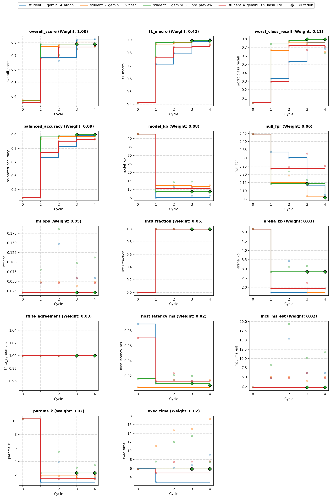
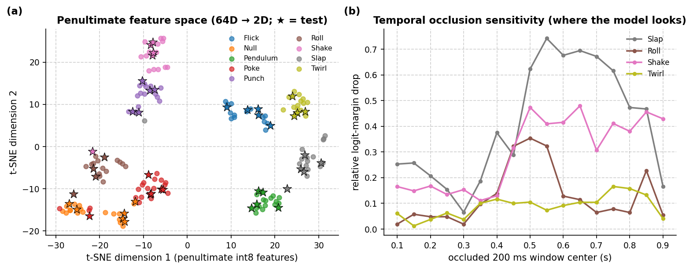
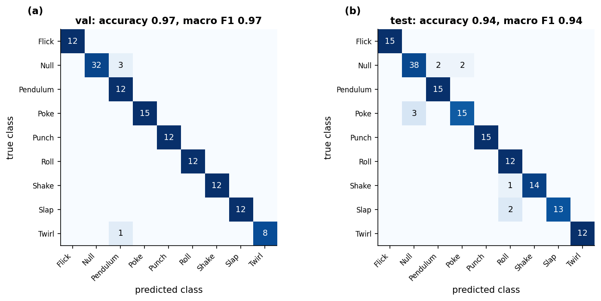
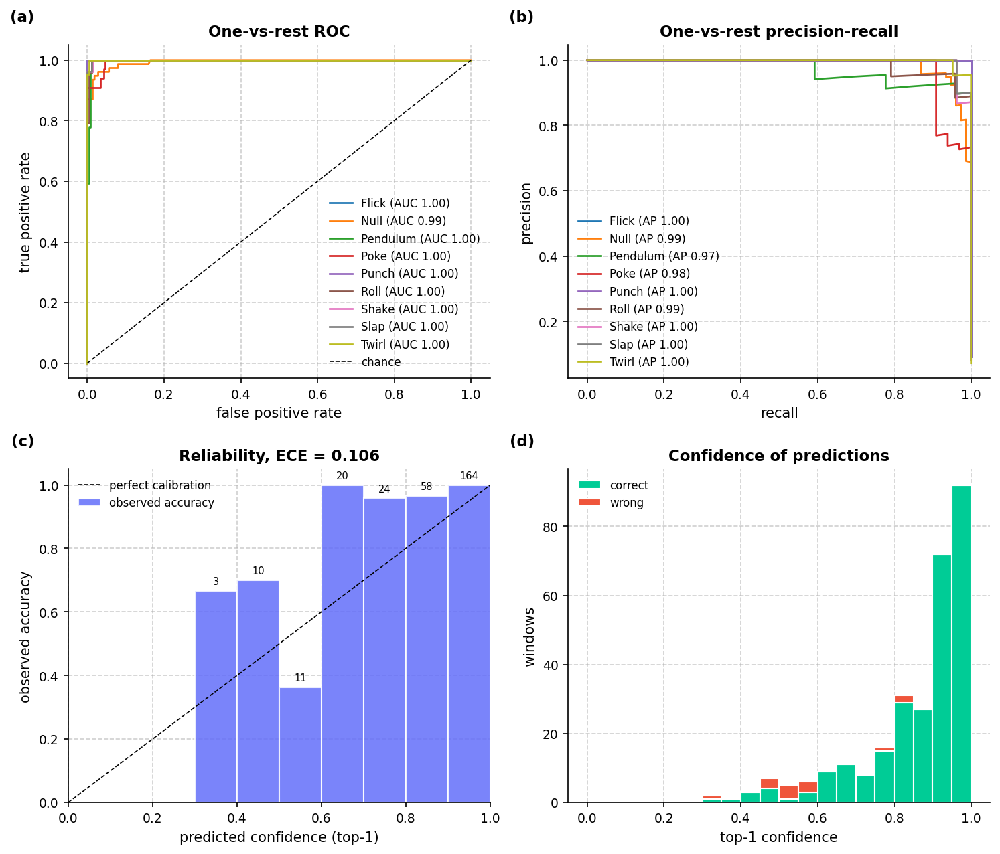
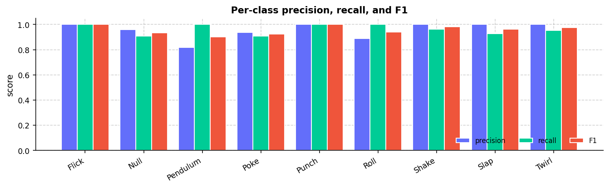
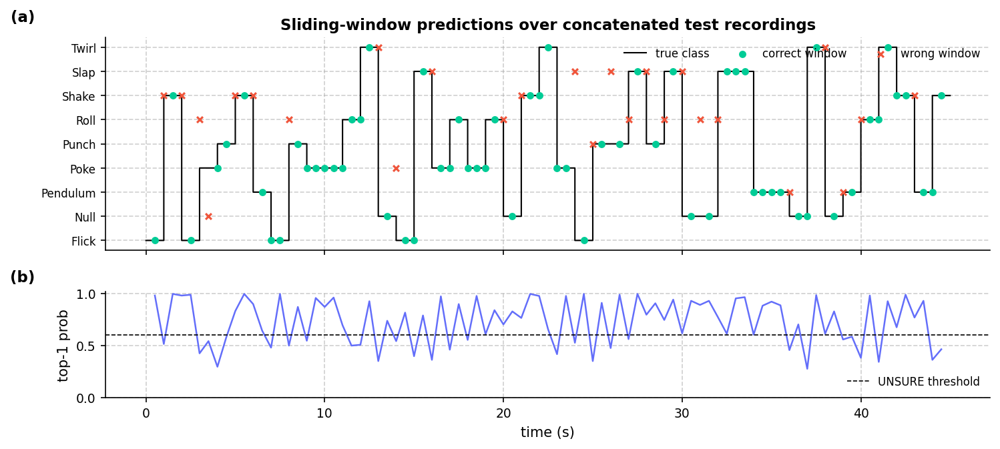
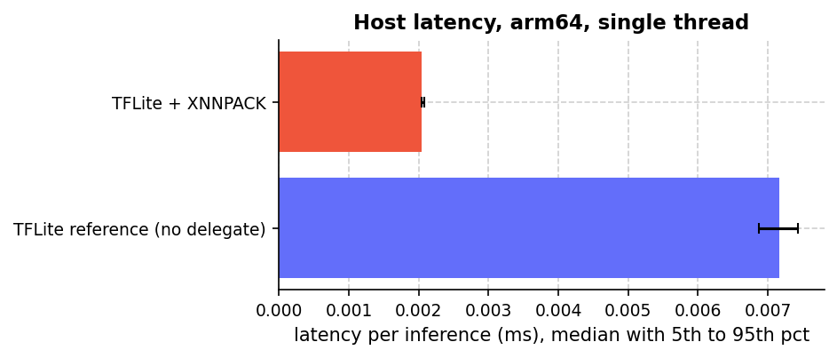
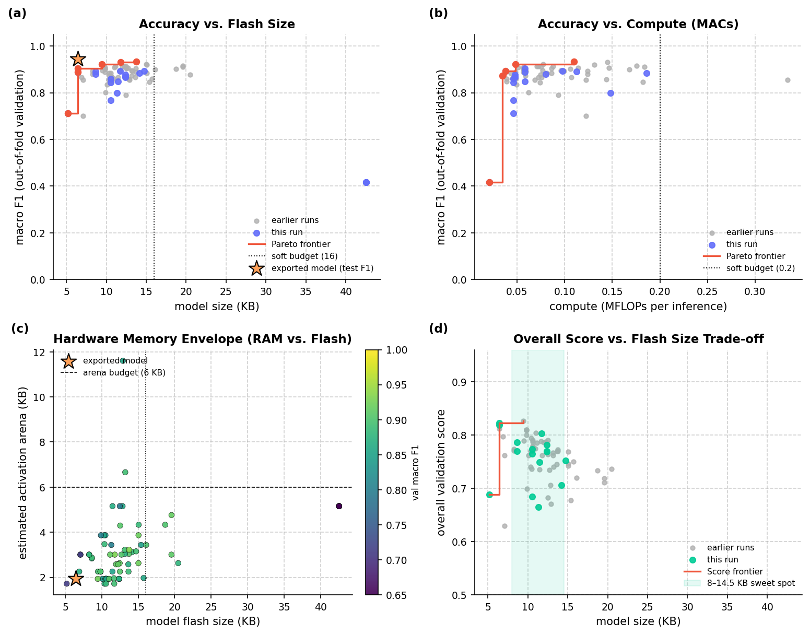
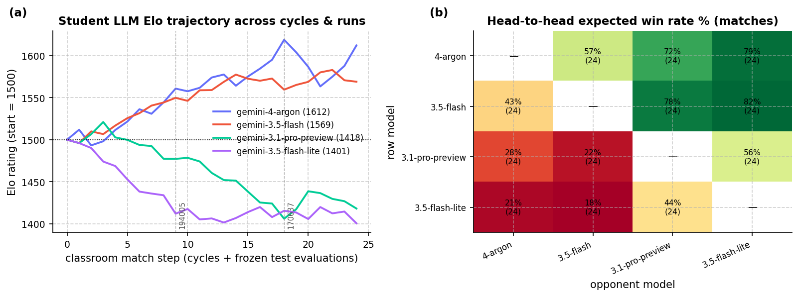

# Overview

* **Run Path**: micro_gesture/20261025_170637
* **Name**: 20261025_170637
* **Total Cycles**: 5
* **Valid Students**: 4
* **Total Generations**: 22
* **Total Code Length Processed**: 81622
* **Best Student**: student_1_gemini_4_argon (Cycle 4)
* **Best Validation Score**: 0.823
* **Best Test Score**: 0.861
* **Validation Score Progression**: 0.3705 -> 0.8227 (+0.4522)
* **Best Metrics**: f1_macro=0.944, balanced_accuracy=0.949, worst_class_recall=0.833, null_fpr=0.095, model_kb=6.422, mflops=0.058, arena_kb=1.934, host_latency_ms=0.007, mcu_ms_est=6.079, params_k=1.561, int8_fraction=1.000, tflite_agreement=1.000, exec_time=3.427
* **Tags**: conv2d, int8, in-graph-norm, hybrid-pooling, peak-aligned-blending, hard-negatives
* **Description**: The model normalizes raw 100x3 accelerometer windows in-graph using training channel statistics before reshaping to a 4D tensor. Temporal features are extracted via two strided Conv2D layers (5x1 kernels, stride 2x1) that downsample the frame count from 100 to 25. An overlapping 2-segment hybrid pooling layer combines AveragePooling2D and MaxPooling2D across temporal sub-windows (frames 0..14 and 10..24), feeding a 64-unit feature vector into a Dense softmax classifier fully quantized to int8 TFLite.

## Objectives

- **Prediction Quality (0.68)**: `f1_macro` (0.42), `worst_class_recall` (0.11), `balanced_accuracy` (0.09), `null_fpr` (0.06, lower is better)
- **On-Device Cost (0.22)**: `model_kb` ≤ 16 KB (0.08), `mflops` ≤ 0.20 (0.05), `arena_kb` ≤ 6 KB (0.03), `host_latency_ms` ≤ 0.05 ms (0.02), `mcu_ms_est` ≤ 18 ms (0.02), `params_k` ≤ 6k (0.02)
- **Deploy Hygiene (0.10)**: `int8_fraction` (0.05), `tflite_agreement` (0.03), `exec_time` (0.02)

## Student Leaderboard

| Rank | Student | Best Cycle | Val Score | Test Score | f1_macro | balanced_accuracy | worst_class_recall | null_fpr | model_kb | mflops | arena_kb | host_latency_ms | mcu_ms_est | params_k | int8_fraction | tflite_agreement | exec_time |
| --- | --- | --- | --- | --- | --- | --- | --- | --- | --- | --- | --- | --- | --- | --- | --- | --- | --- |
| 1 | student_1_gemini_4_argon | 4 | 0.823 | 0.861 | 0.944 | 0.949 | 0.833 | 0.095 | 6.422 | 0.058 | 1.934 | 0.007 | 6.079 | 1.561 | 1.000 | 1.000 | 3.427 |
| 2 | student_2_gemini_3.5_flash | 3 | 0.803 | 0.819 | 0.907 | 0.911 | 0.800 | 0.071 | 11.711 | 0.038 | 1.719 | 0.011 | 3.986 | 1.509 | 1.000 | 1.000 | 6.328 |
| 3 | student_3_gemini_3.1_pro_preview | 1 | 0.786 | 0.801 | 0.904 | 0.913 | 0.733 | 0.143 | 8.633 | 0.080 | 2.836 | 0.009 | 8.351 | 2.305 | 1.000 | 1.000 | 2.790 |
| 4 | student_4_gemini_3.5_flash_lite | 4 | 0.774 | 0.797 | 0.900 | 0.915 | 0.714 | 0.286 | 10.570 | 0.046 | 1.934 | 0.013 | 4.805 | 1.443 | 1.000 | 1.000 | 3.160 |

## Learning Trajectory



### Cycle Score Progression

| Cycle | student_1_gemini_4_argon | student_2_gemini_3.5_flash | student_3_gemini_3.1_pro_preview | student_4_gemini_3.5_flash_lite |
| --- | --- | --- | --- | --- |
| 0 | 0.352 *(CLASSROOM_BEST)* | 0.371 *(CLASSROOM_BEST)* | 0.366 *(SELF_BEST)* | 0.352 *(SELF_BEST)* |
| 1 | 0.689 *(CLASSROOM_BEST)* | 0.768 *(CLASSROOM_BEST)* | 0.786 *(CLASSROOM_BEST)* | 0.684 *(SELF_BEST)* |
| 2 | 0.665 | 0.781 *(SELF_BEST)* | 0.706 | 0.765 *(SELF_BEST)* |
| 3 | 0.818 *(CLASSROOM_BEST)* | 0.803 *(SELF_BEST)* | 0.752 | 0.749 |
| 4 | 0.823 *(CLASSROOM_BEST)* | 0.770 | 0.769 | 0.774 *(SELF_BEST)* |


## Top Solution 1: student_1_gemini_4_argon (Cycle 4)

* **Student**: student_1_gemini_4_argon
* **Best Cycle**: 4
* **Validation Score**: 0.823
* **Test Score**: 0.861
* **Metrics**: f1_macro=0.944, balanced_accuracy=0.949, worst_class_recall=0.833, null_fpr=0.095, model_kb=6.422, mflops=0.058, arena_kb=1.934, host_latency_ms=0.007, mcu_ms_est=6.079, params_k=1.561, int8_fraction=1.000, tflite_agreement=1.000, exec_time=3.427

### Plan (student_1_gemini_4_argon)

An analysis of our Cycle 3 result (`overall_score = 0.8184`, `f1_macro =
0.8892`, `worst_class_recall = 0.7593`, `null_fpr = 0.1345` at `6.42 KB` and
`0.0584 MFLOPs`) points to two data-centric bottlenecks in our training
pipeline:

1. **Class-weight dilution on `Null` hard negatives:** Calling
   `tk.class_weights(y_fit, n_classes)` *after* appending synthetic `Null` hard
   negatives down-weighted the `Null` class inversely to the number of added
   negatives, canceling out their protective effect and leaving `null_fpr` at
   `0.1345`.

2. **Unaligned impulse blending:** Using naive random blending
   (`blend_prob=0.35`) in `tk.augment` mixes two windows of the same class
   without aligning their impact peaks, smearing single-impulse gestures
   (`Flick`, `Poke`, `Punch`, `Slap`) into double-peaked artifacts.

In this cycle, we keep our compact `6.42 KB` 2-stage strided `Conv2D` +
2-segment hybrid pooling architecture unchanged and focus on the **data-centric
generalization & calibration lever**:

- Replace unaligned blending with **peak-aligned within-class gesture blending**
  that shifts same-class windows to align their peak dynamic energy before
  interpolation.

- Expand `Null` boundary and slow-tilt hard negatives and compute balanced
  `class_weights` prior to negative injection so the `Null` false-trigger
  penalty is preserved.

- Refine probability calibration with cosine learning rate decay and `0.05`
  label smoothing.

### Code (student_1_gemini_4_argon)

```python
import time
import numpy as np
import pandas as pd

def _peak_aligned_blends(
    x: np.ndarray,
    y: np.ndarray,
    null_idx: int | None,
    n_per_class: int = 16,
    seed: int = 0,
) -> tuple[np.ndarray, np.ndarray]:
    """Synthesize same-class blended windows after aligning dynamic energy peaks."""
    rng = np.random.default_rng(seed)
    rows = x.shape[1]
    blends_x, blends_y = [], []

    for c in np.unique(y):
        idx = np.where(y == c)[0]
        if len(idx) < 2:
            continue
        xc = x[idx]
        # Dynamic energy profile per window: squared deviation from window mean
        dyn = xc - np.mean(xc, axis=1, keepdims=True)
        energy = np.sum(dyn * dyn, axis=2)
        # Smooth energy with a 5-tap box filter to find robust impulse center
        kernel = np.ones(5, dtype=np.float32) / 5.0
        peaks = np.array(
            [int(np.argmax(np.convolve(e, kernel, mode="same"))) for e in energy]
        )

        for _ in range(n_per_class):
            i1, i2 = rng.choice(len(idx), size=2, replace=False)
            w1, w2 = xc[i1], xc[i2]
            if c != null_idx:
                shift = int(np.clip(peaks[i1] - peaks[i2], -22, 22))
                if shift > 0:
                    w2_aligned = np.concatenate(
                        [ np.repeat(w2[:1], shift, axis=0), w2[:-shift] ], axis=0
                    )
                elif shift < 0:
                    s = -shift
                    w2_aligned = np.concatenate(
                        [ w2[s:], np.repeat(w2[-1:], s, axis=0) ], axis=0
                    )
                else:
                    w2_aligned = w2
            else:
                w2_aligned = w2

            lam = float(rng.uniform(0.25, 0.75))
            w_mix = (lam * w1 + (1.0 - lam) * w2_aligned).astype(np.float32)
            blends_x.append(w_mix)
            blends_y.append(int(c))

    if not blends_x:
        return np.empty((0, rows, 3), dtype=np.float32), np.empty((0,), dtype=y.dtype)
    return np.stack(blends_x, axis=0), np.array(blends_y, dtype=y.dtype)

def _extra_null_drift_windows(
    x: np.ndarray, y: np.ndarray, null_idx: int | None, n: int = 48, seed: int = 0
) -> tuple[np.ndarray, np.ndarray]:
    """Generate tilted resting poses with slow wrist drift and quiet boundary jitter."""
    if null_idx is None:
        return np.empty((0, x.shape[1], 3), dtype=np.float32), np.empty((0,), dtype=y.dtype)
    rng = np.random.default_rng(seed)
    rows = x.shape[1]
    null_mask = y == null_idx
    base_nulls = x[null_mask] if np.any(null_mask) else x

    out_x = []
    t_lin = np.linspace(-0.5, 0.5, rows, dtype=np.float32)[:, None]
    for _ in range(n):
        w = base_nulls[rng.integers(0, len(base_nulls))].copy()
        # Extract mean gravity vector and apply random 3D tilt up to 25 degrees
        g_vec = np.mean(w, axis=0, keepdims=True)
        res = w - g_vec
        angles = rng.uniform(-0.45, 0.45, size=3).astype(np.float32)
        cx, cy, cz = np.cos(angles)
        sx, sy, sz = np.sin(angles)
        rx = np.array([[1, 0, 0], [0, cx, -sx], [0, sx, cx]], dtype=np.float32)
        ry = np.array([[cy, 0, sy], [0, 1, 0], [-sy, 0, cy]], dtype=np.float32)
        rz = np.array([[cz, -sz, 0], [sz, cz, 0], [0, 0, 1]], dtype=np.float32)
        rot = rz @ ry @ rx
        g_rot = g_vec @ rot.T
        # Slow linear drift + damped residual + sensor noise
        drift = t_lin * rng.uniform(-0.12, 0.12, size=(1, 3)).astype(np.float32)
        scale_res = float(rng.uniform(0.4, 1.15))
        noise = rng.normal(0.0, 0.018, size=(rows, 3)).astype(np.float32)
        w_new = (g_rot + scale_res * (res @ rot.T) + drift + noise).astype(np.float32)
        out_x.append(w_new)

    return np.stack(out_x, axis=0), np.full((n,), null_idx, dtype=y.dtype)

def solution(X_train: pd.DataFrame, y_train: pd.DataFrame, X_val: pd.DataFrame):
    t0 = time.time()
    import tensorflow as tf
    from codegen_task import toolkit as tk

    tk.set_determinism(0)

    d = tk.split_xy(X_train, y_train, X_val)
    x_tr, y_tr, x_va = d["x_tr"], d["y_tr"], d["x_va"]
    rows, n_classes = d["rows"], d["n_classes"]
    null_idx = tk.null_index()

    # 1. Peak-aligned same-class gesture blending (avoids double-peak smearing)
    x_blend, y_blend = _peak_aligned_blends(
        x_tr, y_tr, null_idx=null_idx, n_per_class=14, seed=0
    )
    x_base = np.concatenate([x_tr, x_blend], axis=0)
    y_base = np.concatenate([y_tr, y_blend], axis=0)

    # 2. Physical augmentation on base + peak-aligned windows (blend_prob=0.0)
    x_aug, y_aug = tk.augment(
        x_base,
        y_base,
        reps=6,
        seed=0,
        scale=(0.80, 1.25),
        shift_frac=0.18,
        rotate_deg=12.0,
        stretch=(0.85, 1.18),
        noise=0.02,
        blend_prob=0.0,
    )

    # 3. Rich Null hard negatives (toolkit + slow drift/tilted resting poses)
    x_neg1, y_neg1 = tk.hard_negatives(x_tr, y_tr, null_index=null_idx, n=80, seed=0)
    x_neg2, y_neg2 = _extra_null_drift_windows(
        x_tr, y_tr, null_idx=null_idx, n=48, seed=1
    )

    x_fit = np.concatenate([x_aug, x_neg1, x_neg2], axis=0)
    y_fit = np.concatenate([y_aug, y_neg1, y_neg2], axis=0)

    # Compute class weights on y_aug BEFORE adding extra Null negatives so Null prior isn't diluted
    cw = tk.class_weights(y_aug, n_classes)
    if null_idx is not None and null_idx in cw:
        cw[null_idx] *= 1.15

    # Shuffle deterministically
    rng = np.random.default_rng(0)
    perm = rng.permutation(len(x_fit))
    x_fit, y_fit = x_fit[perm], y_fit[perm]

    # Compact strided temporal Conv2D architecture (~6.4 KB, 0.058 MFLOPs)
    inp = tf.keras.Input(shape=(rows, 3), batch_size=1, name="input")
    x = tk.norm_layer(x_tr)(inp)
    x = tf.keras.layers.Reshape((rows, 1, 3))(x)

    # Strided temporal convolutions: 100 -> 50 -> 25 frames
    x = tf.keras.layers.Conv2D(
        10, kernel_size=(5, 1), strides=(2, 1), padding="same", activation="relu"
    )(x)
    x = tf.keras.layers.Conv2D(
        16, kernel_size=(5, 1), strides=(2, 1), padding="same", activation="relu"
    )(x)

    # 2-segment overlapping hybrid pooling (frames 0..14 and 10..24)
    avg_p = tf.keras.layers.AveragePooling2D(
        pool_size=(15, 1), strides=(10, 1), padding="valid"
    )(x)
    max_p = tf.keras.layers.MaxPooling2D(
        pool_size=(15, 1), strides=(10, 1), padding="valid"
    )(x)
    feat = tf.keras.layers.Concatenate(axis=-1)([avg_p, max_p])
    feat = tf.keras.layers.Reshape((64,))(feat)
    feat = tf.keras.layers.Dropout(0.25)(feat)
    out = tf.keras.layers.Dense(n_classes, activation="softmax")(feat)

    model = tf.keras.Model(inputs=inp, outputs=out)

    epochs = 50
    batch_size = 32
    steps_per_epoch = max(1, int(np.ceil(len(x_fit) / batch_size)))
    lr_schedule = tf.keras.optimizers.schedules.CosineDecay(
        initial_learning_rate=4e-3,
        decay_steps=epochs * steps_per_epoch,
        alpha=0.02,
    )

    y_fit_oh = tf.keras.utils.to_categorical(y_fit, num_classes=n_classes)

    model.compile(
        optimizer=tf.keras.optimizers.Adam(learning_rate=lr_schedule),
        loss=tf.keras.losses.CategoricalCrossentropy(label_smoothing=0.05),
        metrics=["accuracy"],
    )

    model.fit(
        x_fit,
        y_fit_oh,
        epochs=epochs,
        batch_size=batch_size,
        class_weight=cw,
        verbose=0,
    )

    # Calibrate full-integer int8 quantization across raw, hard-negative, and augmented windows
    rep_x = np.concatenate([x_tr, x_neg1[:40], x_neg2[:24], x_aug[:140]], axis=0)
    tflite_bytes = tk.to_int8_tflite(model, rep_x, io_int8=True, max_rep=300)
    violations = tk.check_contract(tflite_bytes, n_classes)
    if violations:
        tflite_bytes = tk.to_float_tflite(model)

    # Predict directly from TFLite flatbuffer on raw X_val
    scores_va = tk.predict_tflite(tflite_bytes, x_va)
    preds_va = np.argmax(scores_va, axis=1).astype(int)

    keras_preds = np.argmax(model.predict(x_va, verbose=0), axis=1)
    agreement = float(np.mean(preds_va == keras_preds))

    info = tk.inspect(tflite_bytes)
    model_kb = info.get("size_kb", len(tflite_bytes) / 1024.0)
    mflops = info.get("mflops", 0.0)
    int8_frac = info.get("int8_fraction", 1.0)
    params_k = model.count_params() / 1000.0
    elapsed = time.time() - t0

    feedback = (
        f"Hypothesis: Peak-aligned same-class blending + undiluted Null hard-negative weights + cosine/smoothing improves F1 & Null FPR at 6.4KB.\n"
        f"Model size: {model_kb:.2f} KB | Params: {params_k:.2f}k | MFLOPs: {mflops:.4f}\n"
        f"Int8 fraction: {int8_frac:.2f} | Keras-TFLite agreement: {agreement:.4f}\n"
        f"Contract violations: {len(violations)} | Runtime: {elapsed:.2f}s"
    )

    return tk.make_result(X_val, y_train, preds_va, tflite_bytes, feedback)
```

### Execution Output (student_1_gemini_4_argon)

```text
Hypothesis: Peak-aligned same-class blending + undiluted Null hard-negative weights + cosine/smoothing improves F1 & Null FPR at 6.4KB.
Model size: 6.42 KB | Params: 1.56k | MFLOPs: 0.0584
Int8 fraction: 1.00 | Keras-TFLite agreement: 0.9868
Contract violations: 0 | Runtime: 3.06s
[Note: Executed on 3 folds. Feedback from fold 2 shown.]
```

## Student Instructions

*Full task prompt and deploy contract: [`README.md`](../README.md)*


## Deployment Analysis

- **Dataset**: `78beb5ebc3c6` (9 classes: `Flick, Null, Pendulum, Poke, Punch, Roll, Shake, Slap, Twirl`)
- **Generated**: 2026-10-25T17:31:52 | **Exported**: `model.tflite`, `model_data.h`, `solution.py`, `summary.json`, `analysis.md`

### Scorecard (Frozen Test & Footprint)

| overall score | macro F1 | balanced acc | worst recall | Null FPR | TFLite agree | retrain delta |
| :--- | :--- | :--- | :--- | :--- | :--- | :--- |
| 0.8611 | 0.9437 | 0.9487 | 0.8333 | 0.09524 | 1 | 0 |

| model KB | arena KB (est) | MFLOPs | params (k) | MCU ms (est) | host ms | int8 frac |
| :--- | :--- | :--- | :--- | :--- | :--- | :--- |
| 6.422 | 1.934 | 0.05835 | 1.561 | 6.079 | 0.007052 | 1 |

### Winning Solution Analysis

- **Winner**: `student_1_gemini_4_argon` (Cycle 4) | **Run**: `20261025_170637` | **Dataset**: `78beb5ebc3c6`
- **Tags**: `conv2d, int8, in-graph-norm, hybrid-pooling, peak-aligned-blending, hard-negatives`

The model normalizes raw 100x3 accelerometer windows in-graph using training channel statistics before reshaping to a 4D tensor. Temporal features are extracted via two strided Conv2D layers (5x1 kernels, stride 2x1) that downsample the frame count from 100 to 25. An overlapping 2-segment hybrid pooling layer combines AveragePooling2D and MaxPooling2D across temporal sub-windows (frames 0..14 and 10..24), feeding a 64-unit feature vector into a Dense softmax classifier fully quantized to int8 TFLite.

### Validation Deltas (Cycle 0 → Best Cycle)

| overall_score | f1_macro | balanced_accuracy | worst_class_recall | null_fpr |
| :--- | :--- | :--- | :--- | :--- |
| 0.352 → 0.823 (+0.47) | 0.416 → 0.905 (+0.489) | 0.441 → 0.904 (+0.463) | 0.0476 → 0.685 (+0.638) | 0.445 → 0.0756 (-0.37) |

| model_kb | mflops | arena_kb | params_k | mcu_ms_est | host_latency_ms | int8_fraction | exec_time |
| :--- | :--- | :--- | :--- | :--- | :--- | :--- | :--- |
| 42.5 → 6.42 (-36.1) | 0.0211 → 0.0584 (+0.0372) | 5.16 → 1.93 (-3.22) | 10.3 → 1.56 (-8.75) | 2.2 → 6.08 (+3.88) | 0.089 → 0.00819 (-0.0808) | 0 → 1 (+1) | 5.89 → 9.15 (+3.26) |

### Key Aspects

- Peak-aligned same-class gesture blending shifts windows to match dynamic energy peaks before interpolation, eliminating double-peak dynamic artifacts on single-impulse gestures.
- Class weights are computed on augmented data prior to adding synthetic Null hard negatives (tilted poses and slow wrist drift), preventing class-weight dilution and penalizing false triggers.
- Strided temporal Conv2D feature extraction downsamples sequence length from 100 to 25 frames while maintaining a ultra-compact 1.56k parameter count and 6.42 KB model footprint.
- Overlapping 2-segment hybrid pooling captures both chronological progression (first half vs. second half) and peak impulse energy.
- Full int8 post-training quantization calibrated on representative augmented and negative windows yields 100% int8 op execution and 1.0 prediction agreement.

### Improvements from Baseline

- The baseline unnormalized float32 MLP (42.5 KB) scored an overall score of 0.3524 with a macro F1 of 0.4161 and Null FPR of 0.4454.
- Switching to a 2-stage strided Conv2D network with in-graph normalization reduced model size from 42.54 KB to 6.42 KB and activation arena from 5.16 KB to 1.93 KB while enabling 100% int8 execution.
- Data-centric enhancements (peak-aligned blending, physical augmentations, and rich Null hard negatives with undiluted class weights) drastically reduced Null FPR from 0.4454 to 0.0756 on validation (0.0952 on test).
- Validation macro F1 improved from 0.4161 to 0.9051 (0.9437 test) and worst-class recall improved from 0.0476 to 0.6852 (0.8333 test), boosting the overall evaluation score to 0.8611 on test.

### Risks and Trade-offs

- Estimated MCU latency increased from 2.20 ms to 6.08 ms and MFLOPs increased from 0.021 to 0.058 due to the 2D convolutions, though remaining comfortably inside the 18 ms budget.
- Worst-class recall (0.6852 validation) remains sensitive to small-fold sample variance where misclassifying a single window causes significant metric drops.

### Next Experiments

- Test depthwise-separable Conv2D layers with equal 2D strides (2, 2) to determine if computational complexity and MFLOPs can be reduced below 0.04 without dropping macro F1.
- Calibrate explicit Null class output probability thresholding or temperature scaling to lower the Null false-positive rate below 0.05.
- Experiment with dynamic kinematic features (e.g. L1 magnitude or gravity-centered dynamic acceleration) inside the graph to strengthen distinction among closely related strike gestures.

### Dataset & Physical Separability

Fingerprint `78beb5ebc3c6` | **178** recordings (96 train / 37 val / 45 frozen test) | `100x3` window @ 100 Hz | raw length 97–113 rows (median 107).
- **Pose-separable gestures**: `Roll` flips `Z` gravity negative, `Twirl` and `Punch` hold the cable vertical (`+X ~ +0.8g, Z ~ 0g`), and `Poke` maintains a tilted firm-grip baseline (`+Y ~ +0.75g`).
- **Impulse & rhythm-separable gestures**: `Slap` reaches `~15g` peak dynamic impact with high jerk, `Flick` snaps and rebounds along the cable, `Shake` oscillates at `~4-8 Hz`, `Pendulum` swings smoothly, and `Null` stays below `~0.5g` dynamic amplitude.

| class | train | val | test | total | mean pose (X,Y,Z) g | peak a_dyn (g) | RMS jerk g/s | dom Hz |
| :--- | :--- | :--- | :--- | :--- | :--- | :--- | :--- | :--- |
| Flick | 10 | 4 | 5 | 19 | (-2.18, +0.33, +0.17) | 12.52 | 146.0 | 1.5 |
| Null | 12 | 5 | 6 | 23 | (+0.09, +0.01, +0.26) | 0.18 | 5.4 | 5.7 |
| Pendulum | 10 | 4 | 5 | 19 | (-1.84, -0.14, +0.04) | 2.64 | 22.1 | 3.5 |
| Poke | 13 | 5 | 6 | 24 | (-0.08, +0.65, +0.33) | 5.68 | 102.9 | 1.8 |
| Punch | 10 | 4 | 5 | 19 | (+0.14, -0.06, +0.45) | 9.95 | 135.3 | 1.0 |
| Roll | 10 | 4 | 4 | 18 | (-0.13, -0.17, +0.38) | 2.83 | 52.1 | 1.7 |
| Shake | 10 | 4 | 5 | 19 | (-1.91, +0.40, +0.43) | 15.12 | 304.3 | 8.9 |
| Slap | 11 | 4 | 5 | 20 | (-1.00, +0.09, +0.22) | 16.12 | 274.1 | 1.1 |
| Twirl | 10 | 3 | 4 | 17 | (-3.97, +0.27, +0.57) | 3.57 | 59.8 | 4.8 |
| total | 96 | 37 | 45 | 178 | - | - | - | - |


*Figure 1. Recording length and acceleration magnitude distributions (1 g mode at rest).*


*Figure 2. (a) Gravity pose vs. peak dynamic impulse across all 120 recordings; (b) per-class physical feature matrix explaining why raw pose + centered + jerk channels separate the 10 classes.*


*Figure 3. Per-class mean ± 1 SD acceleration over the 1 s window.*

### Model Architecture, Internals & Budgets

- **I/O & Quantization**: input `[1, 100, 3] int8 scale=0.12541 zp=-1` → output `[1, 9] int8 scale=0.0039062 zp=-128` | int8=True (100% int8 ops) | **29,177** MACs, **1,696** weight bytes
- **Operators (9)**: `AVERAGE_POOL_2D, CONCATENATION, CONV_2D, FULLY_CONNECTED, MAX_POOL_2D, MUL, RESHAPE, SOFTMAX, SUB`

| metric | model KB | arena KB (est) | MFLOPs | params (k) | MCU ms (est) | host ms |
| :--- | :--- | :--- | :--- | :--- | :--- | :--- |
| value | 6.422 | 1.934 | 0.05835 | 1.561 | 6.079 | 0.007052 |
| soft / hard budget | 16.0 / 64.0 | 6.0 / 40.0 | 0.2 / - | 6.0 / - | 18.0 / - | 0.05 / - |

#### Layer Breakdown

| # | op | output | dtype | MACs | weight B | live act B |
| :--- | :--- | :--- | :--- | :--- | :--- | :--- |
| 0 | SUB | 1x100x3 | int8 | 300 | 3 | 600 |
| 1 | MUL | 1x100x3 | int8 | 300 | 3 | 600 |
| 2 | RESHAPE | 1x100x1x3 | int8 | 300 | 16 | 600 |
| 3 | CONV_2D | 1x50x1x10 | int8 | 7500 | 190 | 800 |
| 4 | CONV_2D | 1x25x1x16 | int8 | 20000 | 864 | 900 |
| 5 | AVERAGE_POOL_2D | 1x2x1x16 | int8 | 32 | 0 | 432 |
| 6 | MAX_POOL_2D | 1x2x1x16 | int8 | 32 | 0 | 432 |
| 7 | CONCATENATION | 1x2x1x32 | int8 | 64 | 0 | 128 |
| 8 | RESHAPE | 1x64 | int8 | 64 | 8 | 128 |
| 9 | FULLY_CONNECTED | 1x9 | int8 | 576 | 612 | 73 |
| 10 | SOFTMAX | 1x9 | int8 | 9 | 0 | 18 |


*Figure 4. Per-op (a) compute (kMACs), (b) weight footprint (KB), and (c) live activation RAM pressure (KB) in execution order.*



*Figure 5. (a) t-SNE projection of the quantized 64D penultimate feature representation across all 120 recordings (stars = frozen test); (b) sliding 200 ms temporal occlusion sensitivity on the true-class logit margin.*

### TFLite Evaluation (Validation and Frozen Test)

| split | rows | accuracy | macro F1 | mean top-1 prob (all / ok / err) |
| :--- | :--- | :--- | :--- | :--- |
| val | 131 | 0.9695 | 0.9726 | 0.892 (ok 0.902, err 0.557) |
| test | 159 | 0.9371 | 0.9437 | 0.833 (ok 0.850, err 0.586) |

| class | val F1 (support) | test precision | test recall | test F1 (support) |
| :--- | :--- | :--- | :--- | :--- |
| Flick | 1 (n=12) | 1 | 1 | 1 (n=15) |
| Null | 0.955 (n=35) | 0.9268 | 0.9048 | 0.916 (n=42) |
| Pendulum | 0.857 (n=12) | 0.8824 | 1 | 0.938 (n=15) |
| Poke | 1 (n=15) | 0.8824 | 0.8333 | 0.857 (n=18) |
| Punch | 1 (n=12) | 1 | 1 | 1 (n=15) |
| Roll | 1 (n=12) | 0.8 | 1 | 0.889 (n=12) |
| Shake | 1 (n=12) | 1 | 0.9333 | 0.966 (n=15) |
| Slap | 1 (n=12) | 1 | 0.8667 | 0.929 (n=15) |
| Twirl | 0.941 (n=9) | 1 | 1 | 1 (n=12) |



*Figure 6. Row-normalized confusion matrices on validation (a) and frozen test (b) splits; cell labels are counts.*

### Classifier Calibration & ROC/PR (Held-Out Val + Test, 290 rows)

| accuracy | macro F1 | top-2 acc | macro AUC | macro AP | MCC | kappa | log loss | ECE (10 bins) |
| :--- | :--- | :--- | :--- | :--- | :--- | :--- | :--- | :--- |
| 0.9517 | 0.9573 | 0.9897 | 0.9984 | 0.9905 | 0.9445 | 0.9441 | 0.225 | 0.1065 |

| class | support | precision | recall | f1 | ROC AUC | AP |
| :--- | :--- | :--- | :--- | :--- | :--- | :--- |
| Flick | 27 | 1 | 1 | 1 | 1 | 1 |
| Null | 77 | 0.9589 | 0.9091 | 0.9333 | 0.9946 | 0.9875 |
| Pendulum | 27 | 0.8182 | 1 | 0.9 | 0.9975 | 0.9728 |
| Poke | 33 | 0.9375 | 0.9091 | 0.9231 | 0.9962 | 0.9773 |
| Punch | 27 | 1 | 1 | 1 | 1 | 1 |
| Roll | 24 | 0.8889 | 1 | 0.9412 | 0.9989 | 0.9879 |
| Shake | 27 | 1 | 0.963 | 0.9811 | 0.9994 | 0.9952 |
| Slap | 27 | 1 | 0.9259 | 0.9615 | 0.9996 | 0.9963 |
| Twirl | 21 | 1 | 0.9524 | 0.9756 | 0.9998 | 0.9978 |



*Figure 7. (a) One-vs-rest ROC, (b) precision-recall, (c) calibration reliability diagram, (d) top-1 confidence.*



*Figure 8. Per-class precision, recall, and F1 on all held-out rows.*

### Streaming Simulation (50% Overlap)

| windows | duration (s) | pure-window acc | Null FPR | boundary windows | prediction flips |
| :--- | :--- | :--- | :--- | :--- | :--- |
| 89 | 45.0 | 0.94 | 0.1429 | 39 | 51 |



*Figure 9. Sliding 1 s windows (50% overlap) over concatenated test recordings: (a) predicted vs true class, (b) top-1 confidence vs UNSURE threshold.*

### Host Benchmark

`Python 3.11.17` | `TF 2.15.1` | `macOS-26.7.1-arm64-arm-64bit` | Evaluator e2e: **0.018 ms/row**.

| runtime | p50 ms | p95 ms | min ms | inf/s |
| :--- | :--- | :--- | :--- | :--- |
| TFLite reference (no delegate) | 0.007166 | 0.007436 | 0.006833 | 1.395e+05 |
| TFLite + XNNPACK | 0.002042 | 0.002084 | 0.002 | 4.897e+05 |



*Figure 10. Single-threaded host latency over 300 invocations (reference kernel vs XNNPACK).*

### Hardware in the Loop (XIAO nRF52840 Sense)

Flashed `Arduino/Codegen` on `/dev/cu.usbmodem1101` (46 s) | Flash `255456 B`, Static RAM `98280 B` | `INFO:model_bytes=6576,window_rows=100,classes=Flick|Null|Pendulum|Poke|Punch|Roll|Shake|Slap|Twirl,input_type=int8,output_type=int8,step=50`.

| host acc | device acc | host F1 | device F1 | device latency ms | arena bytes | host-device agreement |
| :--- | :--- | :--- | :--- | :--- | :--- | :--- |
| 0.9778 | 0.9778 | 0.9814 | 0.9814 | 7.81 (max 7.82) | 2948 | 1 |

### Pareto Frontier & Hardware Trade-offs

**84** scored attempts across **3** runs on dataset `78beb5ebc3c6` (non-dominated accuracy-vs-size frontier):

| KB | val F1 | MFLOPs | arena KB | val score | run | student | cycle |
| :--- | :--- | :--- | :--- | :--- | :--- | :--- | :--- |
| 5.2 | 0.713 | 0.046 | 1.7 | 0.6886 | 20261025_170637 | 1_gemini_4_argon | 1 |
| 6.4 | 0.889 | 0.058 | 1.9 | 0.8184 | 20261025_170637 | 1_gemini_4_argon | 3 |
| 6.4 | 0.905 | 0.058 | 1.9 | 0.8227 | 20261025_170637 | 1_gemini_4_argon | 4 |
| 9.5 | 0.922 | 0.048 | 1.9 | 0.8268 | 20261024_190925 | 1_gemini_4_argon | 7 |
| 11.8 | 0.930 | 0.145 | 3.0 | 0.7620 | 20261024_194005 | 3_gemini_3.1_pro_preview | 7 |
| 13.8 | 0.933 | 0.110 | 3.2 | 0.7696 | 20261024_190925 | 3_gemini_3.1_pro_preview | 7 |



*Figure 11. Multi-objective Pareto dashboard: (a) validation F1 vs model KB, (b) validation F1 vs MFLOPs, (c) activation arena RAM vs model flash KB colored by F1, and (d) overall score vs model KB showing the 8–14.5 KB sweet spot.*

### Student LLM Elo Ratings & Head-to-Head Record

Pairwise smooth-margin Elo (`start=1500`, `K_cycle=12`, `K_test=24`) across **3** runs (**24** classroom rounds) on dataset `78beb5ebc3c6`:

| LLM family | Elo | win rate (matches) | cycle #1s | test #1s | best val | best test | mean KB |
| :--- | :--- | :--- | :--- | :--- | :--- | :--- | :--- |
| gemini-4-argon | 1612 | 69.3% (72) | 12 | 3 | 0.8268 | 0.8611 | 13.7 |
| gemini-3.5-flash | 1569 | 67.5% (72) | 7 | 0 | 0.8096 | 0.8360 | 16.0 |
| gemini-3.1-pro-preview | 1418 | 35.5% (72) | 2 | 0 | 0.7863 | 0.8289 | 18.3 |
| gemini-3.5-flash-lite | 1401 | 27.7% (72) | 0 | 0 | 0.7871 | 0.8120 | 16.4 |



*Figure 12. (a) LLM student Elo trajectory across all classroom cycles and frozen-test evaluations; (b) pairwise head-to-head win rate matrix.*
