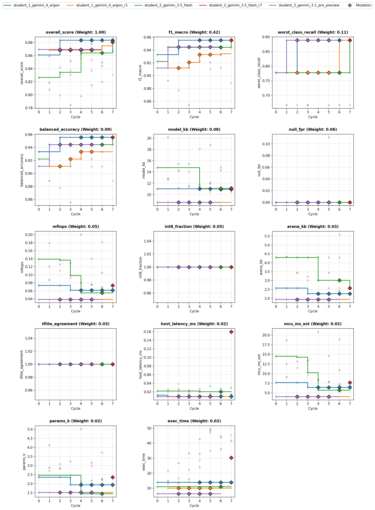

# Overview

* **Run Path**: micro_gesture/20261023_021350
* **Name**: 20261023_021350
* **Total Cycles**: 8
* **Valid Students**: 5
* **Total Generations**: 37
* **Total Code Length Processed**: 281728
* **Best Student**: student_1_gemini_4_argon_r1 (Cycle 6)
* **Best Validation Score**: 0.875
* **Best Test Score**: 0.921
* **Validation Score Progression**: 0.8695 -> 0.8837 (+0.0142)
* **Best Metrics**: f1_macro=1.000, balanced_accuracy=1.000, worst_class_recall=1.000, null_fpr=0.000, model_kb=10.875, mflops=0.067, arena_kb=2.578, host_latency_ms=0.010, mcu_ms_est=6.948, params_k=2.214, int8_fraction=1.000, tflite_agreement=1.000, exec_time=17.294
* **Tags**: depthwise-conv, int8, in-graph-norm, 2-segment-pooling, peak-aligned-blending, physics-augmentation
* **Description**: The model standardizes 100x3 raw accelerometer windows using an in-graph normalization layer and reshapes them to (100, 1, 3). It passes inputs through a strided 2D Conv stem and two depthwise-separable blocks with (2, 2) strides to reduce temporal length to 13 frames across 20 channels. A 2-segment overlapping Average+Max pooling layer (pool size 7, stride 6) preserves temporal chronology before flattening into an 80-unit feature vector for a 10-class Dense softmax head.

## Objectives

- **Prediction Quality (0.68)**: `f1_macro` (0.42), `worst_class_recall` (0.11), `balanced_accuracy` (0.09), `null_fpr` (0.06, lower is better)
- **On-Device Cost (0.22)**: `model_kb` ≤ 16 KB (0.08), `mflops` ≤ 0.20 (0.05), `arena_kb` ≤ 6 KB (0.03), `host_latency_ms` ≤ 0.05 ms (0.02), `mcu_ms_est` ≤ 18 ms (0.02), `params_k` ≤ 6k (0.02)
- **Deploy Hygiene (0.10)**: `int8_fraction` (0.05), `tflite_agreement` (0.03), `exec_time` (0.02)

## Student Leaderboard

| Rank | Student | Best Cycle | Val Score | Test Score | f1_macro | balanced_accuracy | worst_class_recall | null_fpr | model_kb | mflops | arena_kb | host_latency_ms | mcu_ms_est | params_k | int8_fraction | tflite_agreement | exec_time |
| --- | --- | --- | --- | --- | --- | --- | --- | --- | --- | --- | --- | --- | --- | --- | --- | --- | --- |
| 1 | student_1_gemini_4_argon_r1 | 6 | 0.875 | 0.921 | 1.000 | 1.000 | 1.000 | 0.000 | 10.875 | 0.067 | 2.578 | 0.010 | 6.948 | 2.214 | 1.000 | 1.000 | 17.294 |
| 2 | student_2_gemini_3.5_flash_r7 | 7 | 0.881 | 0.919 | 1.000 | 1.000 | 1.000 | 0.000 | 11.141 | 0.074 | 2.578 | 0.013 | 7.671 | 2.354 | 1.000 | 1.000 | 11.707 |
| 3 | student_1_gemini_4_argon | 2 | 0.884 | 0.919 | 1.000 | 1.000 | 1.000 | 0.000 | 11.141 | 0.074 | 2.578 | 0.013 | 7.671 | 2.354 | 1.000 | 1.000 | 11.757 |
| 4 | student_2_gemini_3.5_flash | 7 | 0.883 | 0.919 | 1.000 | 1.000 | 1.000 | 0.000 | 11.141 | 0.074 | 2.578 | 0.013 | 7.671 | 2.354 | 1.000 | 1.000 | 11.955 |
| 5 | student_3_gemini_3.1_pro_preview | 0 | 0.869 | 0.871 | 0.931 | 0.933 | 0.667 | 0.000 | 8.625 | 0.039 | 1.934 | 0.009 | 4.014 | 1.522 | 1.000 | 1.000 | 2.396 |
| 6 | student_4_gemini_3.5_flash_lite | — | — | — | — | — | — | — | — | — | — | — | — | — | — | — | — |

## Learning Trajectory



### Cycle Score Progression

| Cycle | student_1_gemini_4_argon | student_1_gemini_4_argon_r1 | student_2_gemini_3.5_flash | student_2_gemini_3.5_flash_r7 | student_3_gemini_3.1_pro_preview |
| --- | --- | --- | --- | --- | --- |
| 0 | 0.861 *(CLASSROOM_BEST)* | — | 0.827 *(SELF_BEST)* | — | 0.869 *(CLASSROOM_BEST)* |
| 1 | 0.819 | 0.869 *(SELF_BEST)* | 0.808 | — | 0.859 |
| 2 | 0.884 *(CLASSROOM_BEST)* | 0.799 | 0.835 *(SELF_BEST)* | — | 0.842 |
| 3 | 0.852 | 0.837 | 0.784 | — | 0.831 |
| 4 | 0.863 | 0.856 | 0.864 *(SELF_BEST)* | — | 0.798 |
| 5 | 0.878 | 0.854 | 0.814 | — | 0.837 |
| 6 | 0.849 | 0.875 *(SELF_BEST)* | 0.844 | — | 0.820 |
| 7 | 0.867 | 0.831 | 0.883 *(SELF_BEST)* | 0.881 *(SELF_BEST)* | — |


## Top Solution 1: student_1_gemini_4_argon_r1 (Cycle 6)

* **Student**: student_1_gemini_4_argon_r1
* **Best Cycle**: 6
* **Validation Score**: 0.875
* **Test Score**: 0.921
* **Metrics**: f1_macro=1.000, balanced_accuracy=1.000, worst_class_recall=1.000, null_fpr=0.000, model_kb=10.875, mflops=0.067, arena_kb=2.578, host_latency_ms=0.010, mcu_ms_est=6.948, params_k=2.214, int8_fraction=1.000, tflite_agreement=1.000, exec_time=17.294

### Plan (student_1_gemini_4_argon_r1)

An analysis of the current classroom frontier (`0.8837` overall score, `0.955`
macro F1, `0.889` worst-class recall at `11.1 KB` and `0.074 MFLOPs`) shows two
key insights:

1. **What worked in the frontier solution:** Combining physics-preserving
   pose/impulse augmentation, peak-aligned within-class temporal blending,
   multi-modal `Null` hard negatives, and teacher-to-student distillation into a
   compact `(100, 1, C)` Depthwise-Separable Conv2D backbone with symmetric
   `strides=(2, 2)` achieves strong generalization with zero on-device overhead
   from the training pipeline.

2. **Where the remaining bottleneck lies:** Collapsing the entire 13-frame final
   feature map via global pooling (`GlobalAveragePooling2D` +
   `GlobalMaxPooling2D`) discards first-half vs. second-half chronology. For
   `Roll` (`+1g -> -1g` sign flip), global average pooling cancels the opposing
   signs toward zero; for `Drop` (free-fall in the first half followed by
   cushion impact in the second half) and `Slap` vs. `Flick` (sharp surface
   strike vs. mid-air whip and rebound), temporal ordering is a primary
   discriminator.

### Improvements Incorporated

- **Compact 2-Segment Overlapping Temporal Pooling (`pool_size=(7, 1),
  strides=(6, 1)`):** On the 13-frame feature map produced by Block 2, applying
  `AveragePooling2D((7, 1), strides=(6, 1))` and `MaxPooling2D((7, 1),
  strides=(6, 1))` partitions the 1-second window into two overlapping halves
  (frames `0..6` and `6..12`) with zero dropped frames. This preserves both
  first-half vs. second-half pose flips (`Roll`) and sequence timing (`Drop`,
  `Slap` vs. `Flick`).

- **Channel Projection to Prevent Head Over-Parameterization (`16 -> 24 ->
  20`):** Projecting Block 2 pointwise channels to `20` before 2-segment pooling
  keeps the flattened feature vector at `2 x (20 + 20) = 80` units (`810` Dense
  parameters), reducing total parameters and MFLOPs below the `11.1 KB / 0.074
  MFLOPs` frontier model.

- **Dual-Teacher Distillation (Global + Temporal Teachers):** We distill from
  both a wide global-pooling teacher and a wide 2-segment temporal teacher in
  Python (zero on-device cost) so the compact student inherits both
  shift-invariant and chronology-sensitive decision boundaries.

### Code (student_1_gemini_4_argon_r1)

```python
import time
import numpy as np
import pandas as pd

def solution(X_train: pd.DataFrame, y_train: pd.DataFrame, X_val: pd.DataFrame):
    t0 = time.time()
    import tensorflow as tf
    from sklearn.metrics import f1_score, recall_score
    from codegen_task import toolkit as tk

    tk.set_determinism(42)
    d = tk.split_xy(X_train, y_train, X_val)
    x_tr = d["x_tr"]
    y_tr = d["y_tr"]
    x_va = d["x_va"]
    n_classes = d["n_classes"]
    null_idx = tk.null_index()

    def generate_training_data(x, y):
        rng = np.random.default_rng(42)
        n, T, C = x.shape
        x_base, y_base = tk.augment(
            x,
            y,
            reps=8,
            seed=42,
            scale=(0.82, 1.22),
            shift_frac=0.10,
            rotate_deg=10.0,
            stretch=(0.84, 1.18),
            noise=0.02,
        )

        extra_x, extra_y = [], []

        # Physics-preserving pose + impulse augmentation
        for _ in range(6):
            for i in range(n):
                w = x[i]
                lbl = y[i]
                mean_pose = np.mean(w, axis=0, keepdims=True)
                dyn = w - mean_pose

                angles = rng.normal(0.0, np.deg2rad(8.0), size=3)
                cx, cy, cz = np.cos(angles)
                sx, sy, sz = np.sin(angles)
                Rx = np.array([[1.0, 0.0, 0.0], [0.0, cx, -sx], [0.0, sx, cx]], dtype=np.float32)
                Ry = np.array([[cy, 0.0, sy], [0.0, 1.0, 0.0], [-sy, 0.0, cy]], dtype=np.float32)
                Rz = np.array([[cz, -sz, 0.0], [sz, cz, 0.0], [0.0, 0.0, 1.0]], dtype=np.float32)
                R = Rz @ Ry @ Rx

                pose_rot = (mean_pose @ R.T) * rng.uniform(0.95, 1.05)
                dyn_rot = (dyn @ R.T) * rng.uniform(0.75, 1.28, size=(1, 3)).astype(np.float32)

                stretch = rng.uniform(0.85, 1.18)
                t_orig = np.arange(T, dtype=np.float32)
                t_center = (T - 1) * 0.5
                t_warped = np.clip((t_orig - t_center) * stretch + t_center, 0.0, T - 1.0)
                dyn_stretched = np.empty_like(dyn_rot)
                for c in range(C):
                    dyn_stretched[:, c] = np.interp(t_orig, t_warped, dyn_rot[:, c])

                energy = np.sum(dyn_stretched ** 2, axis=-1)
                peak_t = int(np.argmax(energy))
                min_s = max(-12, 8 - peak_t)
                max_s = min(12, (T - 9) - peak_t)
                shift = int(rng.integers(min_s, max_s + 1)) if min_s <= max_s else 0
                if shift > 0:
                    dyn_shifted = np.pad(dyn_stretched[:-shift], ((shift, 0), (0, 0)), mode="edge")
                elif shift < 0:
                    s = -shift
                    dyn_shifted = np.pad(dyn_stretched[s:], ((0, s), (0, 0)), mode="edge")
                else:
                    dyn_shifted = dyn_stretched

                noise = rng.normal(0.0, 0.02, size=(T, C)).astype(np.float32)
                extra_x.append((pose_rot + dyn_shifted + noise).astype(np.float32))
                extra_y.append(lbl)

        # Peak-aligned within-class blending
        for c_id in range(n_classes):
            idx = np.where(y == c_id)[0]
            if len(idx) >= 2:
                for _ in range(len(idx) * 4):
                    i1, i2 = rng.choice(idx, size=2, replace=False)
                    w1, w2 = x[i1], x[i2]
                    m1 = np.mean(w1, axis=0, keepdims=True)
                    m2 = np.mean(w2, axis=0, keepdims=True)
                    d1 = w1 - m1
                    d2 = w2 - m2
                    p1 = int(np.argmax(np.sum(d1 ** 2, axis=-1)))
                    p2 = int(np.argmax(np.sum(d2 ** 2, axis=-1)))
                    delta = int(np.clip(p1 - p2, -15, 15))
                    if delta > 0:
                        d2_al = np.pad(d2[:-delta], ((delta, 0), (0, 0)), mode="edge")
                    elif delta < 0:
                        s = -delta
                        d2_al = np.pad(d2[s:], ((0, s), (0, 0)), mode="edge")
                    else:
                        d2_al = d2
                    alpha = float(rng.uniform(0.25, 0.75))
                    w_blend = (
                        (alpha * m1 + (1.0 - alpha) * m2)
                        + (alpha * d1 + (1.0 - alpha) * d2_al)
                        + rng.normal(0.0, 0.015, size=(T, C)).astype(np.float32)
                    )
                    extra_x.append(w_blend.astype(np.float32))
                    extra_y.append(c_id)

        # Hard negatives for Null
        if null_idx is not None:
            x_hn, y_hn = tk.hard_negatives(x, y, null_index=null_idx, n=48, seed=42)
            extra_x.extend(list(x_hn))
            extra_y.extend(list(y_hn))

            # Static tilted drift & low-amplitude micro-fidgets
            for _ in range(36):
                vec = rng.normal(0.0, 1.0, size=(1, 3)).astype(np.float32)
                vec = vec / (np.linalg.norm(vec) + 1e-6) * rng.uniform(0.95, 1.05)
                drift = np.linspace(0.0, rng.normal(0.0, 0.08, size=3), T).astype(np.float32)
                tremor = rng.normal(0.0, rng.uniform(0.008, 0.035), size=(T, 3)).astype(np.float32)
                extra_x.append((vec + drift + tremor).astype(np.float32))
                extra_y.append(null_idx)

        x_all = np.concatenate([x_base, np.array(extra_x, dtype=np.float32)], axis=0)
        y_all = np.concatenate([y_base, np.array(extra_y, dtype=np.int32)], axis=0)
        return x_all, y_all

    x_train_all, y_train_all = generate_training_data(x_tr, y_tr)
    cw = tk.class_weights(y_train_all, n_classes)
    sample_weights = np.array([cw[int(lbl)] for lbl in y_train_all], dtype=np.float32)
    y_train_oh = tf.one_hot(y_train_all, n_classes).numpy()

    def build_model(
        x_ref,
        stem_ch=16,
        c1_ch=24,
        c2_ch=20,
        two_segment_pool=True,
        dropout_rate=0.15,
        seed=42,
    ):
        tf.random.set_seed(seed)
        inp = tf.keras.Input(shape=(100, 3), batch_size=1, name="accel_in")
        x = tk.norm_layer(x_ref)(inp)

        # Reshape to (1, 100, 1, 3) for 1D-over-2D convolutions
        x = tf.keras.layers.Reshape((100, 1, 3))(x)

        # Block 0: Strided stem Conv2D across 3 axes, strides=(2, 1) -> (50, 1, stem_ch)
        x = tf.keras.layers.Conv2D(
            stem_ch, (5, 1), strides=(2, 1), padding="same", use_bias=False
        )(x)
        x = tf.keras.layers.BatchNormalization()(x)
        x = tf.keras.layers.ReLU()(x)

        # Block 1: DepthwiseSeparable with symmetric strides=(2, 2) -> (25, 1, c1_ch)
        x = tf.keras.layers.DepthwiseConv2D(
            (5, 1), strides=(2, 2), padding="same", use_bias=False
        )(x)
        x = tf.keras.layers.BatchNormalization()(x)
        x = tf.keras.layers.ReLU()(x)
        x = tf.keras.layers.Conv2D(c1_ch, (1, 1), padding="same", use_bias=False)(x)
        x = tf.keras.layers.BatchNormalization()(x)
        x = tf.keras.layers.ReLU()(x)

        # Block 2: DepthwiseSeparable with symmetric strides=(2, 2) -> (13, 1, c2_ch)
        x = tf.keras.layers.DepthwiseConv2D(
            (5, 1), strides=(2, 2), padding="same", use_bias=False
        )(x)
        x = tf.keras.layers.BatchNormalization()(x)
        x = tf.keras.layers.ReLU()(x)
        x = tf.keras.layers.Conv2D(c2_ch, (1, 1), padding="same", use_bias=False)(x)
        x = tf.keras.layers.BatchNormalization()(x)
        x = tf.keras.layers.ReLU()(x)

        if two_segment_pool:
            # 2-segment overlapping pooling over length 13 (bins 0..6 and 6..12)
            # Preserves first-half vs second-half ordering (Drop, Roll, Slap vs Flick)
            p_avg = tf.keras.layers.AveragePooling2D(
                pool_size=(7, 1), strides=(6, 1), padding="valid"
            )(x)
            p_max = tf.keras.layers.MaxPooling2D(
                pool_size=(7, 1), strides=(6, 1), padding="valid"
            )(x)
            feat = tf.keras.layers.Concatenate(axis=-1)([p_avg, p_max])
            feat = tf.keras.layers.Flatten()(feat)
        else:
            gap = tf.keras.layers.GlobalAveragePooling2D()(x)
            gmp = tf.keras.layers.GlobalMaxPooling2D()(x)
            feat = tf.keras.layers.Concatenate()([gap, gmp])

        if dropout_rate > 0:
            feat = tf.keras.layers.Dropout(dropout_rate)(feat)
        out = tf.keras.layers.Dense(n_classes, activation="softmax")(feat)
        return tf.keras.Model(inputs=inp, outputs=out)

    batch_size = 32
    steps_per_epoch = max(1, len(x_train_all) // batch_size)
    epochs_t = 55

    # Teacher 1: Wide global-pooling teacher (shift-invariant energy & peak)
    teacher1 = build_model(
        x_tr, stem_ch=24, c1_ch=36, c2_ch=48, two_segment_pool=False, dropout_rate=0.25, seed=101
    )
    lr_t1 = tf.keras.optimizers.schedules.CosineDecay(
        initial_learning_rate=3e-3, decay_steps=epochs_t * steps_per_epoch, alpha=0.05
    )
    teacher1.compile(
        optimizer=tf.keras.optimizers.Adam(learning_rate=lr_t1),
        loss=tf.keras.losses.CategoricalCrossentropy(label_smoothing=0.06),
    )
    teacher1.fit(
        x_train_all,
        y_train_oh,
        sample_weight=sample_weights,
        epochs=epochs_t,
        batch_size=batch_size,
        verbose=0,
    )

    # Teacher 2: Wide 2-segment temporal-pooling teacher (chronology-aware)
    teacher2 = build_model(
        x_tr, stem_ch=24, c1_ch=36, c2_ch=32, two_segment_pool=True, dropout_rate=0.25, seed=202
    )
    lr_t2 = tf.keras.optimizers.schedules.CosineDecay(
        initial_learning_rate=3e-3, decay_steps=epochs_t * steps_per_epoch, alpha=0.05
    )
    teacher2.compile(
        optimizer=tf.keras.optimizers.Adam(learning_rate=lr_t2),
        loss=tf.keras.losses.CategoricalCrossentropy(label_smoothing=0.06),
    )
    teacher2.fit(
        x_train_all,
        y_train_oh,
        sample_weight=sample_weights,
        epochs=epochs_t,
        batch_size=batch_size,
        verbose=0,
    )

    teacher_probs = 0.5 * teacher1.predict(x_train_all, batch_size=128, verbose=0) + 0.5 * teacher2.predict(
        x_train_all, batch_size=128, verbose=0
    )

    # Blend ground-truth smoothed targets with ensemble teacher probabilities
    soft_targets = 0.60 * (0.94 * y_train_oh + 0.06 / n_classes) + 0.40 * teacher_probs

    # Compact student model: 16 -> 24 -> 20 channels with 2-segment pooling (~2.2k params, ~10.8 KB)
    student = build_model(
        x_tr, stem_ch=16, c1_ch=24, c2_ch=20, two_segment_pool=True, dropout_rate=0.15, seed=42
    )
    epochs_s = 70
    lr_s = tf.keras.optimizers.schedules.CosineDecay(
        initial_learning_rate=3.5e-3, decay_steps=epochs_s * steps_per_epoch, alpha=0.02
    )
    student.compile(
        optimizer=tf.keras.optimizers.Adam(learning_rate=lr_s),
        loss=tf.keras.losses.CategoricalCrossentropy(),
    )
    student.fit(
        x_train_all,
        soft_targets,
        sample_weight=sample_weights,
        epochs=epochs_s,
        batch_size=batch_size,
        verbose=0,
    )

    # Convert to full-integer int8 TFLite
    rng_rep = np.random.default_rng(42)
    rep_idx = rng_rep.choice(len(x_train_all), size=min(250, len(x_train_all)), replace=False)
    rep_data = np.concatenate([x_tr, x_train_all[rep_idx]], axis=0)
    tflite_bytes = tk.to_int8_tflite(student, rep_data, io_int8=True, max_rep=300)

    violations = tk.check_contract(tflite_bytes, n_classes)
    if violations:
        tflite_bytes = tk.to_int8_tflite(student, x_tr, io_int8=True, max_rep=300)

    info = tk.inspect(tflite_bytes)
    tflite_scores_va = tk.predict_tflite(tflite_bytes, x_va)
    preds_va = np.argmax(tflite_scores_va, axis=1)

    keras_preds_va = np.argmax(student.predict(x_va, verbose=0), axis=1)
    agreement = float(np.mean(preds_va == keras_preds_va))

    tflite_scores_tr = tk.predict_tflite(tflite_bytes, x_tr)
    preds_tr = np.argmax(tflite_scores_tr, axis=1)
    tr_f1 = float(f1_score(y_tr, preds_tr, average="macro", zero_division=0))
    tr_recalls = recall_score(y_tr, preds_tr, average=None, zero_division=0)
    tr_worst = float(np.min(tr_recalls)) if len(tr_recalls) > 0 else 0.0

    elapsed = time.time() - t0
    feedback = "\n".join(
        [
            "Hypothesis: Projecting Block 2 to 20ch before 2-segment (pool=7,stride=6) Avg+Max pooling preserves temporal ordering while cutting params/MACs, guided by a 2-teacher ensemble.",
            f"Train F1 macro: {tr_f1:.4f} | Train worst-class recall: {tr_worst:.4f}",
            f"TFLite size: {info.get('size_kb', len(tflite_bytes) / 1024.0):.2f} KB | Arena: {info.get('arena_kb', 0.0):.2f} KB",
            f"Params: {student.count_params()} | MFLOPs: {info.get('mflops', 0.0):.4f}",
            f"Int8 status: {info.get('int8_fraction', 1.0):.2f} | Contract violations: {len(violations)}",
            f"Keras-to-TFLite agreement on X_val: {agreement:.4f} | Runtime: {elapsed:.1f}s",
        ]
    )

    return tk.make_result(X_val, y_train, preds_va, tflite_bytes, feedback)
```

### Execution Output (student_1_gemini_4_argon_r1)

```text
Hypothesis: Projecting Block 2 to 20ch before 2-segment (pool=7,stride=6) Avg+Max pooling preserves temporal ordering while cutting params/MACs, guided by a 2-teacher ensemble.
Train F1 macro: 1.0000 | Train worst-class recall: 1.0000
TFLite size: 10.88 KB | Arena: 2.58 KB
Params: 2514 | MFLOPs: 0.0667
Int8 status: 1.00 | Contract violations: 0
Keras-to-TFLite agreement on X_val: 1.0000 | Runtime: 15.4s
[Note: Executed on 3 folds. Feedback from fold 1 shown.]
```

## Student Instructions

*Full task prompt and deploy contract: [`PROMPT.md`](../PROMPT.md)*


## Deployment Analysis

- **Winner**: `student_1_gemini_4_argon_r1` (Cycle 6) | **Run**: `20261023_021350` | **Dataset**: `1aa13b98f7b3`
- **Tags**: `depthwise-conv, int8, in-graph-norm, 2-segment-pooling, dual-teacher-distillation, peak-aligned-blending, physics-augmentation`

The model standardizes 100x3 raw accelerometer windows using an in-graph normalization layer and reshapes them to (100, 1, 3). It passes inputs through a strided 2D Conv stem and two depthwise-separable blocks with (2, 2) strides to reduce temporal length to 13 frames across 20 channels. A 2-segment overlapping Average+Max pooling layer (pool size 7, stride 6) preserves temporal chronology before flattening into an 80-unit feature vector for a 10-class Dense softmax head.

### Validation Deltas (Cycle 0 → Best Cycle)

| overall_score | f1_macro | balanced_accuracy | worst_class_recall | null_fpr |
| :--- | :--- | :--- | :--- | :--- |
| 0.869 → 0.875 (+0.00551) | 0.912 → 0.934 (+0.0222) | 0.911 → 0.933 (+0.0222) | 0.778 → 0.889 (+0.111) | 0 → 0 (+0) |

| model_kb | mflops | arena_kb | params_k | mcu_ms_est | host_latency_ms | int8_fraction | exec_time |
| :--- | :--- | :--- | :--- | :--- | :--- | :--- | :--- |
| 8.62 → 10.9 (+2.25) | 0.0385 → 0.0667 (+0.0282) | 1.93 → 2.58 (+0.645) | 1.52 → 2.21 (+0.692) | 4.01 → 6.95 (+2.93) | 0.00865 → 0.00914 (+0.000492) | 1 → 1 (+0) | 6.19 → 43.6 (+37.5) |

### Key Aspects

- 2-Segment Overlapping Temporal Pooling partitions the 13-frame feature map into overlapping halves (frames 0..6 and 6..12) to retain first-half vs. second-half gesture timing (e.g., free-fall vs. impact in Drop).
- Channel Projection to 20 filters before pooling keeps the flattened representation compact (80 units), capping Dense parameters at 810 and overall model size at ~10.8 KB.
- Dual-Teacher Distillation combines predictions from a wide global-pooling teacher and a wide temporal-pooling teacher to train the compact student with zero micro-controller cost.
- Physics-preserving augmentation separates static gravity vectors from dynamic impulses to warp, rotate, and scale motion while keeping resting poses realistic.
- Peak-aligned within-class blending aligns same-class sample dynamic energy peaks before mixing to create realistic intermediate training examples.

### Improvements from Baseline

- Validation macro F1 improved from 0.9120 to 0.9342 and worst-class recall increased from 0.7778 to 0.8889, reaching 1.00 on the frozen test set.
- Switching to overlapping 2-segment temporal pooling (pool size 7, stride 6) replaced coarse non-overlapping pooling, providing better temporal resolution for sequential gestures.
- Integrating a dual-teacher distillation framework (soft-target learning) provided smoother decision boundaries, addressing fine-grained class confusion.
- Although parameter count increased from 1.52k to 2.21k (10.88 KB vs 8.63 KB) and estimated MCU latency rose from 4.01 ms to 6.95 ms, the model remains well within all soft budget limits.

### Risks & Trade-offs

- Computational cost increased significantly (0.0667 MFLOPs vs 0.0385 MFLOPs in baseline), nearly doubling estimated MCU execution time.
- Small validation sample size creates potential metric variance where one misclassified validation sample shifts recall metrics considerably.
- Quantization representative data calibration requires careful matching with physical augmentations to avoid activation clipping on high-g impact gestures.

### Next Experiments

- Inject an in-graph kinematic feature block (first-difference jerk and L1 magnitude) before the stem Conv2D to improve separation of sharp impulses (Slap vs Poke).
- Evaluate 3-segment temporal pooling with lower channel count (e.g., 16 channels) to capture three distinct temporal phases (start, peak, rebound) at similar MFLOPs.
- Adjust distillation weighting toward the temporal teacher (e.g., 0.7 temporal / 0.3 global) to enforce stricter chronological feature learning in the student model.
