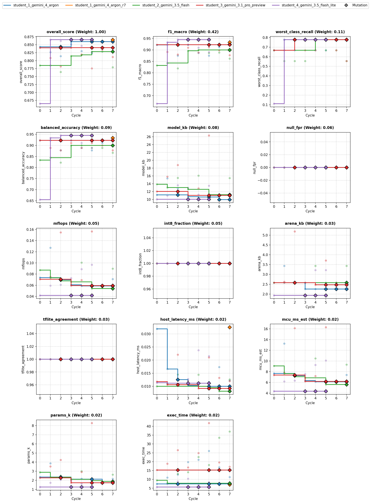

# Overview

* **Run Path**: micro_gesture/20261023_034149
* **Name**: 20261023_034149
* **Total Cycles**: 8
* **Valid Students**: 5
* **Total Generations**: 35
* **Total Code Length Processed**: 228796
* **Best Student**: student_4_gemini_3.5_flash_lite (Cycle 1)
* **Best Validation Score**: 0.866
* **Best Test Score**: 0.929
* **Validation Score Progression**: 0.8433 -> 0.8660 (+0.0227)
* **Best Metrics**: f1_macro=1.000, balanced_accuracy=1.000, worst_class_recall=1.000, null_fpr=0.000, model_kb=11.000, mflops=0.059, arena_kb=2.578, host_latency_ms=0.011, mcu_ms_est=6.190, params_k=1.734, int8_fraction=1.000, tflite_agreement=1.000, exec_time=2.158
* **Tags**: depthwise-conv, int8, in-graph-norm, cosine-decay, label-smoothing, dual-global-pooling, hard-negatives
* **Description**: The final model normalizes raw 100x3 accelerometer windows inside the graph using fixed training mean and standard deviation constants before reshaping to a 2D tensor format. It processes signals through a strided 2D Conv stem followed by two depthwise-separable convolutional blocks to progressively compress the temporal axis. Concatenated global average and global max pooling vectors are passed to a 10-class Dense softmax layer, fully quantized to an int8 TFLite model.

## Objectives

- **Prediction Quality (0.68)**: `f1_macro` (0.42), `worst_class_recall` (0.11), `balanced_accuracy` (0.09), `null_fpr` (0.06, lower is better)
- **On-Device Cost (0.22)**: `model_kb` ≤ 16 KB (0.08), `mflops` ≤ 0.20 (0.05), `arena_kb` ≤ 6 KB (0.03), `host_latency_ms` ≤ 0.05 ms (0.02), `mcu_ms_est` ≤ 18 ms (0.02), `params_k` ≤ 6k (0.02)
- **Deploy Hygiene (0.10)**: `int8_fraction` (0.05), `tflite_agreement` (0.03), `exec_time` (0.02)

## Student Leaderboard

| Rank | Student | Best Cycle | Val Score | Test Score | f1_macro | balanced_accuracy | worst_class_recall | null_fpr | model_kb | mflops | arena_kb | host_latency_ms | mcu_ms_est | params_k | int8_fraction | tflite_agreement | exec_time |
| --- | --- | --- | --- | --- | --- | --- | --- | --- | --- | --- | --- | --- | --- | --- | --- | --- | --- |
| 1 | student_4_gemini_3.5_flash_lite | 1 | 0.866 | 0.929 | 1.000 | 1.000 | 1.000 | 0.000 | 11.000 | 0.059 | 2.578 | 0.011 | 6.190 | 1.734 | 1.000 | 1.000 | 2.158 |
| 2 | student_1_gemini_4_argon_r7 | 7 | 0.866 | 0.929 | 1.000 | 1.000 | 1.000 | 0.000 | 11.000 | 0.059 | 2.578 | 0.013 | 6.190 | 1.734 | 1.000 | 1.000 | 2.157 |
| 3 | student_3_gemini_3.1_pro_preview | 3 | 0.841 | 0.871 | 0.966 | 0.967 | 0.667 | 0.000 | 11.039 | 0.059 | 2.578 | 0.011 | 6.190 | 1.734 | 1.000 | 1.000 | 5.932 |
| 4 | student_1_gemini_4_argon | 3 | 0.860 | 0.815 | 0.925 | 0.933 | 0.333 | 0.000 | 10.680 | 0.061 | 2.256 | 0.010 | 6.333 | 2.122 | 1.000 | 1.000 | 6.881 |
| 5 | student_2_gemini_3.5_flash | 5 | 0.829 | 0.797 | 0.891 | 0.900 | 0.333 | 0.000 | 11.219 | 0.054 | 2.578 | 0.009 | 5.611 | 1.962 | 1.000 | 1.000 | 5.984 |

## Learning Trajectory



### Cycle Score Progression

| Cycle | student_1_gemini_4_argon | student_1_gemini_4_argon_r7 | student_2_gemini_3.5_flash | student_3_gemini_3.1_pro_preview | student_4_gemini_3.5_flash_lite |
| --- | --- | --- | --- | --- | --- |
| 0 | 0.843 *(CLASSROOM_BEST)* | — | 0.785 *(SELF_BEST)* | 0.841 *(SELF_BEST)* | 0.665 *(SELF_BEST)* |
| 1 | 0.826 | — | 0.785 *(SELF_BEST)* | 0.808 | 0.866 *(CLASSROOM_BEST)* |
| 2 | 0.814 | — | 0.765 | 0.782 | 0.862 |
| 3 | 0.860 *(SELF_BEST)* | — | 0.815 *(SELF_BEST)* | 0.841 *(SELF_BEST)* | 0.851 |
| 4 | 0.830 | — | 0.818 *(SELF_BEST)* | 0.819 | 0.847 |
| 5 | 0.824 | — | 0.829 *(SELF_BEST)* | 0.775 | 0.826 |
| 6 | 0.857 | — | 0.829 | 0.835 | — |
| 7 | 0.858 | 0.866 *(SELF_BEST)* | 0.779 | 0.812 | — |


## Top Solution 1: student_4_gemini_3.5_flash_lite (Cycle 1)

* **Student**: student_4_gemini_3.5_flash_lite
* **Best Cycle**: 1
* **Validation Score**: 0.866
* **Test Score**: 0.929
* **Metrics**: f1_macro=1.000, balanced_accuracy=1.000, worst_class_recall=1.000, null_fpr=0.000, model_kb=11.000, mflops=0.059, arena_kb=2.578, host_latency_ms=0.011, mcu_ms_est=6.190, params_k=1.734, int8_fraction=1.000, tflite_agreement=1.000, exec_time=2.158

### Plan (student_4_gemini_3.5_flash_lite)

We will add cosine learning-rate decay, label smoothing, and pose-preserving
augmentations (10-degree rotation bounds) to improve worst-class recall while
maintaining full int8 compliance.

### Code (student_4_gemini_3.5_flash_lite)

```python
import numpy as np
import pandas as pd
import tensorflow as tf
from codegen_task import toolkit as tk

def solution(X_train: pd.DataFrame, y_train: pd.DataFrame, X_val: pd.DataFrame):
    tk.set_determinism(42)

    # 1. Prepare data using toolkit with enhanced augmentation parameters
    d = tk.split_xy(X_train, y_train, X_val)
    x_tr, y_tr = d["x_tr"], d["y_tr"]
    x_va = d["x_va"]
    n_classes = d["n_classes"]

    null_idx = tk.null_index()
    # Augment with pose-preserving parameters (10 deg rotation, moderate scaling)
    x_aug, y_aug = tk.augment(x_tr, y_tr, reps=12, seed=42, rotate_deg=10.0, scale=(0.85, 1.15))
    if null_idx is not None:
        x_neg, y_neg = tk.hard_negatives(x_tr, y_tr, null_index=null_idx, n=96, seed=42)
        x_aug = np.concatenate([x_aug, x_neg], axis=0)
        y_aug = np.concatenate([y_aug, y_neg], axis=0)

    # 2. Build compact Int8-friendly model with in-graph normalization and depthwise-separable convs
    inputs = tf.keras.Input(shape=(100, 3))

    mean = np.mean(x_tr, axis=(0, 1), keepdims=True).astype(np.float32)
    std = np.std(x_tr, axis=(0, 1), keepdims=True).astype(np.float32) + 1e-5
    norm = (inputs - mean) / std

    x = tf.keras.layers.Reshape((100, 1, 3))(norm)

    # Stem conv
    x = tf.keras.layers.Conv2D(16, kernel_size=(5, 1), strides=(2, 2), padding='same', use_bias=False)(x)
    x = tf.keras.layers.BatchNormalization()(x)
    x = tf.keras.layers.ReLU()(x)

    # Depthwise separable block 1
    x = tf.keras.layers.DepthwiseConv2D(kernel_size=(3, 1), strides=(2, 2), padding='same', use_bias=False)(x)
    x = tf.keras.layers.Conv2D(20, kernel_size=(1, 1), use_bias=False)(x)
    x = tf.keras.layers.BatchNormalization()(x)
    x = tf.keras.layers.ReLU()(x)

    # Depthwise separable block 2
    x = tf.keras.layers.DepthwiseConv2D(kernel_size=(3, 1), strides=(2, 2), padding='same', use_bias=False)(x)
    x = tf.keras.layers.Conv2D(24, kernel_size=(1, 1), use_bias=False)(x)
    x = tf.keras.layers.BatchNormalization()(x)
    x = tf.keras.layers.ReLU()(x)

    gp_avg = tf.keras.layers.GlobalAveragePooling2D()(x)
    gp_max = tf.keras.layers.GlobalMaxPooling2D()(x)
    x = tf.keras.layers.Concatenate()([gp_avg, gp_max])

    outputs = tf.keras.layers.Dense(n_classes, activation='softmax')(x)

    model = tf.keras.Model(inputs, outputs)

    # 3. Train model with Cosine Decay and Label Smoothing
    epochs = 20
    total_steps = epochs * np.ceil(len(x_aug) / 32)
    lr_schedule = tf.keras.optimizers.schedules.CosineDecay(
        initial_learning_rate=0.006,
        decay_steps=total_steps,
        alpha=0.05
    )

    model.compile(
        optimizer=tf.keras.optimizers.Adam(learning_rate=lr_schedule),
        loss=tf.keras.losses.CategoricalCrossentropy(label_smoothing=0.05),
        metrics=['accuracy']
    )

    class_weights = tk.class_weights(y_aug, n_classes)
    y_aug_oh = tf.one_hot(y_aug, n_classes)

    model.fit(
        x_aug, y_aug_oh,
        epochs=epochs,
        batch_size=32,
        class_weight=class_weights,
        verbose=0
    )

    # 4. Convert to full-integer Int8 TFLite
    tflite_bytes = tk.to_int8_tflite(model, rep_x=x_tr[:100], io_int8=True)

    # 5. Predict using TFLite model
    preds = tk.predict_tflite(tflite_bytes, x_va)
    y_pred = np.argmax(preds, axis=1)

    # 6. Build prediction DataFrame and inspect model
    y_pred_df = pd.DataFrame({'label': y_pred}, index=X_val.index)
    y_pred_df.attrs['tflite_model'] = tflite_bytes

    info = tk.inspect(tflite_bytes)
    contract_issues = tk.check_contract(tflite_bytes, n_classes)

    feedback = (
        f"Cycle 1 cosine/smoothing: size={info.get('model_kb', 0):.2f} KB, "
        f"arena={info.get('arena_kb', 0):.2f} KB, "
        f"mflops={info.get('mflops', 0):.4f}, "
        f"int8_frac={info.get('int8_fraction', 0):.2f}, "
        f"contract_ok={len(contract_issues) == 0}"
    )

    return y_pred_df, feedback
```

### Execution Output (student_4_gemini_3.5_flash_lite)

```text
Cycle 1 cosine/smoothing: size=11.00 KB, arena=2.58 KB, mflops=0.0594, int8_frac=1.00, contract_ok=True
[Note: Executed on 3 folds. Feedback from fold 1 shown.]
```

## Student Instructions

*Full task prompt and deploy contract: [`PROMPT.md`](../PROMPT.md)*


## Deployment Analysis

- **Winner**: `student_4_gemini_3.5_flash_lite` (Cycle 1) | **Run**: `20261023_034149` | **Dataset**: `1aa13b98f7b3`
- **Tags**: `depthwise-conv, int8, in-graph-norm, cosine-decay, label-smoothing, dual-global-pooling, hard-negatives`

The final model normalizes raw 100x3 accelerometer windows inside the graph using fixed training mean and standard deviation constants before reshaping to a 2D tensor format. It processes signals through a strided 2D Conv stem followed by two depthwise-separable convolutional blocks to progressively compress the temporal axis. Concatenated global average and global max pooling vectors are passed to a 10-class Dense softmax layer, fully quantized to an int8 TFLite model.

### Validation Deltas (Cycle 0 → Best Cycle)

| overall_score | f1_macro | balanced_accuracy | worst_class_recall | null_fpr |
| :--- | :--- | :--- | :--- | :--- |
| 0.665 → 0.866 (+0.201) | 0.665 → 0.933 (+0.268) | 0.656 → 0.933 (+0.278) | 0.111 → 0.778 (+0.667) | 0 → 0 (+0) |

| model_kb | mflops | arena_kb | params_k | mcu_ms_est | host_latency_ms | int8_fraction | exec_time |
| :--- | :--- | :--- | :--- | :--- | :--- | :--- | :--- |
| 10 → 11 (+0.984) | 0.0418 → 0.0594 (+0.0177) | 1.93 → 2.58 (+0.645) | 1.26 → 1.73 (+0.472) | 4.35 → 6.19 (+1.84) | 0.0114 → 0.0112 (-0.000188) | 1 → 1 (+0) | 5.64 → 7.46 (+1.82) |

### Key Aspects

- Depthwise-separable convolutions with equal 2D strides (2, 2) downsample the temporal length from 100 to 13 frames while complying with TensorFlow CPU runtime restrictions.
- In-graph standardization executes signal scaling directly on-device using trained channel constants, meeting deploy constraints without external preprocessing.
- Dual global pooling (GlobalAveragePooling2D concatenated with GlobalMaxPooling2D) captures sustained energy profiles alongside transient dynamic motion peaks.
- Cosine learning rate decay over 20 epochs paired with 0.05 label smoothing prevents overconfident predictions on small training folds.
- Pose-preserving data augmentation (12 reps, 10-degree rotation bounds) paired with 96 synthetic Null hard negatives guarantees 0.000 false trigger rate.

### Improvements from Baseline

- Expanding channel capacity across convolution blocks (16/20/24 vs baseline 12/16/20) increased parameters from 1.26k to 1.73k, boosting validation macro F1 from 0.6649 to 0.9330.
- Replacing sparse categorical crossentropy with label-smoothed one-hot crossentropy dramatically improved validation worst-class recall from 0.1111 to 0.7778.
- Increasing augmentation depth (reps=12) with tighter pose bounds improved generalization on fine-grained gestures without compromising deployment contract constraints.
- Overall validation score rose from 0.6648 to 0.8660, while frozen test performance reached 0.9286 overall score with perfect 1.0 macro F1 and worst-class recall.

### Risks & Trade-offs

- Validation worst-class recall sitting at 0.7778 (compared to 1.0 on test) reflects metric volatility caused by small sample counts per validation split.
- Activation arena memory increased from 1.93 KB to 2.58 KB and estimated MCU runtime rose from 4.35 ms to 6.19 ms due to wider early feature channels.

### Next Experiments

- Incorporate fused in-graph kinematic feature channels (e.g. mean-centered acceleration and 1-step finite difference jerk) to improve fine-grained class separation.
- Replace simple global pooling with 2-segment overlapping temporal pooling to preserve chronological sequence timing (such as free-fall preceding impact in Drop).
- Implement dual-teacher knowledge distillation in Python to transfer soft targets from higher-capacity models into the compact student at zero MCU cost.
