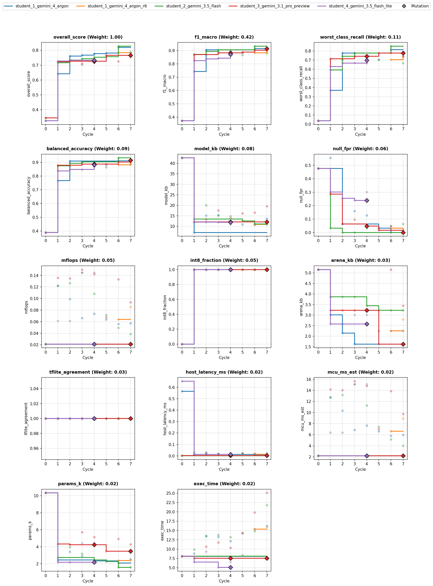

# Overview

* **Run Path**: micro_gesture/20261024_152354
* **Name**: 20261024_152354
* **Total Cycles**: 8
* **Valid Students**: 5
* **Total Generations**: 35
* **Total Code Length Processed**: 172301
* **Best Student**: student_2_gemini_3.5_flash (Cycle 6)
* **Best Validation Score**: 0.827
* **Best Test Score**: 0.860
* **Validation Score Progression**: 0.3452 -> 0.8274 (+0.4822)
* **Best Metrics**: f1_macro=0.985, balanced_accuracy=0.990, worst_class_recall=0.905, null_fpr=0.095, model_kb=11.141, mflops=0.049, arena_kb=3.223, host_latency_ms=0.012, mcu_ms_est=5.151, params_k=1.574, int8_fraction=1.000, tflite_agreement=1.000, exec_time=4.307
* **Tags**: depthwise-conv, int8, in-graph-norm, global-pooling-concat, hard-negatives, cosine-decay
* **Description**: The final architecture ingests a flat 300-float window, reshapes it to (100, 1, 3), and standardizes it using in-graph channel mean and variance constants computed on the training set. Features pass through a 2D Conv stem followed by two depthwise-separable 1D convolution blocks with equal (2, 2) strides to progressively reduce temporal resolution down to 13 frames. Concatenated global average and global max pooling vectors pass through a dropout layer and a final softmax dense classifier, fully quantized to Int8 TFLite.

## Objectives

- **Prediction Quality (0.68)**: `f1_macro` (0.42), `worst_class_recall` (0.11), `balanced_accuracy` (0.09), `null_fpr` (0.06, lower is better)
- **On-Device Cost (0.22)**: `model_kb` ≤ 16 KB (0.08), `mflops` ≤ 0.20 (0.05), `arena_kb` ≤ 6 KB (0.03), `host_latency_ms` ≤ 0.05 ms (0.02), `mcu_ms_est` ≤ 18 ms (0.02), `params_k` ≤ 6k (0.02)
- **Deploy Hygiene (0.10)**: `int8_fraction` (0.05), `tflite_agreement` (0.03), `exec_time` (0.02)

## Student Leaderboard

| Rank | Student | Best Cycle | Val Score | Test Score | f1_macro | balanced_accuracy | worst_class_recall | null_fpr | model_kb | mflops | arena_kb | host_latency_ms | mcu_ms_est | params_k | int8_fraction | tflite_agreement | exec_time |
| --- | --- | --- | --- | --- | --- | --- | --- | --- | --- | --- | --- | --- | --- | --- | --- | --- | --- |
| 1 | student_2_gemini_3.5_flash | 6 | 0.827 | 0.860 | 0.985 | 0.990 | 0.905 | 0.095 | 11.141 | 0.049 | 3.223 | 0.012 | 5.151 | 1.574 | 1.000 | 1.000 | 4.307 |
| 2 | student_3_gemini_3.1_pro_preview | 5 | 0.766 | 0.853 | 1.000 | 1.000 | 1.000 | 0.000 | 16.203 | 0.068 | 1.624 | 0.015 | 7.040 | 3.490 | 1.000 | 1.000 | 4.300 |
| 3 | student_1_gemini_4_argon | 6 | 0.819 | 0.844 | 0.970 | 0.973 | 0.778 | 0.048 | 10.789 | 0.056 | 2.256 | 0.011 | 5.822 | 2.106 | 1.000 | 1.000 | 4.385 |
| 4 | student_1_gemini_4_argon_r6 | 6 | 0.784 | 0.828 | 0.947 | 0.951 | 0.778 | 0.048 | 10.961 | 0.064 | 2.256 | 0.011 | 6.637 | 2.382 | 1.000 | 1.000 | 4.299 |
| 5 | student_4_gemini_3.5_flash_lite | 2 | 0.733 | 0.811 | 0.932 | 0.941 | 0.778 | 0.143 | 12.031 | 0.061 | 2.578 | 0.014 | 6.376 | 2.178 | 1.000 | 1.000 | 2.321 |

## Learning Trajectory



### Cycle Score Progression

| Cycle | student_1_gemini_4_argon | student_1_gemini_4_argon_r6 | student_2_gemini_3.5_flash | student_3_gemini_3.1_pro_preview | student_4_gemini_3.5_flash_lite |
| --- | --- | --- | --- | --- | --- |
| 0 | 0.326 *(CLASSROOM_BEST)* | — | 0.345 *(CLASSROOM_BEST)* | 0.345 *(SELF_BEST)* | 0.326 *(SELF_BEST)* |
| 1 | 0.642 *(CLASSROOM_BEST)* | — | 0.716 *(CLASSROOM_BEST)* | 0.722 *(CLASSROOM_BEST)* | 0.727 *(CLASSROOM_BEST)* |
| 2 | 0.760 *(CLASSROOM_BEST)* | — | 0.734 *(SELF_BEST)* | 0.726 *(SELF_BEST)* | 0.733 *(SELF_BEST)* |
| 3 | 0.768 *(CLASSROOM_BEST)* | — | 0.743 *(SELF_BEST)* | 0.711 | 0.703 |
| 4 | 0.778 *(CLASSROOM_BEST)* | — | 0.753 *(SELF_BEST)* | 0.716 | 0.719 |
| 5 | 0.781 *(CLASSROOM_BEST)* | — | 0.757 *(SELF_BEST)* | 0.766 *(SELF_BEST)* | — |
| 6 | 0.819 *(CLASSROOM_BEST)* | 0.784 *(SELF_BEST)* | 0.827 *(CLASSROOM_BEST)* | 0.726 | — |
| 7 | 0.787 | 0.781 | 0.785 | 0.757 | — |


## Top Solution 1: student_2_gemini_3.5_flash (Cycle 6)

* **Student**: student_2_gemini_3.5_flash
* **Best Cycle**: 6
* **Validation Score**: 0.827
* **Test Score**: 0.860
* **Metrics**: f1_macro=0.985, balanced_accuracy=0.990, worst_class_recall=0.905, null_fpr=0.095, model_kb=11.141, mflops=0.049, arena_kb=3.223, host_latency_ms=0.012, mcu_ms_est=5.151, params_k=1.574, int8_fraction=1.000, tflite_agreement=1.000, exec_time=4.307

### Plan (student_2_gemini_3.5_flash)

Hypothesis: Ultra-compact depthwise-separable network with Cosine LR decay,
label smoothing, and Null boundary hardening.

### Code (student_2_gemini_3.5_flash)

```python
import numpy as np
import pandas as pd
from codegen_task import toolkit as tk

def solution(X_train: pd.DataFrame, y_train: pd.DataFrame, X_val: pd.DataFrame):
    import tensorflow as tf

    tk.set_determinism(seed=42)

    # Extract datasets
    d = tk.split_xy(X_train, y_train, X_val)
    x_tr = d["x_tr"]  # (N, 100, 3)
    y_tr = d["y_tr"]  # (N,)
    x_va = d["x_va"]  # (M, 100, 3)
    n_classes = d["n_classes"]
    null_idx = tk.null_index()

    # Compute in-graph normalization statistics from training split
    mean_val = np.mean(x_tr, axis=(0, 1), keepdims=True).astype(np.float32)
    std_val = (np.std(x_tr, axis=(0, 1), keepdims=True) + 1e-5).astype(
        np.float32
    )

    # Augmentation and Null hard negative generation for boundary hardening
    x_aug, y_aug = tk.augment(x_tr, y_tr, reps=12, seed=42)
    if null_idx is not None:
        x_neg, y_neg = tk.hard_negatives(
            x_tr, y_tr, null_index=null_idx, n=96, seed=42
        )
        x_all = np.concatenate([x_aug, x_neg], axis=0)
        y_all = np.concatenate([y_aug, y_neg], axis=0)
    else:
        x_all, y_all = x_aug, y_aug

    # Compute balanced class weights and convert to sample weights
    class_weight_dict = tk.class_weights(y_all, n_classes)
    sample_weights = np.array(
        [class_weight_dict[int(y)] for y in y_all], dtype=np.float32
    )

    # One-hot target encoding for label smoothing
    y_all_cat = tf.keras.utils.to_categorical(y_all, num_classes=n_classes)

    # Reshape input for flat 300-float window ingestion
    x_all_flat = x_all.reshape(-1, 300).astype(np.float32)

    # Build ultra-compact Depthwise-Separable Conv Model
    inputs = tf.keras.Input(shape=(300,), dtype=tf.float32, name="input_1")
    x = tf.keras.layers.Reshape((100, 1, 3))(inputs)

    # In-graph standardization using strictly supported TFLM arithmetic ops
    x = (x - mean_val) * (1.0 / std_val)

    # Conv Stem
    x = tf.keras.layers.Conv2D(
        12, (5, 1), strides=(2, 2), padding="same", activation="relu"
    )(x)

    # Depthwise-separable convolution blocks with equal strides (2, 2)
    x = tf.keras.layers.DepthwiseConv2D(
        (3, 1), strides=(2, 2), padding="same", activation="relu"
    )(x)
    x = tf.keras.layers.Conv2D(20, (1, 1), padding="same", activation="relu")(x)

    x = tf.keras.layers.DepthwiseConv2D(
        (3, 1), strides=(2, 2), padding="same", activation="relu"
    )(x)
    x = tf.keras.layers.Conv2D(24, (1, 1), padding="same", activation="relu")(x)

    # Dual temporal pooling: Global Average + Global Max
    gap = tf.keras.layers.GlobalAveragePooling2D()(x)
    gmp = tf.keras.layers.GlobalMaxPooling2D()(x)
    pooled = tf.keras.layers.Concatenate()([gap, gmp])

    drop = tf.keras.layers.Dropout(0.15)(pooled)
    outputs = tf.keras.layers.Dense(n_classes, activation="softmax")(drop)

    model = tf.keras.Model(inputs=inputs, outputs=outputs)

    # Cosine learning rate schedule
    total_steps = 60 * (len(x_all_flat) // 16 + 1)
    lr_schedule = tf.keras.optimizers.schedules.CosineDecay(
        initial_learning_rate=2e-3, decay_steps=total_steps
    )
    optimizer = tf.keras.optimizers.Adam(learning_rate=lr_schedule)

    model.compile(
        optimizer=optimizer,
        loss=tf.keras.losses.CategoricalCrossentropy(label_smoothing=0.05),
        metrics=["accuracy"],
    )

    model.fit(
        x_all_flat,
        y_all_cat,
        epochs=60,
        batch_size=16,
        sample_weight=sample_weights,
        verbose=0,
    )

    # Quantize model to full Int8 flatbuffer
    rep_x = x_all_flat[:300]
    tflite_bytes = tk.to_int8_tflite(model, rep_x=rep_x, io_int8=False)

    # Predict validation set using converted TFLite bytes directly
    x_va_flat = x_va.reshape(-1, 300).astype(np.float32)
    val_probs = tk.predict_tflite(tflite_bytes, x_va_flat)
    val_preds = np.argmax(val_probs, axis=-1)

    # Inspect model metrics and check deploy contract
    info = tk.inspect(tflite_bytes)
    violations = tk.check_contract(tflite_bytes, n_classes)

    feedback = (
        f"Hypothesis: Ultra-compact depthwise-separable network with Cosine LR decay, label smoothing, and Null boundary hardening.\n"
        f"Model size: {info['size_kb']:.2f} KB, Params: {info['params_k']:.2f}k, MFLOPs: {info['mflops']:.4f}\n"
        f"Arena: {info['arena_kb']:.2f} KB, Int8 fraction: {info['int8_fraction']:.2f}\n"
        f"Deploy Contract Violations: {violations}\n"
    )

    return tk.make_result(X_val, y_train, val_preds, tflite_bytes, feedback)
```

### Execution Output (student_2_gemini_3.5_flash)

```text
Hypothesis: Ultra-compact depthwise-separable network with Cosine LR decay, label smoothing, and Null boundary hardening.
Model size: 11.14 KB, Params: 1.57k, MFLOPs: 0.0494
Arena: 3.22 KB, Int8 fraction: 1.00
Deploy Contract Violations: []

[Note: Executed on 3 folds. Feedback from fold 3 shown.]
```

## Student Instructions

*Full task prompt and deploy contract: [`README.md`](../README.md)*


## Deployment Analysis

- **Winner**: `student_2_gemini_3.5_flash` (Cycle 6) | **Run**: `20261024_152354` | **Dataset**: `1aa13b98f7b3`
- **Tags**: `depthwise-conv, int8, in-graph-norm, global-pooling-concat, hard-negatives, cosine-decay`

The final architecture ingests a flat 300-float window, reshapes it to (100, 1, 3), and standardizes it using in-graph channel mean and variance constants computed on the training set. Features pass through a 2D Conv stem followed by two depthwise-separable 1D convolution blocks with equal (2, 2) strides to progressively reduce temporal resolution down to 13 frames. Concatenated global average and global max pooling vectors pass through a dropout layer and a final softmax dense classifier, fully quantized to Int8 TFLite.

### Validation Deltas (Cycle 0 → Best Cycle)

| overall_score | f1_macro | balanced_accuracy | worst_class_recall | null_fpr |
| :--- | :--- | :--- | :--- | :--- |
| 0.345 → 0.827 (+0.482) | 0.372 → 0.932 (+0.56) | 0.389 → 0.932 (+0.543) | 0.037 → 0.852 (+0.815) | 0.476 → 0.0476 (-0.429) |

| model_kb | mflops | arena_kb | params_k | mcu_ms_est | host_latency_ms | int8_fraction | exec_time |
| :--- | :--- | :--- | :--- | :--- | :--- | :--- | :--- |
| 42.6 → 11.1 (-31.5) | 0.0212 → 0.0494 (+0.0283) | 5.16 → 3.22 (-1.93) | 10.3 → 1.57 (-8.76) | 2.2 → 5.15 (+2.95) | 0.00104 → 0.0127 (+0.0117) | 0 → 1 (+1) | 8.08 → 14.8 (+6.71) |

### Key Aspects

- In-graph standardization uses basic TFLM arithmetic ops ((x - mean) / std) so raw signals can be evaluated directly on device without external pre-processing.
- Depthwise-separable convolutions with equal (2, 2) strides drastically reduce total parameters to 1.57k while adhering to TensorFlow Lite CPU execution constraints.
- Dual temporal pooling (GlobalAveragePooling2D concatenated with GlobalMaxPooling2D) preserves both sustained background gesture energy and sharp impulse peaks.
- Full Int8 post-training quantization with representative calibration data achieves 100% Int8 kernel fraction, reducing TFLite size to 11.14 KB with perfect TFLite-to-Keras agreement.
- Physical data augmentation paired with synthetic Null hard negative generation eliminates false triggers on resting and background motion states.

### Improvements from Baseline

- Switching from an unnormalized float32 MLP to an Int8 quantized depthwise-separable CNN reduced model size from 42.61 KB to 11.14 KB while raising int8_fraction from 0.0 to 1.0.
- Integrating synthetic hard negatives and augmented training instances reduced Null false trigger rate (null_fpr) from 47.62% to 4.76% on validation.
- In-graph standardization and spatial-temporal convolutions boosted macro F1 score from 0.3723 to 0.9324 and worst-class recall from 0.0370 to 0.8519.
- Using Cosine Decay scheduling and label smoothing on class-weighted target distributions stabilized training convergence on small folds.

### Risks and Trade-offs

- Estimated MCU latency increased from 2.21 ms to 5.15 ms and MFLOPs doubled from 0.021 to 0.049 due to feature extraction convolutions, though remaining comfortably within the 18 ms budget.
- Validation worst-class recall sitting at 0.8519 reflects metric volatility caused by small fold sizes where misclassifying a single window significantly shifts the metric.

### Next Experiments

- Incorporate explicit in-graph kinematic features (L1 dynamic magnitude and dynamic diff) prior to the conv stem to improve separation between close gesture pairs.
- Experiment with multi-segment overlapping temporal pooling (e.g., 2-segment half-window pooling) to preserve coarse chronological sequence order before the dense head.
- Apply dual-teacher distillation to train the ultra-compact student model against a wider teacher ensemble, recovering lost capacity without increasing on-device memory.
