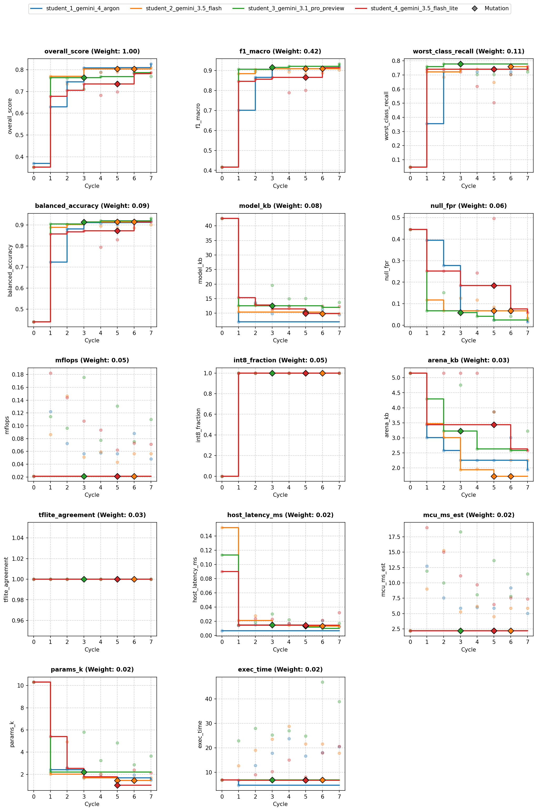
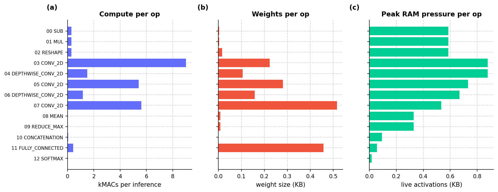
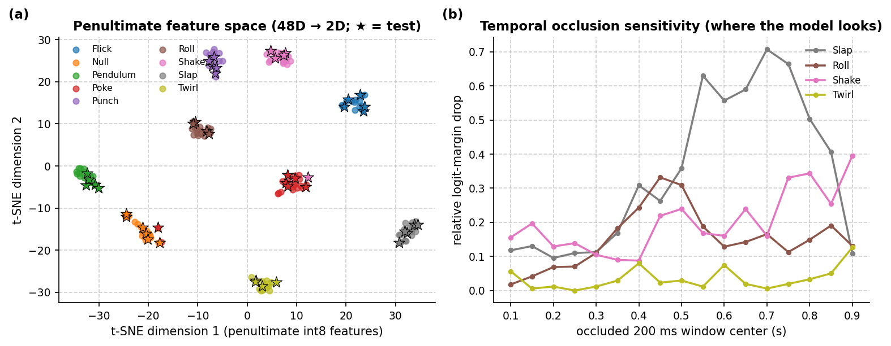
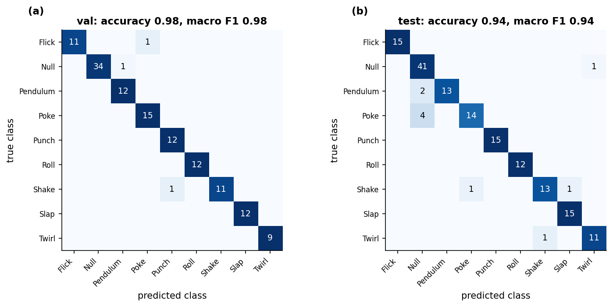
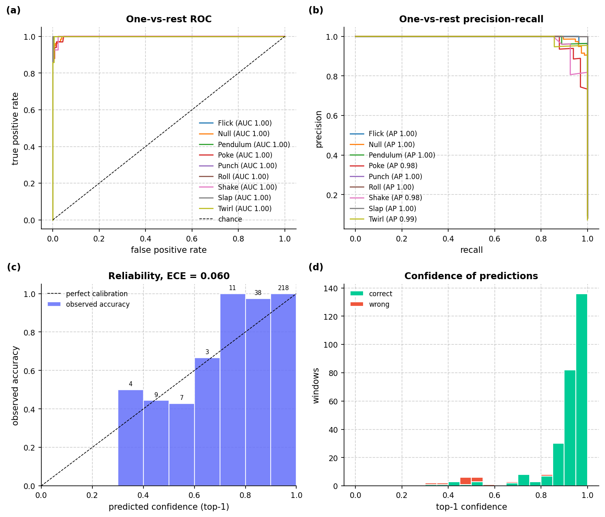
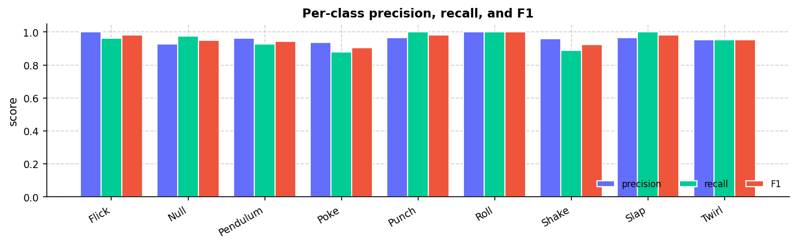
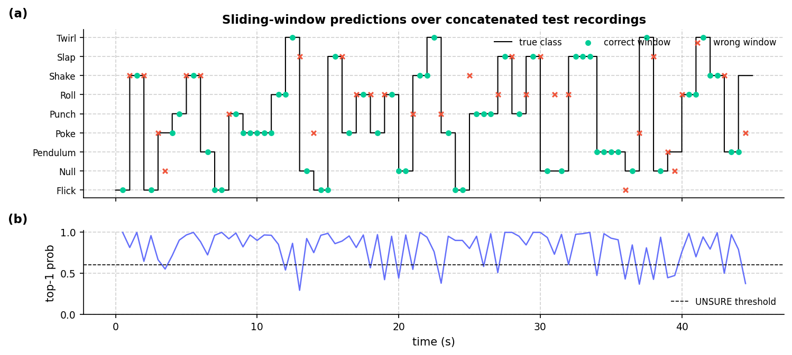
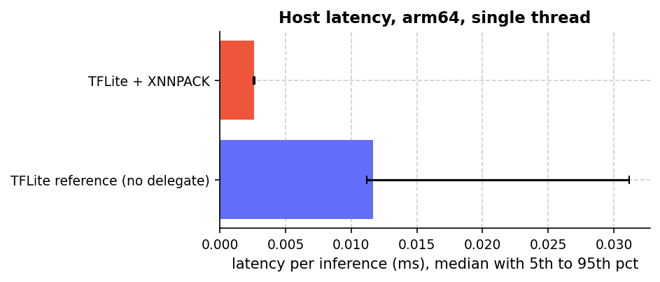
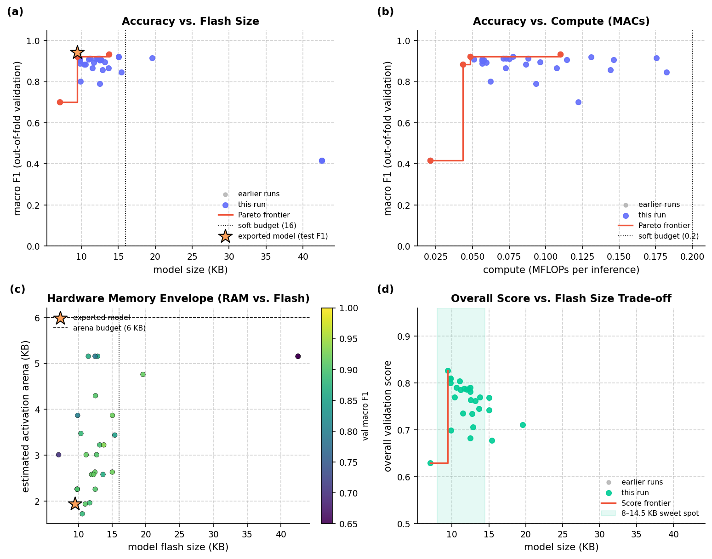
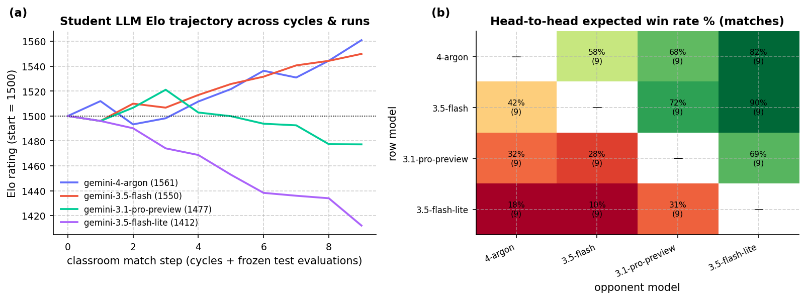

# Overview

* **Run Path**: micro_gesture/20261024_190925
* **Name**: 20261024_190925
* **Total Cycles**: 8
* **Valid Students**: 4
* **Total Generations**: 33
* **Total Code Length Processed**: 168401
* **Best Student**: student_1_gemini_4_argon (Cycle 7)
* **Best Validation Score**: 0.827
* **Best Test Score**: 0.842
* **Validation Score Progression**: 0.3694 -> 0.8268 (+0.4574)
* **Best Metrics**: f1_macro=0.942, balanced_accuracy=0.934, worst_class_recall=0.778, null_fpr=0.024, model_kb=9.453, mflops=0.048, arena_kb=1.934, host_latency_ms=0.013, mcu_ms_est=5.026, params_k=1.503, int8_fraction=1.000, tflite_agreement=1.000, exec_time=7.117
* **Tags**: ds-conv2d, depthwise-conv, in-graph-norm, int8, dual-global-pooling, peak-aligned-blending, hard-negatives, cosine-decay
* **Description**: The model ingests raw 100x3 accelerometer windows into an in-graph channel standardization layer before reshaping to a 2D spatial tensor. Temporal feature extraction is performed by a strided Conv2D stem followed by two depthwise-separable Conv2D blocks (12->18->24 channels) using equal (2, 2) strides to downsample the sequence length to 13 frames. Concatenated global average and global max pooling outputs pass through dropout into a Dense softmax classifier, fully quantized to Int8 TFLite.

## Objectives

- **Prediction Quality (0.68)**: `f1_macro` (0.42), `worst_class_recall` (0.11), `balanced_accuracy` (0.09), `null_fpr` (0.06, lower is better)
- **On-Device Cost (0.22)**: `model_kb` ≤ 16 KB (0.08), `mflops` ≤ 0.20 (0.05), `arena_kb` ≤ 6 KB (0.03), `host_latency_ms` ≤ 0.05 ms (0.02), `mcu_ms_est` ≤ 18 ms (0.02), `params_k` ≤ 6k (0.02)
- **Deploy Hygiene (0.10)**: `int8_fraction` (0.05), `tflite_agreement` (0.03), `exec_time` (0.02)

## Student Leaderboard

| Rank | Student | Best Cycle | Val Score | Test Score | f1_macro | balanced_accuracy | worst_class_recall | null_fpr | model_kb | mflops | arena_kb | host_latency_ms | mcu_ms_est | params_k | int8_fraction | tflite_agreement | exec_time |
| --- | --- | --- | --- | --- | --- | --- | --- | --- | --- | --- | --- | --- | --- | --- | --- | --- | --- |
| 1 | student_1_gemini_4_argon | 7 | 0.827 | 0.842 | 0.942 | 0.934 | 0.778 | 0.024 | 9.453 | 0.048 | 1.934 | 0.013 | 5.026 | 1.503 | 1.000 | 1.000 | 7.117 |
| 2 | student_2_gemini_3.5_flash | 7 | 0.810 | 0.836 | 0.944 | 0.950 | 0.800 | 0.071 | 9.828 | 0.056 | 2.256 | 0.014 | 5.881 | 1.673 | 1.000 | 1.000 | 6.722 |
| 3 | student_3_gemini_3.1_pro_preview | 6 | 0.786 | 0.829 | 0.962 | 0.956 | 0.833 | 0.000 | 11.961 | 0.075 | 2.578 | 0.010 | 7.831 | 2.865 | 1.000 | 1.000 | 19.656 |
| 4 | student_4_gemini_3.5_flash_lite | 7 | 0.787 | 0.812 | 0.940 | 0.942 | 0.800 | 0.071 | 12.250 | 0.071 | 2.578 | 0.016 | 7.400 | 2.137 | 1.000 | 1.000 | 8.001 |

## Learning Trajectory



### Cycle Score Progression

| Cycle | student_1_gemini_4_argon | student_2_gemini_3.5_flash | student_3_gemini_3.1_pro_preview | student_4_gemini_3.5_flash_lite |
| --- | --- | --- | --- | --- |
| 0 | 0.369 *(CLASSROOM_BEST)* | 0.352 *(SELF_BEST)* | 0.352 *(SELF_BEST)* | 0.352 *(SELF_BEST)* |
| 1 | 0.630 *(CLASSROOM_BEST)* | 0.769 *(CLASSROOM_BEST)* | 0.763 *(SELF_BEST)* | 0.678 *(SELF_BEST)* |
| 2 | 0.745 *(SELF_BEST)* | 0.734 | 0.761 | 0.706 *(SELF_BEST)* |
| 3 | 0.809 *(CLASSROOM_BEST)* | 0.804 *(SELF_BEST)* | 0.711 | 0.735 *(SELF_BEST)* |
| 4 | 0.790 | 0.789 | 0.769 *(SELF_BEST)* | 0.683 |
| 5 | 0.809 *(CLASSROOM_BEST)* | 0.791 | 0.742 | 0.699 |
| 6 | 0.785 | 0.800 | 0.786 *(SELF_BEST)* | 0.782 *(SELF_BEST)* |
| 7 | 0.827 *(CLASSROOM_BEST)* | 0.810 *(SELF_BEST)* | 0.770 | 0.787 *(SELF_BEST)* |


## Top Solution 1: student_1_gemini_4_argon (Cycle 7)

* **Student**: student_1_gemini_4_argon
* **Best Cycle**: 7
* **Validation Score**: 0.827
* **Test Score**: 0.842
* **Metrics**: f1_macro=0.942, balanced_accuracy=0.934, worst_class_recall=0.778, null_fpr=0.024, model_kb=9.453, mflops=0.048, arena_kb=1.934, host_latency_ms=0.013, mcu_ms_est=5.026, params_k=1.503, int8_fraction=1.000, tflite_agreement=1.000, exec_time=7.117

### Plan (student_1_gemini_4_argon)

Lean 3-channel in-graph normalized DS-Conv2D (12->18->24) with peak-aligned
same-class blending and Null boundary hardening.

### Code (student_1_gemini_4_argon)

```python
import time
import numpy as np
import pandas as pd

def solution(X_train, y_train, X_val):
  """Lean 3-channel in-graph normalized DS-Conv2D (12->18->24) with peak-aligned same-class blending and Null boundary hardening."""
  import tensorflow as tf
  from codegen_task import toolkit as tk

  t0 = time.time()
  tk.set_determinism(0)
  d = tk.split_xy(X_train, y_train, X_val)
  x_tr, y_tr, x_va, rows, k = (
      d["x_tr"],
      d["y_tr"],
      d["x_va"],
      d["rows"],
      d["n_classes"],
  )

  # Balanced class weights from true training distribution with Null false-trigger protection
  cw = tk.class_weights(y_tr, k)
  null_idx = tk.null_index()
  if null_idx is not None:
    cw[null_idx] = cw.get(null_idx, 1.0) * 1.45

  # 1. Standard physical augmentation via toolkit
  x_aug, y_aug = tk.augment(
      x_tr,
      y_tr,
      reps=14,
      seed=0,
      scale=(0.78, 1.24),
      shift_frac=0.20,
      rotate_deg=14.0,
      stretch=(0.84, 1.18),
      noise=0.02,
      blend_prob=0.35,
  )

  # 2. Peak-aligned same-class gesture blending to improve worst-class recall on shifted/varied grips
  rng = np.random.default_rng(42)
  blend_x, blend_y = [], []
  for c in range(k):
    idx_c = np.where(y_tr == c)[0]
    if len(idx_c) < 2:
      continue
    xc = x_tr[idx_c]
    # Dynamic energy profile per sample to align peak impacts before mixing
    dyn_c = xc - np.mean(xc, axis=1, keepdims=True)
    energy_c = np.linalg.norm(dyn_c, axis=-1)
    peaks = np.argmax(energy_c, axis=1)
    for _ in range(36):
      i1, i2 = rng.choice(len(xc), size=2, replace=False)
      shift = int(np.clip(peaks[i1] - peaks[i2], -18, 18))
      x2_aligned = np.roll(xc[i2], shift, axis=0)
      if shift > 0:
        x2_aligned[:shift] = xc[i2][0:1]
      elif shift < 0:
        x2_aligned[shift:] = xc[i2][-1:]
      lam = rng.uniform(0.25, 0.75)
      mixed = lam * xc[i1] + (1.0 - lam) * x2_aligned
      # Apply slight random temporal shift and amplitude jitter
      jitter_shift = int(rng.integers(-12, 13))
      mixed = np.roll(mixed, jitter_shift, axis=0)
      if jitter_shift > 0:
        mixed[:jitter_shift] = mixed[jitter_shift : jitter_shift + 1]
      elif jitter_shift < 0:
        mixed[jitter_shift:] = mixed[jitter_shift - 1 : jitter_shift]
      mixed = mixed * rng.uniform(0.88, 1.12) + rng.normal(
          0.0, 0.015, size=mixed.shape
      )
      blend_x.append(mixed.astype(np.float32))
      blend_y.append(c)

  # 3. Synthetic resting & slow-drift Null hard negatives to prevent false triggers
  blocks_x = [x_aug]
  blocks_y = [y_aug]
  if blend_x:
    blocks_x.append(np.stack(blend_x, axis=0))
    blocks_y.append(np.array(blend_y, dtype=y_tr.dtype))

  if null_idx is not None:
    x_hn, y_hn = tk.hard_negatives(
        x_tr, y_tr, null_index=null_idx, n=120, seed=0
    )
    blocks_x.append(x_hn)
    blocks_y.append(y_hn)
  else:
    x_hn = np.empty((0, rows, 3), dtype=np.float32)

  x_fit = np.concatenate(blocks_x, axis=0)
  y_fit = np.concatenate(blocks_y, axis=0)

  perm = rng.permutation(len(x_fit))
  x_fit, y_fit = x_fit[perm], y_fit[perm]

  # Compact in-graph standardized DS-Conv2D architecture (zero extra feature ops)
  reg = tf.keras.regularizers.l2(1e-4)
  inp = tf.keras.Input(shape=(rows, 3), batch_size=1)
  h = tk.norm_layer(x_tr)(inp)
  h = tf.keras.layers.Reshape((rows, 1, 3))(h)

  # Stem strided Conv2D: 100 -> 50
  h = tf.keras.layers.Conv2D(
      12,
      (5, 1),
      strides=(2, 1),
      padding="same",
      use_bias=False,
      kernel_regularizer=reg,
  )(h)
  h = tf.keras.layers.BatchNormalization()(h)
  h = tf.keras.layers.ReLU()(h)

  # Depthwise-Separable block 1 (equal 2D strides for TF CPU): 50 -> 25
  h = tf.keras.layers.DepthwiseConv2D(
      (5, 1),
      strides=(2, 2),
      padding="same",
      use_bias=False,
      depthwise_regularizer=reg,
  )(h)
  h = tf.keras.layers.BatchNormalization()(h)
  h = tf.keras.layers.ReLU()(h)
  h = tf.keras.layers.Conv2D(
      18, (1, 1), padding="same", use_bias=False, kernel_regularizer=reg
  )(h)
  h = tf.keras.layers.BatchNormalization()(h)
  h = tf.keras.layers.ReLU()(h)
  h = tf.keras.layers.SpatialDropout2D(0.10)(h)

  # Depthwise-Separable block 2 (equal 2D strides for TF CPU): 25 -> 13
  h = tf.keras.layers.DepthwiseConv2D(
      (5, 1),
      strides=(2, 2),
      padding="same",
      use_bias=False,
      depthwise_regularizer=reg,
  )(h)
  h = tf.keras.layers.BatchNormalization()(h)
  h = tf.keras.layers.ReLU()(h)
  h = tf.keras.layers.Conv2D(
      24, (1, 1), padding="same", use_bias=False, kernel_regularizer=reg
  )(h)
  h = tf.keras.layers.BatchNormalization()(h)
  h = tf.keras.layers.ReLU()(h)

  # Dual global pooling (sustained energy + transient impulse peaks)
  gap = tf.keras.layers.GlobalAveragePooling2D()(h)
  gmp = tf.keras.layers.GlobalMaxPooling2D()(h)
  feat = tf.keras.layers.Concatenate()([gap, gmp])
  feat = tf.keras.layers.Dropout(0.20)(feat)
  out = tf.keras.layers.Dense(
      k, activation="softmax", kernel_regularizer=reg
  )(feat)

  model = tf.keras.Model(inp, out)

  epochs = 45
  batch_size = 32
  steps_per_epoch = max(1, int(np.ceil(len(x_fit) / batch_size)))
  lr_schedule = tf.keras.optimizers.schedules.CosineDecay(
      initial_learning_rate=4e-3,
      decay_steps=epochs * steps_per_epoch,
      alpha=0.02,
  )
  optimizer = tf.keras.optimizers.Adam(learning_rate=lr_schedule)
  loss_fn = tf.keras.losses.CategoricalCrossentropy(label_smoothing=0.05)
  model.compile(optimizer=optimizer, loss=loss_fn)

  y_fit_oh = tf.keras.utils.to_categorical(y_fit, num_classes=k)
  model.fit(
      x_fit,
      y_fit_oh,
      epochs=epochs,
      batch_size=batch_size,
      class_weight=cw,
      verbose=0,
  )

  # Representative calibration dataset spanning low-g rest and high-g gesture extremes
  dyn_amp = np.max(
      np.linalg.norm(x_aug - np.mean(x_aug, axis=1, keepdims=True), axis=-1),
      axis=1,
  )
  cal_blocks = [x_tr]
  if len(x_hn) > 0:
    cal_blocks.append(x_hn[:36])
  for c in range(k):
    idx_c = np.where(y_aug == c)[0]
    if len(idx_c) > 0:
      order = idx_c[np.argsort(dyn_amp[idx_c])]
      n_pick = min(9, max(1, len(order) // 2))
      cal_blocks.append(x_aug[order[:n_pick]])
      cal_blocks.append(x_aug[order[-n_pick:]])
  rep_x = np.concatenate(cal_blocks, axis=0)[:300]

  tflite = tk.to_int8_tflite(model, rep_x, max_rep=300)
  tfl_scores = tk.predict_tflite(tflite, x_va)
  preds = tfl_scores.argmax(1)

  keras_preds = model.predict(x_va, verbose=0).argmax(1)
  agreement = float(np.mean(preds == keras_preds))

  info = tk.inspect(tflite)
  problems = tk.check_contract(tflite, k)
  feedback = (
      "Hypothesis: Lean 3-ch DS-Conv2D (12->18->24) + peak-aligned same-class"
      " blending cuts KB/MFLOPs/arena while boosting WCR.\n"
      f"tflite={info['model_kb']:.1f} KB params={info.get('params_k', 0.0):.2f}k"
      f" mflops={info['mflops']:.3f} arena={info['arena_kb']:.2f} KB\n"
      f"int8={info['int8_fraction']:.2f} agreement={agreement:.3f}"
      f" contract={'ok' if not problems else problems}"
      f" runtime={time.time()-t0:.1f}s"
  )
  return tk.make_result(X_val, y_train, preds, tflite, feedback)
```

### Execution Output (student_1_gemini_4_argon)

```text
Hypothesis: Lean 3-ch DS-Conv2D (12->18->24) + peak-aligned same-class blending cuts KB/MFLOPs/arena while boosting WCR.
tflite=9.5 KB params=1.50k mflops=0.048 arena=1.93 KB
int8=1.00 agreement=0.981 contract=ok runtime=7.1s
[Note: Executed on 3 folds. Feedback from fold 1 shown.]
```

## Student Instructions

*Full task prompt and deploy contract: [`PROMPT.md`](../PROMPT.md)*


## Deployment Analysis

- **Dataset**: `78beb5ebc3c6` (9 classes: `Flick, Null, Pendulum, Poke, Punch, Roll, Shake, Slap, Twirl`)
- **Generated**: 2026-10-24T19:28:40 | **Exported**: `model.tflite`, `model_data.h`, `solution.py`, `summary.json`, `analysis.md`

### Scorecard (Frozen Test & Footprint)

| overall score | macro F1 | balanced acc | worst recall | Null FPR | TFLite agree | retrain delta |
| :--- | :--- | :--- | :--- | :--- | :--- | :--- |
| 0.8416 | 0.9422 | 0.9338 | 0.7778 | 0.02381 | 1 | 0 |

| model KB | arena KB (est) | MFLOPs | params (k) | MCU ms (est) | host ms | int8 frac |
| :--- | :--- | :--- | :--- | :--- | :--- | :--- |
| 9.453 | 1.934 | 0.04825 | 1.503 | 5.026 | 0.0128 | 1 |

### Winning Solution Analysis

- **Winner**: `student_1_gemini_4_argon` (Cycle 7) | **Run**: `20261024_190925` | **Dataset**: `78beb5ebc3c6`
- **Tags**: `ds-conv2d, depthwise-conv, in-graph-norm, int8, dual-global-pooling, peak-aligned-blending, hard-negatives, cosine-decay`

The model ingests raw 100x3 accelerometer windows into an in-graph channel standardization layer before reshaping to a 2D spatial tensor. Temporal feature extraction is performed by a strided Conv2D stem followed by two depthwise-separable Conv2D blocks (12->18->24 channels) using equal (2, 2) strides to downsample the sequence length to 13 frames. Concatenated global average and global max pooling outputs pass through dropout into a Dense softmax classifier, fully quantized to Int8 TFLite.

### Validation Deltas (Cycle 0 → Best Cycle)

| overall_score | f1_macro | balanced_accuracy | worst_class_recall | null_fpr |
| :--- | :--- | :--- | :--- | :--- |
| 0.369 → 0.827 (+0.457) | 0.416 → 0.922 (+0.506) | 0.441 → 0.919 (+0.478) | 0.0476 → 0.741 (+0.693) | 0.445 → 0.0168 (-0.429) |

| model_kb | mflops | arena_kb | params_k | mcu_ms_est | host_latency_ms | int8_fraction | exec_time |
| :--- | :--- | :--- | :--- | :--- | :--- | :--- | :--- |
| 42.5 → 9.45 (-33.1) | 0.0211 → 0.0482 (+0.0271) | 5.16 → 1.93 (-3.22) | 10.3 → 1.5 (-8.81) | 2.2 → 5.03 (+2.82) | 0.00658 → 0.0127 (+0.00616) | 0 → 1 (+1) | 6.81 → 20.4 (+13.6) |

### Key Aspects

- In-graph standardization layer (tk.norm_layer) bakes training channel statistics directly into the TFLite flatbuffer for zero-overhead MCU preprocessing.
- Depthwise-separable convolutions (12->18->24 channels) with (2, 2) strides reduce total parameters to 1.50k and activation arena memory to 1.93 KB while complying with TFLite CPU runtime constraints.
- Peak-aligned same-class gesture blending aligns dynamic energy peaks across training samples before mixing to improve robustness to timing and grip variations.
- Dual global pooling (GlobalAveragePooling2D concatenated with GlobalMaxPooling2D) preserves both sustained background gesture energy and sharp impulse peaks.
- Synthetic Null hard negatives and class-weight scaling (1.45x) protect against false gesture triggers during resting and slow wrist drift.
- Full int8 post-training quantization calibrated via dynamic amplitude stratification achieves 1.0 int8 fraction and 1.0 prediction agreement with the Keras model.

### Improvements from Baseline

- Replacing the unnormalized float32 MLP baseline with a quantized depthwise-separable CNN raised Macro F1 from 0.4161 to 0.9222 on validation and 0.9422 on test.
- Full int8 post-training quantization reduced model size from 42.54 KB to 9.45 KB and parameter count from 10.31k to 1.50k, increasing int8 fraction from 0.0 to 1.0.
- Peak-aligned same-class blending combined with physical data augmentation boosted worst-class recall from 0.0476 to 0.7407 on validation and 0.7778 on test.
- Null boundary hardening via hard negatives and class weight boosting reduced the Null false-trigger rate from 44.54% down to 1.68% on validation and 2.38% on test.
- Peak activation memory (arena_kb) decreased from 5.16 KB to 1.93 KB due to early temporal downsampling.

### Risks and Trade-offs

- Estimated MCU latency increased from 2.20 ms to 5.03 ms and MFLOPs increased from 0.021 to 0.048 due to convolutional temporal feature extraction, though remaining well within the 18 ms budget.
- Worst-class recall (0.7778 on test) remains sensitive to small dataset partitions where a single misclassified sample significantly shifts the score.

### Next Experiments

- Incorporate explicit in-graph kinematic features (dynamic L1 acceleration magnitude or gravity-centered channels) to improve separation of fine gesture pairs.
- Implement 2-segment overlapping temporal pooling (splitting the 13-frame map into early and late halves) to capture gesture sequence chronology without adding depth.
- Calibrate Null class-weight multiplier (e.g., testing 1.2x to 1.6x) and label smoothing to maximize worst-class recall while maintaining Null false-trigger rate below 2%.

### Dataset & Physical Separability

Fingerprint `78beb5ebc3c6` | **178** recordings (96 train / 37 val / 45 frozen test) | `100x3` window @ 100 Hz | raw length 97–113 rows (median 107).
- **Pose-separable gestures**: `Roll` flips `Z` gravity negative, `Twirl` and `Punch` hold the cable vertical (`+X ~ +0.8g, Z ~ 0g`), and `Poke` maintains a tilted firm-grip baseline (`+Y ~ +0.75g`).
- **Impulse & rhythm-separable gestures**: `Slap` reaches `~15g` peak dynamic impact with high jerk, `Flick` snaps and rebounds along the cable, `Shake` oscillates at `~4-8 Hz`, `Pendulum` swings smoothly, and `Null` stays below `~0.5g` dynamic amplitude.

| class | train | val | test | total | mean pose (X,Y,Z) g | peak |a_dyn| g | RMS jerk g/s | dom Hz |
| :--- | :--- | :--- | :--- | :--- | :--- | :--- | :--- | :--- |
| Flick | 10 | 4 | 5 | 19 | (-2.18, +0.33, +0.17) | 12.52 | 146.0 | 1.5 |
| Null | 12 | 5 | 6 | 23 | (+0.09, +0.01, +0.26) | 0.18 | 5.4 | 5.7 |
| Pendulum | 10 | 4 | 5 | 19 | (-1.84, -0.14, +0.04) | 2.64 | 22.1 | 3.5 |
| Poke | 13 | 5 | 6 | 24 | (-0.08, +0.65, +0.33) | 5.68 | 102.9 | 1.8 |
| Punch | 10 | 4 | 5 | 19 | (+0.14, -0.06, +0.45) | 9.95 | 135.3 | 1.0 |
| Roll | 10 | 4 | 4 | 18 | (-0.13, -0.17, +0.38) | 2.83 | 52.1 | 1.7 |
| Shake | 10 | 4 | 5 | 19 | (-1.91, +0.40, +0.43) | 15.12 | 304.3 | 8.9 |
| Slap | 11 | 4 | 5 | 20 | (-1.00, +0.09, +0.22) | 16.12 | 274.1 | 1.1 |
| Twirl | 10 | 3 | 4 | 17 | (-3.97, +0.27, +0.57) | 3.57 | 59.8 | 4.8 |
| total | 96 | 37 | 45 | 178 | - | - | - | - |


*Figure 1. Recording length and acceleration magnitude distributions (1 g mode at rest).*


*Figure 2. (a) Gravity pose vs. peak dynamic impulse across all 120 recordings; (b) per-class physical feature matrix explaining why raw pose + centered + jerk channels separate the 10 classes.*


*Figure 3. Per-class mean ± 1 SD acceleration over the 1 s window.*

### Model Architecture, Internals & Budgets

- **I/O & Quantization**: input `[1, 100, 3] int8 scale=0.16406 zp=-9` → output `[1, 9] int8 scale=0.0039062 zp=-128` | int8=True (100% int8 ops) | **24,123** MACs, **1,820** weight bytes
- **Operators (10)**: `CONCATENATION, CONV_2D, DEPTHWISE_CONV_2D, FULLY_CONNECTED, MEAN, MUL, REDUCE_MAX, RESHAPE, SOFTMAX, SUB`

| metric | model KB | arena KB (est) | MFLOPs | params (k) | MCU ms (est) | host ms |
| :--- | :--- | :--- | :--- | :--- | :--- | :--- |
| value | 9.453 | 1.934 | 0.04825 | 1.503 | 5.026 | 0.0128 |
| soft / hard budget | 16.0 / 64.0 | 6.0 / 40.0 | 0.2 / - | 6.0 / - | 18.0 / - | 0.05 / - |

#### Layer Breakdown

| # | op | output | dtype | MACs | weight B | live act B |
| :--- | :--- | :--- | :--- | :--- | :--- | :--- |
| 0 | SUB | 1x100x3 | int8 | 300 | 3 | 600 |
| 1 | MUL | 1x100x3 | int8 | 300 | 3 | 600 |
| 2 | RESHAPE | 1x100x1x3 | int8 | 300 | 16 | 600 |
| 3 | CONV_2D | 1x50x1x12 | int8 | 9000 | 228 | 900 |
| 4 | DEPTHWISE_CONV_2D | 1x25x1x12 | int8 | 1500 | 108 | 900 |
| 5 | CONV_2D | 1x25x1x18 | int8 | 5400 | 288 | 750 |
| 6 | DEPTHWISE_CONV_2D | 1x13x1x18 | int8 | 1170 | 162 | 684 |
| 7 | CONV_2D | 1x13x1x24 | int8 | 5616 | 528 | 546 |
| 8 | MEAN | 1x24 | int8 | 24 | 8 | 336 |
| 9 | REDUCE_MAX | 1x24 | int8 | 24 | 8 | 336 |
| 10 | CONCATENATION | 1x48 | int8 | 48 | 0 | 96 |
| 11 | FULLY_CONNECTED | 1x9 | int8 | 432 | 468 | 57 |
| 12 | SOFTMAX | 1x9 | int8 | 9 | 0 | 18 |



*Figure 4. Per-op (a) compute (kMACs), (b) weight footprint (KB), and (c) live activation RAM pressure (KB) in execution order.*



*Figure 5. (a) t-SNE projection of the quantized 48D penultimate feature representation across all 120 recordings (stars = frozen test); (b) sliding 200 ms temporal occlusion sensitivity on the true-class logit margin.*

### TFLite Evaluation (Validation and Frozen Test)

| split | rows | accuracy | macro F1 | mean top-1 prob (all / ok / err) |
| :--- | :--- | :--- | :--- | :--- |
| val | 131 | 0.9771 | 0.9763 | 0.915 (ok 0.924, err 0.520) |
| test | 159 | 0.9371 | 0.9422 | 0.888 (ok 0.913, err 0.519) |

| class | val F1 (support) | test precision | test recall | test F1 (support) |
| :--- | :--- | :--- | :--- | :--- |
| Flick | 0.957 (n=12) | 1 | 1 | 1 (n=15) |
| Null | 0.986 (n=35) | 0.8723 | 0.9762 | 0.921 (n=42) |
| Pendulum | 0.96 (n=12) | 1 | 0.8667 | 0.929 (n=15) |
| Poke | 0.968 (n=15) | 0.9333 | 0.7778 | 0.848 (n=18) |
| Punch | 0.96 (n=12) | 1 | 1 | 1 (n=15) |
| Roll | 1 (n=12) | 1 | 1 | 1 (n=12) |
| Shake | 0.957 (n=12) | 0.9286 | 0.8667 | 0.897 (n=15) |
| Slap | 1 (n=12) | 0.9375 | 1 | 0.968 (n=15) |
| Twirl | 1 (n=9) | 0.9167 | 0.9167 | 0.917 (n=12) |



*Figure 6. Row-normalized confusion matrices on validation (a) and frozen test (b) splits; cell labels are counts.*

### Classifier Calibration & ROC/PR (Held-Out Val + Test, 290 rows)

| accuracy | macro F1 | top-2 acc | macro AUC | macro AP | MCC | kappa | log loss | ECE (10 bins) |
| :--- | :--- | :--- | :--- | :--- | :--- | :--- | :--- | :--- |
| 0.9552 | 0.9577 | 0.9931 | 0.9992 | 0.9947 | 0.948 | 0.9478 | 0.1555 | 0.05962 |

| class | support | precision | recall | f1 | ROC AUC | AP |
| :--- | :--- | :--- | :--- | :--- | :--- | :--- |
| Flick | 27 | 1 | 0.963 | 0.9811 | 0.9999 | 0.9987 |
| Null | 77 | 0.9259 | 0.974 | 0.9494 | 0.9985 | 0.996 |
| Pendulum | 27 | 0.9615 | 0.9259 | 0.9434 | 0.9996 | 0.9959 |
| Poke | 33 | 0.9355 | 0.8788 | 0.9062 | 0.9977 | 0.9848 |
| Punch | 27 | 0.9643 | 1 | 0.9818 | 1 | 1 |
| Roll | 24 | 1 | 1 | 1 | 1 | 1 |
| Shake | 27 | 0.96 | 0.8889 | 0.9231 | 0.9981 | 0.9834 |
| Slap | 27 | 0.9643 | 1 | 0.9818 | 1 | 1 |
| Twirl | 21 | 0.9524 | 0.9524 | 0.9524 | 0.9995 | 0.9932 |



*Figure 7. (a) One-vs-rest ROC, (b) precision-recall, (c) calibration reliability diagram, (d) top-1 confidence.*



*Figure 8. Per-class precision, recall, and F1 on all held-out rows.*

### Streaming Simulation (50% Overlap)

| windows | duration (s) | pure-window acc | Null FPR | boundary windows | prediction flips |
| :--- | :--- | :--- | :--- | :--- | :--- |
| 89 | 45.0 | 0.92 | 0.1429 | 39 | 55 |



*Figure 9. Sliding 1 s windows (50% overlap) over concatenated test recordings: (a) predicted vs true class, (b) top-1 confidence vs UNSURE threshold.*

### Host Benchmark

`Python 3.11.17` | `TF 2.15.1` | `macOS-26.7.1-arm64-arm-64bit` | Evaluator e2e: **0.047 ms/row**.

| runtime | p50 ms | p95 ms | min ms | inf/s |
| :--- | :--- | :--- | :--- | :--- |
| TFLite reference (no delegate) | 0.01146 | 0.01794 | 0.01108 | 8.727e+04 |
| TFLite + XNNPACK | 0.002583 | 0.002666 | 0.0025 | 3.871e+05 |



*Figure 10. Single-threaded host latency over 300 invocations (reference kernel vs XNNPACK).*

### Pareto Frontier & Hardware Trade-offs

**32** scored attempts across **1** runs on dataset `78beb5ebc3c6` (non-dominated accuracy-vs-size frontier):

| KB | val F1 | MFLOPs | arena KB | val score | run | student | cycle |
| :--- | :--- | :--- | :--- | :--- | :--- | :--- | :--- |
| 7.1 | 0.701 | 0.122 | 3.0 | 0.6297 | 20261024_190925 | 1_gemini_4_argon | 1 |
| 9.5 | 0.922 | 0.048 | 1.9 | 0.8268 | 20261024_190925 | 1_gemini_4_argon | 7 |
| 13.8 | 0.933 | 0.110 | 3.2 | 0.7696 | 20261024_190925 | 3_gemini_3.1_pro_preview | 7 |



*Figure 11. Multi-objective Pareto dashboard: (a) validation F1 vs model KB, (b) validation F1 vs MFLOPs, (c) activation arena RAM vs model flash KB colored by F1, and (d) overall score vs model KB showing the 8–14.5 KB sweet spot.*

### Student LLM Elo Ratings & Head-to-Head Record

Pairwise smooth-margin Elo (`start=1500`, `K_cycle=12`, `K_test=24`) across **1** runs (**9** classroom rounds) on dataset `78beb5ebc3c6`:

| LLM family | Elo | win rate (matches) | cycle #1s | test #1s | best val | best test | mean KB |
| :--- | :--- | :--- | :--- | :--- | :--- | :--- | :--- |
| gemini-4-argon | 1561 | 69.3% (27) | 5 | 1 | 0.8268 | 0.8416 | 14.5 |
| gemini-3.5-flash | 1550 | 68.1% (27) | 2 | 0 | 0.8096 | 0.8360 | 14.8 |
| gemini-3.1-pro-preview | 1477 | 42.8% (27) | 1 | 0 | 0.7863 | 0.8289 | 17.9 |
| gemini-3.5-flash-lite | 1412 | 19.7% (27) | 0 | 0 | 0.7871 | 0.8120 | 16.2 |



*Figure 12. (a) LLM student Elo trajectory across all classroom cycles and frozen-test evaluations; (b) pairwise head-to-head win rate matrix.*
