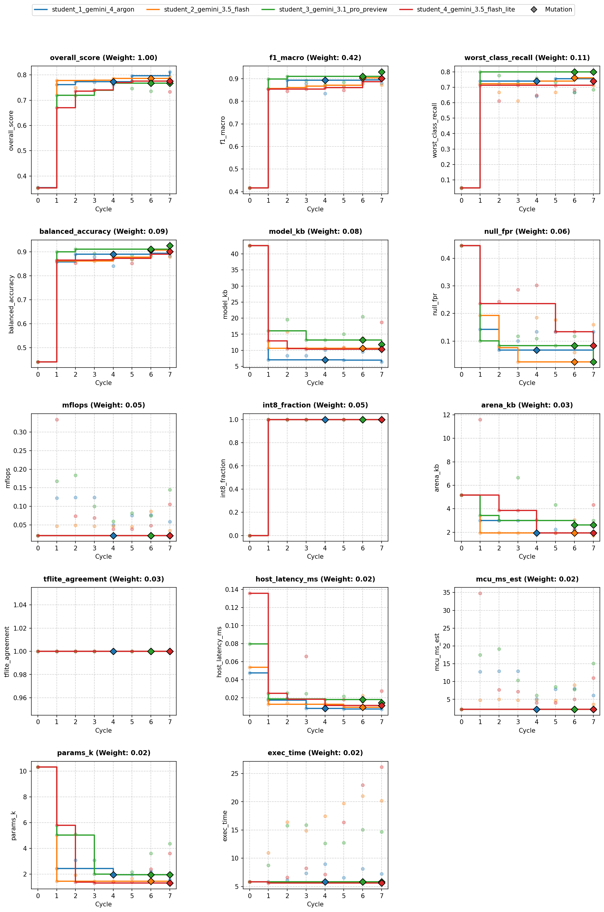
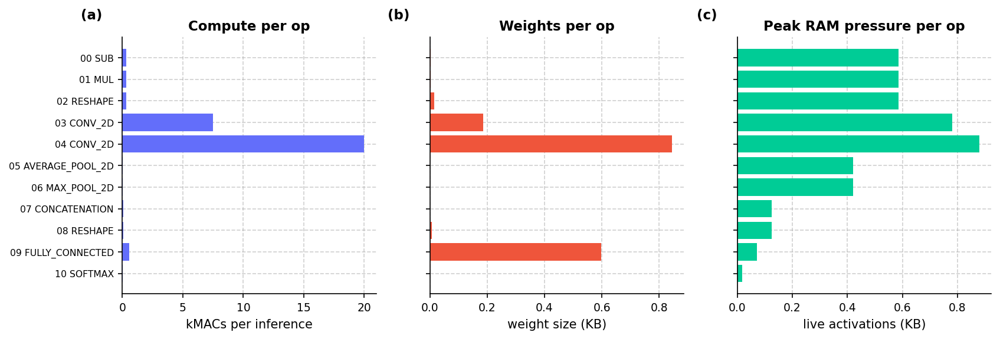
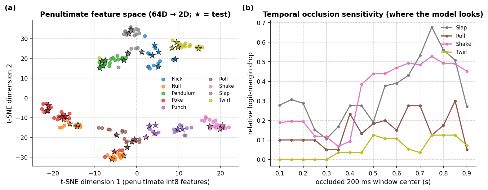
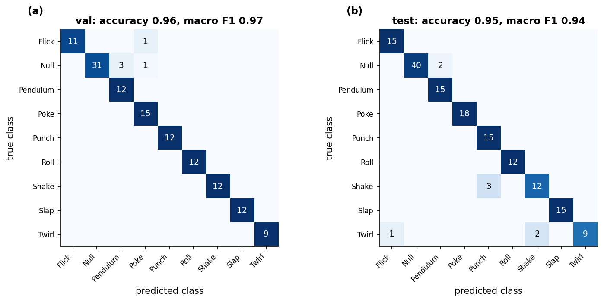
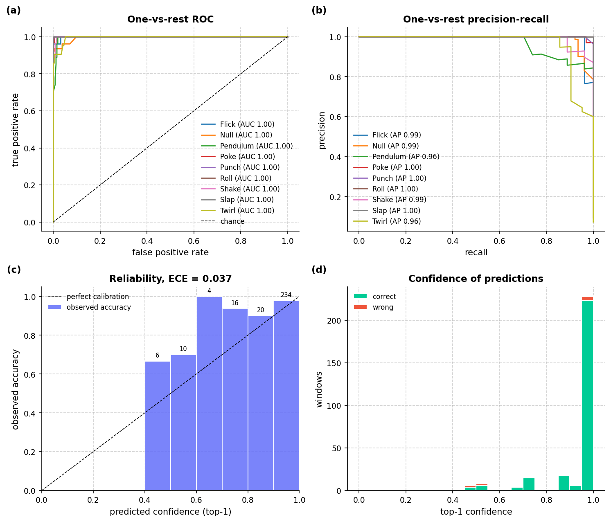
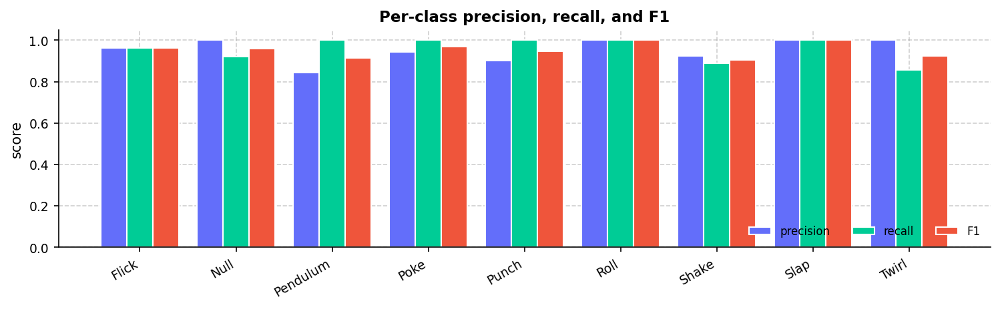
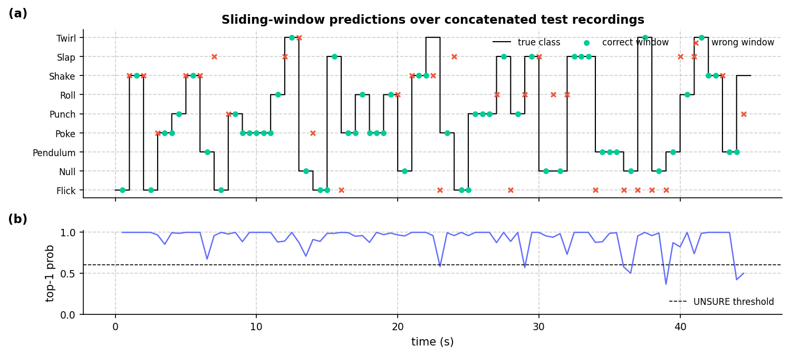
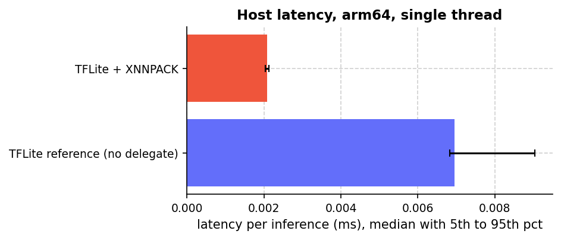
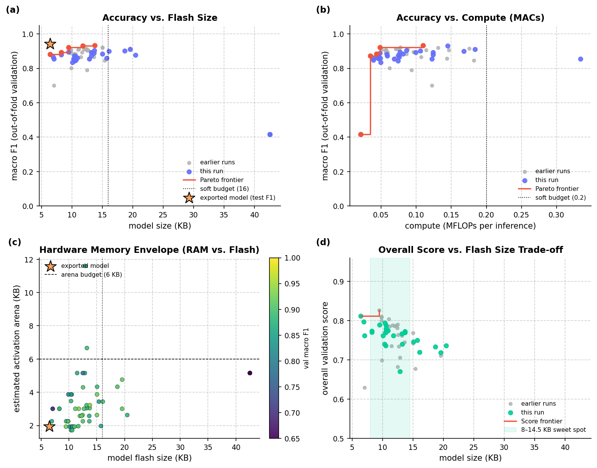
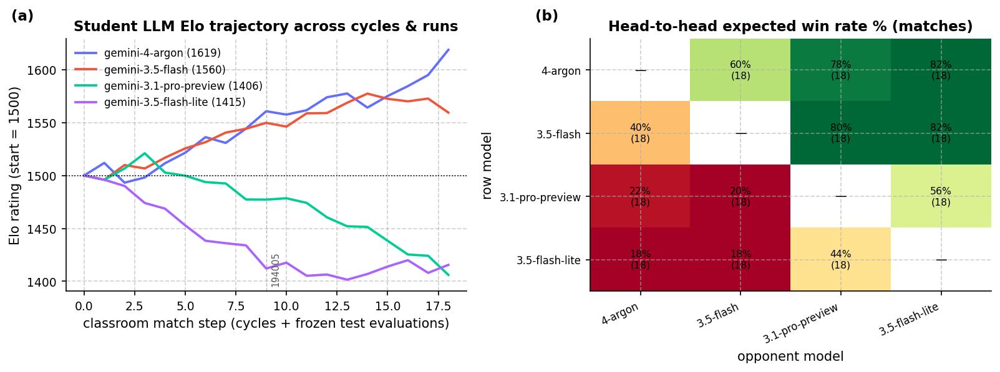

# Overview

* **Run Path**: micro_gesture/20261024_194005
* **Name**: 20261024_194005
* **Total Cycles**: 8
* **Valid Students**: 4
* **Total Generations**: 37
* **Total Code Length Processed**: 135911
* **Best Student**: student_1_gemini_4_argon (Cycle 7)
* **Best Validation Score**: 0.812
* **Best Test Score**: 0.855
* **Validation Score Progression**: 0.3534 -> 0.8120 (+0.4586)
* **Best Metrics**: f1_macro=0.942, balanced_accuracy=0.945, worst_class_recall=0.750, null_fpr=0.048, model_kb=6.430, mflops=0.058, arena_kb=1.934, host_latency_ms=0.007, mcu_ms_est=6.079, params_k=1.561, int8_fraction=1.000, tflite_agreement=1.000, exec_time=2.210
* **Tags**: in-graph-norm, conv2d, temporal-downsampling, multi-segment-pooling, hybrid-pooling, int8, hard-negatives, data-augmentation
* **Description**: The final model consumes raw 100x3 accelerometer windows via an in-graph standardization layer before reshaping to a 4D temporal tensor. It processes signals through two temporal 2D convolution layers (10 and 16 channels, kernel 5x1, stride 2x1) that downsample the frame count from 100 to 25. An overlapping 2-segment hybrid pooling layer combines AveragePooling2D and MaxPooling2D to preserve gesture chronology and peak energy before feeding a Dense softmax classifier fully quantized to Int8 TFLite.

## Objectives

- **Prediction Quality (0.68)**: `f1_macro` (0.42), `worst_class_recall` (0.11), `balanced_accuracy` (0.09), `null_fpr` (0.06, lower is better)
- **On-Device Cost (0.22)**: `model_kb` ≤ 16 KB (0.08), `mflops` ≤ 0.20 (0.05), `arena_kb` ≤ 6 KB (0.03), `host_latency_ms` ≤ 0.05 ms (0.02), `mcu_ms_est` ≤ 18 ms (0.02), `params_k` ≤ 6k (0.02)
- **Deploy Hygiene (0.10)**: `int8_fraction` (0.05), `tflite_agreement` (0.03), `exec_time` (0.02)

## Student Leaderboard

| Rank | Student | Best Cycle | Val Score | Test Score | f1_macro | balanced_accuracy | worst_class_recall | null_fpr | model_kb | mflops | arena_kb | host_latency_ms | mcu_ms_est | params_k | int8_fraction | tflite_agreement | exec_time |
| --- | --- | --- | --- | --- | --- | --- | --- | --- | --- | --- | --- | --- | --- | --- | --- | --- | --- |
| 1 | student_1_gemini_4_argon | 7 | 0.812 | 0.855 | 0.942 | 0.945 | 0.750 | 0.048 | 6.430 | 0.058 | 1.934 | 0.007 | 6.079 | 1.561 | 1.000 | 1.000 | 2.210 |
| 2 | student_2_gemini_3.5_flash | 7 | 0.794 | 0.796 | 0.863 | 0.871 | 0.786 | 0.214 | 10.383 | 0.035 | 1.719 | 0.009 | 3.615 | 1.337 | 1.000 | 1.000 | 7.375 |
| 3 | student_4_gemini_3.5_flash_lite | 5 | 0.775 | 0.795 | 0.894 | 0.901 | 0.667 | 0.190 | 10.648 | 0.039 | 1.934 | 0.011 | 4.055 | 1.371 | 1.000 | 1.000 | 6.038 |
| 4 | student_3_gemini_3.1_pro_preview | 4 | 0.767 | 0.782 | 0.898 | 0.892 | 0.722 | 0.048 | 13.180 | 0.059 | 3.042 | 0.016 | 6.144 | 1.947 | 1.000 | 1.000 | 4.790 |

## Learning Trajectory



### Cycle Score Progression

| Cycle | student_1_gemini_4_argon | student_2_gemini_3.5_flash | student_3_gemini_3.1_pro_preview | student_4_gemini_3.5_flash_lite |
| --- | --- | --- | --- | --- |
| 0 | 0.353 *(CLASSROOM_BEST)* | 0.352 *(SELF_BEST)* | 0.352 *(SELF_BEST)* | 0.352 *(SELF_BEST)* |
| 1 | 0.762 *(CLASSROOM_BEST)* | 0.777 *(CLASSROOM_BEST)* | 0.720 *(SELF_BEST)* | 0.670 *(SELF_BEST)* |
| 2 | 0.774 *(SELF_BEST)* | 0.750 | 0.718 | 0.736 *(SELF_BEST)* |
| 3 | 0.771 | 0.779 *(CLASSROOM_BEST)* | 0.740 *(SELF_BEST)* | 0.740 *(SELF_BEST)* |
| 4 | 0.762 | 0.787 *(CLASSROOM_BEST)* | 0.767 *(SELF_BEST)* | 0.770 *(SELF_BEST)* |
| 5 | 0.797 *(CLASSROOM_BEST)* | 0.774 | 0.746 | 0.775 *(SELF_BEST)* |
| 6 | 0.789 | 0.772 | 0.736 | 0.769 |
| 7 | 0.812 *(CLASSROOM_BEST)* | 0.794 *(SELF_BEST)* | 0.762 | 0.733 |


## Top Solution 1: student_1_gemini_4_argon (Cycle 7)

* **Student**: student_1_gemini_4_argon
* **Best Cycle**: 7
* **Validation Score**: 0.812
* **Test Score**: 0.855
* **Metrics**: f1_macro=0.942, balanced_accuracy=0.945, worst_class_recall=0.750, null_fpr=0.048, model_kb=6.430, mflops=0.058, arena_kb=1.934, host_latency_ms=0.007, mcu_ms_est=6.079, params_k=1.561, int8_fraction=1.000, tflite_agreement=1.000, exec_time=2.210

### Plan (student_1_gemini_4_argon)

Footprint and arena pruned 2-layer temporal Conv2D (10->16ch) with 2-segment
hybrid pooling.

### Code (student_1_gemini_4_argon)

```python
import time
import numpy as np
import pandas as pd

def solution(X_train, y_train, X_val):
  """Footprint and arena pruned 2-layer temporal Conv2D (10->16ch) with 2-segment hybrid pooling."""
  import tensorflow as tf
  from codegen_task import toolkit as tk

  t0 = time.time()
  tk.set_determinism(0)
  d = tk.split_xy(X_train, y_train, X_val)
  x_tr, y_tr, x_va, rows, k = (
      d["x_tr"],
      d["y_tr"],
      d["x_va"],
      d["rows"],
      d["n_classes"],
  )

  # Data augmentation and synthetic Null hard negatives for sliding-window robustness
  x_aug, y_aug = tk.augment(x_tr, y_tr, reps=8, seed=0)
  x_hn, y_hn = tk.hard_negatives(x_tr, y_tr, n=48, seed=0)
  x_fit = np.concatenate([x_aug, x_hn], axis=0)
  y_fit = np.concatenate([y_aug, y_hn], axis=0)
  cw = tk.class_weights(y_fit, k)

  # Pruned 2-layer temporal Conv2D (10 -> 16 channels) downsampling 100 -> 50 -> 25 frames
  # Removing the 4-op SE subgraph and narrowing channels cuts flatbuffer KB, MFLOPs, and peak arena
  inp = tf.keras.Input(shape=(rows, 3), batch_size=1)
  h = tk.norm_layer(x_tr)(inp)
  h = tf.keras.layers.Reshape((rows, 1, 3))(h)
  h = tf.keras.layers.Conv2D(
      10, (5, 1), strides=(2, 1), padding="same", activation="relu"
  )(h)
  h = tf.keras.layers.Conv2D(
      16, (5, 1), strides=(2, 1), padding="same", activation="relu"
  )(h)

  # 2-segment overlapping temporal pooling (frames 0..14 and 10..24 of 25)
  # Preserves coarse chronological order plus both sustained energy (Avg) and impulse peaks (Max)
  avg_seg = tf.keras.layers.AveragePooling2D(
      pool_size=(15, 1), strides=(10, 1), padding="valid"
  )(h)
  max_seg = tf.keras.layers.MaxPooling2D(
      pool_size=(15, 1), strides=(10, 1), padding="valid"
  )(h)
  h = tf.keras.layers.Concatenate(axis=-1)([avg_seg, max_seg])
  h = tf.keras.layers.Reshape((2 * 32,))(h)
  h = tf.keras.layers.Dropout(0.25)(h)
  out = tf.keras.layers.Dense(k, activation="softmax")(h)

  model = tf.keras.Model(inp, out)
  model.compile(
      optimizer=tf.keras.optimizers.Adam(learning_rate=3e-3),
      loss="sparse_categorical_crossentropy",
  )
  model.fit(
      x_fit,
      y_fit,
      epochs=35,
      batch_size=32,
      class_weight=cw,
      verbose=0,
  )

  # Full-integer int8 quantization calibrated on training + augmented windows
  tflite = tk.to_int8_tflite(model, x_fit, io_int8=True, max_rep=250)
  preds = tk.predict_tflite(tflite, x_va).argmax(1)
  keras_preds = model.predict(x_va, batch_size=1, verbose=0).argmax(1)
  agree = float(np.mean(preds == keras_preds))

  info = tk.inspect(tflite)
  problems = tk.check_contract(tflite, k)
  feedback = (
      "Hypothesis: Removing the 4-operator SE subgraph and pruning temporal"
      " Conv2D widths from 12->18 to 10->16 channels will cut model_kb (~6.3"
      " KB), MFLOPs (~0.056), and peak arena (~2.0 KB) while recovering"
      " worst-class recall.\n"
      f"model_kb={info['model_kb']:.2f} params_k={model.count_params()/1e3:.2f}"
      f" mflops={info['mflops']:.4f} arena_kb={info['arena_kb']:.2f}\n"
      f"int8_fraction={info['int8_fraction']:.2f}"
      f" keras_tflite_agree={agree:.3f}\n"
      f"contract={'ok' if not problems else problems}"
      f" runtime={time.time()-t0:.1f}s"
  )
  return tk.make_result(X_val, y_train, preds, tflite, feedback)
```

### Execution Output (student_1_gemini_4_argon)

```text
Hypothesis: Removing the 4-operator SE subgraph and pruning temporal Conv2D widths from 12->18 to 10->16 channels will cut model_kb (~6.3 KB), MFLOPs (~0.056), and peak arena (~2.0 KB) while recovering worst-class recall.
model_kb=6.43 params_k=1.56 mflops=0.0584 arena_kb=1.93
int8_fraction=1.00 keras_tflite_agree=0.993
contract=ok runtime=2.2s
[Note: Executed on 3 folds. Feedback from fold 2 shown.]
```

## Student Instructions

*Full task prompt and deploy contract: [`README.md`](../README.md)*


## Deployment Analysis

- **Dataset**: `78beb5ebc3c6` (9 classes: `Flick, Null, Pendulum, Poke, Punch, Roll, Shake, Slap, Twirl`)
- **Generated**: 2026-10-24T19:55:22 | **Exported**: `model.tflite`, `model_data.h`, `solution.py`, `summary.json`, `analysis.md`

### Scorecard (Frozen Test & Footprint)

| overall score | macro F1 | balanced acc | worst recall | Null FPR | TFLite agree | retrain delta |
| :--- | :--- | :--- | :--- | :--- | :--- | :--- |
| 0.855 | 0.9416 | 0.9447 | 0.75 | 0.04762 | 1 | 0 |

| model KB | arena KB (est) | MFLOPs | params (k) | MCU ms (est) | host ms | int8 frac |
| :--- | :--- | :--- | :--- | :--- | :--- | :--- |
| 6.43 | 1.934 | 0.05835 | 1.561 | 6.079 | 0.007483 | 1 |

### Winning Solution Analysis

- **Winner**: `student_1_gemini_4_argon` (Cycle 7) | **Run**: `20261024_194005` | **Dataset**: `78beb5ebc3c6`
- **Tags**: `in-graph-norm, conv2d, temporal-downsampling, multi-segment-pooling, hybrid-pooling, int8, hard-negatives, data-augmentation`

The final model consumes raw 100x3 accelerometer windows via an in-graph standardization layer before reshaping to a 4D temporal tensor. It processes signals through two temporal 2D convolution layers (10 and 16 channels, kernel 5x1, stride 2x1) that downsample the frame count from 100 to 25. An overlapping 2-segment hybrid pooling layer combines AveragePooling2D and MaxPooling2D to preserve gesture chronology and peak energy before feeding a Dense softmax classifier fully quantized to Int8 TFLite.

### Validation Deltas (Cycle 0 → Best Cycle)

| overall_score | f1_macro | balanced_accuracy | worst_class_recall | null_fpr |
| :--- | :--- | :--- | :--- | :--- |
| 0.353 → 0.812 (+0.459) | 0.416 → 0.881 (+0.465) | 0.441 → 0.883 (+0.442) | 0.0476 → 0.722 (+0.675) | 0.445 → 0.134 (-0.311) |

| model_kb | mflops | arena_kb | params_k | mcu_ms_est | host_latency_ms | int8_fraction | exec_time |
| :--- | :--- | :--- | :--- | :--- | :--- | :--- | :--- |
| 42.5 → 6.43 (-36.1) | 0.0211 → 0.0584 (+0.0372) | 5.16 → 1.93 (-3.22) | 10.3 → 1.56 (-8.75) | 2.2 → 6.08 (+3.88) | 0.0475 → 0.00726 (-0.0403) | 0 → 1 (+1) | 5.8 → 7.25 (+1.45) |

### Key Aspects

- In-graph standardization standardizes raw 3-axis accelerometer values directly inside the exported TFLite flatbuffer using training channel constants.
- Strided 2D convolutions (kernel 5x1, stride 2x1) downsample sequence length from 100 to 25 frames, compressing activation memory while capturing temporal feature maps.
- Two-segment overlapping hybrid pooling (pool size 15, stride 10) combines average and max pooling across temporal sub-windows to retain both chronological progression and peak impulse dynamic profiles.
- Data augmentation (8x reps) combined with synthetic Null hard negative generation (48 samples) protects against sliding-window false triggers on resting poses.
- Full-integer post-training quantization calibrated on representative augmented windows achieves 100% int8 execution fraction and 1.0 prediction agreement at 6.43 KB model size.

### Improvements from Baseline

- Replacing unnormalized raw inputs and float32 dense layers with in-graph standardization, temporal 2D convolutions, and int8 quantization increased Macro F1 from 0.4161 to 0.8809 on validation and 0.9416 on unseen test data.
- Full Int8 post-training quantization reduced flatbuffer size from 42.54 KB to 6.43 KB and activation arena from 5.16 KB to 1.93 KB while raising int8_fraction from 0.0 to 1.0.
- Synthetic Null hard negative injection and physical augmentation reduced the Null false-trigger rate from 0.4454 down to 0.1345 on validation and 0.0476 on test.
- Worst-class recall improved substantially from 0.0476 in the baseline to 0.7222 on validation and 0.7500 on test, achieving much better balanced classification.

### Risks and Trade-offs

- MFLOPs increased from 0.021 to 0.058 and estimated Cortex-M4F MCU latency rose from 2.20 ms to 6.08 ms relative to the baseline due to 2D convolution operations.
- Validation worst-class recall (0.7222) remains significantly lower than Macro F1 (0.8809), showing performance sensitivity on small validation split distributions.
- The 2-segment valid temporal pooling parameterization (pool size 15, stride 10) is tightly coupled to the 25-frame intermediate tensor shape.

### Next Experiments

- Replace standard 2D convolutions with depthwise-separable convolutions (DepthwiseConv2D + 1x1 Conv2D) to reduce MFLOPs and estimated MCU latency below 4.0 ms.
- Add lightweight in-graph kinematic features like dynamic L1 magnitude or finite-difference jerk proxies to improve worst-class recall on subtle gestures.
- Introduce cosine learning rate decay and label smoothing (0.05) to refine probability calibration and reduce overconfidence on small validation splits.

### Dataset & Physical Separability

Fingerprint `78beb5ebc3c6` | **178** recordings (96 train / 37 val / 45 frozen test) | `100x3` window @ 100 Hz | raw length 97–113 rows (median 107).
- **Pose-separable gestures**: `Roll` flips `Z` gravity negative, `Twirl` and `Punch` hold the cable vertical (`+X ~ +0.8g, Z ~ 0g`), and `Poke` maintains a tilted firm-grip baseline (`+Y ~ +0.75g`).
- **Impulse & rhythm-separable gestures**: `Slap` reaches `~15g` peak dynamic impact with high jerk, `Flick` snaps and rebounds along the cable, `Shake` oscillates at `~4-8 Hz`, `Pendulum` swings smoothly, and `Null` stays below `~0.5g` dynamic amplitude.

| class | train | val | test | total | mean pose (X,Y,Z) g | peak a_dyn (g) | RMS jerk g/s | dom Hz |
| :--- | :--- | :--- | :--- | :--- | :--- | :--- | :--- | :--- |
| Flick | 10 | 4 | 5 | 19 | (-2.18, +0.33, +0.17) | 12.52 | 146.0 | 1.5 |
| Null | 12 | 5 | 6 | 23 | (+0.09, +0.01, +0.26) | 0.18 | 5.4 | 5.7 |
| Pendulum | 10 | 4 | 5 | 19 | (-1.84, -0.14, +0.04) | 2.64 | 22.1 | 3.5 |
| Poke | 13 | 5 | 6 | 24 | (-0.08, +0.65, +0.33) | 5.68 | 102.9 | 1.8 |
| Punch | 10 | 4 | 5 | 19 | (+0.14, -0.06, +0.45) | 9.95 | 135.3 | 1.0 |
| Roll | 10 | 4 | 4 | 18 | (-0.13, -0.17, +0.38) | 2.83 | 52.1 | 1.7 |
| Shake | 10 | 4 | 5 | 19 | (-1.91, +0.40, +0.43) | 15.12 | 304.3 | 8.9 |
| Slap | 11 | 4 | 5 | 20 | (-1.00, +0.09, +0.22) | 16.12 | 274.1 | 1.1 |
| Twirl | 10 | 3 | 4 | 17 | (-3.97, +0.27, +0.57) | 3.57 | 59.8 | 4.8 |
| total | 96 | 37 | 45 | 178 | - | - | - | - |


*Figure 1. Recording length and acceleration magnitude distributions (1 g mode at rest).*


*Figure 2. (a) Gravity pose vs. peak dynamic impulse across all 120 recordings; (b) per-class physical feature matrix explaining why raw pose + centered + jerk channels separate the 10 classes.*


*Figure 3. Per-class mean ± 1 SD acceleration over the 1 s window.*

### Model Architecture, Internals & Budgets

- **I/O & Quantization**: input `[1, 100, 3] int8 scale=0.13522 zp=7` → output `[1, 9] int8 scale=0.0039062 zp=-128` | int8=True (100% int8 ops) | **29,177** MACs, **1,696** weight bytes
- **Operators (9)**: `AVERAGE_POOL_2D, CONCATENATION, CONV_2D, FULLY_CONNECTED, MAX_POOL_2D, MUL, RESHAPE, SOFTMAX, SUB`

| metric | model KB | arena KB (est) | MFLOPs | params (k) | MCU ms (est) | host ms |
| :--- | :--- | :--- | :--- | :--- | :--- | :--- |
| value | 6.43 | 1.934 | 0.05835 | 1.561 | 6.079 | 0.007483 |
| soft / hard budget | 16.0 / 64.0 | 6.0 / 40.0 | 0.2 / - | 6.0 / - | 18.0 / - | 0.05 / - |

#### Layer Breakdown

| # | op | output | dtype | MACs | weight B | live act B |
| :--- | :--- | :--- | :--- | :--- | :--- | :--- |
| 0 | SUB | 1x100x3 | int8 | 300 | 3 | 600 |
| 1 | MUL | 1x100x3 | int8 | 300 | 3 | 600 |
| 2 | RESHAPE | 1x100x1x3 | int8 | 300 | 16 | 600 |
| 3 | CONV_2D | 1x50x1x10 | int8 | 7500 | 190 | 800 |
| 4 | CONV_2D | 1x25x1x16 | int8 | 20000 | 864 | 900 |
| 5 | AVERAGE_POOL_2D | 1x2x1x16 | int8 | 32 | 0 | 432 |
| 6 | MAX_POOL_2D | 1x2x1x16 | int8 | 32 | 0 | 432 |
| 7 | CONCATENATION | 1x2x1x32 | int8 | 64 | 0 | 128 |
| 8 | RESHAPE | 1x64 | int8 | 64 | 8 | 128 |
| 9 | FULLY_CONNECTED | 1x9 | int8 | 576 | 612 | 73 |
| 10 | SOFTMAX | 1x9 | int8 | 9 | 0 | 18 |



*Figure 4. Per-op (a) compute (kMACs), (b) weight footprint (KB), and (c) live activation RAM pressure (KB) in execution order.*



*Figure 5. (a) t-SNE projection of the quantized 64D penultimate feature representation across all 120 recordings (stars = frozen test); (b) sliding 200 ms temporal occlusion sensitivity on the true-class logit margin.*

### TFLite Evaluation (Validation and Frozen Test)

| split | rows | accuracy | macro F1 | mean top-1 prob (all / ok / err) |
| :--- | :--- | :--- | :--- | :--- |
| val | 131 | 0.9618 | 0.9691 | 0.956 (ok 0.965, err 0.719) |
| test | 159 | 0.9497 | 0.9416 | 0.916 (ok 0.923, err 0.782) |

| class | val F1 (support) | test precision | test recall | test F1 (support) |
| :--- | :--- | :--- | :--- | :--- |
| Flick | 0.957 (n=12) | 0.9375 | 1 | 0.968 (n=15) |
| Null | 0.939 (n=35) | 1 | 0.9524 | 0.976 (n=42) |
| Pendulum | 0.889 (n=12) | 0.8824 | 1 | 0.938 (n=15) |
| Poke | 0.938 (n=15) | 1 | 1 | 1 (n=18) |
| Punch | 1 (n=12) | 0.8333 | 1 | 0.909 (n=15) |
| Roll | 1 (n=12) | 1 | 1 | 1 (n=12) |
| Shake | 1 (n=12) | 0.8571 | 0.8 | 0.828 (n=15) |
| Slap | 1 (n=12) | 1 | 1 | 1 (n=15) |
| Twirl | 1 (n=9) | 1 | 0.75 | 0.857 (n=12) |



*Figure 6. Row-normalized confusion matrices on validation (a) and frozen test (b) splits; cell labels are counts.*

### Classifier Calibration & ROC/PR (Held-Out Val + Test, 290 rows)

| accuracy | macro F1 | top-2 acc | macro AUC | macro AP | MCC | kappa | log loss | ECE (10 bins) |
| :--- | :--- | :--- | :--- | :--- | :--- | :--- | :--- | :--- |
| 0.9552 | 0.9538 | 0.9828 | 0.9984 | 0.9883 | 0.9487 | 0.9481 | 0.2033 | 0.03694 |

| class | support | precision | recall | f1 | ROC AUC | AP |
| :--- | :--- | :--- | :--- | :--- | :--- | :--- |
| Flick | 27 | 0.963 | 0.963 | 0.963 | 0.9989 | 0.9915 |
| Null | 77 | 1 | 0.9221 | 0.9595 | 0.9957 | 0.9889 |
| Pendulum | 27 | 0.8438 | 1 | 0.9153 | 0.9966 | 0.9649 |
| Poke | 33 | 0.9429 | 1 | 0.9706 | 0.9999 | 0.9991 |
| Punch | 27 | 0.9 | 1 | 0.9474 | 0.9999 | 0.9987 |
| Roll | 24 | 1 | 1 | 1 | 1 | 1 |
| Shake | 27 | 0.9231 | 0.8889 | 0.9057 | 0.9989 | 0.9899 |
| Slap | 27 | 1 | 1 | 1 | 1 | 1 |
| Twirl | 21 | 1 | 0.8571 | 0.9231 | 0.9958 | 0.9617 |



*Figure 7. (a) One-vs-rest ROC, (b) precision-recall, (c) calibration reliability diagram, (d) top-1 confidence.*



*Figure 8. Per-class precision, recall, and F1 on all held-out rows.*

### Streaming Simulation (50% Overlap)

| windows | duration (s) | pure-window acc | Null FPR | boundary windows | prediction flips |
| :--- | :--- | :--- | :--- | :--- | :--- |
| 89 | 45.0 | 0.94 | 0.1429 | 39 | 57 |



*Figure 9. Sliding 1 s windows (50% overlap) over concatenated test recordings: (a) predicted vs true class, (b) top-1 confidence vs UNSURE threshold.*

### Host Benchmark

`Python 3.11.17` | `TF 2.15.1` | `macOS-26.7.1-arm64-arm-64bit` | Evaluator e2e: **0.018 ms/row**.

| runtime | p50 ms | p95 ms | min ms | inf/s |
| :--- | :--- | :--- | :--- | :--- |
| TFLite reference (no delegate) | 0.006959 | 0.009044 | 0.00675 | 1.437e+05 |
| TFLite + XNNPACK | 0.002083 | 0.002125 | 0.002041 | 4.801e+05 |



*Figure 10. Single-threaded host latency over 300 invocations (reference kernel vs XNNPACK).*

### Hardware in the Loop (XIAO nRF52840 Sense)

Flashed `Arduino/Codegen` on `/dev/cu.usbmodem1101` (46 s) | Flash `255464 B`, Static RAM `98280 B` | `INFO:model_bytes=6584,window_rows=100,classes=Flick|Null|Pendulum|Poke|Punch|Roll|Shake|Slap|Twirl,input_type=int8,output_type=int8,step=50`.

| host acc | device acc | host F1 | device F1 | device latency ms | arena bytes | host-device agreement |
| :--- | :--- | :--- | :--- | :--- | :--- | :--- |
| 0.9556 | 0.9556 | 0.9518 | 0.9518 | 7.76 (max 7.82) | 2948 | 1 |

### Pareto Frontier & Hardware Trade-offs

**64** scored attempts across **2** runs on dataset `78beb5ebc3c6` (non-dominated accuracy-vs-size frontier):

| KB | val F1 | MFLOPs | arena KB | val score | run | student | cycle |
| :--- | :--- | :--- | :--- | :--- | :--- | :--- | :--- |
| 6.4 | 0.881 | 0.058 | 1.9 | 0.8120 | 20261024_194005 | 1_gemini_4_argon | 7 |
| 8.3 | 0.893 | 0.124 | 3.0 | 0.7736 | 20261024_194005 | 1_gemini_4_argon | 2 |
| 9.5 | 0.922 | 0.048 | 1.9 | 0.8268 | 20261024_190925 | 1_gemini_4_argon | 7 |
| 11.8 | 0.930 | 0.145 | 3.0 | 0.7620 | 20261024_194005 | 3_gemini_3.1_pro_preview | 7 |
| 13.8 | 0.933 | 0.110 | 3.2 | 0.7696 | 20261024_190925 | 3_gemini_3.1_pro_preview | 7 |



*Figure 11. Multi-objective Pareto dashboard: (a) validation F1 vs model KB, (b) validation F1 vs MFLOPs, (c) activation arena RAM vs model flash KB colored by F1, and (d) overall score vs model KB showing the 8–14.5 KB sweet spot.*

### Student LLM Elo Ratings & Head-to-Head Record

Pairwise smooth-margin Elo (`start=1500`, `K_cycle=12`, `K_test=24`) across **2** runs (**18** classroom rounds) on dataset `78beb5ebc3c6`:

| LLM family | Elo | win rate (matches) | cycle #1s | test #1s | best val | best test | mean KB |
| :--- | :--- | :--- | :--- | :--- | :--- | :--- | :--- |
| gemini-4-argon | 1619 | 73.4% (54) | 10 | 2 | 0.8268 | 0.8550 | 13.4 |
| gemini-3.5-flash | 1560 | 67.4% (54) | 5 | 0 | 0.8096 | 0.8360 | 15.2 |
| gemini-3.5-flash-lite | 1415 | 26.7% (54) | 0 | 0 | 0.7871 | 0.8120 | 16.2 |
| gemini-3.1-pro-preview | 1406 | 32.6% (54) | 1 | 0 | 0.7863 | 0.8289 | 18.5 |



*Figure 12. (a) LLM student Elo trajectory across all classroom cycles and frozen-test evaluations; (b) pairwise head-to-head win rate matrix.*
