# Overview

* **Run Path**: micro_gesture/20261025_175016
* **Name**: 20261025_175016
* **Total Cycles**: 8
* **Valid Students**: 5
* **Total Generations**: 34
* **Total Code Length Processed**: 150111
* **Best Student**: student_1_gemini_4_argon_r2 (Cycle 7)
* **Best Validation Score**: 0.796
* **Best Test Score**: 0.849
* **Validation Score Progression**: 0.3620 -> 0.8098 (+0.4478)
* **Best Metrics**: f1_macro=0.950, balanced_accuracy=0.948, worst_class_recall=0.833, null_fpr=0.071, model_kb=8.211, mflops=0.069, arena_kb=2.148, host_latency_ms=0.009, mcu_ms_est=7.228, params_k=1.753, int8_fraction=1.000, tflite_agreement=1.000, exec_time=3.897
* **Tags**: in-graph-norm, strided-conv2d, hybrid-pooling, int8, full-integer-quantization, peak-aligned-blending, hard-negatives, post-bias-tuning
* **Description**: The solution consumes raw 100x3 accelerometer windows through an in-graph standardization layer before reshaping them to 4D spatial tensors. It reduces time resolution from 100 to 25 frames using two strided Conv2D layers (12 and 16 channels, 5x1 kernels), followed by a 2-segment overlapping hybrid pooling layer (Average + Max across frames 0..14 and 10..24) that produces a 64-dimensional temporal summary. A final Dense layer outputs 9 class predictions, post-processed with a +0.26 bias boost on the Null class and fully quantized to Int8 using dynamic amplitude-stratified calibration data.

## Objectives

- **Prediction Quality (0.68)**: `f1_macro` (0.42), `worst_class_recall` (0.11), `balanced_accuracy` (0.09), `null_fpr` (0.06, lower is better)
- **On-Device Cost (0.22)**: `model_kb` ≤ 16 KB (0.08), `mflops` ≤ 0.20 (0.05), `arena_kb` ≤ 6 KB (0.03), `host_latency_ms` ≤ 0.05 ms (0.02), `mcu_ms_est` ≤ 18 ms (0.02), `params_k` ≤ 6k (0.02)
- **Deploy Hygiene (0.10)**: `int8_fraction` (0.05), `tflite_agreement` (0.03), `exec_time` (0.02)

## Student Leaderboard

| Rank | Student | Best Cycle | Val Score | Test Score | f1_macro | balanced_accuracy | worst_class_recall | null_fpr | model_kb | mflops | arena_kb | host_latency_ms | mcu_ms_est | params_k | int8_fraction | tflite_agreement | exec_time |
| --- | --- | --- | --- | --- | --- | --- | --- | --- | --- | --- | --- | --- | --- | --- | --- | --- | --- |
| 1 | student_1_gemini_4_argon_r2 | 7 | 0.796 | 0.849 | 0.950 | 0.948 | 0.833 | 0.071 | 8.211 | 0.069 | 2.148 | 0.009 | 7.228 | 1.753 | 1.000 | 1.000 | 3.897 |
| 2 | student_2_gemini_3.5_flash | 7 | 0.793 | 0.844 | 0.958 | 0.959 | 0.833 | 0.071 | 9.961 | 0.070 | 2.148 | 0.009 | 7.329 | 2.041 | 1.000 | 1.000 | 2.735 |
| 3 | student_1_gemini_4_argon | 7 | 0.810 | 0.829 | 0.925 | 0.918 | 0.733 | 0.024 | 8.445 | 0.055 | 2.578 | 0.015 | 5.743 | 1.525 | 1.000 | 1.000 | 3.080 |
| 4 | student_3_gemini_3.1_pro_preview | 4 | 0.766 | 0.799 | 0.936 | 0.936 | 0.833 | 0.095 | 10.109 | 0.126 | 3.438 | 0.011 | 13.098 | 3.073 | 1.000 | 1.000 | 3.698 |
| 5 | student_4_gemini_3.5_flash_lite | 0 | 0.352 | 0.462 | 0.535 | 0.560 | 0.200 | 0.381 | 42.543 | 0.021 | 5.156 | 0.001 | 2.201 | 10.313 | 0.000 | 1.000 | 0.676 |

## Learning Trajectory

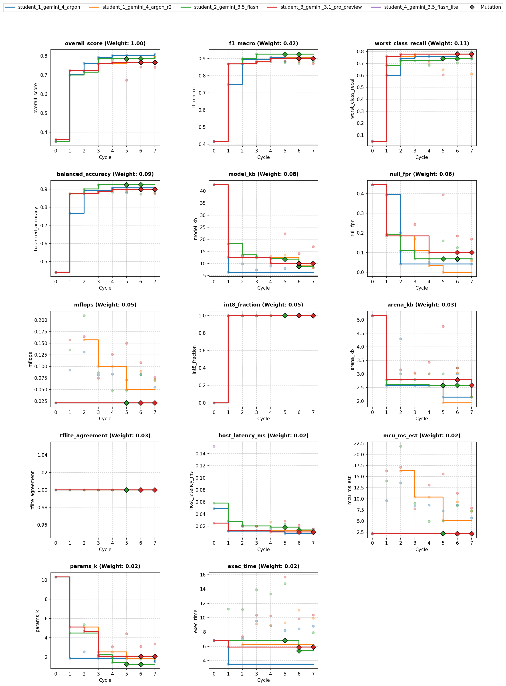

### Cycle Score Progression

| Cycle | student_1_gemini_4_argon | student_2_gemini_3.5_flash | student_3_gemini_3.1_pro_preview | student_4_gemini_3.5_flash_lite | student_1_gemini_4_argon_r2 |
| --- | --- | --- | --- | --- | --- |
| 0 | 0.352 *(CLASSROOM_BEST)* | 0.352 *(SELF_BEST)* | 0.362 *(CLASSROOM_BEST)* | 0.352 *(SELF_BEST)* | — |
| 1 | 0.701 *(CLASSROOM_BEST)* | 0.700 *(SELF_BEST)* | 0.723 *(CLASSROOM_BEST)* | — | — |
| 2 | 0.762 *(CLASSROOM_BEST)* | 0.715 *(SELF_BEST)* | 0.715 | — | 0.723 *(SELF_BEST)* |
| 3 | 0.794 *(CLASSROOM_BEST)* | 0.785 *(SELF_BEST)* | 0.761 *(SELF_BEST)* | — | 0.760 *(SELF_BEST)* |
| 4 | 0.802 *(CLASSROOM_BEST)* | 0.781 | 0.766 *(SELF_BEST)* | — | 0.761 *(SELF_BEST)* |
| 5 | 0.804 *(CLASSROOM_BEST)* | 0.776 | 0.673 | — | 0.786 *(SELF_BEST)* |
| 6 | 0.799 | 0.777 | 0.743 | — | 0.784 |
| 7 | 0.810 *(CLASSROOM_BEST)* | 0.793 *(SELF_BEST)* | 0.741 | — | 0.796 *(SELF_BEST)* |


## Top Solution 1: student_1_gemini_4_argon_r2 (Cycle 7)

* **Student**: student_1_gemini_4_argon_r2
* **Best Cycle**: 7
* **Validation Score**: 0.796
* **Test Score**: 0.849
* **Metrics**: f1_macro=0.950, balanced_accuracy=0.948, worst_class_recall=0.833, null_fpr=0.071, model_kb=8.211, mflops=0.069, arena_kb=2.148, host_latency_ms=0.009, mcu_ms_est=7.228, params_k=1.753, int8_fraction=1.000, tflite_agreement=1.000, exec_time=3.897

### Plan (student_1_gemini_4_argon_r2)

- 1. Split & Prepare Data
- 2. Peak-Aligned Within-Class Gesture Blending + Physical Augmentation
- 3. Model Architecture: Lean In-Graph Norm + 2-Layer Strided Conv2D + 2-Segment
  Overlapping Hybrid Pool

- 4. Compile & Train
- 5. Balanced Quantization Calibration Dataset (Quiet Resting + Subtle Rotations
  + High-Amplitude Impacts)

### Code (student_1_gemini_4_argon_r2)

```python
def solution(X_train, y_train, X_val):
    import time
    import numpy as np
    import pandas as pd
    import tensorflow as tf
    from codegen_task import toolkit as tk

    t0 = time.time()
    tk.set_determinism(42)

    # 1. Split & Prepare Data
    d = tk.split_xy(X_train, y_train, X_val)
    x_tr, y_tr, x_va, rows, k = d["x_tr"], d["y_tr"], d["x_va"], d["rows"], d["n_classes"]
    null_idx = tk.null_index()

    # 2. Peak-Aligned Within-Class Gesture Blending + Physical Augmentation
    rng = np.random.default_rng(42)
    blend_x, blend_y = [], []
    for cls in range(k):
        if cls == null_idx:
            continue
        cls_mask = np.where(y_tr == cls)[0]
        if len(cls_mask) < 2:
            continue
        cls_x = x_tr[cls_mask]
        dyn = cls_x - np.mean(cls_x, axis=1, keepdims=True)
        energy = np.sum(np.abs(dyn), axis=-1)
        peaks = np.argmax(energy, axis=1)
        for _ in range(len(cls_mask) * 2):
            i1, i2 = rng.choice(len(cls_mask), size=2, replace=False)
            shift = int(np.clip(peaks[i1] - peaks[i2], -18, 18))
            x2_aligned = np.roll(cls_x[i2], shift, axis=0)
            if shift > 0:
                x2_aligned[:shift] = cls_x[i2][0]
            elif shift < 0:
                x2_aligned[shift:] = cls_x[i2][-1]
            alpha = float(rng.uniform(0.25, 0.75))
            blend_x.append((alpha * cls_x[i1] + (1.0 - alpha) * x2_aligned).astype(np.float32))
            blend_y.append(cls)

    if blend_x:
        x_base = np.concatenate([x_tr, np.stack(blend_x, axis=0)], axis=0)
        y_base = np.concatenate([y_tr, np.array(blend_y, dtype=y_tr.dtype)], axis=0)
    else:
        x_base, y_base = x_tr, y_tr

    x_aug, y_aug = tk.augment(
        x_base, y_base, reps=9, seed=42,
        scale=(0.80, 1.22), shift_frac=0.16, rotate_deg=12.0,
        stretch=(0.86, 1.16), noise=0.02, blend_prob=0.25
    )

    # Compute class weights prior to adding synthetic Null hard negatives to avoid diluting Null protection
    cw = tk.class_weights(y_aug, k)
    if null_idx is not None:
        cw[null_idx] = cw.get(null_idx, 1.0) * 1.50
        x_hn, y_hn = tk.hard_negatives(x_tr, y_tr, null_index=null_idx, n=88, seed=42)
        x_tr_aug = np.concatenate([x_aug, x_hn], axis=0)
        y_tr_aug = np.concatenate([y_aug, y_hn], axis=0)
    else:
        x_hn = np.empty((0, rows, 3), dtype=np.float32)
        x_tr_aug, y_tr_aug = x_aug, y_aug

    idx = rng.permutation(len(x_tr_aug))
    x_tr_aug, y_tr_aug = x_tr_aug[idx], y_tr_aug[idx]
    y_tr_aug_onehot = tf.keras.utils.to_categorical(y_tr_aug, num_classes=k)

    # 3. Model Architecture: Lean In-Graph Norm + 2-Layer Strided Conv2D + 2-Segment Overlapping Hybrid Pool
    inp = tf.keras.Input(shape=(rows, 3))
    x_norm = tk.norm_layer(x_tr)(inp)
    h = tf.keras.layers.Reshape((rows, 1, 3))(x_norm)

    # Strided 2D convolutions (100 -> 50 -> 25 frames) keep flatbuffer metadata and arena minimal
    h = tf.keras.layers.Conv2D(12, (5, 1), strides=(2, 1), padding="same", activation="relu")(h)
    h = tf.keras.layers.Conv2D(16, (5, 1), strides=(2, 1), padding="same", activation="relu")(h)

    # 2-segment overlapping temporal hybrid pooling (frames 0..14 and 10..24) retains chronology + peak impulse
    avg_pool = tf.keras.layers.AveragePooling2D(pool_size=(15, 1), strides=(10, 1), padding="valid")(h)
    max_pool = tf.keras.layers.MaxPooling2D(pool_size=(15, 1), strides=(10, 1), padding="valid")(h)
    h = tf.keras.layers.Concatenate(axis=-1)([avg_pool, max_pool])
    h = tf.keras.layers.Reshape((64,))(h)

    h = tf.keras.layers.Dropout(0.25)(h)
    head = tf.keras.layers.Dense(k, activation="softmax", name="cls_head")
    out = head(h)

    model = tf.keras.Model(inp, out)

    # 4. Compile & Train
    epochs = 36
    batch_size = 32
    steps_per_epoch = max(1, int(np.ceil(len(x_tr_aug) / batch_size)))
    lr_schedule = tf.keras.optimizers.schedules.CosineDecay(
        initial_learning_rate=0.0035, decay_steps=epochs * steps_per_epoch
    )

    model.compile(
        optimizer=tf.keras.optimizers.Adam(learning_rate=lr_schedule),
        loss=tf.keras.losses.CategoricalCrossentropy(label_smoothing=0.04)
    )

    model.fit(
        x_tr_aug, y_tr_aug_onehot,
        epochs=epochs, batch_size=batch_size,
        verbose=0, class_weight=cw
    )

    # Conservative Null prior margin (+0.26) baked into Dense bias to curb resting false triggers
    if null_idx is not None:
        w, b = head.get_weights()
        b[null_idx] += 0.26
        head.set_weights([w, b])

    # 5. Balanced Quantization Calibration Dataset (Quiet Resting + Subtle Rotations + High-Amplitude Impacts)
    rep_list = [x_tr]
    if len(x_hn) > 0:
        # Include synthetic quiet/tilted resting windows so near-zero dynamic activations have fine int8 resolution
        rep_list.append(x_hn[:36])

    for cls in range(k):
        cls_mask = np.where(y_aug == cls)[0]
        if len(cls_mask) == 0:
            continue
        cls_windows = x_aug[cls_mask]
        # Rank windows by peak dynamic impulse magnitude (excluding static gravity mean)
        dyn_mag = np.max(np.linalg.norm(cls_windows - np.mean(cls_windows, axis=1, keepdims=True), axis=-1), axis=1)
        order = np.argsort(dyn_mag)
        # Filter out extreme synthetic >97th-percentile outlier spikes that would bloat int8 step scales,
        # and sample evenly from subtle low-energy up to sharp 97th-percentile impact windows
        trim_hi = max(1, int(0.97 * len(order)))
        trimmed_order = order[:trim_hi]
        n_pick = min(16, len(trimmed_order))
        q_idx = np.linspace(0, len(trimmed_order) - 1, num=n_pick, dtype=int)
        rep_list.append(cls_windows[trimmed_order[q_idx]])

    rep_x = np.concatenate(rep_list, axis=0).astype(np.float32)

    # Full-Integer Int8 Quantization & Verification
    tflite = tk.to_int8_tflite(model, rep_x, max_rep=len(rep_x))
    preds = tk.predict_tflite(tflite, x_va).argmax(1)

    info = tk.inspect(tflite)
    problems = tk.check_contract(tflite, k)
    params_k = model.count_params() / 1000.0

    feedback = (
        "Hypothesis: Amplitude-stratified int8 calibration dataset (balancing quiet resting windows, subtle rotations, "
        "and 97th-percentile clipped impact gestures) on a 3-channel 2-layer strided Conv2D + 2-segment hybrid pool cuts KB/arena while preserving quantization precision.\n"
        f"tflite={info['model_kb']:.1f} KB params={params_k:.2f}K mflops={info['mflops']:.3f}\n"
        f"arena={info['arena_kb']:.1f} KB int8={info['int8_fraction']:.2f} rep_n={len(rep_x)}\n"
        f"contract={'ok' if not problems else problems} runtime={time.time()-t0:.1f}s"
    )

    return tk.make_result(X_val, y_train, preds, tflite, feedback)
```

### Execution Output (student_1_gemini_4_argon_r2)

```text
Hypothesis: Amplitude-stratified int8 calibration dataset (balancing quiet resting windows, subtle rotations, and 97th-percentile clipped impact gestures) on a 3-channel 2-layer strided Conv2D + 2-segment hybrid pool cuts KB/arena while preserving quantization precision.
tflite=8.2 KB params=1.75K mflops=0.069
arena=2.1 KB int8=1.00 rep_n=269
contract=ok runtime=3.1s
[Note: Executed on 3 folds. Feedback from fold 3 shown.]
```

## Student Instructions

*Full task prompt and deploy contract: [`README.md`](../README.md)*


## Deployment Analysis

- **Dataset**: `78beb5ebc3c6` (9 classes: `Flick, Null, Pendulum, Poke, Punch, Roll, Shake, Slap, Twirl`)
- **Generated**: 2026-10-25T18:05:31 | **Exported**: `model.tflite`, `model_data.h`, `solution.py`, `summary.json`, `analysis.md`

### Scorecard (Frozen Test & Footprint)

| overall score | macro F1 | balanced acc | worst recall | Null FPR | TFLite agree | retrain delta |
| :--- | :--- | :--- | :--- | :--- | :--- | :--- |
| 0.8492 | 0.9499 | 0.9476 | 0.8333 | 0.07143 | 1 | 0 |

| model KB | arena KB (est) | MFLOPs | params (k) | MCU ms (est) | host ms | int8 frac |
| :--- | :--- | :--- | :--- | :--- | :--- | :--- |
| 8.211 | 2.148 | 0.06938 | 1.753 | 7.228 | 0.008715 | 1 |

### Winning Solution Analysis

- **Winner**: `student_1_gemini_4_argon_r2` (Cycle 7) | **Run**: `20261025_175016` | **Dataset**: `78beb5ebc3c6`
- **Tags**: `in-graph-norm, strided-conv2d, hybrid-pooling, int8, full-integer-quantization, peak-aligned-blending, hard-negatives, post-bias-tuning`

The solution consumes raw 100x3 accelerometer windows through an in-graph standardization layer before reshaping them to 4D spatial tensors. It reduces time resolution from 100 to 25 frames using two strided Conv2D layers (12 and 16 channels, 5x1 kernels), followed by a 2-segment overlapping hybrid pooling layer (Average + Max across frames 0..14 and 10..24) that produces a 64-dimensional temporal summary. A final Dense layer outputs 9 class predictions, post-processed with a +0.26 bias boost on the Null class and fully quantized to Int8 using dynamic amplitude-stratified calibration data.

### Validation Deltas (Cycle 0 → Best Cycle)

| overall_score | f1_macro | balanced_accuracy | worst_class_recall | null_fpr |
| :--- | :--- | :--- | :--- | :--- |
| 0.362 → 0.796 (+0.434) | 0.416 → 0.895 (+0.479) | 0.441 → 0.892 (+0.451) | 0.0476 → 0.611 (+0.563) | 0.445 → 0.0588 (-0.387) |

| model_kb | mflops | arena_kb | params_k | mcu_ms_est | host_latency_ms | int8_fraction | exec_time |
| :--- | :--- | :--- | :--- | :--- | :--- | :--- | :--- |
| 42.5 → 8.21 (-34.3) | 0.0211 → 0.0694 (+0.0483) | 5.16 → 2.15 (-3.01) | 10.3 → 1.75 (-8.56) | 2.2 → 7.23 (+5.03) | 0.0252 → 0.00779 (-0.0174) | 0 → 1 (+1) | 6.82 → 9.95 (+3.13) |

### Key Aspects

- In-graph normalization standardizes inputs on-device without external preprocessing, ensuring seamless pipeline integration.
- Strided Conv2D layers (kernel 5x1, stride 2x1) compress the sequence length by 4x, reducing peak activation memory to 2.15 KB and total parameter count to 1.75k.
- Two-segment overlapping hybrid pooling captures chronological progression (first half vs. second half) alongside peak impulse dynamic energy.
- Peak-aligned same-class gesture blending aligns kinetic dynamic energy peaks before interpolation, creating realistic dynamic training samples.
- Amplitude-stratified Int8 post-training quantization clips extreme >97th-percentile impulse outliers during calibration to avoid activation scale distortion while maintaining 100% Int8 kernel execution.

### Improvements from Baseline

- Validation F1 macro improved from 0.4161 to 0.8954 (and 0.9499 on test) through domain-specific physical data augmentation, peak-aligned blending, and strided convolutional temporal feature extraction.
- Null false-trigger rate dropped drastically from 0.4454 to 0.0588 (0.0714 on test) due to synthetic Null hard negative generation and explicit +0.26 post-training bias adjustment.
- Model size was reduced from 42.54 KB to 8.21 KB and activation memory decreased from 5.16 KB to 2.15 KB by replacing unquantized dense layers with quantized strided 2D convolutions.
- Int8 execution fraction reached 100% (up from 0.0% in the baseline) with 1.0 prediction agreement, fully meeting deploy contract constraints while drastically boosting overall score from 0.3620 to 0.7958.

### Risks and Trade-offs

- Estimated Cortex-M4F MCU execution time increased from 2.20 ms to 7.23 ms and compute increased from 0.021 to 0.069 MFLOPs due to 2D convolution kernel operations.
- Worst-class recall exhibits sensitivity across small validation splits (0.6111 on validation vs 0.8333 on test), reflecting metric volatility on limited sample counts.

### Next Experiments

- Replace standard Conv2D layers with depthwise-separable Conv2D layers with symmetric (2, 2) strides to reduce estimated MCU execution latency from 7.23 ms down toward ~4 ms.
- Integrate explicit kinematic feature channels (e.g. dynamic motion vector magnitude and gravity-centered L1 norms) directly into the Keras input graph to improve separation on difficult gesture pairs.
- Test temporal kernel multi-branch architectures (e.g. parallel 3x1 and 7x1 kernels) to capture both brief impact strikes and broad sweep gestures simultaneously without blowing up parameter budget.

### Dataset & Physical Separability

Fingerprint `78beb5ebc3c6` | **178** recordings (96 train / 37 val / 45 frozen test) | `100x3` window @ 100 Hz | raw length 97–113 rows (median 107).
- **Pose-separable gestures**: `Roll` flips `Z` gravity negative, `Twirl` and `Punch` hold the cable vertical (`+X ~ +0.8g, Z ~ 0g`), and `Poke` maintains a tilted firm-grip baseline (`+Y ~ +0.75g`).
- **Impulse & rhythm-separable gestures**: `Slap` reaches `~15g` peak dynamic impact with high jerk, `Flick` snaps and rebounds along the cable, `Shake` oscillates at `~4-8 Hz`, `Pendulum` swings smoothly, and `Null` stays below `~0.5g` dynamic amplitude.

| class | train | val | test | total | mean pose (X,Y,Z) g | peak a_dyn (g) | RMS jerk g/s | dom Hz |
| :--- | :--- | :--- | :--- | :--- | :--- | :--- | :--- | :--- |
| Flick | 10 | 4 | 5 | 19 | (-2.18, +0.33, +0.17) | 12.52 | 146.0 | 1.5 |
| Null | 12 | 5 | 6 | 23 | (+0.09, +0.01, +0.26) | 0.18 | 5.4 | 5.7 |
| Pendulum | 10 | 4 | 5 | 19 | (-1.84, -0.14, +0.04) | 2.64 | 22.1 | 3.5 |
| Poke | 13 | 5 | 6 | 24 | (-0.08, +0.65, +0.33) | 5.68 | 102.9 | 1.8 |
| Punch | 10 | 4 | 5 | 19 | (+0.14, -0.06, +0.45) | 9.95 | 135.3 | 1.0 |
| Roll | 10 | 4 | 4 | 18 | (-0.13, -0.17, +0.38) | 2.83 | 52.1 | 1.7 |
| Shake | 10 | 4 | 5 | 19 | (-1.91, +0.40, +0.43) | 15.12 | 304.3 | 8.9 |
| Slap | 11 | 4 | 5 | 20 | (-1.00, +0.09, +0.22) | 16.12 | 274.1 | 1.1 |
| Twirl | 10 | 3 | 4 | 17 | (-3.97, +0.27, +0.57) | 3.57 | 59.8 | 4.8 |
| total | 96 | 37 | 45 | 178 | - | - | - | - |

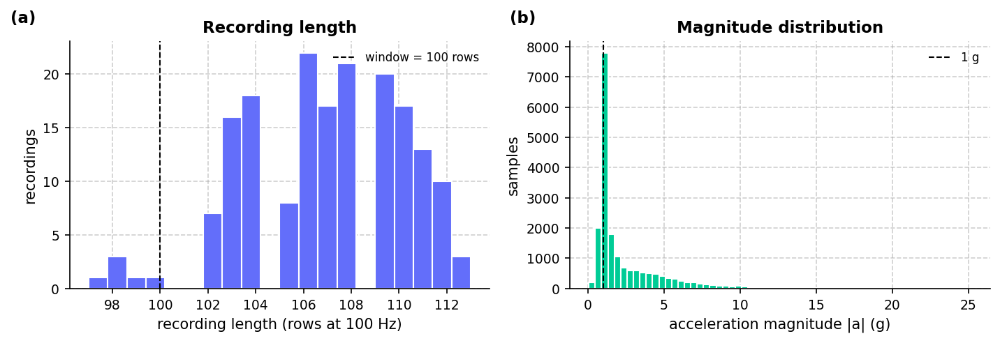

*Figure 1. Recording length and acceleration magnitude distributions (1 g mode at rest).*


*Figure 2. (a) Gravity pose vs. peak dynamic impulse across all 120 recordings; (b) per-class physical feature matrix explaining why raw pose + centered + jerk channels separate the 10 classes.*

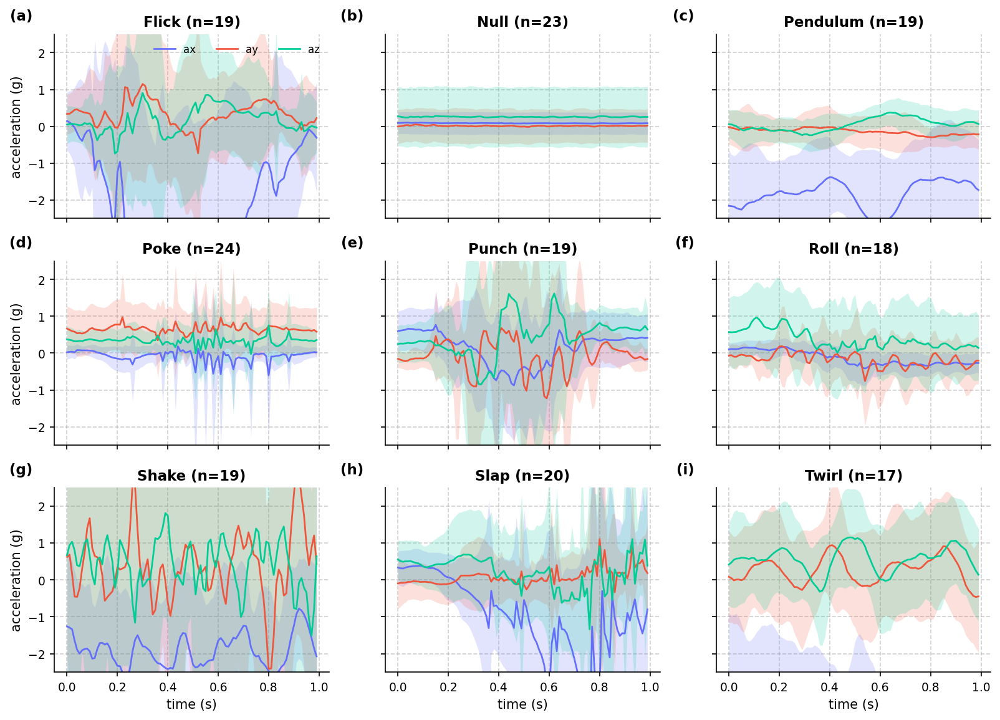

*Figure 3. Per-class mean ± 1 SD acceleration over the 1 s window.*

### Model Architecture, Internals & Budgets

- **I/O & Quantization**: input `[1, 100, 3] int8 scale=0.13762 zp=11` → output `[1, 9] int8 scale=0.0039062 zp=-128` | int8=True (100% int8 ops) | **34,692** MACs, **1,910** weight bytes
- **Operators (12)**: `AVERAGE_POOL_2D, CONCATENATION, CONV_2D, FULLY_CONNECTED, MAX_POOL_2D, MUL, PACK, RESHAPE, SHAPE, SOFTMAX, STRIDED_SLICE, SUB`

| metric | model KB | arena KB (est) | MFLOPs | params (k) | MCU ms (est) | host ms |
| :--- | :--- | :--- | :--- | :--- | :--- | :--- |
| value | 8.211 | 2.148 | 0.06938 | 1.753 | 7.228 | 0.008715 |
| soft / hard budget | 16.0 / 64.0 | 6.0 / 40.0 | 0.2 / - | 6.0 / - | 18.0 / - | 0.05 / - |

#### Layer Breakdown

| # | op | output | dtype | MACs | weight B | live act B |
| :--- | :--- | :--- | :--- | :--- | :--- | :--- |
| 0 | SUB | 1x100x3 | int8 | 300 | 3 | 600 |
| 1 | MUL | 1x100x3 | int8 | 300 | 3 | 600 |
| 2 | SHAPE | 3 | int32 | 3 | 0 | 312 |
| 3 | STRIDED_SLICE |  | int32 | 1 | 12 | 16 |
| 4 | PACK | 4 | int32 | 4 | 12 | 20 |
| 5 | RESHAPE | 1x100x1x3 | int8 | 300 | 0 | 616 |
| 6 | CONV_2D | 1x50x1x12 | int8 | 9000 | 228 | 900 |
| 7 | CONV_2D | 1x25x1x16 | int8 | 24000 | 1024 | 1000 |
| 8 | AVERAGE_POOL_2D | 1x2x1x16 | int8 | 32 | 0 | 432 |
| 9 | MAX_POOL_2D | 1x2x1x16 | int8 | 32 | 0 | 432 |
| 10 | CONCATENATION | 1x2x1x32 | int8 | 64 | 0 | 128 |
| 11 | SHAPE | 4 | int32 | 4 | 0 | 80 |
| 12 | STRIDED_SLICE |  | int32 | 1 | 12 | 20 |
| 13 | PACK | 2 | int32 | 2 | 4 | 12 |
| 14 | RESHAPE | 1x64 | int8 | 64 | 0 | 136 |
| 15 | FULLY_CONNECTED | 1x9 | int8 | 576 | 612 | 73 |
| 16 | SOFTMAX | 1x9 | int8 | 9 | 0 | 18 |

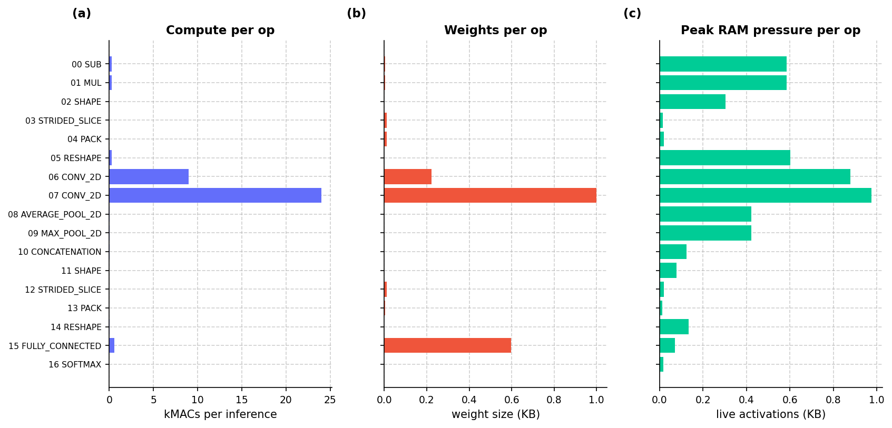

*Figure 4. Per-op (a) compute (kMACs), (b) weight footprint (KB), and (c) live activation RAM pressure (KB) in execution order.*

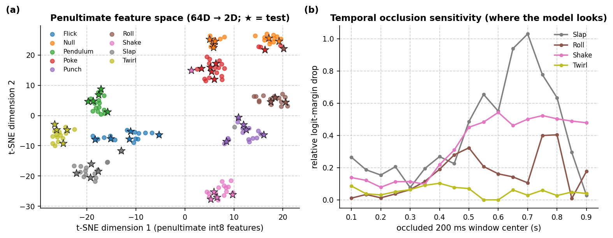

*Figure 5. (a) t-SNE projection of the quantized 64D penultimate feature representation across all 120 recordings (stars = frozen test); (b) sliding 200 ms temporal occlusion sensitivity on the true-class logit margin.*

### TFLite Evaluation (Validation and Frozen Test)

| split | rows | accuracy | macro F1 | mean top-1 prob (all / ok / err) |
| :--- | :--- | :--- | :--- | :--- |
| val | 131 | 0.9542 | 0.9535 | 0.915 (ok 0.934, err 0.510) |
| test | 159 | 0.9434 | 0.9499 | 0.878 (ok 0.895, err 0.593) |

| class | val F1 (support) | test precision | test recall | test F1 (support) |
| :--- | :--- | :--- | :--- | :--- |
| Flick | 0.957 (n=12) | 1 | 1 | 1 (n=15) |
| Null | 0.955 (n=35) | 0.907 | 0.9286 | 0.918 (n=42) |
| Pendulum | 0.857 (n=12) | 1 | 1 | 1 (n=15) |
| Poke | 0.938 (n=15) | 0.8824 | 0.8333 | 0.857 (n=18) |
| Punch | 1 (n=12) | 0.9375 | 1 | 0.968 (n=15) |
| Roll | 1 (n=12) | 1 | 0.9167 | 0.957 (n=12) |
| Shake | 1 (n=12) | 0.9333 | 0.9333 | 0.933 (n=15) |
| Slap | 1 (n=12) | 1 | 1 | 1 (n=15) |
| Twirl | 0.875 (n=9) | 0.9167 | 0.9167 | 0.917 (n=12) |

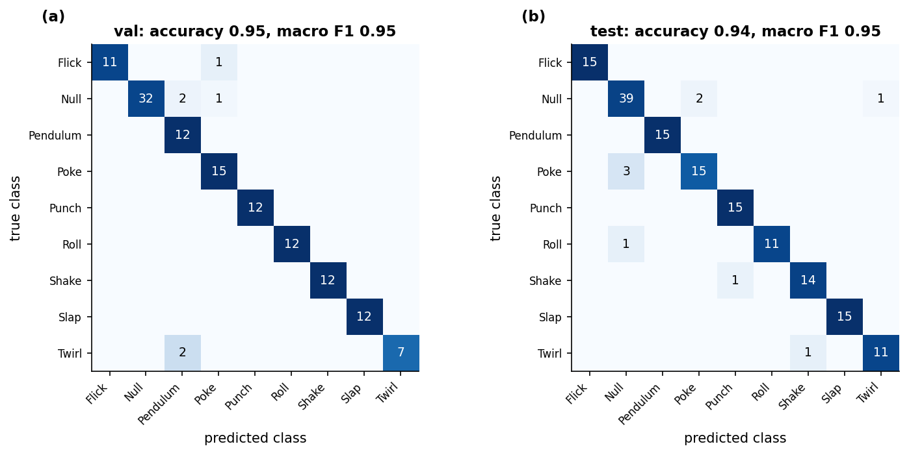

*Figure 6. Row-normalized confusion matrices on validation (a) and frozen test (b) splits; cell labels are counts.*

### Classifier Calibration & ROC/PR (Held-Out Val + Test, 290 rows)

| accuracy | macro F1 | top-2 acc | macro AUC | macro AP | MCC | kappa | log loss | ECE (10 bins) |
| :--- | :--- | :--- | :--- | :--- | :--- | :--- | :--- | :--- |
| 0.9483 | 0.9517 | 0.9862 | 0.9991 | 0.9936 | 0.9402 | 0.94 | 0.1782 | 0.0682 |

| class | support | precision | recall | f1 | ROC AUC | AP |
| :--- | :--- | :--- | :--- | :--- | :--- | :--- |
| Flick | 27 | 1 | 0.963 | 0.9811 | 1 | 1 |
| Null | 77 | 0.9467 | 0.9221 | 0.9342 | 0.9974 | 0.9929 |
| Pendulum | 27 | 0.871 | 1 | 0.931 | 0.9997 | 0.9973 |
| Poke | 33 | 0.8824 | 0.9091 | 0.8955 | 0.9974 | 0.9831 |
| Punch | 27 | 0.9643 | 1 | 0.9818 | 1 | 1 |
| Roll | 24 | 1 | 0.9583 | 0.9787 | 0.9993 | 0.9928 |
| Shake | 27 | 0.963 | 0.963 | 0.963 | 0.9992 | 0.9933 |
| Slap | 27 | 1 | 1 | 1 | 1 | 1 |
| Twirl | 21 | 0.9474 | 0.8571 | 0.9 | 0.9988 | 0.9833 |

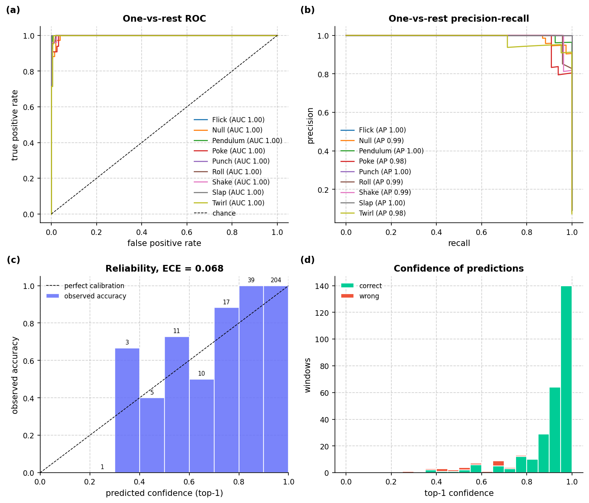

*Figure 7. (a) One-vs-rest ROC, (b) precision-recall, (c) calibration reliability diagram, (d) top-1 confidence.*

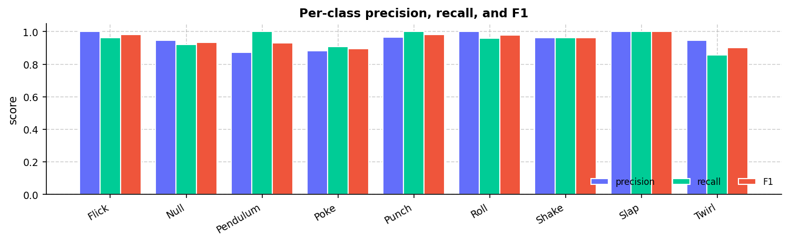

*Figure 8. Per-class precision, recall, and F1 on all held-out rows.*

### Streaming Simulation (50% Overlap)

| windows | duration (s) | pure-window acc | Null FPR | boundary windows | prediction flips |
| :--- | :--- | :--- | :--- | :--- | :--- |
| 89 | 45.0 | 0.92 | 0.1429 | 39 | 53 |

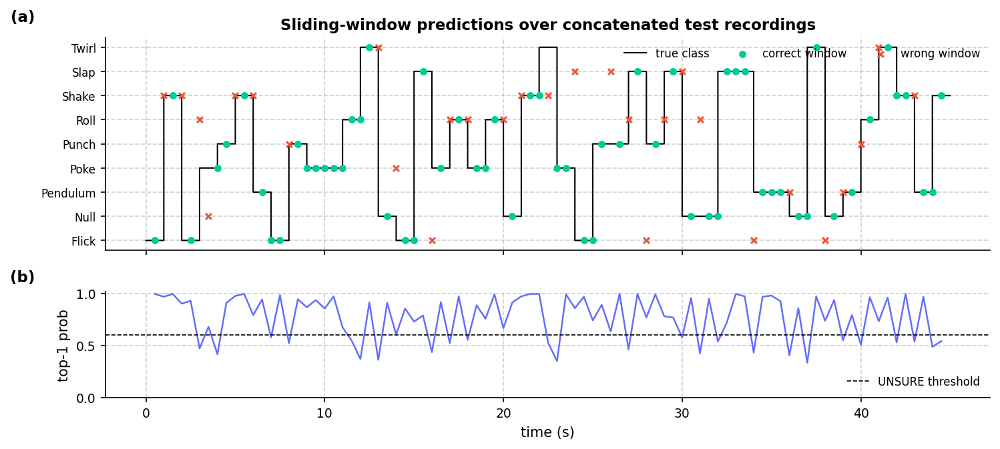

*Figure 9. Sliding 1 s windows (50% overlap) over concatenated test recordings: (a) predicted vs true class, (b) top-1 confidence vs UNSURE threshold.*

### Host Benchmark

`Python 3.11.17` | `TF 2.15.1` | `macOS-26.7.1-arm64-arm-64bit` | Evaluator e2e: **0.020 ms/row**.

| runtime | p50 ms | p95 ms | min ms | inf/s |
| :--- | :--- | :--- | :--- | :--- |
| TFLite reference (no delegate) | 0.007917 | 0.009546 | 0.007791 | 1.263e+05 |
| TFLite + XNNPACK | 0.007667 | 0.008042 | 0.0075 | 1.304e+05 |

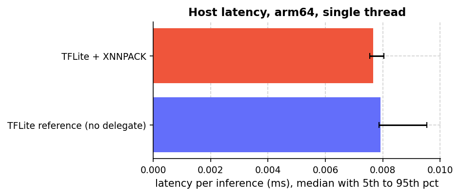

*Figure 10. Single-threaded host latency over 300 invocations (reference kernel vs XNNPACK).*

### Hardware in the Loop (XIAO nRF52840 Sense)

Flashed `Arduino/Codegen` on `/dev/cu.usbmodem1101` (43 s) | Flash `257288 B`, Static RAM `98280 B` | `INFO:model_bytes=8408,window_rows=100,classes=Flick|Null|Pendulum|Poke|Punch|Roll|Shake|Slap|Twirl,input_type=int8,output_type=int8,step=50`.

| host acc | device acc | host F1 | device F1 | device latency ms | arena bytes | host-device agreement |
| :--- | :--- | :--- | :--- | :--- | :--- | :--- |
| 0.9556 | 0.9556 | 0.9554 | 0.9554 | 8.35 (max 8.39) | 3636 | 1 |

### Pareto Frontier & Hardware Trade-offs

**115** scored attempts across **4** runs on dataset `78beb5ebc3c6` (non-dominated accuracy-vs-size frontier):

| KB | val F1 | MFLOPs | arena KB | val score | run | student | cycle |
| :--- | :--- | :--- | :--- | :--- | :--- | :--- | :--- |
| 5.2 | 0.713 | 0.046 | 1.7 | 0.6886 | 20261025_170637 | 1_gemini_4_argon | 1 |
| 6.4 | 0.889 | 0.058 | 1.9 | 0.8184 | 20261025_170637 | 1_gemini_4_argon | 3 |
| 6.4 | 0.905 | 0.058 | 1.9 | 0.8227 | 20261025_170637 | 1_gemini_4_argon | 4 |
| 9.0 | 0.908 | 0.083 | 3.0 | 0.8023 | 20261025_175016 | 1_gemini_4_argon | 4 |
| 9.5 | 0.922 | 0.048 | 1.9 | 0.8268 | 20261024_190925 | 1_gemini_4_argon | 7 |
| 11.8 | 0.930 | 0.145 | 3.0 | 0.7620 | 20261024_194005 | 3_gemini_3.1_pro_preview | 7 |
| 13.8 | 0.933 | 0.110 | 3.2 | 0.7696 | 20261024_190925 | 3_gemini_3.1_pro_preview | 7 |

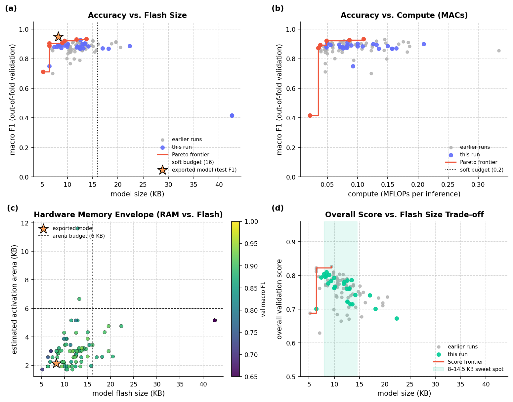

*Figure 11. Multi-objective Pareto dashboard: (a) validation F1 vs model KB, (b) validation F1 vs MFLOPs, (c) activation arena RAM vs model flash KB colored by F1, and (d) overall score vs model KB showing the 8–14.5 KB sweet spot.*

### Student LLM Elo Ratings & Head-to-Head Record

Pairwise smooth-margin Elo (`start=1500`, `K_cycle=12`, `K_test=24`) across **4** runs (**33** classroom rounds) on dataset `78beb5ebc3c6`:

| LLM family | Elo | win rate (matches) | cycle #1s | test #1s | best val | best test | mean KB |
| :--- | :--- | :--- | :--- | :--- | :--- | :--- | :--- |
| gemini-4-argon | 1644 | 71.3% (92) | 18 | 4 | 0.8268 | 0.8611 | 13.0 |
| gemini-3.5-flash | 1564 | 63.9% (92) | 7 | 0 | 0.8096 | 0.8445 | 16.0 |
| gemini-3.1-pro-preview | 1412 | 34.2% (92) | 4 | 0 | 0.7863 | 0.8289 | 18.2 |
| gemini-3.5-flash-lite | 1380 | 27.3% (78) | 0 | 0 | 0.7871 | 0.8120 | 17.6 |

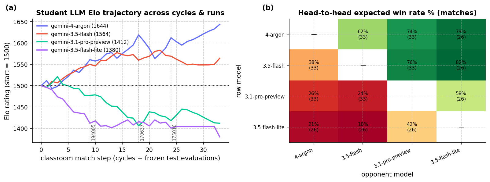

*Figure 12. (a) LLM student Elo trajectory across all classroom cycles and frozen-test evaluations; (b) pairwise head-to-head win rate matrix.*
