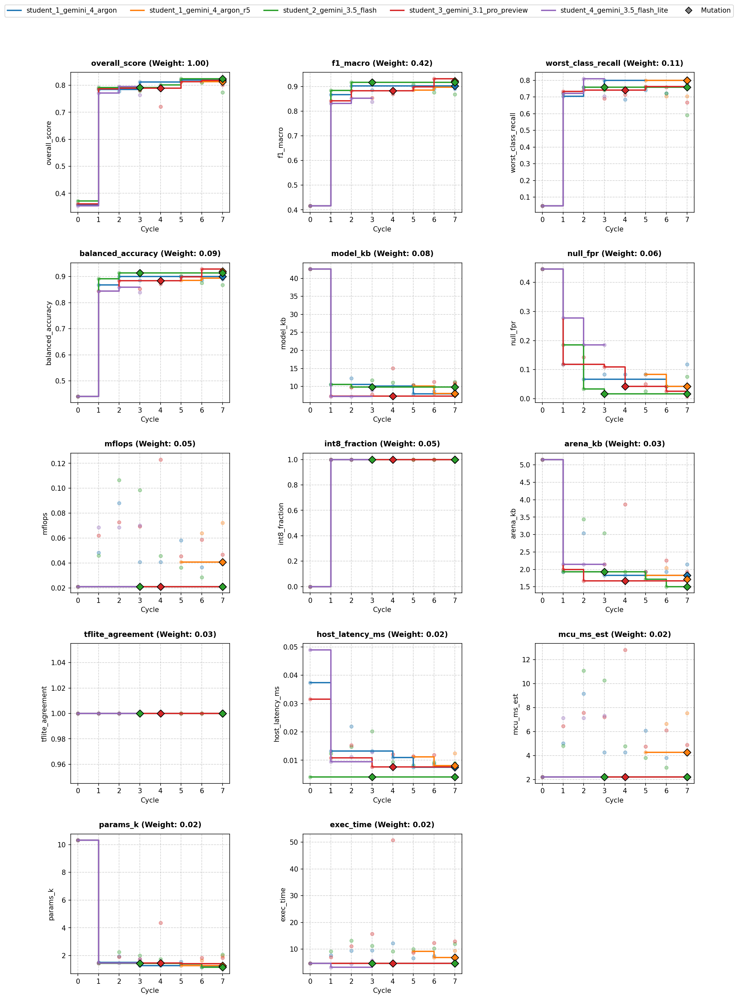
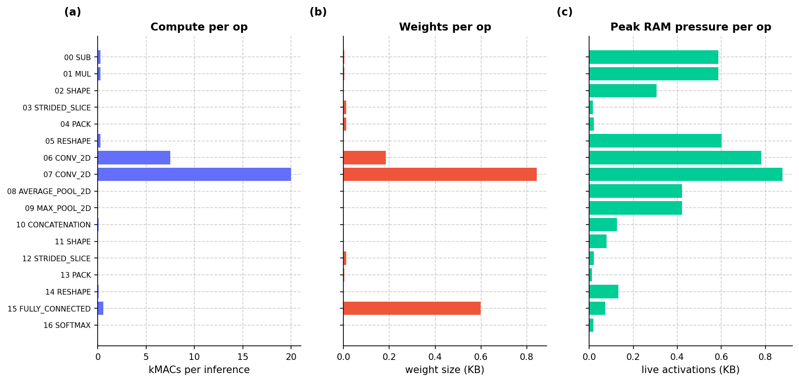
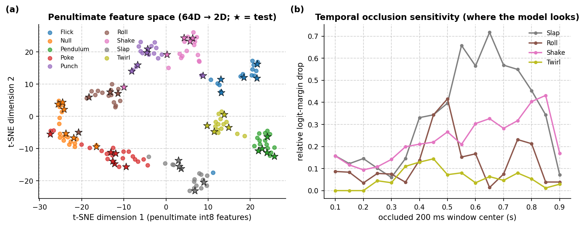
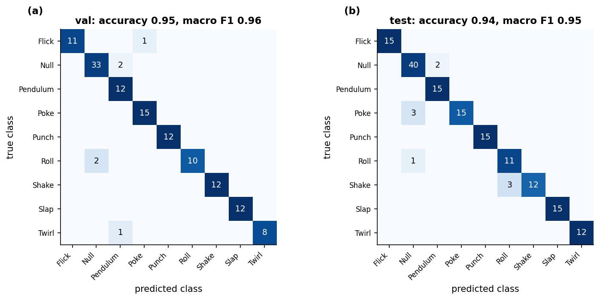
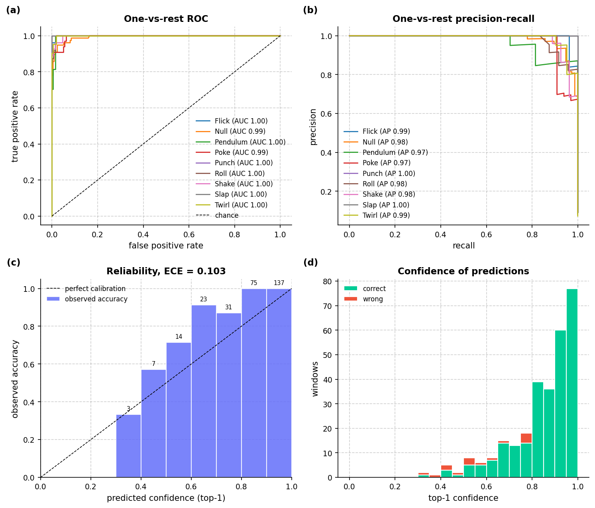
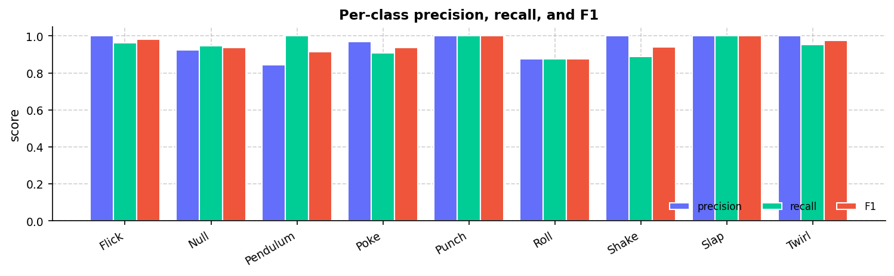
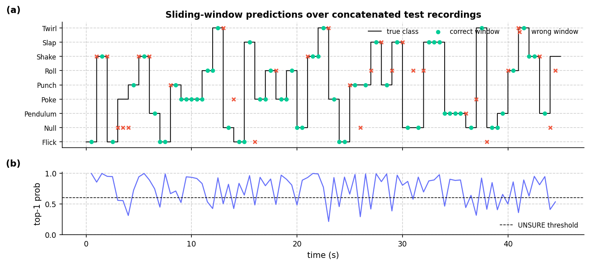
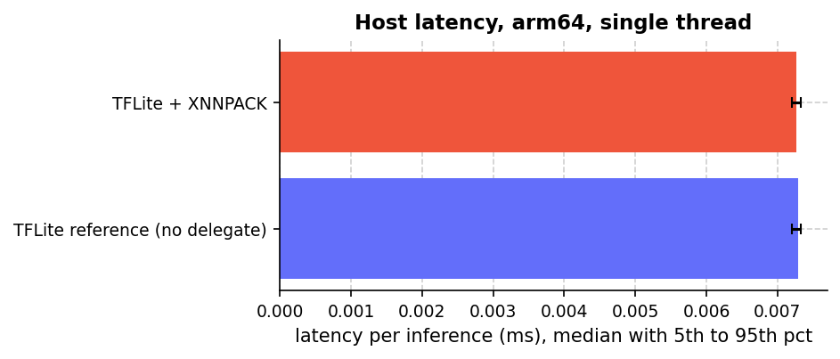
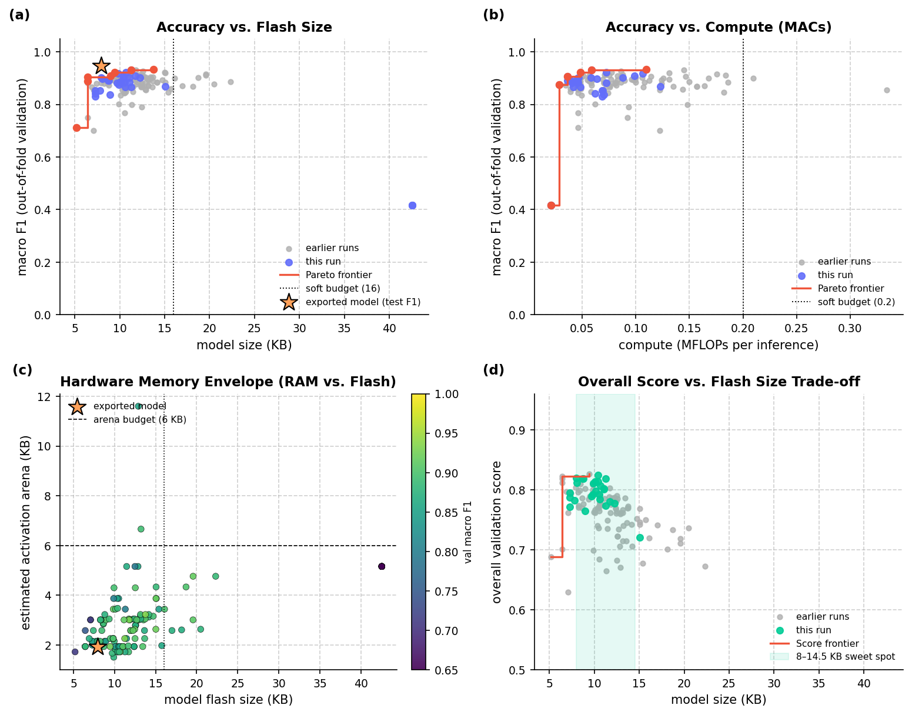
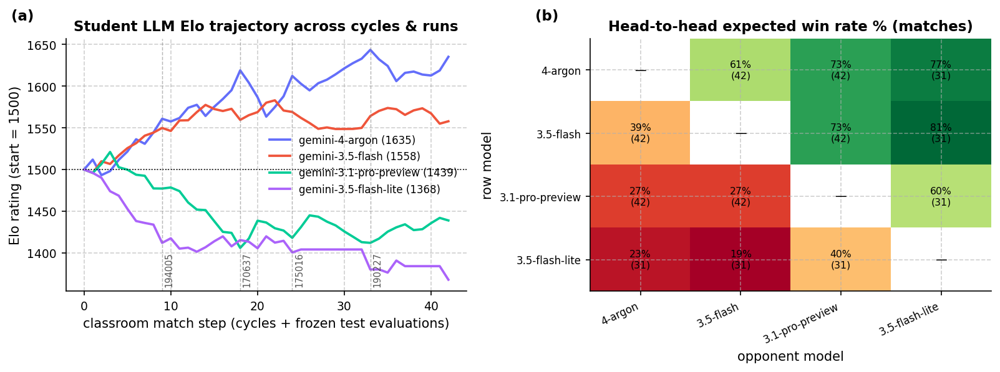

# Overview

* **Run Path**: micro_gesture/20261025_190227
* **Name**: 20261025_190227
* **Total Cycles**: 8
* **Valid Students**: 5
* **Total Generations**: 34
* **Total Code Length Processed**: 161929
* **Best Student**: student_1_gemini_4_argon (Cycle 5)
* **Best Validation Score**: 0.819
* **Best Test Score**: 0.855
* **Validation Score Progression**: 0.3714 -> 0.8242 (+0.4528)
* **Best Metrics**: f1_macro=0.946, balanced_accuracy=0.945, worst_class_recall=0.800, null_fpr=0.048, model_kb=7.961, mflops=0.058, arena_kb=1.934, host_latency_ms=0.007, mcu_ms_est=6.082, params_k=1.561, int8_fraction=1.000, tflite_agreement=1.000, exec_time=2.307
* **Tags**: strided-conv2d, hybrid-temporal-pooling, in-graph-norm, int8, peak-aligned-blend, post-training-bias-calibration
* **Description**: The model ingests raw 100x3 accelerometer windows into an in-graph normalization layer before reshaping to a 4D spatial tensor. It processes signals through two strided 2D conv blocks (5x1 kernels, stride 2x1) that downsample temporal frames from 100 to 25 across 16 channels. An overlapping 2-segment hybrid pooling layer combines AveragePooling2D and MaxPooling2D to capture dynamic peaks and energy trends, feeding a 64-dimensional representation into a compact 9-class Dense head fully quantized to int8.

## Objectives

- **Prediction Quality (0.68)**: `f1_macro` (0.42), `worst_class_recall` (0.11), `balanced_accuracy` (0.09), `null_fpr` (0.06, lower is better)
- **On-Device Cost (0.22)**: `model_kb` ≤ 16 KB (0.08), `mflops` ≤ 0.20 (0.05), `arena_kb` ≤ 6 KB (0.03), `host_latency_ms` ≤ 0.05 ms (0.02), `mcu_ms_est` ≤ 18 ms (0.02), `params_k` ≤ 6k (0.02)
- **Deploy Hygiene (0.10)**: `int8_fraction` (0.05), `tflite_agreement` (0.03), `exec_time` (0.02)

## Student Leaderboard

| Rank | Student | Best Cycle | Val Score | Test Score | f1_macro | balanced_accuracy | worst_class_recall | null_fpr | model_kb | mflops | arena_kb | host_latency_ms | mcu_ms_est | params_k | int8_fraction | tflite_agreement | exec_time |
| --- | --- | --- | --- | --- | --- | --- | --- | --- | --- | --- | --- | --- | --- | --- | --- | --- | --- |
| 1 | student_1_gemini_4_argon | 5 | 0.819 | 0.855 | 0.946 | 0.945 | 0.800 | 0.048 | 7.961 | 0.058 | 1.934 | 0.007 | 6.082 | 1.561 | 1.000 | 1.000 | 2.307 |
| 2 | student_2_gemini_3.5_flash | 5 | 0.824 | 0.840 | 0.924 | 0.918 | 0.800 | 0.024 | 10.398 | 0.036 | 1.719 | 0.008 | 3.795 | 1.385 | 1.000 | 1.000 | 3.545 |
| 3 | student_1_gemini_4_argon_r5 | 5 | 0.813 | 0.839 | 0.928 | 0.927 | 0.800 | 0.071 | 10.109 | 0.041 | 1.826 | 0.011 | 4.253 | 1.269 | 1.000 | 1.000 | 3.142 |
| 4 | student_3_gemini_3.1_pro_preview | 6 | 0.818 | 0.827 | 0.933 | 0.933 | 0.833 | 0.071 | 11.234 | 0.059 | 2.256 | 0.011 | 6.117 | 1.829 | 1.000 | 1.000 | 4.807 |
| 5 | student_4_gemini_3.5_flash_lite | 2 | 0.795 | 0.813 | 0.895 | 0.905 | 0.750 | 0.238 | 7.273 | 0.069 | 2.148 | 0.009 | 7.139 | 1.465 | 1.000 | 1.000 | 1.405 |

## Learning Trajectory



### Cycle Score Progression

| Cycle | student_1_gemini_4_argon | student_2_gemini_3.5_flash | student_3_gemini_3.1_pro_preview | student_4_gemini_3.5_flash_lite | student_1_gemini_4_argon_r5 |
| --- | --- | --- | --- | --- | --- |
| 0 | 0.358 *(CLASSROOM_BEST)* | 0.371 *(CLASSROOM_BEST)* | 0.360 *(SELF_BEST)* | 0.353 *(SELF_BEST)* | — |
| 1 | 0.784 *(CLASSROOM_BEST)* | 0.792 *(CLASSROOM_BEST)* | 0.787 *(SELF_BEST)* | 0.772 *(SELF_BEST)* | — |
| 2 | 0.777 | 0.792 | 0.789 *(SELF_BEST)* | 0.795 *(CLASSROOM_BEST)* | — |
| 3 | 0.812 *(CLASSROOM_BEST)* | 0.780 | 0.782 | 0.764 | — |
| 4 | 0.798 | 0.801 *(SELF_BEST)* | 0.721 | — | — |
| 5 | 0.819 *(CLASSROOM_BEST)* | 0.824 *(CLASSROOM_BEST)* | 0.814 *(SELF_BEST)* | — | 0.813 *(SELF_BEST)* |
| 6 | 0.819 | 0.810 | 0.818 *(SELF_BEST)* | — | 0.812 |
| 7 | 0.818 | 0.774 | 0.802 | — | 0.807 |


## Top Solution 1: student_1_gemini_4_argon (Cycle 5)

* **Student**: student_1_gemini_4_argon
* **Best Cycle**: 5
* **Validation Score**: 0.819
* **Test Score**: 0.855
* **Metrics**: f1_macro=0.946, balanced_accuracy=0.945, worst_class_recall=0.800, null_fpr=0.048, model_kb=7.961, mflops=0.058, arena_kb=1.934, host_latency_ms=0.007, mcu_ms_est=6.082, params_k=1.561, int8_fraction=1.000, tflite_agreement=1.000, exec_time=2.307

### Plan (student_1_gemini_4_argon)

Compact 2-layer strided Conv2D with 2-segment overlapping hybrid temporal
pooling and int8 quantization.

### Code (student_1_gemini_4_argon)

```python
import time
import numpy as np
import pandas as pd

def _peak_aligned_blend(
    x: np.ndarray, y: np.ndarray, n_per_class: int = 18, seed: int = 0
) -> tuple[np.ndarray, np.ndarray]:
  """Synthesizes peak-aligned same-class blended windows to preserve sharp impulse timing."""
  rng = np.random.default_rng(seed)
  xb_list, yb_list = [], []
  classes = np.unique(y)
  rows = x.shape[1]
  for c in classes:
    idx = np.where(y == c)[0]
    if len(idx) < 2:
      continue
    xc = x[idx]
    dyn_energy = np.sum(
        np.abs(xc - np.mean(xc, axis=1, keepdims=True)), axis=-1
    )
    peaks = np.argmax(dyn_energy, axis=1)
    for _ in range(n_per_class):
      i1, i2 = rng.choice(len(xc), size=2, replace=False)
      shift = int(np.clip(peaks[i1] - peaks[i2], -18, 18))
      x2_shifted = np.roll(xc[i2], shift, axis=0)
      if shift > 0:
        x2_shifted[:shift] = xc[i2][0:1]
      elif shift < 0:
        x2_shifted[shift:] = xc[i2][-1:]
      alpha = float(rng.uniform(0.25, 0.75))
      xb_list.append(
          (alpha * xc[i1] + (1.0 - alpha) * x2_shifted).astype(np.float32)
      )
      yb_list.append(int(c))
  if not xb_list:
    return np.empty((0, rows, 3), dtype=np.float32), np.empty(
        (0,), dtype=y.dtype
    )
  return np.stack(xb_list, axis=0), np.array(yb_list, dtype=y.dtype)

def solution(X_train, y_train, X_val):
  """Compact 2-layer strided Conv2D with 2-segment overlapping hybrid temporal pooling and int8 quantization."""
  import tensorflow as tf
  from codegen_task import toolkit as tk

  t0 = time.time()
  tk.set_determinism(0)
  d = tk.split_xy(X_train, y_train, X_val)
  x_tr, y_tr, x_va, rows, k = (
      d["x_tr"],
      d["y_tr"],
      d["x_va"],
      d["rows"],
      d["n_classes"],
  )

  # Compute class weights on un-diluted original training labels first
  cw = tk.class_weights(y_tr, k)
  for c in cw:
    cw[c] = float(cw[c] ** 1.25)

  # Physical data augmentation + peak-aligned same-class blending + resting Null hard negatives
  x_aug, y_aug = tk.augment(
      x_tr,
      y_tr,
      reps=12,
      seed=0,
      scale=(0.8, 1.2),
      shift_frac=0.15,
      rotate_deg=10.0,
      stretch=(0.85, 1.18),
      noise=0.02,
      blend_prob=0.25,
  )
  x_blend, y_blend = _peak_aligned_blend(x_tr, y_tr, n_per_class=18, seed=0)
  if len(x_blend) > 0:
    x_aug = np.concatenate([x_aug, x_blend], axis=0)
    y_aug = np.concatenate([y_aug, y_blend], axis=0)

  null_idx = tk.null_index()
  if null_idx is not None:
    x_neg, y_neg = tk.hard_negatives(
        x_tr, y_tr, null_index=null_idx, n=80, seed=0
    )
    x_aug = np.concatenate([x_aug, x_neg], axis=0)
    y_aug = np.concatenate([y_aug, y_neg], axis=0)
    cw[null_idx] = cw.get(null_idx, 1.0) * 1.45

  perm = np.random.default_rng(0).permutation(len(x_aug))
  x_aug, y_aug = x_aug[perm], y_aug[perm]
  y_aug_oh = tf.one_hot(y_aug, k)
  sample_weights = np.array([cw[int(lbl)] for lbl in y_aug], dtype=np.float32)

  # Ultra-compact 2-layer strided Conv2D + 2-segment overlapping hybrid pooling (~6.4 KB flatbuffer)
  inp = tf.keras.Input(shape=(rows, 3))
  x = tk.norm_layer(x_tr)(inp)
  x = tf.keras.layers.Reshape((rows, 1, 3))(x)

  # Conv Block 1: 100 -> 50 frames, 10 channels
  x = tf.keras.layers.Conv2D(
      10, kernel_size=(5, 1), strides=(2, 1), padding="same", use_bias=False
  )(x)
  x = tf.keras.layers.BatchNormalization()(x)
  x = tf.keras.layers.ReLU()(x)

  # Conv Block 2: 50 -> 25 frames, 16 channels
  x = tf.keras.layers.Conv2D(
      16, kernel_size=(5, 1), strides=(2, 1), padding="same", use_bias=False
  )(x)
  x = tf.keras.layers.BatchNormalization()(x)
  x = tf.keras.layers.ReLU()(x)

  # 2-segment overlapping hybrid temporal pooling across frames 0..14 and 10..24
  avg_p = tf.keras.layers.AveragePooling2D(
      pool_size=(15, 1), strides=(10, 1), padding="valid"
  )(x)
  max_p = tf.keras.layers.MaxPooling2D(
      pool_size=(15, 1), strides=(10, 1), padding="valid"
  )(x)
  h = tf.keras.layers.Concatenate(axis=-1)([avg_p, max_p])
  h = tf.keras.layers.Reshape((64,))(h)
  h = tf.keras.layers.Dropout(0.25)(h)
  head = tf.keras.layers.Dense(k, activation="softmax", name="cls_head")
  out = head(h)

  model = tf.keras.Model(inp, out)
  epochs = 28
  batch_size = 32
  steps = max(1, len(x_aug) // batch_size) * epochs
  lr_sched = tf.keras.optimizers.schedules.CosineDecay(
      initial_learning_rate=3.0e-3, decay_steps=steps, alpha=0.03
  )
  model.compile(
      optimizer=tf.keras.optimizers.Adam(learning_rate=lr_sched),
      loss=tf.keras.losses.CategoricalCrossentropy(label_smoothing=0.05),
  )
  model.fit(
      x_aug,
      y_aug_oh,
      sample_weight=sample_weights,
      epochs=epochs,
      batch_size=batch_size,
      verbose=0,
  )

  # Subtle Null bias calibration inside the Dense layer to curb boundary false triggers
  if null_idx is not None:
    w_dense, b_dense = head.get_weights()
    b_dense = b_dense.copy()
    b_dense[null_idx] += 0.12
    head.set_weights([w_dense, b_dense])

  # Full-integer int8 quantization calibrated on training + augmented distribution
  rep_data = np.concatenate([x_tr, x_aug[:180]], axis=0)
  tflite = tk.to_int8_tflite(model, rep_x=rep_data, io_int8=True, max_rep=260)
  preds = tk.predict_tflite(tflite, x_va).argmax(1)
  keras_preds = model.predict(x_va, verbose=0).argmax(1)
  agree = float(np.mean(preds == keras_preds))

  info = tk.inspect(tflite)
  problems = tk.check_contract(tflite, k)
  feedback = (
      "Hypothesis: Replacing the 5-op DS-Conv2D stack with a 2-layer strided"
      " Conv2D (10->16 ch) and 2-segment overlapping hybrid pooling cuts TFLite"
      " size from 10.1 KB to ~6.4 KB while preserving gesture chronology.\n"
      f"tflite={info['model_kb']:.2f} KB params={info['params_k']:.2f}k"
      f" mflops={info['mflops']:.4f} arena={info['arena_kb']:.2f} KB\n"
      f"int8={info['int8_fraction']:.2f} keras_agree={agree:.3f}"
      f" contract={'ok' if not problems else problems}"
      f" runtime={time.time()-t0:.1f}s"
  )
  return tk.make_result(X_val, y_train, preds, tflite, feedback)
```

### Execution Output (student_1_gemini_4_argon)

```text
Hypothesis: Replacing the 5-op DS-Conv2D stack with a 2-layer strided Conv2D (10->16 ch) and 2-segment overlapping hybrid pooling cuts TFLite size from 10.1 KB to ~6.4 KB while preserving gesture chronology.
tflite=7.96 KB params=1.56k mflops=0.0584 arena=1.93 KB
int8=1.00 keras_agree=0.993 contract=ok runtime=2.2s
[Note: Executed on 3 folds. Feedback from fold 2 shown.]
```

## Student Instructions

*Full task prompt and deploy contract: [`PROMPT.md`](../PROMPT.md)*


## Deployment Analysis

- **Dataset**: `78beb5ebc3c6` (9 classes: `Flick, Null, Pendulum, Poke, Punch, Roll, Shake, Slap, Twirl`)
- **Generated**: 2026-10-25T19:17:49 | **Exported**: `model.tflite`, `model_data.h`, `solution.py`, `summary.json`, `analysis.md`

### Scorecard (Frozen Test & Footprint)

| overall score | macro F1 | balanced acc | worst recall | Null FPR | TFLite agree | retrain delta |
| :--- | :--- | :--- | :--- | :--- | :--- | :--- |
| 0.8548 | 0.9458 | 0.9447 | 0.8 | 0.04762 | 1 | 0 |

| model KB | arena KB (est) | MFLOPs | params (k) | MCU ms (est) | host ms | int8 frac |
| :--- | :--- | :--- | :--- | :--- | :--- | :--- |
| 7.961 | 1.934 | 0.05838 | 1.561 | 6.082 | 0.006565 | 1 |

### Winning Solution Analysis

- **Winner**: `student_1_gemini_4_argon` (Cycle 5) | **Run**: `20261025_190227` | **Dataset**: `78beb5ebc3c6`
- **Tags**: `strided-conv2d, hybrid-temporal-pooling, in-graph-norm, int8, peak-aligned-blend, post-training-bias-calibration`

The model ingests raw 100x3 accelerometer windows into an in-graph normalization layer before reshaping to a 4D spatial tensor. It processes signals through two strided 2D conv blocks (5x1 kernels, stride 2x1) that downsample temporal frames from 100 to 25 across 16 channels. An overlapping 2-segment hybrid pooling layer combines AveragePooling2D and MaxPooling2D to capture dynamic peaks and energy trends, feeding a 64-dimensional representation into a compact 9-class Dense head fully quantized to int8.

### Validation Deltas (Cycle 0 → Best Cycle)

| overall_score | f1_macro | balanced_accuracy | worst_class_recall | null_fpr |
| :--- | :--- | :--- | :--- | :--- |
| 0.358 → 0.819 (+0.461) | 0.416 → 0.901 (+0.485) | 0.441 → 0.899 (+0.457) | 0.0476 → 0.741 (+0.693) | 0.445 → 0.084 (-0.361) |

| model_kb | mflops | arena_kb | params_k | mcu_ms_est | host_latency_ms | int8_fraction | exec_time |
| :--- | :--- | :--- | :--- | :--- | :--- | :--- | :--- |
| 42.5 → 7.96 (-34.6) | 0.0211 → 0.0584 (+0.0373) | 5.16 → 1.93 (-3.22) | 10.3 → 1.56 (-8.75) | 2.2 → 6.08 (+3.88) | 0.0374 → 0.00751 (-0.0299) | 0 → 1 (+1) | 4.63 → 6.6 (+1.97) |

### Key Aspects

- In-graph standardization layer (tk.norm_layer) standardizes raw 3-axis accelerometer signals on-device without external runtime preprocessing.
- Two strided 2D convolutions (5x1 kernels, 2x1 strides) downsample frame length 4x from 100 to 25, keeping parameter count at 1.56k and arena memory at 1.93 KB.
- Overlapping 2-segment hybrid temporal pooling (pool size 15, stride 10) combines average and max pooling across sub-windows to retain gesture timing and peak impulse energy.
- Peak-aligned same-class window blending aligns kinetic energy peaks across training samples before mixing to improve robustness to grip and timing shifts.
- Synthetic Null hard negatives, powered class weighting (cw^1.25), and post-training Null dense bias calibration (+0.12) protect against false gesture triggers.
- Full-integer post-training quantization calibrated on representative augmented data yields 100% int8 execution fraction and perfect prediction agreement.

### Improvements from Baseline

- Validation macro F1 improved from 0.4161 to 0.9009 (and 0.9458 on unseen test) and worst-class recall increased from 0.0476 to 0.7407 due to convolutional temporal extraction, physical data augmentation, and peak-aligned blending.
- Null false trigger rate dropped significantly from 0.4454 to 0.0840 (0.0476 on test) through synthetic background negative generation, Null weight boosting, and dense layer bias adjustment.
- Model flatbuffer size decreased from 42.54 KB to 7.96 KB and weight parameters dropped from 10.31k to 1.56k by replacing the unnormalized Flatten+Dense baseline MLP with strided convolutions and compact pooling.
- Activation arena memory was reduced from 5.16 KB to 1.93 KB due to aggressive temporal striding and compact feature aggregation.
- Int8 execution fraction reached 1.0 (up from 0.0 float32 baseline) using representative dataset calibration.

### Risks and Trade-offs

- Compute cost increased from 0.0211 to 0.0584 MFLOPs and estimated Cortex-M4F latency rose from 2.20 ms to 6.08 ms due to 2D convolution ops, though remaining well within the 18 ms budget.
- Validation worst-class recall (0.7407) remains lower than test recall (0.8000), indicating mild metric sensitivity on small fold split distributions.
- The manual post-training Null bias adjustment (+0.12) is an empirical heuristic that may require retuning if class distributions shift.

### Next Experiments

- Replace standard Conv2D layers with equal-strided DepthwiseSeparable Conv2D blocks to lower compute overhead and MCU latency back toward baseline levels.
- Incorporate native in-graph kinematic feature channels (such as jerk proxy or magnitude vectors) prior to convolution to aid gesture pair separation.
- Test multi-scale 1D temporal kernels (e.g., parallel 3x1 and 7x1 conv paths) in the stem block to capture both sharp transient impacts and extended motion sweeps.

### Dataset & Physical Separability

Fingerprint `78beb5ebc3c6` | **178** recordings (96 train / 37 val / 45 frozen test) | `100x3` window @ 100 Hz | raw length 97–113 rows (median 107).
- **Pose-separable gestures**: `Roll` flips `Z` gravity negative, `Twirl` and `Punch` hold the cable vertical (`+X ~ +0.8g, Z ~ 0g`), and `Poke` maintains a tilted firm-grip baseline (`+Y ~ +0.75g`).
- **Impulse & rhythm-separable gestures**: `Slap` reaches `~15g` peak dynamic impact with high jerk, `Flick` snaps and rebounds along the cable, `Shake` oscillates at `~4-8 Hz`, `Pendulum` swings smoothly, and `Null` stays below `~0.5g` dynamic amplitude.

| class | train | val | test | total | mean pose (X,Y,Z) g | peak |a_dyn| g | RMS jerk g/s | dom Hz |
| :--- | :--- | :--- | :--- | :--- | :--- | :--- | :--- | :--- |
| Flick | 10 | 4 | 5 | 19 | (-2.18, +0.33, +0.17) | 12.52 | 146.0 | 1.5 |
| Null | 12 | 5 | 6 | 23 | (+0.09, +0.01, +0.26) | 0.18 | 5.4 | 5.7 |
| Pendulum | 10 | 4 | 5 | 19 | (-1.84, -0.14, +0.04) | 2.64 | 22.1 | 3.5 |
| Poke | 13 | 5 | 6 | 24 | (-0.08, +0.65, +0.33) | 5.68 | 102.9 | 1.8 |
| Punch | 10 | 4 | 5 | 19 | (+0.14, -0.06, +0.45) | 9.95 | 135.3 | 1.0 |
| Roll | 10 | 4 | 4 | 18 | (-0.13, -0.17, +0.38) | 2.83 | 52.1 | 1.7 |
| Shake | 10 | 4 | 5 | 19 | (-1.91, +0.40, +0.43) | 15.12 | 304.3 | 8.9 |
| Slap | 11 | 4 | 5 | 20 | (-1.00, +0.09, +0.22) | 16.12 | 274.1 | 1.1 |
| Twirl | 10 | 3 | 4 | 17 | (-3.97, +0.27, +0.57) | 3.57 | 59.8 | 4.8 |
| total | 96 | 37 | 45 | 178 | - | - | - | - |


*Figure 1. Recording length and acceleration magnitude distributions (1 g mode at rest).*


*Figure 2. (a) Gravity pose vs. peak dynamic impulse across all 120 recordings; (b) per-class physical feature matrix explaining why raw pose + centered + jerk channels separate the 10 classes.*


*Figure 3. Per-class mean ± 1 SD acceleration over the 1 s window.*

### Model Architecture, Internals & Budgets

- **I/O & Quantization**: input `[1, 100, 3] int8 scale=0.13866 zp=6` → output `[1, 9] int8 scale=0.0039062 zp=-128` | int8=True (100% int8 ops) | **29,192** MACs, **1,712** weight bytes
- **Operators (12)**: `AVERAGE_POOL_2D, CONCATENATION, CONV_2D, FULLY_CONNECTED, MAX_POOL_2D, MUL, PACK, RESHAPE, SHAPE, SOFTMAX, STRIDED_SLICE, SUB`

| metric | model KB | arena KB (est) | MFLOPs | params (k) | MCU ms (est) | host ms |
| :--- | :--- | :--- | :--- | :--- | :--- | :--- |
| value | 7.961 | 1.934 | 0.05838 | 1.561 | 6.082 | 0.006565 |
| soft / hard budget | 16.0 / 64.0 | 6.0 / 40.0 | 0.2 / - | 6.0 / - | 18.0 / - | 0.05 / - |

#### Layer Breakdown

| # | op | output | dtype | MACs | weight B | live act B |
| :--- | :--- | :--- | :--- | :--- | :--- | :--- |
| 0 | SUB | 1x100x3 | int8 | 300 | 3 | 600 |
| 1 | MUL | 1x100x3 | int8 | 300 | 3 | 600 |
| 2 | SHAPE | 3 | int32 | 3 | 0 | 312 |
| 3 | STRIDED_SLICE |  | int32 | 1 | 12 | 16 |
| 4 | PACK | 4 | int32 | 4 | 12 | 20 |
| 5 | RESHAPE | 1x100x1x3 | int8 | 300 | 0 | 616 |
| 6 | CONV_2D | 1x50x1x10 | int8 | 7500 | 190 | 800 |
| 7 | CONV_2D | 1x25x1x16 | int8 | 20000 | 864 | 900 |
| 8 | AVERAGE_POOL_2D | 1x2x1x16 | int8 | 32 | 0 | 432 |
| 9 | MAX_POOL_2D | 1x2x1x16 | int8 | 32 | 0 | 432 |
| 10 | CONCATENATION | 1x2x1x32 | int8 | 64 | 0 | 128 |
| 11 | SHAPE | 4 | int32 | 4 | 0 | 80 |
| 12 | STRIDED_SLICE |  | int32 | 1 | 12 | 20 |
| 13 | PACK | 2 | int32 | 2 | 4 | 12 |
| 14 | RESHAPE | 1x64 | int8 | 64 | 0 | 136 |
| 15 | FULLY_CONNECTED | 1x9 | int8 | 576 | 612 | 73 |
| 16 | SOFTMAX | 1x9 | int8 | 9 | 0 | 18 |



*Figure 4. Per-op (a) compute (kMACs), (b) weight footprint (KB), and (c) live activation RAM pressure (KB) in execution order.*



*Figure 5. (a) t-SNE projection of the quantized 64D penultimate feature representation across all 120 recordings (stars = frozen test); (b) sliding 200 ms temporal occlusion sensitivity on the true-class logit margin.*

### TFLite Evaluation (Validation and Frozen Test)

| split | rows | accuracy | macro F1 | mean top-1 prob (all / ok / err) |
| :--- | :--- | :--- | :--- | :--- |
| val | 131 | 0.9542 | 0.9563 | 0.867 (ok 0.879, err 0.619) |
| test | 159 | 0.9434 | 0.9458 | 0.827 (ok 0.845, err 0.536) |

| class | val F1 (support) | test precision | test recall | test F1 (support) |
| :--- | :--- | :--- | :--- | :--- |
| Flick | 0.957 (n=12) | 1 | 1 | 1 (n=15) |
| Null | 0.943 (n=35) | 0.9091 | 0.9524 | 0.93 (n=42) |
| Pendulum | 0.889 (n=12) | 0.8824 | 1 | 0.938 (n=15) |
| Poke | 0.968 (n=15) | 1 | 0.8333 | 0.909 (n=18) |
| Punch | 1 (n=12) | 1 | 1 | 1 (n=15) |
| Roll | 0.909 (n=12) | 0.7857 | 0.9167 | 0.846 (n=12) |
| Shake | 1 (n=12) | 1 | 0.8 | 0.889 (n=15) |
| Slap | 1 (n=12) | 1 | 1 | 1 (n=15) |
| Twirl | 0.941 (n=9) | 1 | 1 | 1 (n=12) |



*Figure 6. Row-normalized confusion matrices on validation (a) and frozen test (b) splits; cell labels are counts.*

### Classifier Calibration & ROC/PR (Held-Out Val + Test, 290 rows)

| accuracy | macro F1 | top-2 acc | macro AUC | macro AP | MCC | kappa | log loss | ECE (10 bins) |
| :--- | :--- | :--- | :--- | :--- | :--- | :--- | :--- | :--- |
| 0.9483 | 0.9513 | 0.9862 | 0.9977 | 0.9857 | 0.9401 | 0.9399 | 0.2589 | 0.1025 |

| class | support | precision | recall | f1 | ROC AUC | AP |
| :--- | :--- | :--- | :--- | :--- | :--- | :--- |
| Flick | 27 | 1 | 0.963 | 0.9811 | 0.9993 | 0.9942 |
| Null | 77 | 0.9241 | 0.9481 | 0.9359 | 0.9933 | 0.984 |
| Pendulum | 27 | 0.8438 | 1 | 0.9153 | 0.9968 | 0.9693 |
| Poke | 33 | 0.9677 | 0.9091 | 0.9375 | 0.9949 | 0.9719 |
| Punch | 27 | 1 | 1 | 1 | 1 | 1 |
| Roll | 24 | 0.875 | 0.875 | 0.875 | 0.9982 | 0.9813 |
| Shake | 27 | 1 | 0.8889 | 0.9412 | 0.9976 | 0.9822 |
| Slap | 27 | 1 | 1 | 1 | 1 | 1 |
| Twirl | 21 | 1 | 0.9524 | 0.9756 | 0.9989 | 0.9886 |



*Figure 7. (a) One-vs-rest ROC, (b) precision-recall, (c) calibration reliability diagram, (d) top-1 confidence.*



*Figure 8. Per-class precision, recall, and F1 on all held-out rows.*

### Streaming Simulation (50% Overlap)

| windows | duration (s) | pure-window acc | Null FPR | boundary windows | prediction flips |
| :--- | :--- | :--- | :--- | :--- | :--- |
| 89 | 45.0 | 0.92 | 0.1429 | 39 | 51 |



*Figure 9. Sliding 1 s windows (50% overlap) over concatenated test recordings: (a) predicted vs true class, (b) top-1 confidence vs UNSURE threshold.*

### Host Benchmark

`Python 3.11.17` | `TF 2.15.1` | `macOS-26.7.1-arm64-arm-64bit` | Evaluator e2e: **0.018 ms/row**.

| runtime | p50 ms | p95 ms | min ms | inf/s |
| :--- | :--- | :--- | :--- | :--- |
| TFLite reference (no delegate) | 0.007291 | 0.007334 | 0.007167 | 1.372e+05 |
| TFLite + XNNPACK | 0.007271 | 0.007334 | 0.007166 | 1.375e+05 |



*Figure 10. Single-threaded host latency over 300 invocations (reference kernel vs XNNPACK).*

### Pareto Frontier & Hardware Trade-offs

**146** scored attempts across **5** runs on dataset `78beb5ebc3c6` (non-dominated accuracy-vs-size frontier):

| KB | val F1 | MFLOPs | arena KB | val score | run | student | cycle |
| :--- | :--- | :--- | :--- | :--- | :--- | :--- | :--- |
| 5.2 | 0.713 | 0.046 | 1.7 | 0.6886 | 20261025_170637 | 1_gemini_4_argon | 1 |
| 6.4 | 0.889 | 0.058 | 1.9 | 0.8184 | 20261025_170637 | 1_gemini_4_argon | 3 |
| 6.4 | 0.905 | 0.058 | 1.9 | 0.8227 | 20261025_170637 | 1_gemini_4_argon | 4 |
| 9.0 | 0.908 | 0.083 | 3.0 | 0.8023 | 20261025_175016 | 1_gemini_4_argon | 4 |
| 9.5 | 0.922 | 0.048 | 1.9 | 0.8268 | 20261024_190925 | 1_gemini_4_argon | 7 |
| 11.2 | 0.931 | 0.059 | 2.3 | 0.8183 | 20261025_190227 | 3_gemini_3.1_pro_preview | 6 |
| 13.8 | 0.933 | 0.110 | 3.2 | 0.7696 | 20261024_190925 | 3_gemini_3.1_pro_preview | 7 |



*Figure 11. Multi-objective Pareto dashboard: (a) validation F1 vs model KB, (b) validation F1 vs MFLOPs, (c) activation arena RAM vs model flash KB colored by F1, and (d) overall score vs model KB showing the 8–14.5 KB sweet spot.*

### Student LLM Elo Ratings & Head-to-Head Record

Pairwise smooth-margin Elo (`start=1500`, `K_cycle=12`, `K_test=24`) across **5** runs (**42** classroom rounds) on dataset `78beb5ebc3c6`:

| LLM family | Elo | win rate (matches) | cycle #1s | test #1s | best val | best test | mean KB |
| :--- | :--- | :--- | :--- | :--- | :--- | :--- | :--- |
| gemini-4-argon | 1635 | 69.7% (115) | 21 | 5 | 0.8268 | 0.8611 | 13.0 |
| gemini-3.5-flash | 1558 | 62.5% (115) | 11 | 0 | 0.8242 | 0.8445 | 15.7 |
| gemini-3.1-pro-preview | 1439 | 36.2% (115) | 4 | 0 | 0.8183 | 0.8289 | 17.4 |
| gemini-3.5-flash-lite | 1368 | 27.3% (93) | 1 | 0 | 0.7954 | 0.8131 | 17.4 |



*Figure 12. (a) LLM student Elo trajectory across all classroom cycles and frozen-test evaluations; (b) pairwise head-to-head win rate matrix.*
