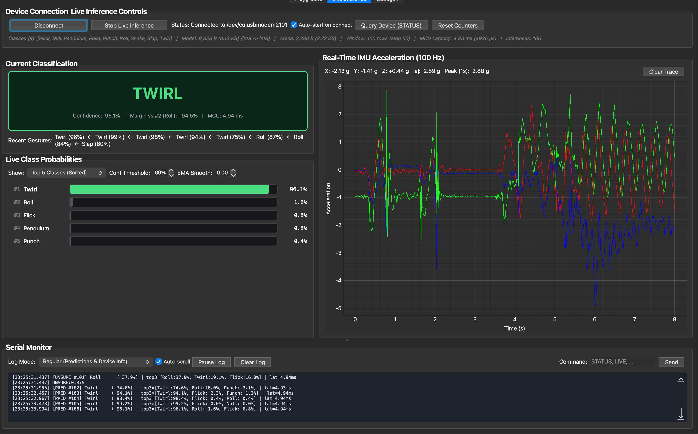

# On-Device ML Playground

This project is a tool for beginners to explore on-device ML.

> **Upstream Credit:** Forked from [**`anandghanw/ml-on-device-playground`**](https://github.com/anandghanw/ml-on-device-playground) created by **Anandghan** (`@anandghanw`).


## Overview

This project provides a complete environment for recording sensor data, training machine learning models, and deploying them to microcontroller devices. It's designed to help beginners understand the full workflow of on-device machine learning without requiring extensive background knowledge.

This fork also adds a dedicated [**Live Inference**](#live-inference-extension) dashboard and an automated [**Codegen Classroom**](#codegen-classroom-extension) TinyML model discovery and hardware-in-the-loop (HIL) pipeline.

## Features

- Simple data collection interface
- Integrated model training pipeline
- Real-time visualization and [live multi-class inference dashboard](#live-inference-extension)
- Automated [`codegen-classroom`](#codegen-classroom-extension) TinyML model search and on-device HIL verification

## Table of Contents

- [Prerequisites](#prerequisites)
- [Installation](#installation)
    - [Python Environment Setup](#python-environment-setup)
    - [Arduino Setup](#arduino-setup)
- [Getting Started](#getting-started)
    - [Data Recording](#data-recording)
    - [Model Training](#model-training)
    - [Inference](#inference)
- [Project Structure](#project-structure)
- [Live Inference Extension](#live-inference-extension)
- [Codegen Classroom Extension](#codegen-classroom-extension)
- [Contributing](#contributing)
- [License](#license)

## Prerequisites

- [XIAO BLE Sense](https://www.seeedstudio.com/Seeed-XIAO-BLE-Sense-nRF52840-p-5253.html) board
- Arduino IDE (version 1.8.x or newer) or `arduino-cli`
- Python 3.10 or newer
- USB cable for connecting the board to your computer

## Installation

### Clone this repository:
   ```bash
   git clone https://github.com/jake-g/ml-on-device-playground.git
   cd ml-on-device-playground
   ```
   
### Python Environment Setup

1. Run the `Makefile` setup target (or `./setup_python_env.sh`):
   ```bash
   make setup
   ```

   This will create a virtual environment and install all required Python packages.

### Arduino Setup

You can install all board cores and libraries automatically via `arduino-cli`:
```bash
make core
```

Or set up manually in the Arduino IDE:

1. Install the Arduino IDE from [arduino.cc](https://www.arduino.cc/en/software)

2. Add Seeed XIAO nRF52840 Sense board support:
    - Open Arduino IDE
    - Go to `File > Preferences`
    - Add this URL to "Additional Boards Manager URLs":
      ```
      https://files.seeedstudio.com/arduino/package_seeeduino_boards_index.json
      ```
    - Go to `Tools > Board > Boards Manager...`
    - Search for "Seeed nRF52 Boards" and install

3. Install the required libraries:
    - Open the Arduino IDE
    - Go to `Sketch > Include Library > Manage Libraries...`
    - Search for and install "Seeed Arduino LSM6DS3"

4. Install the TensorFlow Lite Micro Arduino Examples library:
    - In the Arduino IDE, go to `Sketch > Include Library > Add .ZIP Library...`
    - Select the `tflite-micro-arduino-examples-main.zip` file from the root directory
    - This library has been downloaded from https://github.com/lakshanthad/tflite-micro-arduino-examples

## Getting Started

### Data Recording

1. Connect your XIAO BLE Sense board to your computer

2. Upload the recording sketch (`make record` or upload `Arduino/Record/Record.ino` in Arduino IDE)

3. Launch the playground UI:
   ```bash
   make ui
   ```

4. Follow the UI to collect training data for your gestures

### Model Training

After collecting sufficient data:

1. In the playground tool, select the **Playground** tab for quick MLP/1D-CNN training, or the [**Codegen**](#codegen-classroom-extension) tab to evolve quantized TinyML architectures with `codegen-classroom`

2. Once complete, the model will be converted to TensorFlow Lite format and prepared for deployment

### Inference

1. Upload the inference sketch (`make inference` for the Playground MLP, or `make codegen` for the Codegen model)

   **Important:** You must re-upload the sketch every time you train a new model to update the model on the device.

2. Open the **Playground** or [**Live Inference**](#live-inference-extension) tab (`make ui`) to visualize real-time predictions from your model

## Project Structure

```
ml-on-device-playground/
├── Arduino/
│   ├── Record/                   # 100 Hz IMU data recording sketch
│   │   └── Record.ino
│   ├── Inference/                # Playground MLP inference sketch
│   │   └── Inference.ino
│   └── Codegen/                  # Codegen TFLite Micro & HIL replay sketch
│       ├── Codegen.ino
│       └── model_data.h
├── Python/
│   ├── codegen_task/             # Evolutionary TinyML task, toolkit, deploy, and reports
│   ├── data/                     # Recorded 9-class 100 Hz gesture dataset
│   ├── models/                   # Trained Playground models
│   ├── live_inference_widget.py  # PyQt Live Inference tab (probabilities, IMU plot, serial log)
│   ├── codegen_widget.py         # PyQt Codegen tab (live CV graph, bar plots, log, reports)
│   └── main.py                   # Main PyQt application entry point
├── Makefile                      # CLI targets for setup, UI, codegen, build, and flash
├── setup_python_env.sh           # Python environment setup script
└── tflite-micro-arduino-examples-main.zip  # TFLite Micro library
```

## Live Inference Extension

The **Live Inference** tab (`Python/live_inference_widget.py`) provides a dedicated real-time telemetry and classification dashboard for models running on the XIAO nRF52840 Sense (`Arduino/Codegen` or `Arduino/Inference`):



- **Current Classification Card**: Displays the active gesture prediction (`IDLE` on `Null`, `UNSURE` below threshold, or the detected gesture class), confidence percentage, top-2 margin, on-device MCU inference latency, and a rolling ribbon of recent non-`Null` gestures.
- **Live Class Probabilities**: Horizontal confidence bars supporting **Top 5 Classes (Sorted)**, **All Classes (Sorted)**, or **Fixed Class Order**, with adjustable confidence threshold and exponential moving average (EMA) smoothing.
- **Real-Time 100 Hz IMU Acceleration Plot**: Streams live 3-axis accelerometer traces (`ax`, `ay`, `az`), instantaneous magnitude `|a|`, and 1-second peak `g` from the board (`STREAM:1`) alongside inference results.
- **Dual-Mode Serial Monitor**: Switch between **Regular (Predictions & Device Info)** for formatted prediction/latency summaries and **Verbose (All Raw Serial + IMU)** for full device debugging and interactive serial commands (`STATUS`, `LIVE`, `REPLAY`).

## Codegen Classroom Extension

The **Codegen** tab and `Python/codegen_task/` package add an automated TinyML model discovery and hardware-in-the-loop (HIL) deployment pipeline powered by [**`codegen-classroom`**](https://github.com/google-research/codegen-classroom):


- **Evolutionary TinyML Codegen (`Python/codegen_task/`)**: Multi-agent LLM students iteratively design, quantize (`INT8`), and validate neural networks against strict microcontroller flash, arena RAM, and op-resolver budgets.
- **Codegen UI Tab (`Python/codegen_widget.py`)**: Run and monitor evolutionary cycles, view live cross-validation metrics and leaderboard histograms, inspect leaderboard solutions, and trigger on-device replay directly from the PyQt GUI.
- **TFLite Micro Firmware (`Arduino/Codegen/`)**: Streams live 100 Hz IMU predictions and supports deterministic `REPLAY` verification over USB serial (`100%` host/device agreement on the 9-class gesture benchmark).
- **CLI Workflow (`Makefile`)**: Build, flash, and evaluate from the terminal:
  ```bash
  make setup          # Create virtualenv, install dependencies, and Arduino core
  make ui             # Launch the PyQt Playground, Live Inference, and Codegen GUI
  make codegen-run    # Run evolutionary model search and promote winner
  make codegen        # Compile and flash Arduino/Codegen to XIAO BLE Sense
  make device-eval    # Replay frozen test windows on-device over USB serial
  ```

See [**`Python/codegen_task/README.md`**](Python/codegen_task/README.md) for setup instructions (including `GEMINI_API_KEY` configuration), scoring contract, and the gesture collection guide, and [**`Python/codegen_task/solutions/best_report.md`**](Python/codegen_task/solutions/best_report.md) for the latest benchmark report.

## Contributing

Contributions are welcome! Please feel free to submit a Pull Request.

## License

This project is licensed under the MIT License - see the LICENSE file for details.